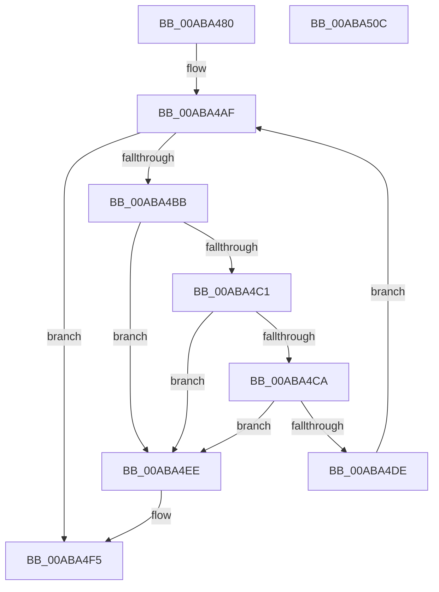

# PiDmaGuardQueueFlush

- RVA: `0x00ABA480`–`0x00ABA50D` (길이 `141` bytes)
- VA: `0x0000000140ABA480`
- 실행 섹션: `PAGE`
- PDB 이름 있음: `예`; PDB Function 태그: `아니요`
- unwind 정보 RVA: `0x0005CF00`
- 디코드: `37`개 명령, `141/141` bytes 표시
- 미해석 바이트: `0` (있으면 어셈블리에 `.byte`로 보존)

> 이 문서는 커널 이미지의 기계어와 PDB 기호를 분석해 생성했습니다. 4번과 5번은 함수 원형과 자료형을 바이너리 사용 방식에서 추정한 C 해석이며 원본 소스 복구 결과는 아닙니다.

## 1. Dependencies

- 직접 호출 지점: **3**; 고유 호출 대상: **3**
- 직접 호출자로 확인된 함수: **1**
- RIP 상대 이미지 참조: **3**

### Outgoing calls
- `0x00ABA4A3` → [ExAcquireResourceExclusiveLite](../../text/21/ExAcquireResourceExclusiveLite_function_00214E20.md) (function, `0x00214E20`)
- `0x00ABA4FC` → [ExReleaseResourceLite](../../text/25/ExReleaseResourceLite_function_0025FA10.md) (function, `0x0025FA10`)
- `0x00ABA501` → [KeLeaveCriticalRegion](../../text/25/KeLeaveCriticalRegion_function_0025D8B0.md) (function, `0x0025D8B0`)

### Direct callers
- [PipDmgFlushQueueAndRestartDevices](../73/PipDmgFlushQueueAndRestartDevices_function_0073BF9C.md) at `0x0073BFD4`

### Static image references
- `0x00ABA494` → RVA `0x00F8A800` (`.data`; read)
- `0x00ABA4A8` → RVA `0x00F8A7F0` (`.data`; read)
- `0x00ABA4CA` → RVA `0x00F8A7F0` (`.data`; write)

## 2. Other-region calls and transfers

- 다른 실행 섹션으로 향하는 call: **3**
  - `0x00ABA4A3` → [ExAcquireResourceExclusiveLite](../../text/21/ExAcquireResourceExclusiveLite_function_00214E20.md) (`PAGE` → `.text`)
  - `0x00ABA4FC` → [ExReleaseResourceLite](../../text/25/ExReleaseResourceLite_function_0025FA10.md) (`PAGE` → `.text`)
  - `0x00ABA501` → [KeLeaveCriticalRegion](../../text/25/KeLeaveCriticalRegion_function_0025D8B0.md) (`PAGE` → `.text`)
- 별도 외부 분기/꼬리 이동을 확인하지 못했습니다.

## 3. Assembly (complete function range)

```asm
00ABA480  40 53                           push rbx
00ABA482  48 83 EC 20                     sub rsp, 0x20
00ABA486  65 48 8B 04 25 88 01 00 00      mov rax, qword ptr gs:[0x188]
00ABA48F  48 8B D9                        mov rbx, rcx
00ABA492  B2 01                           mov dl, 1
00ABA494  48 8D 0D 65 03 4D 00            lea rcx, [rip + 0x4d0365]
00ABA49B  66 FF 88 E4 01 00 00            dec word ptr [rax + 0x1e4]
00ABA4A2  90                              nop
00ABA4A3  E8 78 A9 75 FF                  call 0x140214e20
00ABA4A8  48 8D 15 41 03 4D 00            lea rdx, [rip + 0x4d0341]
00ABA4AF  48 8B 05 3A 03 4D 00            mov rax, qword ptr [rip + 0x4d033a]
00ABA4B6  48 3B C2                        cmp rax, rdx
00ABA4B9  74 3A                           je 0x140aba4f5
00ABA4BB  48 39 50 08                     cmp qword ptr [rax + 8], rdx
00ABA4BF  75 2D                           jne 0x140aba4ee
00ABA4C1  48 8B 08                        mov rcx, qword ptr [rax]
00ABA4C4  48 39 41 08                     cmp qword ptr [rcx + 8], rax
00ABA4C8  75 24                           jne 0x140aba4ee
00ABA4CA  48 89 0D 1F 03 4D 00            mov qword ptr [rip + 0x4d031f], rcx
00ABA4D1  48 89 51 08                     mov qword ptr [rcx + 8], rdx
00ABA4D5  48 8B 4B 08                     mov rcx, qword ptr [rbx + 8]
00ABA4D9  48 39 19                        cmp qword ptr [rcx], rbx
00ABA4DC  75 10                           jne 0x140aba4ee
00ABA4DE  48 89 18                        mov qword ptr [rax], rbx
00ABA4E1  48 89 48 08                     mov qword ptr [rax + 8], rcx
00ABA4E5  48 89 01                        mov qword ptr [rcx], rax
00ABA4E8  48 89 43 08                     mov qword ptr [rbx + 8], rax
00ABA4EC  EB C1                           jmp 0x140aba4af
00ABA4EE  B9 03 00 00 00                  mov ecx, 3
00ABA4F3  CD 29                           int 0x29
00ABA4F5  48 8D 0D 04 03 4D 00            lea rcx, [rip + 0x4d0304]
00ABA4FC  E8 0F 55 7A FF                  call 0x14025fa10
00ABA501  E8 AA 33 7A FF                  call 0x14025d8b0
00ABA506  48 83 C4 20                     add rsp, 0x20
00ABA50A  5B                              pop rbx
00ABA50B  C3                              ret
00ABA50C  CC                              int3
```

## 4. C-style interpretation (structured pseudocode)

```c
__int64 __fastcall PiDmaGuardQueueFlush(__int64 a1)
{
    __int64 result;
    __int64 v_rsp;

    v_rsp = (v_rsp) - (32);
    result = ExAcquireResourceExclusiveLite(v_rip + 5047141, 1, a3, a4);
loc_00ABA4AF:
    if ((*(unsigned __int64 *)(v_rip + 5047098)) == (v_rip + 5047105)) goto loc_00ABA4F5;
    if ((*(unsigned __int64 *)(*(unsigned __int64 *)(v_rip + 5047098) + 8)) != (v_rip + 5047105)) goto loc_00ABA4EE;
    if ((*(unsigned __int64 *)(*(unsigned __int64 *)(*(unsigned __int64 *)(v_rip + 5047098)) + 8)) != (*(unsigned __int64 *)(v_rip + 5047098))) goto loc_00ABA4EE;
    *(unsigned __int64 *)(v_rip + 5047071) = *(unsigned __int64 *)(*(unsigned __int64 *)(v_rip + 5047098));
    *(unsigned __int64 *)(*(unsigned __int64 *)(*(unsigned __int64 *)(v_rip + 5047098)) + 8) = v_rip + 5047105;
    if ((*(unsigned __int64 *)(*(unsigned __int64 *)(a1 + 8))) != a1) goto loc_00ABA4EE;
    *(unsigned __int64 *)(*(unsigned __int64 *)(v_rip + 5047098)) = a1;
    *(unsigned __int64 *)(*(unsigned __int64 *)(v_rip + 5047098) + 8) = *(unsigned __int64 *)(a1 + 8);
    *(unsigned __int64 *)(*(unsigned __int64 *)(a1 + 8)) = *(unsigned __int64 *)(v_rip + 5047098);
    *(unsigned __int64 *)(a1 + 8) = *(unsigned __int64 *)(v_rip + 5047098);
    goto loc_00ABA4AF;
loc_00ABA4EE:
loc_00ABA4F5:
    result = ExReleaseResourceLite(v_rip + 5047044, v_rip + 5047105, a3, a4);
    result = KeLeaveCriticalRegion(v_rip + 5047044, v_rip + 5047105, a3, a4);
    v_rsp = (v_rsp) + (32);
    return result;
}
```

## 5. (Beta) C Style

```c
int64_t PiDmaGuardQueueFlush(void *Arg1)
{
    uint8_t *arg1 = (uint8_t *)Arg1;

    int64_t result;
    int64_t local_rsp;

    local_rsp = (local_rsp) - (32);
    result = ExAcquireResourceExclusiveLite(v_rip + 5047141, 1, a3, a4);
loc_00ABA4AF:
    if ((*(uint64_t *)(v_rip + 0x4D033A)) == (v_rip + 5047105)) goto loc_00ABA4F5;
    if ((*(uint64_t *)(*(uint64_t *)(v_rip + 0x4D033A) + 0x8)) != (v_rip + 5047105)) goto loc_00ABA4EE;
    if ((*(uint64_t *)(*(uint64_t *)(*(uint64_t *)(v_rip + 0x4D033A)) + 0x8)) != (*(uint64_t *)(v_rip + 0x4D033A))) goto loc_00ABA4EE;
    *(uint64_t *)(v_rip + 0x4D031F) = *(uint64_t *)(*(uint64_t *)(v_rip + 0x4D033A));
    *(uint64_t *)(*(uint64_t *)(*(uint64_t *)(v_rip + 0x4D033A)) + 0x8) = v_rip + 5047105;
    if ((*(uint64_t *)(*(uint64_t *)(arg1 + 0x8))) != Arg1) goto loc_00ABA4EE;
    *(void **)(*(uint64_t *)(v_rip + 0x4D033A)) = Arg1;
    *(uint64_t *)(*(uint64_t *)(v_rip + 0x4D033A) + 0x8) = *(uint64_t *)(arg1 + 0x8);
    *(uint64_t *)(*(uint64_t *)(arg1 + 0x8)) = *(uint64_t *)(v_rip + 0x4D033A);
    *(uint64_t *)(arg1 + 0x8) = *(uint64_t *)(v_rip + 0x4D033A);
    goto loc_00ABA4AF;
loc_00ABA4EE:
loc_00ABA4F5:
    result = ExReleaseResourceLite(v_rip + 5047044, v_rip + 5047105, a3, a4);
    result = KeLeaveCriticalRegion(v_rip + 5047044, v_rip + 5047105, a3, a4);
    local_rsp = (local_rsp) + (32);
    return result;
}
```

### 관측된 메모리 오프셋

구조체 형식이 확인되지 않은 접근은 인자 기준의 오프셋으로만 기록했습니다.

| 기준 인자 | 오프셋 표현 | 폭 (bit) | 접근 |
|---|---:|---:|---|
| `Arg1` | `+ 0x8` | `64` | `R` |
| `Arg1` | `+ 0x8` | `64` | `W` |

## 6. Execution-region graph

[열기: 2D/3D 그래프와 함수 탐색 컨트롤 패널](../../../control-panel.html?section=page&rva=0x00ABA480&view=graph)

- 2D 그래프는 위에서 아래로 흐르고, 3D 그래프는 빈 공간을 드래그해 회전합니다. Shift+드래그는 이동, 휠은 확대·축소, 함수 노드 선택은 대상 보고서 이동입니다.

### Static fallback


