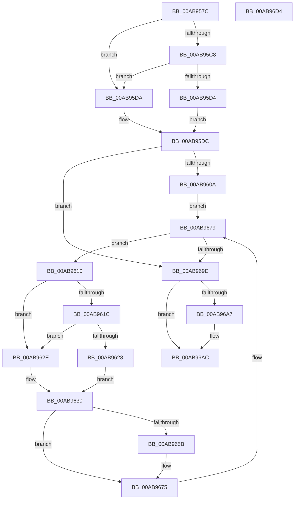

# PiDqDeleteUserObjectFromLoadedHives

- RVA: `0x00AB957C`–`0x00AB96D5` (길이 `345` bytes)
- VA: `0x0000000140AB957C`
- 실행 섹션: `PAGE`
- PDB 이름 있음: `예`; PDB Function 태그: `아니요`
- unwind 정보 RVA: `0x000BD2F0`
- 디코드: `85`개 명령, `345/345` bytes 표시
- 미해석 바이트: `0` (있으면 어셈블리에 `.byte`로 보존)

> 이 문서는 커널 이미지의 기계어와 PDB 기호를 분석해 생성했습니다. 4번과 5번은 함수 원형과 자료형을 바이너리 사용 방식에서 추정한 C 해석이며 원본 소스 복구 결과는 아닙니다.

## 1. Dependencies

- 직접 호출 지점: **7**; 고유 호출 대상: **5**
- 직접 호출자로 확인된 함수: **1**
- RIP 상대 이미지 참조: **3**

### Outgoing calls
- `0x00AB95FD` → [_RegRtlOpenKeyTransacted](../8E/_RegRtlOpenKeyTransacted_function_008EF810.md) (function, `0x008EF810`)
- `0x00AB9652` → [_RegRtlOpenKeyTransacted](../8E/_RegRtlOpenKeyTransacted_function_008EF810.md) (function, `0x008EF810`)
- `0x00AB9666` → [PiDqDeleteUserObject](../96/PiDqDeleteUserObject_function_00965B24.md) (function, `0x00965B24`)
- `0x00AB9670` → [ZwClose](../../text/6A/ZwClose_function_006AD2B0.md) (function, `0x006AD2B0`)
- `0x00AB9690` → [RegRtlEnumKey](../99/RegRtlEnumKey_function_00992C00.md) (function, `0x00992C00`)
- `0x00AB96A7` → [ZwClose](../../text/6A/ZwClose_function_006AD2B0.md) (function, `0x006AD2B0`)
- `0x00AB96B6` → [_security_check_cookie](../../text/6A/_security_check_cookie_function_006AC640.md) (function, `0x006AC640`)

### Direct callers
- [PiDqObjectManagerHandleObjectEvent](../A4/PiDqObjectManagerHandleObjectEvent_function_00A4402C.md) at `0x00A44121`

### Static image references
- `0x00AB959A` → RVA `0x00E0A740` (`.data`; read)
- `0x00AB95BC` → RVA `0x00E66398` (`.data`; read)
- `0x00AB95F3` → RVA `0x00AFE5C0` (` ?? ::NNGAKEGL::`string'`; read)

## 2. Other-region calls and transfers

- 다른 실행 섹션으로 향하는 call: **3**
  - `0x00AB9670` → [ZwClose](../../text/6A/ZwClose_function_006AD2B0.md) (`PAGE` → `.text`)
  - `0x00AB96A7` → [ZwClose](../../text/6A/ZwClose_function_006AD2B0.md) (`PAGE` → `.text`)
  - `0x00AB96B6` → [_security_check_cookie](../../text/6A/_security_check_cookie_function_006AC640.md) (`PAGE` → `.text`)
- 별도 외부 분기/꼬리 이동을 확인하지 못했습니다.

## 3. Assembly (complete function range)

```asm
00AB957C  48 8B C4                        mov rax, rsp
00AB957F  48 89 58 10                     mov qword ptr [rax + 0x10], rbx
00AB9583  48 89 70 18                     mov qword ptr [rax + 0x18], rsi
00AB9587  48 89 78 20                     mov qword ptr [rax + 0x20], rdi
00AB958B  55                              push rbp
00AB958C  48 8D A8 98 FE FF FF            lea rbp, [rax - 0x168]
00AB9593  48 81 EC 60 02 00 00            sub rsp, 0x260
00AB959A  48 8B 05 9F 11 35 00            mov rax, qword ptr [rip + 0x35119f]
00AB95A1  48 33 C4                        xor rax, rsp
00AB95A4  48 89 85 50 01 00 00            mov qword ptr [rbp + 0x150], rax
00AB95AB  48 83 64 24 38 00               and qword ptr [rsp + 0x38], 0
00AB95B1  8B FA                           mov edi, edx
00AB95B3  48 83 64 24 40 00               and qword ptr [rsp + 0x40], 0
00AB95B9  48 8B F1                        mov rsi, rcx
00AB95BC  48 8B 05 D5 CD 3A 00            mov rax, qword ptr [rip + 0x3acdd5]
00AB95C3  48 85 C0                        test rax, rax
00AB95C6  74 12                           je 0x140ab95da
00AB95C8  48 8B 80 E0 00 00 00            mov rax, qword ptr [rax + 0xe0]
00AB95CF  48 85 C0                        test rax, rax
00AB95D2  74 06                           je 0x140ab95da
00AB95D4  48 8B 48 08                     mov rcx, qword ptr [rax + 8]
00AB95D8  EB 02                           jmp 0x140ab95dc
00AB95DA  33 C9                           xor ecx, ecx
00AB95DC  48 89 4C 24 28                  mov qword ptr [rsp + 0x28], rcx
00AB95E1  48 8D 44 24 38                  lea rax, [rsp + 0x38]
00AB95E6  33 C9                           xor ecx, ecx
00AB95E8  48 89 44 24 20                  mov qword ptr [rsp + 0x20], rax
00AB95ED  41 B9 08 00 00 00               mov r9d, 8
00AB95F3  48 8D 15 C6 4F 04 00            lea rdx, [rip + 0x44fc6]
00AB95FA  45 33 C0                        xor r8d, r8d
00AB95FD  E8 0E 62 E3 FF                  call 0x1408ef810
00AB9602  85 C0                           test eax, eax
00AB9604  0F 88 93 00 00 00               js 0x140ab969d
00AB960A  33 DB                           xor ebx, ebx
00AB960C  33 D2                           xor edx, edx
00AB960E  EB 69                           jmp 0x140ab9679
00AB9610  48 8B 05 81 CD 3A 00            mov rax, qword ptr [rip + 0x3acd81]
00AB9617  48 85 C0                        test rax, rax
00AB961A  74 12                           je 0x140ab962e
00AB961C  48 8B 88 E0 00 00 00            mov rcx, qword ptr [rax + 0xe0]
00AB9623  48 85 C9                        test rcx, rcx
00AB9626  74 06                           je 0x140ab962e
00AB9628  48 8B 41 08                     mov rax, qword ptr [rcx + 8]
00AB962C  EB 02                           jmp 0x140ab9630
00AB962E  33 C0                           xor eax, eax
00AB9630  48 8B 4C 24 38                  mov rcx, qword ptr [rsp + 0x38]
00AB9635  48 8D 54 24 50                  lea rdx, [rsp + 0x50]
00AB963A  48 89 44 24 28                  mov qword ptr [rsp + 0x28], rax
00AB963F  41 B9 01 00 00 00               mov r9d, 1
00AB9645  48 8D 44 24 40                  lea rax, [rsp + 0x40]
00AB964A  45 33 C0                        xor r8d, r8d
00AB964D  48 89 44 24 20                  mov qword ptr [rsp + 0x20], rax
00AB9652  E8 B9 61 E3 FF                  call 0x1408ef810
00AB9657  85 C0                           test eax, eax
00AB9659  78 1A                           js 0x140ab9675
00AB965B  48 8B 4C 24 40                  mov rcx, qword ptr [rsp + 0x40]
00AB9660  44 8B C7                        mov r8d, edi
00AB9663  48 8B D6                        mov rdx, rsi
00AB9666  E8 B9 C4 EA FF                  call 0x140965b24
00AB966B  48 8B 4C 24 40                  mov rcx, qword ptr [rsp + 0x40]
00AB9670  E8 3B 3C BF FF                  call 0x1406ad2b0
00AB9675  FF C3                           inc ebx
00AB9677  8B D3                           mov edx, ebx
00AB9679  48 8B 4C 24 38                  mov rcx, qword ptr [rsp + 0x38]
00AB967E  4C 8D 4C 24 30                  lea r9, [rsp + 0x30]
00AB9683  4C 8D 44 24 50                  lea r8, [rsp + 0x50]
00AB9688  C7 44 24 30 00 01 00 00         mov dword ptr [rsp + 0x30], 0x100
00AB9690  E8 6B 95 ED FF                  call 0x140992c00
00AB9695  85 C0                           test eax, eax
00AB9697  0F 89 73 FF FF FF               jns 0x140ab9610
00AB969D  48 8B 4C 24 38                  mov rcx, qword ptr [rsp + 0x38]
00AB96A2  48 85 C9                        test rcx, rcx
00AB96A5  74 05                           je 0x140ab96ac
00AB96A7  E8 04 3C BF FF                  call 0x1406ad2b0
00AB96AC  48 8B 8D 50 01 00 00            mov rcx, qword ptr [rbp + 0x150]
00AB96B3  48 33 CC                        xor rcx, rsp
00AB96B6  E8 85 2F BF FF                  call 0x1406ac640
00AB96BB  4C 8D 9C 24 60 02 00 00         lea r11, [rsp + 0x260]
00AB96C3  49 8B 5B 18                     mov rbx, qword ptr [r11 + 0x18]
00AB96C7  49 8B 73 20                     mov rsi, qword ptr [r11 + 0x20]
00AB96CB  49 8B 7B 28                     mov rdi, qword ptr [r11 + 0x28]
00AB96CF  49 8B E3                        mov rsp, r11
00AB96D2  5D                              pop rbp
00AB96D3  C3                              ret
00AB96D4  CC                              int3
```

## 4. C-style interpretation (structured pseudocode)

```c
__int64 __fastcall PiDqDeleteUserObjectFromLoadedHives(__int64 a1, int a2, int a3)
{
    __int64 result;
    __int64 v_rbx;
    __int64 v_rsp;
    unsigned __int64 v_stack_m218;
    unsigned __int64 v_stack_m228;
    unsigned __int64 v_stack_m230;
    unsigned __int64 v_stack_m238;
    unsigned __int64 v_stack_m240;
    unsigned __int64 v_stack_m248;
    unsigned __int64 v_stack_m8;

    *(unsigned __int64 *)(v_rsp + 16) = v_rbx;
    *(unsigned __int64 *)(v_rsp + 24) = v_rsi;
    *(unsigned __int64 *)(v_rsp + 32) = v_rdi;
    v_rsp = (v_rsp) - (608);
    result = (*(unsigned __int64 *)(v_rip + 3477919)) ^ (v_rsp);
    *(unsigned __int64 *)(v_rsp - 360 + 336) = result;
    if (*(unsigned __int64 *)(v_rip + 3853781) == 0) goto loc_00AB95DA;
    if (*(unsigned __int64 *)(*(unsigned __int64 *)(v_rip + 3853781) + 224) == 0) goto loc_00AB95DA;
    goto loc_00AB95DC;
loc_00AB95DA:
    a1 = 0;
loc_00AB95DC:
    v_stack_m240 = 0;
    a1 = 0;
    v_stack_m248 = v_stack_m230;
    a3 = 0;
    result = _RegRtlOpenKeyTransacted(a1, v_rip + 282566, a3, 8);
    if (sign_flag) goto loc_00AB969D;
    v_rbx = 0;
    a2 = 0;
    goto loc_00AB9679;
loc_00AB9610:
    if (*(unsigned __int64 *)(v_rip + 3853697) == 0) goto loc_00AB962E;
    if (*(unsigned __int64 *)(*(unsigned __int64 *)(v_rip + 3853697) + 224) == 0) goto loc_00AB962E;
    goto loc_00AB9630;
loc_00AB962E:
    result = 0;
loc_00AB9630:
    v_stack_m240 = 0;
    a3 = 0;
    v_stack_m248 = v_stack_m228;
    result = _RegRtlOpenKeyTransacted(v_stack_m230, v_stack_m218, a3, 1);
    if (!(sign_flag)) {
        a1 = v_stack_m228;
        a3 = (unsigned int)((unsigned int)(a2));
        a2 = a1;
        result = PiDqDeleteUserObject(a1, a2, a3, 1);
        a1 = v_stack_m228;
        result = ZwClose(a1, a2, a3, 1);
    }
    v_rbx = (unsigned int)((v_rbx) + 1);
loc_00AB9679:
    v_stack_m238 = 256;
    result = RegRtlEnumKey(v_stack_m230, (unsigned int)((unsigned int)(v_rbx)), v_stack_m218, v_stack_m238);
    if (!sign_flag) goto loc_00AB9610;
loc_00AB969D:
    if (v_stack_m230 != 0) {
        result = ZwClose(v_stack_m230, (unsigned int)((unsigned int)(v_rbx)), v_stack_m218, v_stack_m238);
    }
    a1 = (*(unsigned __int64 *)(v_rsp - 360 + 336)) ^ (v_rsp);
    result = _security_check_cookie(a1, (unsigned int)((unsigned int)(v_rbx)), v_stack_m218, v_stack_m238);
    return result;
}
```

## 5. (Beta) C Style

```c
int64_t PiDqDeleteUserObjectFromLoadedHives(int64_t Arg1, int32_t Arg2, int32_t Arg3)
{
    int64_t result;
    int64_t local_rbx;
    int64_t local_rsp;
    uint64_t v_stack_m218;
    uint64_t v_stack_m228;
    uint64_t v_stack_m230;
    uint64_t v_stack_m238;
    uint64_t v_stack_m240;
    uint64_t v_stack_m248;
    uint64_t v_stack_m8;

    *(uint64_t *)(local_rsp + 0x10) = local_rbx;
    *(uint64_t *)(local_rsp + 0x18) = local_rsi;
    *(uint64_t *)(local_rsp + 0x20) = local_rdi;
    local_rsp = (local_rsp) - (608);
    result = (*(uint64_t *)(v_rip + 0x35119F)) ^ (local_rsp);
    *(uint64_t *)(local_rsp - 0x168 + 0x150) = result;
    if (*(uint64_t *)(v_rip + 0x3ACDD5) == 0) goto loc_00AB95DA;
    if (*(uint64_t *)(*(uint64_t *)(v_rip + 0x3ACDD5) + 0xE0) == 0) goto loc_00AB95DA;
    goto loc_00AB95DC;
loc_00AB95DA:
    Arg1 = 0;
loc_00AB95DC:
    v_stack_m240 = 0;
    Arg1 = 0;
    v_stack_m248 = v_stack_m230;
    Arg3 = 0;
    result = _RegRtlOpenKeyTransacted(Arg1, v_rip + 282566, Arg3, 8);
    if (sign_flag) goto loc_00AB969D;
    local_rbx = 0;
    Arg2 = 0;
    goto loc_00AB9679;
loc_00AB9610:
    if (*(uint64_t *)(v_rip + 0x3ACD81) == 0) goto loc_00AB962E;
    if (*(uint64_t *)(*(uint64_t *)(v_rip + 0x3ACD81) + 0xE0) == 0) goto loc_00AB962E;
    goto loc_00AB9630;
loc_00AB962E:
    result = 0;
loc_00AB9630:
    v_stack_m240 = 0;
    Arg3 = 0;
    v_stack_m248 = v_stack_m228;
    result = _RegRtlOpenKeyTransacted(v_stack_m230, v_stack_m218, Arg3, 1);
    if (!(sign_flag)) {
        Arg1 = v_stack_m228;
        Arg3 = (uint32_t)((uint32_t)(Arg2));
        Arg2 = Arg1;
        result = PiDqDeleteUserObject(Arg1, Arg2, Arg3, 1);
        Arg1 = v_stack_m228;
        result = ZwClose(Arg1, Arg2, Arg3, 1);
    }
    local_rbx = (uint32_t)((local_rbx) + 1);
loc_00AB9679:
    v_stack_m238 = 256;
    result = RegRtlEnumKey(v_stack_m230, (uint32_t)((uint32_t)(local_rbx)), v_stack_m218, v_stack_m238);
    if (!sign_flag) goto loc_00AB9610;
loc_00AB969D:
    if (v_stack_m230 != 0) {
        result = ZwClose(v_stack_m230, (uint32_t)((uint32_t)(local_rbx)), v_stack_m218, v_stack_m238);
    }
    Arg1 = (*(uint64_t *)(local_rsp - 0x168 + 0x150)) ^ (local_rsp);
    result = _security_check_cookie(Arg1, (uint32_t)((uint32_t)(local_rbx)), v_stack_m218, v_stack_m238);
    return result;
}
```

## 6. Execution-region graph

[열기: 2D/3D 그래프와 함수 탐색 컨트롤 패널](../../../control-panel.html?section=page&rva=0x00AB957C&view=graph)

- 2D 그래프는 위에서 아래로 흐르고, 3D 그래프는 빈 공간을 드래그해 회전합니다. Shift+드래그는 이동, 휠은 확대·축소, 함수 노드 선택은 대상 보고서 이동입니다.

### Static fallback


