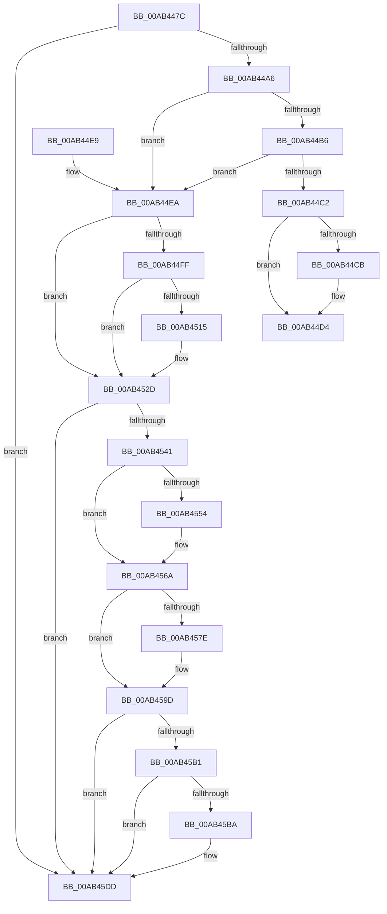

# PiPnpRtlPdoRaiseNtPlugPlayPropertyChangeEvent

- RVA: `0x00AB447C`–`0x00AB45F6` (길이 `378` bytes)
- VA: `0x0000000140AB447C`
- 실행 섹션: `PAGE`
- PDB 이름 있음: `예`; PDB Function 태그: `아니요`
- unwind 정보 RVA: `0x000BCBEC`
- 디코드: `97`개 명령, `378/378` bytes 표시
- 미해석 바이트: `0` (있으면 어셈블리에 `.byte`로 보존)

> 이 문서는 커널 이미지의 기계어와 PDB 기호를 분석해 생성했습니다. 4번과 5번은 함수 원형과 자료형을 바이너리 사용 방식에서 추정한 C 해석이며 원본 소스 복구 결과는 아닙니다.

## 1. Dependencies

- 직접 호출 지점: **13**; 고유 호출 대상: **3**
- 직접 호출자로 확인된 함수: **2**
- RIP 상대 이미지 참조: **0**

### Outgoing calls
- `0x00AB44CF` → [PnpRaiseNtPlugPlayDevicePropertyChangeEvent](../8F/PnpRaiseNtPlugPlayDevicePropertyChangeEvent_function_008F7D80.md) (function, `0x008F7D80`)
- `0x00AB44F1` → [IoAddTriageDumpDataBlock](../../text/42/IoAddTriageDumpDataBlock_function_00428374.md) (function, `0x00428374`)
- `0x00AB4503` → [IoAddTriageDumpDataBlock](../../text/42/IoAddTriageDumpDataBlock_function_00428374.md) (function, `0x00428374`)
- `0x00AB4517` → [IoAddTriageDumpDataBlock](../../text/42/IoAddTriageDumpDataBlock_function_00428374.md) (function, `0x00428374`)
- `0x00AB4528` → [IoAddTriageDumpDataBlock](../../text/42/IoAddTriageDumpDataBlock_function_00428374.md) (function, `0x00428374`)
- `0x00AB454A` → [IoAddTriageDumpDataBlock](../../text/42/IoAddTriageDumpDataBlock_function_00428374.md) (function, `0x00428374`)
- `0x00AB4559` → [IoAddTriageDumpDataBlock](../../text/42/IoAddTriageDumpDataBlock_function_00428374.md) (function, `0x00428374`)
- `0x00AB4565` → [IoAddTriageDumpDataBlock](../../text/42/IoAddTriageDumpDataBlock_function_00428374.md) (function, `0x00428374`)
- `0x00AB4580` → [IoAddTriageDumpDataBlock](../../text/42/IoAddTriageDumpDataBlock_function_00428374.md) (function, `0x00428374`)
- `0x00AB4598` → [IoAddTriageDumpDataBlock](../../text/42/IoAddTriageDumpDataBlock_function_00428374.md) (function, `0x00428374`)
- `0x00AB45BC` → [IoAddTriageDumpDataBlock](../../text/42/IoAddTriageDumpDataBlock_function_00428374.md) (function, `0x00428374`)
- `0x00AB45D8` → [IoAddTriageDumpDataBlock](../../text/42/IoAddTriageDumpDataBlock_function_00428374.md) (function, `0x00428374`)
- `0x00AB45F0` → [KeBugCheckEx](../../text/4F/KeBugCheckEx_function_004FD660.md) (function, `0x004FD660`)

### Direct callers
- [sub_006F45AA](../../text/6F/Unknown_function_006F45AA.md) at `0x006F468B`
- [PiQueryPowerRelations](../AA/PiQueryPowerRelations_function_00AA3F9C.md) at `0x00AA44E5`

### Static image references
- 디코드된 RIP-relative 메모리 참조가 없습니다.

## 2. Other-region calls and transfers

- 다른 실행 섹션으로 향하는 call: **12**
  - `0x00AB44F1` → [IoAddTriageDumpDataBlock](../../text/42/IoAddTriageDumpDataBlock_function_00428374.md) (`PAGE` → `.text`)
  - `0x00AB4503` → [IoAddTriageDumpDataBlock](../../text/42/IoAddTriageDumpDataBlock_function_00428374.md) (`PAGE` → `.text`)
  - `0x00AB4517` → [IoAddTriageDumpDataBlock](../../text/42/IoAddTriageDumpDataBlock_function_00428374.md) (`PAGE` → `.text`)
  - `0x00AB4528` → [IoAddTriageDumpDataBlock](../../text/42/IoAddTriageDumpDataBlock_function_00428374.md) (`PAGE` → `.text`)
  - `0x00AB454A` → [IoAddTriageDumpDataBlock](../../text/42/IoAddTriageDumpDataBlock_function_00428374.md) (`PAGE` → `.text`)
  - `0x00AB4559` → [IoAddTriageDumpDataBlock](../../text/42/IoAddTriageDumpDataBlock_function_00428374.md) (`PAGE` → `.text`)
  - `0x00AB4565` → [IoAddTriageDumpDataBlock](../../text/42/IoAddTriageDumpDataBlock_function_00428374.md) (`PAGE` → `.text`)
  - `0x00AB4580` → [IoAddTriageDumpDataBlock](../../text/42/IoAddTriageDumpDataBlock_function_00428374.md) (`PAGE` → `.text`)
  - `0x00AB4598` → [IoAddTriageDumpDataBlock](../../text/42/IoAddTriageDumpDataBlock_function_00428374.md) (`PAGE` → `.text`)
  - `0x00AB45BC` → [IoAddTriageDumpDataBlock](../../text/42/IoAddTriageDumpDataBlock_function_00428374.md) (`PAGE` → `.text`)
  - `0x00AB45D8` → [IoAddTriageDumpDataBlock](../../text/42/IoAddTriageDumpDataBlock_function_00428374.md) (`PAGE` → `.text`)
  - `0x00AB45F0` → [KeBugCheckEx](../../text/4F/KeBugCheckEx_function_004FD660.md) (`PAGE` → `.text`)
- 별도 외부 분기/꼬리 이동을 확인하지 못했습니다.

## 3. Assembly (complete function range)

```asm
00AB447C  48 89 5C 24 08                  mov qword ptr [rsp + 8], rbx
00AB4481  48 89 6C 24 10                  mov qword ptr [rsp + 0x10], rbp
00AB4486  48 89 74 24 18                  mov qword ptr [rsp + 0x18], rsi
00AB448B  57                              push rdi
00AB448C  48 83 EC 30                     sub rsp, 0x30
00AB4490  33 F6                           xor esi, esi
00AB4492  44 8B C2                        mov r8d, edx
00AB4495  48 8B D9                        mov rbx, rcx
00AB4498  BD 02 00 00 00                  mov ebp, 2
00AB449D  48 85 C9                        test rcx, rcx
00AB44A0  0F 84 37 01 00 00               je 0x140ab45dd
00AB44A6  48 8B 81 38 01 00 00            mov rax, qword ptr [rcx + 0x138]
00AB44AD  48 8B 48 28                     mov rcx, qword ptr [rax + 0x28]
00AB44B1  48 85 C9                        test rcx, rcx
00AB44B4  74 34                           je 0x140ab44ea
00AB44B6  F7 81 8C 01 00 00 00 00 02 00   test dword ptr [rcx + 0x18c], 0x20000
00AB44C0  75 28                           jne 0x140ab44ea
00AB44C2  48 8D 51 28                     lea rdx, [rcx + 0x28]
00AB44C6  48 85 D2                        test rdx, rdx
00AB44C9  74 09                           je 0x140ab44d4
00AB44CB  48 8B 52 08                     mov rdx, qword ptr [rdx + 8]
00AB44CF  E8 AC 38 E4 FF                  call 0x1408f7d80
00AB44D4  48 8B 5C 24 40                  mov rbx, qword ptr [rsp + 0x40]
00AB44D9  48 8B 6C 24 48                  mov rbp, qword ptr [rsp + 0x48]
00AB44DE  48 8B 74 24 50                  mov rsi, qword ptr [rsp + 0x50]
00AB44E3  48 83 C4 30                     add rsp, 0x30
00AB44E7  5F                              pop rdi
00AB44E8  C3                              ret
00AB44E9  CC                              int3
00AB44EA  0F B7 53 02                     movzx edx, word ptr [rbx + 2]
00AB44EE  48 8B CB                        mov rcx, rbx
00AB44F1  E8 7E 3E 97 FF                  call 0x140428374
00AB44F6  48 8B 4B 08                     mov rcx, qword ptr [rbx + 8]
00AB44FA  48 85 C9                        test rcx, rcx
00AB44FD  74 2E                           je 0x140ab452d
00AB44FF  0F BF 51 02                     movsx edx, word ptr [rcx + 2]
00AB4503  E8 6C 3E 97 FF                  call 0x140428374
00AB4508  48 8B 4B 08                     mov rcx, qword ptr [rbx + 8]
00AB450C  48 83 C1 38                     add rcx, 0x38
00AB4510  66 39 31                        cmp word ptr [rcx], si
00AB4513  74 18                           je 0x140ab452d
00AB4515  8B D5                           mov edx, ebp
00AB4517  E8 58 3E 97 FF                  call 0x140428374
00AB451C  48 8B 4B 08                     mov rcx, qword ptr [rbx + 8]
00AB4520  0F B7 51 38                     movzx edx, word ptr [rcx + 0x38]
00AB4524  48 8B 49 40                     mov rcx, qword ptr [rcx + 0x40]
00AB4528  E8 47 3E 97 FF                  call 0x140428374
00AB452D  48 8B 83 38 01 00 00            mov rax, qword ptr [rbx + 0x138]
00AB4534  48 8B 48 28                     mov rcx, qword ptr [rax + 0x28]
00AB4538  48 85 C9                        test rcx, rcx
00AB453B  0F 84 9C 00 00 00               je 0x140ab45dd
00AB4541  BA 88 03 00 00                  mov edx, 0x388
00AB4546  48 8D 79 28                     lea rdi, [rcx + 0x28]
00AB454A  E8 25 3E 97 FF                  call 0x140428374
00AB454F  66 39 37                        cmp word ptr [rdi], si
00AB4552  74 16                           je 0x140ab456a
00AB4554  8B D5                           mov edx, ebp
00AB4556  48 8B CF                        mov rcx, rdi
00AB4559  E8 16 3E 97 FF                  call 0x140428374
00AB455E  0F B7 17                        movzx edx, word ptr [rdi]
00AB4561  48 8B 4F 08                     mov rcx, qword ptr [rdi + 8]
00AB4565  E8 0A 3E 97 FF                  call 0x140428374
00AB456A  48 8B 83 38 01 00 00            mov rax, qword ptr [rbx + 0x138]
00AB4571  48 8B 48 28                     mov rcx, qword ptr [rax + 0x28]
00AB4575  48 83 C1 38                     add rcx, 0x38
00AB4579  66 39 31                        cmp word ptr [rcx], si
00AB457C  74 1F                           je 0x140ab459d
00AB457E  8B D5                           mov edx, ebp
00AB4580  E8 EF 3D 97 FF                  call 0x140428374
00AB4585  48 8B 83 38 01 00 00            mov rax, qword ptr [rbx + 0x138]
00AB458C  48 8B 48 28                     mov rcx, qword ptr [rax + 0x28]
00AB4590  0F B7 51 38                     movzx edx, word ptr [rcx + 0x38]
00AB4594  48 8B 49 40                     mov rcx, qword ptr [rcx + 0x40]
00AB4598  E8 D7 3D 97 FF                  call 0x140428374
00AB459D  48 8B 83 38 01 00 00            mov rax, qword ptr [rbx + 0x138]
00AB45A4  48 8B 48 28                     mov rcx, qword ptr [rax + 0x28]
00AB45A8  48 8B 41 10                     mov rax, qword ptr [rcx + 0x10]
00AB45AC  48 85 C0                        test rax, rax
00AB45AF  74 2C                           je 0x140ab45dd
00AB45B1  48 8D 48 38                     lea rcx, [rax + 0x38]
00AB45B5  66 39 31                        cmp word ptr [rcx], si
00AB45B8  74 23                           je 0x140ab45dd
00AB45BA  8B D5                           mov edx, ebp
00AB45BC  E8 B3 3D 97 FF                  call 0x140428374
00AB45C1  48 8B 83 38 01 00 00            mov rax, qword ptr [rbx + 0x138]
00AB45C8  48 8B 48 28                     mov rcx, qword ptr [rax + 0x28]
00AB45CC  48 8B 49 10                     mov rcx, qword ptr [rcx + 0x10]
00AB45D0  0F B7 51 38                     movzx edx, word ptr [rcx + 0x38]
00AB45D4  48 8B 49 40                     mov rcx, qword ptr [rcx + 0x40]
00AB45D8  E8 97 3D 97 FF                  call 0x140428374
00AB45DD  45 33 C9                        xor r9d, r9d
00AB45E0  48 89 74 24 20                  mov qword ptr [rsp + 0x20], rsi
00AB45E5  4C 8B C3                        mov r8, rbx
00AB45E8  48 8B D5                        mov rdx, rbp
00AB45EB  B9 CA 00 00 00                  mov ecx, 0xca
00AB45F0  E8 6B 90 A4 FF                  call 0x1404fd660
00AB45F5  CC                              int3
```

## 4. C-style interpretation (structured pseudocode)

```c
__int64 __fastcall PiPnpRtlPdoRaiseNtPlugPlayPropertyChangeEvent(__int64 a1, int a2, __int64 a3, int a4)
{
    __int64 result;
    __int64 v_rsi;
    __int64 v_rsp;
    unsigned __int64 v_stack_p10;
    unsigned __int64 v_stack_p18;
    unsigned __int64 v_stack_p20;
    unsigned __int64 v_stack_p8;

    v_stack_p8 = v_rbx;
    v_stack_p10 = v_rbp;
    v_stack_p18 = v_rsi;
    v_rsp = (v_rsp) - (48);
    v_rsi = 0;
    if (a1 == 0) goto loc_00AB45DD;
    if (*(unsigned __int64 *)(*(unsigned __int64 *)(a1 + 312) + 40) == 0) goto loc_00AB44EA;
    if (((*(unsigned int *)(*(unsigned __int64 *)(*(unsigned __int64 *)(a1 + 312) + 40) + 396)) & (0x20000ULL)) != 0) goto loc_00AB44EA;
    result = *(unsigned __int64 *)(a1 + 312);
    if (*(unsigned __int64 *)(*(unsigned __int64 *)(a1 + 312) + 40) + 40 != 0) {
        a2 = *(unsigned __int64 *)(*(unsigned __int64 *)(*(unsigned __int64 *)(a1 + 312) + 40) + 40 + 8);
        result = PnpRaiseNtPlugPlayDevicePropertyChangeEvent(*(unsigned __int64 *)(*(unsigned __int64 *)(a1 + 312) + 40), a2, (unsigned int)(a2), a4);
    }
    v_rsp = (v_rsp) + (48);
    return result;
loc_00AB44EA:
    result = IoAddTriageDumpDataBlock(v_stack_p8, *(unsigned __int16 *)(v_stack_p8 + 2), (unsigned int)(a2), a4);
    if (*(unsigned __int64 *)(v_stack_p8 + 8) == 0) goto loc_00AB452D;
    result = IoAddTriageDumpDataBlock(*(unsigned __int64 *)(v_stack_p8 + 8), (__int16)(*(unsigned __int16 *)(*(unsigned __int64 *)(v_stack_p8 + 8) + 2)), (unsigned int)(a2), a4);
    a1 = (*(unsigned __int64 *)(v_stack_p8 + 8)) + (56);
    if ((*(unsigned __int16 *)(a1)) != ((unsigned __int16)(v_stack_p18))) {
        a2 = (unsigned int)(v_stack_p10);
        result = IoAddTriageDumpDataBlock(a1, a2, (unsigned int)(a2), a4);
        a1 = *(unsigned __int64 *)(v_stack_p8 + 8);
        a2 = *(unsigned __int16 *)(a1 + 56);
        a1 = *(unsigned __int64 *)(a1 + 64);
        result = IoAddTriageDumpDataBlock(a1, a2, (unsigned int)(a2), a4);
    }
    if (*(unsigned __int64 *)(*(unsigned __int64 *)(v_stack_p8 + 312) + 40) == 0) goto loc_00AB45DD;
    result = IoAddTriageDumpDataBlock(*(unsigned __int64 *)(*(unsigned __int64 *)(v_stack_p8 + 312) + 40), 904, (unsigned int)(a2), a4);
    if ((*(unsigned __int16 *)(*(unsigned __int64 *)(*(unsigned __int64 *)(v_stack_p8 + 312) + 40) + 40)) != ((unsigned __int16)(v_stack_p18))) {
        a2 = (unsigned int)(v_stack_p10);
        a1 = *(unsigned __int64 *)(*(unsigned __int64 *)(v_stack_p8 + 312) + 40) + 40;
        result = IoAddTriageDumpDataBlock(a1, a2, (unsigned int)(a2), a4);
        a2 = *(unsigned __int16 *)(*(unsigned __int64 *)(*(unsigned __int64 *)(v_stack_p8 + 312) + 40) + 40);
        a1 = *(unsigned __int64 *)(*(unsigned __int64 *)(*(unsigned __int64 *)(v_stack_p8 + 312) + 40) + 40 + 8);
        result = IoAddTriageDumpDataBlock(a1, a2, (unsigned int)(a2), a4);
    }
    a1 = (*(unsigned __int64 *)(*(unsigned __int64 *)(v_stack_p8 + 312) + 40)) + (56);
    result = *(unsigned __int64 *)(v_stack_p8 + 312);
    if ((*(unsigned __int16 *)(a1)) != ((unsigned __int16)(v_stack_p18))) {
        a2 = (unsigned int)(v_stack_p10);
        result = IoAddTriageDumpDataBlock(a1, a2, (unsigned int)(a2), a4);
        result = *(unsigned __int64 *)(v_stack_p8 + 312);
        a1 = *(unsigned __int64 *)(result + 40);
        a2 = *(unsigned __int16 *)(a1 + 56);
        a1 = *(unsigned __int64 *)(a1 + 64);
        result = IoAddTriageDumpDataBlock(a1, a2, (unsigned int)(a2), a4);
    }
    if (*(unsigned __int64 *)(*(unsigned __int64 *)(*(unsigned __int64 *)(v_stack_p8 + 312) + 40) + 16) == 0) goto loc_00AB45DD;
    result = *(unsigned __int64 *)(*(unsigned __int64 *)(*(unsigned __int64 *)(v_stack_p8 + 312) + 40) + 16);
    if ((*(unsigned __int16 *)(*(unsigned __int64 *)(*(unsigned __int64 *)(*(unsigned __int64 *)(v_stack_p8 + 312) + 40) + 16) + 56)) != ((unsigned __int16)(v_stack_p18))) {
        a2 = (unsigned int)(v_stack_p10);
        result = IoAddTriageDumpDataBlock(*(unsigned __int64 *)(*(unsigned __int64 *)(*(unsigned __int64 *)(v_stack_p8 + 312) + 40) + 16) + 56, a2, (unsigned int)(a2), a4);
        result = *(unsigned __int64 *)(v_stack_p8 + 312);
        a1 = *(unsigned __int64 *)(result + 40);
        a1 = *(unsigned __int64 *)(a1 + 16);
        a2 = *(unsigned __int16 *)(a1 + 56);
        a1 = *(unsigned __int64 *)(a1 + 64);
        result = IoAddTriageDumpDataBlock(a1, a2, (unsigned int)(a2), a4);
    }
    a4 = 0;
    v_stack_p20 = v_stack_p18;
    result = KeBugCheckEx(202, v_stack_p10, v_stack_p8, a4);
    return result;
}
```

## 5. (Beta) C Style

```c
int64_t PiPnpRtlPdoRaiseNtPlugPlayPropertyChangeEvent(void *Arg1, int32_t Arg2, int64_t Arg3, int32_t Arg4)
{
    uint8_t *arg1 = (uint8_t *)Arg1;

    int64_t result;
    int64_t local_rsi;
    int64_t local_rsp;
    uint64_t v_stack_p10;
    uint64_t v_stack_p18;
    uint64_t v_stack_p20;
    uint64_t v_stack_p8;

    v_stack_p8 = local_rbx;
    v_stack_p10 = local_rbp;
    v_stack_p18 = local_rsi;
    local_rsp = (local_rsp) - (48);
    local_rsi = 0;
    if (Arg1 == NULL) goto loc_00AB45DD;
    if (*(uint64_t *)(*(uint64_t *)(arg1 + 0x138) + 0x28) == 0) goto loc_00AB44EA;
    if (((*(uint32_t *)(*(uint64_t *)(*(uint64_t *)(arg1 + 0x138) + 0x28) + 0x18C)) & (0x20000ULL)) != 0) goto loc_00AB44EA;
    result = *(uint64_t *)(arg1 + 0x138);
    if (*(uint64_t *)(*(uint64_t *)(arg1 + 0x138) + 0x28) + 40 != 0) {
        Arg2 = *(uint64_t *)(*(uint64_t *)(*(uint64_t *)(arg1 + 0x138) + 0x28) + 0x28 + 0x8);
        result = PnpRaiseNtPlugPlayDevicePropertyChangeEvent(*(uint64_t *)(*(uint64_t *)(arg1 + 0x138) + 0x28), Arg2, (uint32_t)(Arg2), Arg4);
    }
    local_rsp = (local_rsp) + (48);
    return result;
loc_00AB44EA:
    result = IoAddTriageDumpDataBlock(v_stack_p8, *(uint16_t *)(v_stack_p8 + 0x2), (uint32_t)(Arg2), Arg4);
    if (*(uint64_t *)(v_stack_p8 + 0x8) == 0) goto loc_00AB452D;
    result = IoAddTriageDumpDataBlock(*(uint64_t *)(v_stack_p8 + 0x8), (int16_t)(*(uint16_t *)(*(uint64_t *)(v_stack_p8 + 0x8) + 0x2)), (uint32_t)(Arg2), Arg4);
    Arg1 = (*(uint64_t *)(v_stack_p8 + 0x8)) + (56);
    if ((*(uint16_t *)(arg1)) != ((uint16_t)(v_stack_p18))) {
        Arg2 = (uint32_t)(v_stack_p10);
        result = IoAddTriageDumpDataBlock(Arg1, Arg2, (uint32_t)(Arg2), Arg4);
        Arg1 = *(uint64_t *)(v_stack_p8 + 0x8);
        Arg2 = *(uint16_t *)(arg1 + 0x38);
        Arg1 = *(uint64_t *)(arg1 + 0x40);
        result = IoAddTriageDumpDataBlock(Arg1, Arg2, (uint32_t)(Arg2), Arg4);
    }
    if (*(uint64_t *)(*(uint64_t *)(v_stack_p8 + 0x138) + 0x28) == 0) goto loc_00AB45DD;
    result = IoAddTriageDumpDataBlock(*(uint64_t *)(*(uint64_t *)(v_stack_p8 + 0x138) + 0x28), 904, (uint32_t)(Arg2), Arg4);
    if ((*(uint16_t *)(*(uint64_t *)(*(uint64_t *)(v_stack_p8 + 0x138) + 0x28) + 0x28)) != ((uint16_t)(v_stack_p18))) {
        Arg2 = (uint32_t)(v_stack_p10);
        Arg1 = *(uint64_t *)(*(uint64_t *)(v_stack_p8 + 0x138) + 0x28) + 40;
        result = IoAddTriageDumpDataBlock(Arg1, Arg2, (uint32_t)(Arg2), Arg4);
        Arg2 = *(uint16_t *)(*(uint64_t *)(*(uint64_t *)(v_stack_p8 + 0x138) + 0x28) + 0x28);
        Arg1 = *(uint64_t *)(*(uint64_t *)(*(uint64_t *)(v_stack_p8 + 0x138) + 0x28) + 0x28 + 0x8);
        result = IoAddTriageDumpDataBlock(Arg1, Arg2, (uint32_t)(Arg2), Arg4);
    }
    Arg1 = (*(uint64_t *)(*(uint64_t *)(v_stack_p8 + 0x138) + 0x28)) + (56);
    result = *(uint64_t *)(v_stack_p8 + 0x138);
    if ((*(uint16_t *)(arg1)) != ((uint16_t)(v_stack_p18))) {
        Arg2 = (uint32_t)(v_stack_p10);
        result = IoAddTriageDumpDataBlock(Arg1, Arg2, (uint32_t)(Arg2), Arg4);
        result = *(uint64_t *)(v_stack_p8 + 0x138);
        Arg1 = *(uint64_t *)(result + 0x28);
        Arg2 = *(uint16_t *)(arg1 + 0x38);
        Arg1 = *(uint64_t *)(arg1 + 0x40);
        result = IoAddTriageDumpDataBlock(Arg1, Arg2, (uint32_t)(Arg2), Arg4);
    }
    if (*(uint64_t *)(*(uint64_t *)(*(uint64_t *)(v_stack_p8 + 0x138) + 0x28) + 0x10) == 0) goto loc_00AB45DD;
    result = *(uint64_t *)(*(uint64_t *)(*(uint64_t *)(v_stack_p8 + 0x138) + 0x28) + 0x10);
    if ((*(uint16_t *)(*(uint64_t *)(*(uint64_t *)(*(uint64_t *)(v_stack_p8 + 0x138) + 0x28) + 0x10) + 0x38)) != ((uint16_t)(v_stack_p18))) {
        Arg2 = (uint32_t)(v_stack_p10);
        result = IoAddTriageDumpDataBlock(*(uint64_t *)(*(uint64_t *)(*(uint64_t *)(v_stack_p8 + 0x138) + 0x28) + 0x10) + 56, Arg2, (uint32_t)(Arg2), Arg4);
        result = *(uint64_t *)(v_stack_p8 + 0x138);
        Arg1 = *(uint64_t *)(result + 0x28);
        Arg1 = *(uint64_t *)(arg1 + 0x10);
        Arg2 = *(uint16_t *)(arg1 + 0x38);
        Arg1 = *(uint64_t *)(arg1 + 0x40);
        result = IoAddTriageDumpDataBlock(Arg1, Arg2, (uint32_t)(Arg2), Arg4);
    }
    Arg4 = 0;
    v_stack_p20 = v_stack_p18;
    result = KeBugCheckEx(202, v_stack_p10, v_stack_p8, Arg4);
    return result;
}
```

### 관측된 메모리 오프셋

구조체 형식이 확인되지 않은 접근은 인자 기준의 오프셋으로만 기록했습니다.

| 기준 인자 | 오프셋 표현 | 폭 (bit) | 접근 |
|---|---:|---:|---|
| `Arg1` | `+ 0x2` | `16` | `R` |
| `Arg1` | `+ 0x8` | `64` | `R` |
| `Arg1` | `+ 0x138` | `64` | `R` |

## 6. Execution-region graph

[열기: 2D/3D 그래프와 함수 탐색 컨트롤 패널](../../../control-panel.html?section=page&rva=0x00AB447C&view=graph)

- 2D 그래프는 위에서 아래로 흐르고, 3D 그래프는 빈 공간을 드래그해 회전합니다. Shift+드래그는 이동, 휠은 확대·축소, 함수 노드 선택은 대상 보고서 이동입니다.

### Static fallback


