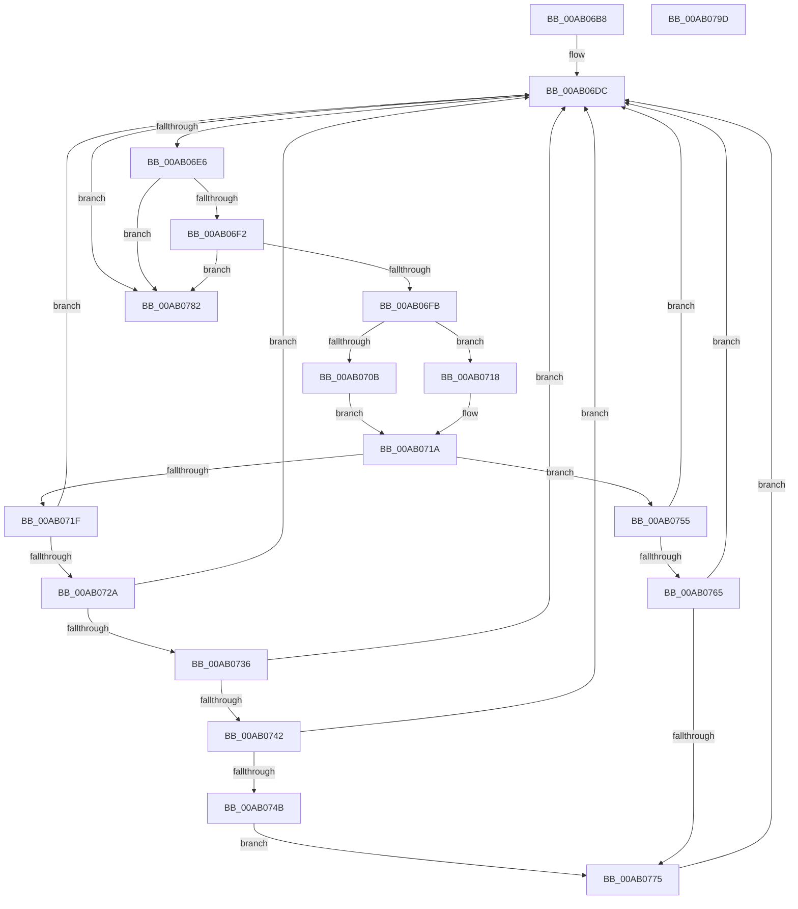

# PiRestartRemovalRelations

- RVA: `0x00AB06B8`–`0x00AB079E` (길이 `230` bytes)
- VA: `0x0000000140AB06B8`
- 실행 섹션: `PAGE`
- PDB 이름 있음: `예`; PDB Function 태그: `아니요`
- unwind 정보 RVA: `0x0005E6B4`
- 디코드: `56`개 명령, `230/230` bytes 표시
- 미해석 바이트: `0` (있으면 어셈블리에 `.byte`로 보존)

> 이 문서는 커널 이미지의 기계어와 PDB 기호를 분석해 생성했습니다. 4번과 5번은 함수 원형과 자료형을 바이너리 사용 방식에서 추정한 C 해석이며 원본 소스 복구 결과는 아닙니다.

## 1. Dependencies

- 직접 호출 지점: **2**; 고유 호출 대상: **2**
- 직접 호출자로 확인된 함수: **1**
- RIP 상대 이미지 참조: **0**

### Outgoing calls
- `0x00AB074E` → [PipClearDevNodeProblem](../A2/PipClearDevNodeProblem_function_00A27C8C.md) (function, `0x00A27C8C`)
- `0x00AB0778` → [PnpRestartDeviceNode](../72/PnpRestartDeviceNode_function_0072CD60.md) (function, `0x0072CD60`)

### Direct callers
- [sub_00B33FE8](../B3/Unknown_function_00B33FE8.md) at `0x00B3422F`

### Static image references
- 디코드된 RIP-relative 메모리 참조가 없습니다.

## 2. Other-region calls and transfers

- 다른 실행 섹션으로 향하는 call: **0**
- 별도 외부 분기/꼬리 이동을 확인하지 못했습니다.

## 3. Assembly (complete function range)

```asm
00AB06B8  48 8B C4                        mov rax, rsp
00AB06BB  48 89 58 08                     mov qword ptr [rax + 8], rbx
00AB06BF  48 89 68 10                     mov qword ptr [rax + 0x10], rbp
00AB06C3  48 89 70 18                     mov qword ptr [rax + 0x18], rsi
00AB06C7  48 89 78 20                     mov qword ptr [rax + 0x20], rdi
00AB06CB  41 56                           push r14
00AB06CD  48 83 EC 20                     sub rsp, 0x20
00AB06D1  49 8B E8                        mov rbp, r8
00AB06D4  48 8B F2                        mov rsi, rdx
00AB06D7  4C 8B F1                        mov r14, rcx
00AB06DA  33 FF                           xor edi, edi
00AB06DC  80 7E 08 00                     cmp byte ptr [rsi + 8], 0
00AB06E0  0F 84 9C 00 00 00               je 0x140ab0782
00AB06E6  4C 8B 06                        mov r8, qword ptr [rsi]
00AB06E9  41 3B 38                        cmp edi, dword ptr [r8]
00AB06EC  0F 83 90 00 00 00               jae 0x140ab0782
00AB06F2  4D 85 C0                        test r8, r8
00AB06F5  0F 84 87 00 00 00               je 0x140ab0782
00AB06FB  48 8D 0C 7F                     lea rcx, [rdi + rdi*2]
00AB06FF  FF C7                           inc edi
00AB0701  49 8B 54 C8 10                  mov rdx, qword ptr [r8 + rcx*8 + 0x10]
00AB0706  48 85 D2                        test rdx, rdx
00AB0709  74 0D                           je 0x140ab0718
00AB070B  48 8B 82 38 01 00 00            mov rax, qword ptr [rdx + 0x138]
00AB0712  48 8B 58 28                     mov rbx, qword ptr [rax + 0x28]
00AB0716  EB 02                           jmp 0x140ab071a
00AB0718  33 DB                           xor ebx, ebx
00AB071A  48 3B D5                        cmp rdx, rbp
00AB071D  75 36                           jne 0x140ab0755
00AB071F  41 8B 86 98 00 00 00            mov eax, dword ptr [r14 + 0x98]
00AB0726  A8 02                           test al, 2
00AB0728  75 B2                           jne 0x140ab06dc
00AB072A  81 BB 2C 01 00 00 14 03 00 00   cmp dword ptr [rbx + 0x12c], 0x314
00AB0734  75 A6                           jne 0x140ab06dc
00AB0736  F7 83 8C 01 00 00 00 20 00 00   test dword ptr [rbx + 0x18c], 0x2000
00AB0740  74 9A                           je 0x140ab06dc
00AB0742  83 BB 94 01 00 00 15            cmp dword ptr [rbx + 0x194], 0x15
00AB0749  75 91                           jne 0x140ab06dc
00AB074B  48 8B CB                        mov rcx, rbx
00AB074E  E8 39 75 F7 FF                  call 0x140a27c8c
00AB0753  EB 20                           jmp 0x140ab0775
00AB0755  F7 83 8C 01 00 00 00 60 00 00   test dword ptr [rbx + 0x18c], 0x6000
00AB075F  0F 85 77 FF FF FF               jne 0x140ab06dc
00AB0765  81 BB 2C 01 00 00 14 03 00 00   cmp dword ptr [rbx + 0x12c], 0x314
00AB076F  0F 85 67 FF FF FF               jne 0x140ab06dc
00AB0775  48 8B CB                        mov rcx, rbx
00AB0778  E8 E3 C5 C7 FF                  call 0x14072cd60
00AB077D  E9 5A FF FF FF                  jmp 0x140ab06dc
00AB0782  48 8B 5C 24 30                  mov rbx, qword ptr [rsp + 0x30]
00AB0787  48 8B 6C 24 38                  mov rbp, qword ptr [rsp + 0x38]
00AB078C  48 8B 74 24 40                  mov rsi, qword ptr [rsp + 0x40]
00AB0791  48 8B 7C 24 48                  mov rdi, qword ptr [rsp + 0x48]
00AB0796  48 83 C4 20                     add rsp, 0x20
00AB079A  41 5E                           pop r14
00AB079C  C3                              ret
00AB079D  CC                              int3
```

## 4. C-style interpretation (structured pseudocode)

```c
__int64 __fastcall PiRestartRemovalRelations(__int64 a1, __int64 a2, __int64 a3)
{
    __int64 result;
    __int64 v_rbx;
    __int64 v_rdi;
    __int64 v_rsp;
    unsigned __int64 v_stack_p10;
    unsigned __int64 v_stack_p18;
    unsigned __int64 v_stack_p20;
    unsigned __int64 v_stack_p8;

    *(unsigned __int64 *)(v_rsp + 8) = v_rbx;
    *(unsigned __int64 *)(v_rsp + 16) = v_rbp;
    *(unsigned __int64 *)(v_rsp + 24) = v_rsi;
    *(unsigned __int64 *)(v_rsp + 32) = v_rdi;
    v_rsp = (v_rsp) - (32);
    v_rdi = 0;
loc_00AB06DC:
    if ((*(unsigned __int8 *)(a2 + 8)) == 0) goto loc_00AB0782;
    if (0 >= (*(unsigned int *)(*(unsigned __int64 *)(a2)))) goto loc_00AB0782;
    if (*(unsigned __int64 *)(a2) == 0) goto loc_00AB0782;
    v_rdi = (unsigned int)((v_rdi) + 1);
    if (*(unsigned __int64 *)(*(unsigned __int64 *)(a2) + v_rdi + v_rdi * 2 * 8 + 16) == 0) goto loc_00AB0718;
    goto loc_00AB071A;
loc_00AB0718:
    v_rbx = 0;
loc_00AB071A:
    if ((*(unsigned __int64 *)(*(unsigned __int64 *)(a2) + v_rdi + v_rdi * 2 * 8 + 16)) != a3) goto loc_00AB0755;
    if ((((unsigned __int8)((unsigned int)(*(unsigned int *)(a1 + 152)))) & (2)) != 0) goto loc_00AB06DC;
    if ((*(unsigned int *)(v_rbx + 300)) != 788) goto loc_00AB06DC;
    if (((*(unsigned int *)(v_rbx + 396)) & (0x2000ULL)) == 0) goto loc_00AB06DC;
    if ((*(unsigned int *)(v_rbx + 404)) != 21) goto loc_00AB06DC;
    result = PipClearDevNodeProblem(0, *(unsigned __int64 *)(*(unsigned __int64 *)(a2) + v_rdi + v_rdi * 2 * 8 + 16), *(unsigned __int64 *)(a2), a4);
    goto loc_00AB0775;
loc_00AB0755:
    if (((*(unsigned int *)(v_rbx + 396)) & (0x6000ULL)) != 0) goto loc_00AB06DC;
    if ((*(unsigned int *)(v_rbx + 300)) != 788) goto loc_00AB06DC;
loc_00AB0775:
    result = PnpRestartDeviceNode(0, *(unsigned __int64 *)(*(unsigned __int64 *)(a2) + v_rdi + v_rdi * 2 * 8 + 16), *(unsigned __int64 *)(a2), a4);
    goto loc_00AB06DC;
loc_00AB0782:
    v_rsp = (v_rsp) + (32);
    return result;
}
```

## 5. (Beta) C Style

```c
int64_t PiRestartRemovalRelations(void *Arg1, void *Arg2, int64_t Arg3)
{
    uint8_t *arg1 = (uint8_t *)Arg1;
    uint8_t *arg2 = (uint8_t *)Arg2;

    int64_t result;
    int64_t local_rbx;
    int64_t local_rdi;
    int64_t local_rsp;
    uint64_t v_stack_p10;
    uint64_t v_stack_p18;
    uint64_t v_stack_p20;
    uint64_t v_stack_p8;

    *(uint64_t *)(local_rsp + 0x8) = local_rbx;
    *(uint64_t *)(local_rsp + 0x10) = local_rbp;
    *(uint64_t *)(local_rsp + 0x18) = local_rsi;
    *(uint64_t *)(local_rsp + 0x20) = local_rdi;
    local_rsp = (local_rsp) - (32);
    local_rdi = 0;
loc_00AB06DC:
    if ((*(uint8_t *)(arg2 + 0x8)) == 0) goto loc_00AB0782;
    if (0 >= (*(uint32_t *)(*(uint64_t *)(arg2)))) goto loc_00AB0782;
    if (*(uint64_t *)(arg2) == 0) goto loc_00AB0782;
    local_rdi = (uint32_t)((local_rdi) + 1);
    if (*(uint64_t *)(*(uint64_t *)(arg2) + local_rdi + local_rdi * 2 * 8 + 0x10) == 0) goto loc_00AB0718;
    goto loc_00AB071A;
loc_00AB0718:
    local_rbx = 0;
loc_00AB071A:
    if ((*(uint64_t *)(*(uint64_t *)(arg2) + local_rdi + local_rdi * 2 * 8 + 0x10)) != Arg3) goto loc_00AB0755;
    if ((((uint8_t)((uint32_t)(*(uint32_t *)(arg1 + 0x98)))) & (2)) != 0) goto loc_00AB06DC;
    if ((*(uint32_t *)(local_rbx + 0x12C)) != 788) goto loc_00AB06DC;
    if (((*(uint32_t *)(local_rbx + 0x18C)) & (0x2000ULL)) == 0) goto loc_00AB06DC;
    if ((*(uint32_t *)(local_rbx + 0x194)) != 21) goto loc_00AB06DC;
    result = PipClearDevNodeProblem(0, *(uint64_t *)(*(uint64_t *)(arg2) + local_rdi + local_rdi * 2 * 8 + 0x10), *(uint64_t *)(arg2), a4);
    goto loc_00AB0775;
loc_00AB0755:
    if (((*(uint32_t *)(local_rbx + 0x18C)) & (0x6000ULL)) != 0) goto loc_00AB06DC;
    if ((*(uint32_t *)(local_rbx + 0x12C)) != 788) goto loc_00AB06DC;
loc_00AB0775:
    result = PnpRestartDeviceNode(0, *(uint64_t *)(*(uint64_t *)(arg2) + local_rdi + local_rdi * 2 * 8 + 0x10), *(uint64_t *)(arg2), a4);
    goto loc_00AB06DC;
loc_00AB0782:
    local_rsp = (local_rsp) + (32);
    return result;
}
```

### 관측된 메모리 오프셋

구조체 형식이 확인되지 않은 접근은 인자 기준의 오프셋으로만 기록했습니다.

| 기준 인자 | 오프셋 표현 | 폭 (bit) | 접근 |
|---|---:|---:|---|
| `Arg1` | `+ 0x98` | `32` | `R` |
| `Arg2` | `+ 0x0` | `64` | `R` |
| `Arg2` | `+ 0x8` | `8` | `R` |

## 6. Execution-region graph

[열기: 2D/3D 그래프와 함수 탐색 컨트롤 패널](../../../control-panel.html?section=page&rva=0x00AB06B8&view=graph)

- 2D 그래프는 위에서 아래로 흐르고, 3D 그래프는 빈 공간을 드래그해 회전합니다. Shift+드래그는 이동, 휠은 확대·축소, 함수 노드 선택은 대상 보고서 이동입니다.

### Static fallback


