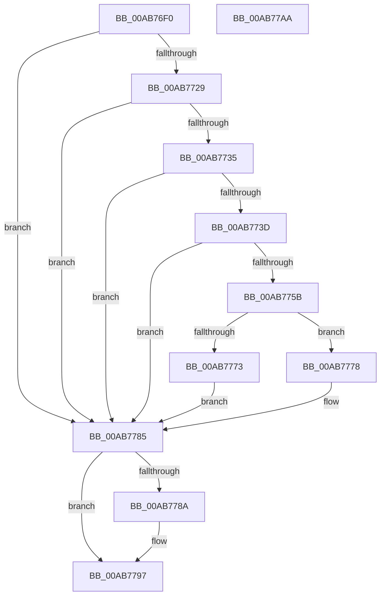

# PiUEventGetProcessImagePath

- RVA: `0x00AB76F0`–`0x00AB77AB` (길이 `187` bytes)
- VA: `0x0000000140AB76F0`
- 실행 섹션: `PAGE`
- PDB 이름 있음: `예`; PDB Function 태그: `아니요`
- unwind 정보 RVA: `0x000BD000`
- 디코드: `56`개 명령, `187/187` bytes 표시
- 미해석 바이트: `0` (있으면 어셈블리에 `.byte`로 보존)

> 이 문서는 커널 이미지의 기계어와 PDB 기호를 분석해 생성했습니다. 4번과 5번은 함수 원형과 자료형을 바이너리 사용 방식에서 추정한 C 해석이며 원본 소스 복구 결과는 아닙니다.

## 1. Dependencies

- 직접 호출 지점: **5**; 고유 호출 대상: **5**
- 직접 호출자로 확인된 함수: **4**
- RIP 상대 이미지 참조: **1**

### Outgoing calls
- `0x00AB771B` → [PsLookupProcessByProcessId](../8A/PsLookupProcessByProcessId_function_008A2AA0.md) (function, `0x008A2AA0`)
- `0x00AB774E` → [ExAllocatePool2](../../poolcode/B8/ExAllocatePool2_function_00B820F0.md) (function, `0x00B820F0`)
- `0x00AB776A` → [RtlStringCbCopyNW](../../text/39/RtlStringCbCopyNW_function_003905E8.md) (function, `0x003905E8`)
- `0x00AB7780` → [ExFreePoolWithTag](../../poolcode/B8/ExFreePoolWithTag_function_00B82870.md) (function, `0x00B82870`)
- `0x00AB7792` → [ObfDereferenceObjectWithTag](../../text/2F/ObfDereferenceObjectWithTag_function_002F78E0.md) (function, `0x002F78E0`)

### Direct callers
- [PiUEventMovePendingEventToSynchronousQueue](../70/PiUEventMovePendingEventToSynchronousQueue_function_00700798.md) at `0x00700854`
- [sub_00B1D4A4](../B1/Unknown_function_00B1D4A4.md) at `0x00B1D4C0`
- [sub_00B1D4A4](../B1/Unknown_function_00B1D4A4.md) at `0x00B1D56C`
- [sub_00B1D4A4](../B1/Unknown_function_00B1D4A4.md) at `0x00B1D63A`
- [sub_00B2EF58](../B2/Unknown_function_00B2EF58.md) at `0x00B2EF71`
- [sub_00B2EF58](../B2/Unknown_function_00B2EF58.md) at `0x00B2EFEC`
- [sub_00B2F090](../B2/Unknown_function_00B2F090.md) at `0x00B2F0B9`
- [sub_00B2F090](../B2/Unknown_function_00B2F090.md) at `0x00B2F15E`

### Static image references
- `0x00AB7703` → RVA `0x0001E288` (`.rdata`; read)

## 2. Other-region calls and transfers

- 다른 실행 섹션으로 향하는 call: **4**
  - `0x00AB774E` → [ExAllocatePool2](../../poolcode/B8/ExAllocatePool2_function_00B820F0.md) (`PAGE` → `POOLCODE`)
  - `0x00AB776A` → [RtlStringCbCopyNW](../../text/39/RtlStringCbCopyNW_function_003905E8.md) (`PAGE` → `.text`)
  - `0x00AB7780` → [ExFreePoolWithTag](../../poolcode/B8/ExFreePoolWithTag_function_00B82870.md) (`PAGE` → `POOLCODE`)
  - `0x00AB7792` → [ObfDereferenceObjectWithTag](../../text/2F/ObfDereferenceObjectWithTag_function_002F78E0.md) (`PAGE` → `.text`)
- 별도 외부 분기/꼬리 이동을 확인하지 못했습니다.

## 3. Assembly (complete function range)

```asm
00AB76F0  4C 8B DC                        mov r11, rsp
00AB76F3  49 89 5B 08                     mov qword ptr [r11 + 8], rbx
00AB76F7  49 89 6B 18                     mov qword ptr [r11 + 0x18], rbp
00AB76FB  56                              push rsi
00AB76FC  57                              push rdi
00AB76FD  41 56                           push r14
00AB76FF  48 83 EC 20                     sub rsp, 0x20
00AB7703  48 8D 05 7E 6B 56 FF            lea rax, [rip - 0xa99482]
00AB770A  48 8B F2                        mov rsi, rdx
00AB770D  48 89 02                        mov qword ptr [rdx], rax
00AB7710  45 33 F6                        xor r14d, r14d
00AB7713  49 8D 53 10                     lea rdx, [r11 + 0x10]
00AB7717  4D 89 73 10                     mov qword ptr [r11 + 0x10], r14
00AB771B  E8 80 B3 DE FF                  call 0x1408a2aa0
00AB7720  48 8B 7C 24 48                  mov rdi, qword ptr [rsp + 0x48]
00AB7725  85 C0                           test eax, eax
00AB7727  78 5C                           js 0x140ab7785
00AB7729  48 8B 9F 50 03 00 00            mov rbx, qword ptr [rdi + 0x350]
00AB7730  48 85 DB                        test rbx, rbx
00AB7733  74 50                           je 0x140ab7785
00AB7735  0F B7 03                        movzx eax, word ptr [rbx]
00AB7738  66 85 C0                        test ax, ax
00AB773B  74 48                           je 0x140ab7785
00AB773D  41 B8 50 6E 70 59               mov r8d, 0x59706e50
00AB7743  48 8D 50 02                     lea rdx, [rax + 2]
00AB7747  B9 00 01 00 00                  mov ecx, 0x100
00AB774C  8B E8                           mov ebp, eax
00AB774E  E8 9D A9 0C 00                  call 0x140b820f0
00AB7753  4C 8B D8                        mov r11, rax
00AB7756  48 85 C0                        test rax, rax
00AB7759  74 2A                           je 0x140ab7785
00AB775B  44 0F B7 0B                     movzx r9d, word ptr [rbx]
00AB775F  48 8D 55 02                     lea rdx, [rbp + 2]
00AB7763  4C 8B 43 08                     mov r8, qword ptr [rbx + 8]
00AB7767  48 8B C8                        mov rcx, rax
00AB776A  E8 79 8E 8D FF                  call 0x1403905e8
00AB776F  85 C0                           test eax, eax
00AB7771  78 05                           js 0x140ab7778
00AB7773  4C 89 1E                        mov qword ptr [rsi], r11
00AB7776  EB 0D                           jmp 0x140ab7785
00AB7778  BA 50 6E 70 59                  mov edx, 0x59706e50
00AB777D  49 8B CB                        mov rcx, r11
00AB7780  E8 EB B0 0C 00                  call 0x140b82870
00AB7785  48 85 FF                        test rdi, rdi
00AB7788  74 0D                           je 0x140ab7797
00AB778A  BA 44 66 6C 74                  mov edx, 0x746c6644
00AB778F  48 8B CF                        mov rcx, rdi
00AB7792  E8 49 01 84 FF                  call 0x1402f78e0
00AB7797  48 8B 5C 24 40                  mov rbx, qword ptr [rsp + 0x40]
00AB779C  48 8B 6C 24 50                  mov rbp, qword ptr [rsp + 0x50]
00AB77A1  48 83 C4 20                     add rsp, 0x20
00AB77A5  41 5E                           pop r14
00AB77A7  5F                              pop rdi
00AB77A8  5E                              pop rsi
00AB77A9  C3                              ret
00AB77AA  CC                              int3
```

## 4. C-style interpretation (structured pseudocode)

```c
__int64 __fastcall PiUEventGetProcessImagePath(__int64 a1, __int64 a2)
{
    __int64 result;
    __int64 v_r14;
    __int64 v_rsp;
    unsigned __int64 v_stack_p10;
    unsigned __int64 v_stack_p18;
    unsigned __int64 v_stack_p8;

    *(unsigned __int64 *)(v_rsp + 8) = v_rbx;
    *(unsigned __int64 *)(v_rsp + 24) = v_rbp;
    v_rsp = (v_rsp) - (32);
    *(unsigned __int64 *)(a2) = v_rip - 11113602;
    v_r14 = 0;
    *(unsigned __int64 *)(v_rsp + 16) = 0;
    result = PsLookupProcessByProcessId(a1, v_rsp + 16, a3, a4);
    if (sign_flag) goto loc_00AB7785;
    if (*(unsigned __int64 *)(v_stack_p10 + 848) == 0) goto loc_00AB7785;
    if ((unsigned __int16)(*(unsigned __int16 *)(*(unsigned __int64 *)(v_stack_p10 + 848))) == 0) goto loc_00AB7785;
    result = ExAllocatePool2(256, *(unsigned __int16 *)(*(unsigned __int64 *)(v_stack_p10 + 848)) + 2, (unsigned int)(0x59706E50ULL), a4);
    if (result == 0) goto loc_00AB7785;
    result = RtlStringCbCopyNW(result, (unsigned int)((unsigned int)(*(unsigned __int16 *)(*(unsigned __int64 *)(v_stack_p10 + 848)))) + 2, *(unsigned __int64 *)(*(unsigned __int64 *)(v_stack_p10 + 848) + 8), *(unsigned __int16 *)(*(unsigned __int64 *)(v_stack_p10 + 848)));
    if (sign_flag) goto loc_00AB7778;
    *(unsigned __int64 *)(a2) = result;
    goto loc_00AB7785;
loc_00AB7778:
    result = ExFreePoolWithTag(result, (unsigned int)(0x59706E50ULL), *(unsigned __int64 *)(*(unsigned __int64 *)(v_stack_p10 + 848) + 8), *(unsigned __int16 *)(*(unsigned __int64 *)(v_stack_p10 + 848)));
loc_00AB7785:
    if (v_stack_p10 != 0) {
        a2 = 0x746C6644ULL;
        a1 = v_stack_p10;
        result = ObfDereferenceObjectWithTag(a1, a2, *(unsigned __int64 *)(*(unsigned __int64 *)(v_stack_p10 + 848) + 8), *(unsigned __int16 *)(*(unsigned __int64 *)(v_stack_p10 + 848)));
    }
    v_rsp = (v_rsp) + (32);
    return result;
}
```

## 5. (Beta) C Style

```c
int64_t PiUEventGetProcessImagePath(int64_t Arg1, void *Arg2)
{
    uint8_t *arg2 = (uint8_t *)Arg2;

    int64_t result;
    int64_t local_r14;
    int64_t local_rsp;
    uint64_t v_stack_p10;
    uint64_t v_stack_p18;
    uint64_t v_stack_p8;

    *(uint64_t *)(local_rsp + 0x8) = local_rbx;
    *(uint64_t *)(local_rsp + 0x18) = local_rbp;
    local_rsp = (local_rsp) - (32);
    *(uint64_t *)(arg2) = v_rip - 11113602;
    local_r14 = 0;
    *(uint64_t *)(local_rsp + 0x10) = 0;
    result = PsLookupProcessByProcessId(Arg1, local_rsp + 16, a3, a4);
    if (sign_flag) goto loc_00AB7785;
    if (*(uint64_t *)(v_stack_p10 + 0x350) == 0) goto loc_00AB7785;
    if ((uint16_t)(*(uint16_t *)(*(uint64_t *)(v_stack_p10 + 0x350))) == 0) goto loc_00AB7785;
    result = ExAllocatePool2(256, *(uint16_t *)(*(uint64_t *)(v_stack_p10 + 0x350)) + 2, (uint32_t)(0x59706E50ULL), a4);
    if (result == 0) goto loc_00AB7785;
    result = RtlStringCbCopyNW(result, (uint32_t)((uint32_t)(*(uint16_t *)(*(uint64_t *)(v_stack_p10 + 0x350)))) + 2, *(uint64_t *)(*(uint64_t *)(v_stack_p10 + 0x350) + 0x8), *(uint16_t *)(*(uint64_t *)(v_stack_p10 + 0x350)));
    if (sign_flag) goto loc_00AB7778;
    *(uint64_t *)(arg2) = result;
    goto loc_00AB7785;
loc_00AB7778:
    result = ExFreePoolWithTag(result, (uint32_t)(0x59706E50ULL), *(uint64_t *)(*(uint64_t *)(v_stack_p10 + 0x350) + 0x8), *(uint16_t *)(*(uint64_t *)(v_stack_p10 + 0x350)));
loc_00AB7785:
    if (v_stack_p10 != 0) {
        Arg2 = 0x746C6644ULL;
        Arg1 = v_stack_p10;
        result = ObfDereferenceObjectWithTag(Arg1, Arg2, *(uint64_t *)(*(uint64_t *)(v_stack_p10 + 0x350) + 0x8), *(uint16_t *)(*(uint64_t *)(v_stack_p10 + 0x350)));
    }
    local_rsp = (local_rsp) + (32);
    return result;
}
```

### 관측된 메모리 오프셋

구조체 형식이 확인되지 않은 접근은 인자 기준의 오프셋으로만 기록했습니다.

| 기준 인자 | 오프셋 표현 | 폭 (bit) | 접근 |
|---|---:|---:|---|
| `Arg2` | `+ 0x0` | `64` | `W` |

## 6. Execution-region graph

[열기: 2D/3D 그래프와 함수 탐색 컨트롤 패널](../../../control-panel.html?section=page&rva=0x00AB76F0&view=graph)

- 2D 그래프는 위에서 아래로 흐르고, 3D 그래프는 빈 공간을 드래그해 회전합니다. Shift+드래그는 이동, 휠은 확대·축소, 함수 노드 선택은 대상 보고서 이동입니다.

### Static fallback


