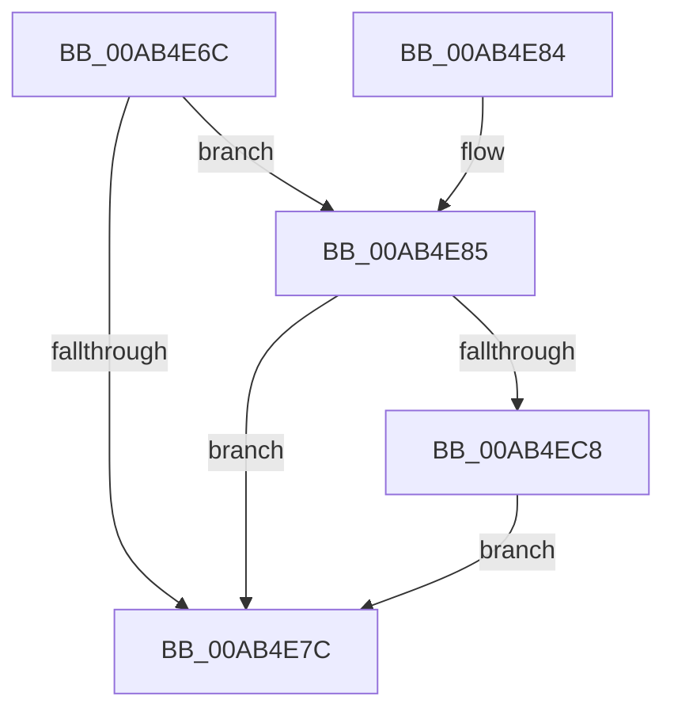

# PiUEventIsClientStuck

- RVA: `0x00AB4E6C`–`0x00AB4EE0` (길이 `116` bytes)
- VA: `0x0000000140AB4E6C`
- 실행 섹션: `PAGE`
- PDB 이름 있음: `예`; PDB Function 태그: `아니요`
- unwind 정보 RVA: `0x000BCC78`
- 디코드: `31`개 명령, `116/116` bytes 표시
- 미해석 바이트: `0` (있으면 어셈블리에 `.byte`로 보존)

> 이 문서는 커널 이미지의 기계어와 PDB 기호를 분석해 생성했습니다. 4번과 5번은 함수 원형과 자료형을 바이너리 사용 방식에서 추정한 C 해석이며 원본 소스 복구 결과는 아닙니다.

## 1. Dependencies

- 직접 호출 지점: **1**; 고유 호출 대상: **1**
- 직접 호출자로 확인된 함수: **1**
- RIP 상대 이미지 참조: **0**

### Outgoing calls
- `0x00AB4ECC` → [PiUEventIsProcessFrozen](../6F/PiUEventIsProcessFrozen_function_006FDF30.md) (function, `0x006FDF30`)

### Direct callers
- [PiUEventNotifyClient](../8E/PiUEventNotifyClient_function_008E6BEC.md) at `0x008E6CC3`

### Static image references
- 디코드된 RIP-relative 메모리 참조가 없습니다.

## 2. Other-region calls and transfers

- 다른 실행 섹션으로 향하는 call: **0**
- 별도 외부 분기/꼬리 이동을 확인하지 못했습니다.

## 3. Assembly (complete function range)

```asm
00AB4E6C  40 53                           push rbx
00AB4E6E  48 83 EC 20                     sub rsp, 0x20
00AB4E72  33 DB                           xor ebx, ebx
00AB4E74  39 99 80 00 00 00               cmp dword ptr [rcx + 0x80], ebx
00AB4E7A  77 09                           ja 0x140ab4e85
00AB4E7C  8A C3                           mov al, bl
00AB4E7E  48 83 C4 20                     add rsp, 0x20
00AB4E82  5B                              pop rbx
00AB4E83  C3                              ret
00AB4E84  CC                              int3
00AB4E85  48 8B 41 70                     mov rax, qword ptr [rcx + 0x70]
00AB4E89  48 BA 14 00 00 00 80 F7 FF FF   movabs rdx, 0xfffff78000000014
00AB4E93  48 8B 12                        mov rdx, qword ptr [rdx]
00AB4E96  48 2B 50 10                     sub rdx, qword ptr [rax + 0x10]
00AB4E9A  48 B8 4B 59 86 38 D6 C5 6D 34   movabs rax, 0x346dc5d63886594b
00AB4EA4  48 F7 EA                        imul rdx
00AB4EA7  48 C1 FA 0B                     sar rdx, 0xb
00AB4EAB  48 8B C2                        mov rax, rdx
00AB4EAE  48 C1 E8 3F                     shr rax, 0x3f
00AB4EB2  48 03 D0                        add rdx, rax
00AB4EB5  8B 81 80 00 00 00               mov eax, dword ptr [rcx + 0x80]
00AB4EBB  48 0F AF D0                     imul rdx, rax
00AB4EBF  48 81 FA C0 27 09 00            cmp rdx, 0x927c0
00AB4EC6  7E B4                           jle 0x140ab4e7c
00AB4EC8  48 8B 49 30                     mov rcx, qword ptr [rcx + 0x30]
00AB4ECC  E8 5F 90 C4 FF                  call 0x1406fdf30
00AB4ED1  84 C0                           test al, al
00AB4ED3  0F B6 DB                        movzx ebx, bl
00AB4ED6  BA 01 00 00 00                  mov edx, 1
00AB4EDB  0F 44 DA                        cmove ebx, edx
00AB4EDE  EB 9C                           jmp 0x140ab4e7c
```

## 4. C-style interpretation (structured pseudocode)

```c
__int64 __fastcall PiUEventIsClientStuck(__int64 a1)
{
    __int64 result;
    __int64 v_rbx;
    __int64 v_rsp;

    v_rsp = (v_rsp) - (32);
    v_rbx = 0;
    if ((*(unsigned int *)(a1 + 128)) > 0) goto loc_00AB4E85;
loc_00AB4E7C:
    v_rsp = (v_rsp) + (32);
    return 0;
loc_00AB4E85:
    a2 = (*(unsigned __int64 *)(a2)) - (*(unsigned __int64 *)(*(unsigned __int64 *)(a1 + 112) + 16));
    a2 = (a2) >> (11);
    result = (a2) >> (63);
    a2 = (a2) + (result);
    a2 = (a2) * ((unsigned int)(*(unsigned int *)(a1 + 128)));
    if (a2 <= 0x927C0ULL) goto loc_00AB4E7C;
    result = PiUEventIsProcessFrozen(*(unsigned __int64 *)(a1 + 48), a2, a3, a4);
    v_rbx = 0;
    if ((unsigned __int8)(result) == 0) { v_rbx = 1; }
    goto loc_00AB4E7C;
}
```

## 5. (Beta) C Style

```c
int64_t PiUEventIsClientStuck(void *Arg1)
{
    uint8_t *arg1 = (uint8_t *)Arg1;

    int64_t result;
    int64_t local_rbx;
    int64_t local_rsp;

    local_rsp = (local_rsp) - (32);
    local_rbx = 0;
    if ((*(uint32_t *)(arg1 + 0x80)) > 0) goto loc_00AB4E85;
loc_00AB4E7C:
    local_rsp = (local_rsp) + (32);
    return 0;
loc_00AB4E85:
    a2 = (*(uint64_t *)(a2)) - (*(uint64_t *)(*(uint64_t *)(arg1 + 0x70) + 0x10));
    a2 = (a2) >> (11);
    result = (a2) >> (63);
    a2 = (a2) + (result);
    a2 = (a2) * ((uint32_t)(*(uint32_t *)(arg1 + 0x80)));
    if (a2 <= 0x927C0ULL) goto loc_00AB4E7C;
    result = PiUEventIsProcessFrozen(*(uint64_t *)(arg1 + 0x30), a2, a3, a4);
    local_rbx = 0;
    if ((uint8_t)(result) == 0) { local_rbx = 1; }
    goto loc_00AB4E7C;
}
```

### 관측된 메모리 오프셋

구조체 형식이 확인되지 않은 접근은 인자 기준의 오프셋으로만 기록했습니다.

| 기준 인자 | 오프셋 표현 | 폭 (bit) | 접근 |
|---|---:|---:|---|
| `Arg1` | `+ 0x30` | `64` | `R` |
| `Arg1` | `+ 0x70` | `64` | `R` |
| `Arg1` | `+ 0x80` | `32` | `R` |

## 6. Execution-region graph

[열기: 2D/3D 그래프와 함수 탐색 컨트롤 패널](../../../control-panel.html?section=page&rva=0x00AB4E6C&view=graph)

- 2D 그래프는 위에서 아래로 흐르고, 3D 그래프는 빈 공간을 드래그해 회전합니다. Shift+드래그는 이동, 휠은 확대·축소, 함수 노드 선택은 대상 보고서 이동입니다.

### Static fallback


