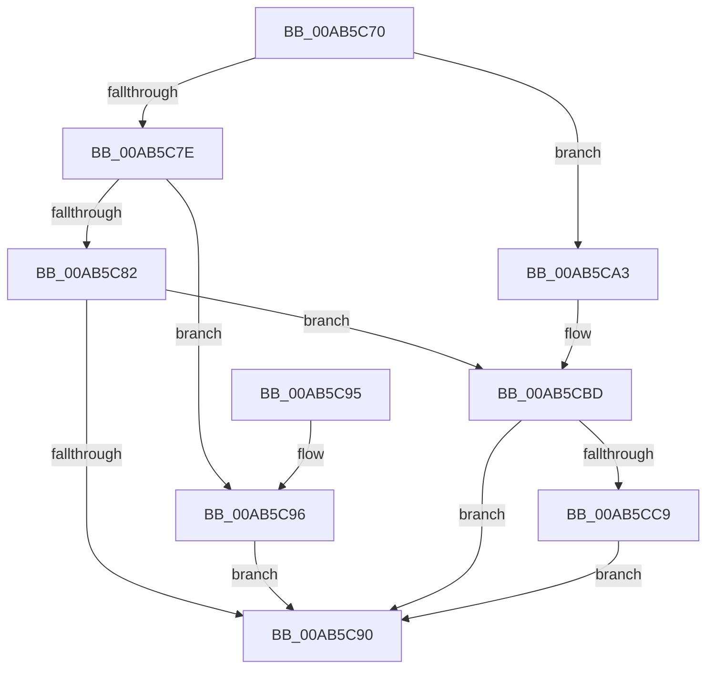

# PipCslStateChangeCallback

- RVA: `0x00AB5C70`–`0x00AB5CD0` (길이 `96` bytes)
- VA: `0x0000000140AB5C70`
- 실행 섹션: `PAGE`
- PDB 이름 있음: `예`; PDB Function 태그: `아니요`
- unwind 정보 RVA: `0x00065954`
- 디코드: `28`개 명령, `96/96` bytes 표시
- 미해석 바이트: `0` (있으면 어셈블리에 `.byte`로 보존)

> 이 문서는 커널 이미지의 기계어와 PDB 기호를 분석해 생성했습니다. 4번과 5번은 함수 원형과 자료형을 바이너리 사용 방식에서 추정한 C 해석이며 원본 소스 복구 결과는 아닙니다.

## 1. Dependencies

- 직접 호출 지점: **2**; 고유 호출 대상: **2**
- 직접 호출자로 확인된 함수: **0**
- RIP 상대 이미지 참조: **3**

### Outgoing calls
- `0x00AB5CB7` → [KeBugCheckEx](../../text/4F/KeBugCheckEx_function_004FD660.md) (function, `0x004FD660`)
- `0x00AB5CC9` → [guard_dispatch_icall](../../text/6B/guard_dispatch_icall_function_006BAAD0.md) (function, `0x006BAAD0`)

### Direct callers
- 이 함수 시작 RVA로 연결되는 직접 call은 확인되지 않았습니다. 간접 호출은 완전히 역산할 수 없습니다.

### Static image references
- `0x00AB5C76` → RVA `0x00F8A998` (`.data`; read)
- `0x00AB5C85` → RVA `0x00F8A99C` (`.data`; read/write)
- `0x00AB5CBD` → RVA `0x00F8A9A0` (`.data`; read)

## 2. Other-region calls and transfers

- 다른 실행 섹션으로 향하는 call: **2**
  - `0x00AB5CB7` → [KeBugCheckEx](../../text/4F/KeBugCheckEx_function_004FD660.md) (`PAGE` → `.text`)
  - `0x00AB5CC9` → [guard_dispatch_icall](../../text/6B/guard_dispatch_icall_function_006BAAD0.md) (`PAGE` → `.text`)
- 별도 외부 분기/꼬리 이동을 확인하지 못했습니다.

## 3. Assembly (complete function range)

```asm
00AB5C70  48 83 EC 38                     sub rsp, 0x38
00AB5C74  33 C9                           xor ecx, ecx
00AB5C76  38 0D 1C 4D 4D 00               cmp byte ptr [rip + 0x4d4d1c], cl
00AB5C7C  74 25                           je 0x140ab5ca3
00AB5C7E  38 0A                           cmp byte ptr [rdx], cl
00AB5C80  74 14                           je 0x140ab5c96
00AB5C82  8D 41 01                        lea eax, [rcx + 1]
00AB5C85  87 05 11 4D 4D 00               xchg dword ptr [rip + 0x4d4d11], eax
00AB5C8B  83 F8 01                        cmp eax, 1
00AB5C8E  75 2D                           jne 0x140ab5cbd
00AB5C90  48 83 C4 38                     add rsp, 0x38
00AB5C94  C3                              ret
00AB5C95  CC                              int3
00AB5C96  B8 02 00 00 00                  mov eax, 2
00AB5C9B  87 05 FB 4C 4D 00               xchg dword ptr [rip + 0x4d4cfb], eax
00AB5CA1  EB ED                           jmp 0x140ab5c90
00AB5CA3  45 33 C9                        xor r9d, r9d
00AB5CA6  48 89 4C 24 20                  mov qword ptr [rsp + 0x20], rcx
00AB5CAB  45 33 C0                        xor r8d, r8d
00AB5CAE  B9 CA 00 00 00                  mov ecx, 0xca
00AB5CB3  41 8D 51 10                     lea edx, [r9 + 0x10]
00AB5CB7  E8 A4 79 A4 FF                  call 0x1404fd660
00AB5CBC  CC                              int3
00AB5CBD  48 8B 05 DC 4C 4D 00            mov rax, qword ptr [rip + 0x4d4cdc]
00AB5CC4  48 85 C0                        test rax, rax
00AB5CC7  74 C7                           je 0x140ab5c90
00AB5CC9  E8 02 4E C0 FF                  call 0x1406baad0
00AB5CCE  EB C0                           jmp 0x140ab5c90
```

## 4. C-style interpretation (structured pseudocode)

```c
__int64 __fastcall PipCslStateChangeCallback(int a1, __int64 a2, int a3, int a4)
{
    __int64 result;
    __int64 v_rsp;
    unsigned __int64 v_stack_p20;

    v_rsp = (v_rsp) - (56);
    a1 = 0;
    if ((*(unsigned __int8 *)(v_rip + 5066012)) == 0) goto loc_00AB5CA3;
    if ((*(unsigned __int8 *)(a2)) == 0) goto loc_00AB5C96;
    if (((unsigned int)(a1 + 1)) != 1) goto loc_00AB5CBD;
loc_00AB5C90:
    v_rsp = (v_rsp) + (56);
    return a1 + 1;
loc_00AB5C96:
    goto loc_00AB5C90;
loc_00AB5CA3:
    a4 = 0;
    v_stack_p20 = 0;
    a3 = 0;
    result = KeBugCheckEx(202, a4 + 16, a3, a4);
loc_00AB5CBD:
    if (*(unsigned __int64 *)(v_rip + 5065948) == 0) goto loc_00AB5C90;
    result = guard_dispatch_icall(202, a4 + 16, a3, a4);
    goto loc_00AB5C90;
}
```

## 5. (Beta) C Style

```c
int64_t PipCslStateChangeCallback(int32_t Arg1, void *Arg2, int32_t Arg3, int32_t Arg4)
{
    uint8_t *arg2 = (uint8_t *)Arg2;

    int64_t result;
    int64_t local_rsp;
    uint64_t v_stack_p20;

    local_rsp = (local_rsp) - (56);
    Arg1 = 0;
    if ((*(uint8_t *)(v_rip + 0x4D4D1C)) == 0) goto loc_00AB5CA3;
    if ((*(uint8_t *)(arg2)) == 0) goto loc_00AB5C96;
    if (((uint32_t)(Arg1 + 1)) != 1) goto loc_00AB5CBD;
loc_00AB5C90:
    local_rsp = (local_rsp) + (56);
    return Arg1 + 1;
loc_00AB5C96:
    goto loc_00AB5C90;
loc_00AB5CA3:
    Arg4 = 0;
    v_stack_p20 = 0;
    Arg3 = 0;
    result = KeBugCheckEx(202, Arg4 + 16, Arg3, Arg4);
loc_00AB5CBD:
    if (*(uint64_t *)(v_rip + 0x4D4CDC) == 0) goto loc_00AB5C90;
    result = guard_dispatch_icall(202, Arg4 + 16, Arg3, Arg4);
    goto loc_00AB5C90;
}
```

### 관측된 메모리 오프셋

구조체 형식이 확인되지 않은 접근은 인자 기준의 오프셋으로만 기록했습니다.

| 기준 인자 | 오프셋 표현 | 폭 (bit) | 접근 |
|---|---:|---:|---|
| `Arg2` | `+ 0x0` | `8` | `R` |

## 6. Execution-region graph

[열기: 2D/3D 그래프와 함수 탐색 컨트롤 패널](../../../control-panel.html?section=page&rva=0x00AB5C70&view=graph)

- 2D 그래프는 위에서 아래로 흐르고, 3D 그래프는 빈 공간을 드래그해 회전합니다. Shift+드래그는 이동, 휠은 확대·축소, 함수 노드 선택은 대상 보고서 이동입니다.

### Static fallback


