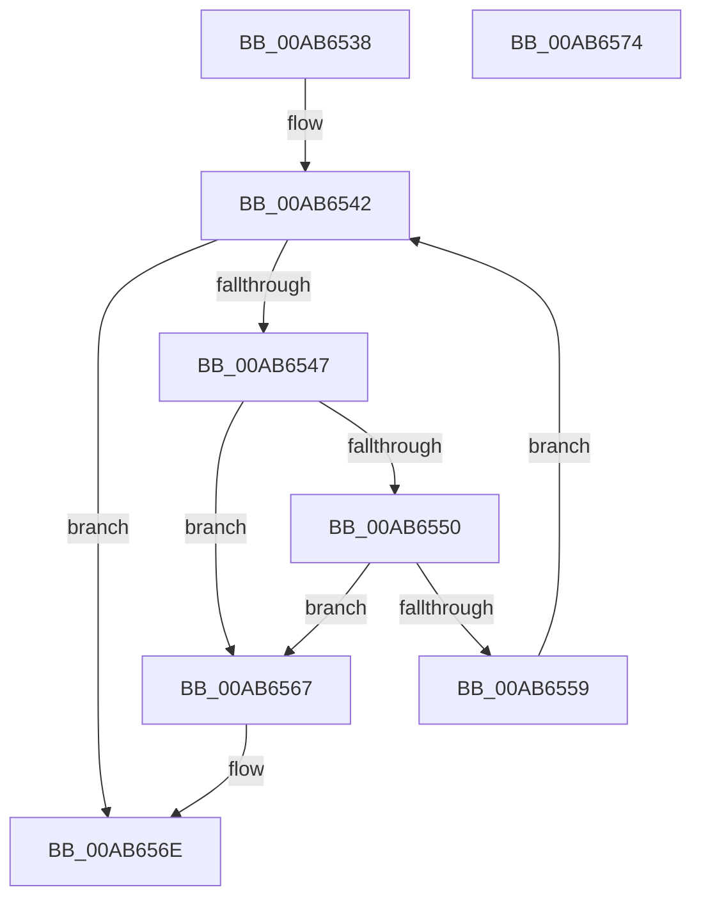

# PipDeleteBindingIds

- RVA: `0x00AB6538`–`0x00AB6575` (길이 `61` bytes)
- VA: `0x0000000140AB6538`
- 실행 섹션: `PAGE`
- PDB 이름 있음: `예`; PDB Function 태그: `아니요`
- unwind 정보 RVA: `0x0005CF00`
- 디코드: `21`개 명령, `61/61` bytes 표시
- 미해석 바이트: `0` (있으면 어셈블리에 `.byte`로 보존)

> 이 문서는 커널 이미지의 기계어와 PDB 기호를 분석해 생성했습니다. 4번과 5번은 함수 원형과 자료형을 바이너리 사용 방식에서 추정한 C 해석이며 원본 소스 복구 결과는 아닙니다.

## 1. Dependencies

- 직접 호출 지점: **1**; 고유 호출 대상: **1**
- 직접 호출자로 확인된 함수: **1**
- RIP 상대 이미지 참조: **0**

### Outgoing calls
- `0x00AB6560` → [PipFreeBindingId](PipFreeBindingId_function_00AB657C.md) (function, `0x00AB657C`)

### Direct callers
- [PipConvertResolutionsToReservations](../AD/PipConvertResolutionsToReservations_function_00AD59D4.md) at `0x00AD5A07`

### Static image references
- 디코드된 RIP-relative 메모리 참조가 없습니다.

## 2. Other-region calls and transfers

- 다른 실행 섹션으로 향하는 call: **0**
- 별도 외부 분기/꼬리 이동을 확인하지 못했습니다.

## 3. Assembly (complete function range)

```asm
00AB6538  40 53                           push rbx
00AB653A  48 83 EC 20                     sub rsp, 0x20
00AB653E  48 8D 59 38                     lea rbx, [rcx + 0x38]
00AB6542  48 39 1B                        cmp qword ptr [rbx], rbx
00AB6545  74 27                           je 0x140ab656e
00AB6547  48 8B 4B 08                     mov rcx, qword ptr [rbx + 8]
00AB654B  48 39 19                        cmp qword ptr [rcx], rbx
00AB654E  75 17                           jne 0x140ab6567
00AB6550  48 8B 41 08                     mov rax, qword ptr [rcx + 8]
00AB6554  48 39 08                        cmp qword ptr [rax], rcx
00AB6557  75 0E                           jne 0x140ab6567
00AB6559  48 89 43 08                     mov qword ptr [rbx + 8], rax
00AB655D  48 89 18                        mov qword ptr [rax], rbx
00AB6560  E8 17 00 00 00                  call 0x140ab657c
00AB6565  EB DB                           jmp 0x140ab6542
00AB6567  B9 03 00 00 00                  mov ecx, 3
00AB656C  CD 29                           int 0x29
00AB656E  48 83 C4 20                     add rsp, 0x20
00AB6572  5B                              pop rbx
00AB6573  C3                              ret
00AB6574  CC                              int3
```

## 4. C-style interpretation (structured pseudocode)

```c
__int64 __fastcall PipDeleteBindingIds(__int64 a1)
{
    __int64 result;
    __int64 v_rsp;

    v_rsp = (v_rsp) - (32);
loc_00AB6542:
    if ((*(unsigned __int64 *)(a1 + 56)) == (a1 + 56)) goto loc_00AB656E;
    if ((*(unsigned __int64 *)(*(unsigned __int64 *)(a1 + 56 + 8))) != (a1 + 56)) goto loc_00AB6567;
    if ((*(unsigned __int64 *)(*(unsigned __int64 *)(*(unsigned __int64 *)(a1 + 56 + 8) + 8))) != (*(unsigned __int64 *)(a1 + 56 + 8))) goto loc_00AB6567;
    *(unsigned __int64 *)(a1 + 56 + 8) = *(unsigned __int64 *)(*(unsigned __int64 *)(a1 + 56 + 8) + 8);
    *(unsigned __int64 *)(*(unsigned __int64 *)(*(unsigned __int64 *)(a1 + 56 + 8) + 8)) = a1 + 56;
    result = PipFreeBindingId(*(unsigned __int64 *)(a1 + 56 + 8), a2, a3, a4);
    goto loc_00AB6542;
loc_00AB6567:
loc_00AB656E:
    v_rsp = (v_rsp) + (32);
    return result;
}
```

## 5. (Beta) C Style

```c
int64_t PipDeleteBindingIds(void *Arg1)
{
    uint8_t *arg1 = (uint8_t *)Arg1;

    int64_t result;
    int64_t local_rsp;

    local_rsp = (local_rsp) - (32);
loc_00AB6542:
    if ((*(uint64_t *)(arg1 + 0x38)) == (Arg1 + 56)) goto loc_00AB656E;
    if ((*(uint64_t *)(*(uint64_t *)(arg1 + 0x38 + 0x8))) != (Arg1 + 56)) goto loc_00AB6567;
    if ((*(uint64_t *)(*(uint64_t *)(*(uint64_t *)(arg1 + 0x38 + 0x8) + 0x8))) != (*(uint64_t *)(arg1 + 0x38 + 0x8))) goto loc_00AB6567;
    *(uint64_t *)(arg1 + 0x38 + 0x8) = *(uint64_t *)(*(uint64_t *)(arg1 + 0x38 + 0x8) + 0x8);
    *(void **)(*(uint64_t *)(*(uint64_t *)(arg1 + 0x38 + 0x8) + 0x8)) = Arg1 + 56;
    result = PipFreeBindingId(*(uint64_t *)(arg1 + 0x38 + 0x8), a2, a3, a4);
    goto loc_00AB6542;
loc_00AB6567:
loc_00AB656E:
    local_rsp = (local_rsp) + (32);
    return result;
}
```

### 관측된 메모리 오프셋

구조체 형식이 확인되지 않은 접근은 인자 기준의 오프셋으로만 기록했습니다.

| 기준 인자 | 오프셋 표현 | 폭 (bit) | 접근 |
|---|---:|---:|---|
| `Arg1` | `+ 0x0` | `64` | `R` |
| `Arg1` | `+ 0x8` | `64` | `R` |
| `Arg1` | `+ 0x8` | `64` | `W` |
| `Arg1` | `+ 0x38` | `64` | `R` |

## 6. Execution-region graph

[열기: 2D/3D 그래프와 함수 탐색 컨트롤 패널](../../../control-panel.html?section=page&rva=0x00AB6538&view=graph)

- 2D 그래프는 위에서 아래로 흐르고, 3D 그래프는 빈 공간을 드래그해 회전합니다. Shift+드래그는 이동, 휠은 확대·축소, 함수 노드 선택은 대상 보고서 이동입니다.

### Static fallback


