# PnpDriverLoadingFailed

- RVA: `0x00AB8928`–`0x00AB8DE3` (길이 `1,211` bytes)
- VA: `0x0000000140AB8928`
- 실행 섹션: `PAGE`
- PDB 이름 있음: `예`; PDB Function 태그: `아니요`
- unwind 정보 RVA: `0x000BD1E4`
- 디코드: `305`개 명령, `1,211/1,211` bytes 표시
- 미해석 바이트: `0` (있으면 어셈블리에 `.byte`로 보존)

> 이 문서는 커널 이미지의 기계어와 PDB 기호를 분석해 생성했습니다. 4번과 5번은 함수 원형과 자료형을 바이너리 사용 방식에서 추정한 C 해석이며 원본 소스 복구 결과는 아닙니다.

## 1. Dependencies

- 직접 호출 지점: **33**; 고유 호출 대상: **20**
- 직접 호출자로 확인된 함수: **2**
- RIP 상대 이미지 참조: **7**

### Outgoing calls
- `0x00AB8998` → [PipOpenServiceEnumKeys](../99/PipOpenServiceEnumKeys_function_00998E94.md) (function, `0x00998E94`)
- `0x00AB89EB` → [ZwOpenKey](../../text/6A/ZwOpenKey_function_006AD310.md) (function, `0x006AD310`)
- `0x00AB8A2F` → [ZwSetValueKey](../../text/6A/ZwSetValueKey_function_006ADCD0.md) (function, `0x006ADCD0`)
- `0x00AB8A46` → [IopGetRegistryValue](../99/IopGetRegistryValue_function_009990EC.md) (function, `0x009990EC`)
- `0x00AB8A74` → [ExFreePoolWithTag](../../poolcode/B8/ExFreePoolWithTag_function_00B82870.md) (function, `0x00B82870`)
- `0x00AB8AA0` → [PipServiceInstanceToDeviceInstance](../72/PipServiceInstanceToDeviceInstance_function_0072C150.md) (function, `0x0072C150`)
- `0x00AB8AB6` → [PnpDeviceObjectFromDeviceInstanceWithTag](../8E/PnpDeviceObjectFromDeviceInstanceWithTag_function_008E7490.md) (function, `0x008E7490`)
- `0x00AB8AD6` → [PipIsDevNodeDNStarted](../../text/47/PipIsDevNodeDNStarted_function_00470870.md) (function, `0x00470870`)
- `0x00AB8AE5` → [IopReleaseDeviceResources](../A0/IopReleaseDeviceResources_function_00A0867C.md) (function, `0x00A0867C`)
- `0x00AB8B05` → [ExAcquireResourceSharedLite](../../text/21/ExAcquireResourceSharedLite_function_00211BC0.md) (function, `0x00211BC0`)
- `0x00AB8B3C` → [PoFxAbandonDevice](../A8/PoFxAbandonDevice_function_00A8AB64.md) (function, `0x00A8AB64`)
- `0x00AB8B49` → [PipSetDevNodeState](../../text/47/PipSetDevNodeState_function_00470708.md) (function, `0x00470708`)
- `0x00AB8B58` → [PipSetDevNodeProblem](../8F/PipSetDevNodeProblem_function_008FDE0C.md) (function, `0x008FDE0C`)
- `0x00AB8B60` → [ObfDereferenceObject](../../text/2F/ObfDereferenceObject_function_002F9350.md) (function, `0x002F9350`)
- `0x00AB8B6B` → [ExFreePoolWithTag](../../poolcode/B8/ExFreePoolWithTag_function_00B82870.md) (function, `0x00B82870`)
- `0x00AB8B77` → [ExReleaseResourceLite](../../text/25/ExReleaseResourceLite_function_0025FA10.md) (function, `0x0025FA10`)
- `0x00AB8B7C` → [KeLeaveCriticalRegion](../../text/25/KeLeaveCriticalRegion_function_0025D8B0.md) (function, `0x0025D8B0`)
- `0x00AB8BBB` → [ExAcquireResourceSharedLite](../../text/21/ExAcquireResourceSharedLite_function_00211BC0.md) (function, `0x00211BC0`)
- `0x00AB8C00` → [RtlStringCchPrintfExW](../../text/42/RtlStringCchPrintfExW_function_0042B390.md) (function, `0x0042B390`)
- `0x00AB8C41` → [IopGetRegistryValue](../99/IopGetRegistryValue_function_009990EC.md) (function, `0x009990EC`)
- `0x00AB8C63` → [ZwDeleteValueKey](../../text/6A/ZwDeleteValueKey_function_006AECB0.md) (function, `0x006AECB0`)
- `0x00AB8C8F` → [RtlStringCchPrintfExW](../../text/42/RtlStringCchPrintfExW_function_0042B390.md) (function, `0x0042B390`)
- `0x00AB8CE7` → [ZwSetValueKey](../../text/6A/ZwSetValueKey_function_006ADCD0.md) (function, `0x006ADCD0`)
- `0x00AB8CF1` → [ExFreePoolWithTag](../../poolcode/B8/ExFreePoolWithTag_function_00B82870.md) (function, `0x00B82870`)
- `0x00AB8D3C` → [ZwSetValueKey](../../text/6A/ZwSetValueKey_function_006ADCD0.md) (function, `0x006ADCD0`)
- `0x00AB8D6E` → [ZwSetValueKey](../../text/6A/ZwSetValueKey_function_006ADCD0.md) (function, `0x006ADCD0`)
- `0x00AB8D7A` → [ExReleaseResourceLite](../../text/25/ExReleaseResourceLite_function_0025FA10.md) (function, `0x0025FA10`)
- `0x00AB8D7F` → [KeLeaveCriticalRegion](../../text/25/KeLeaveCriticalRegion_function_0025D8B0.md) (function, `0x0025D8B0`)
- `0x00AB8D8C` → [ZwClose](../../text/6A/ZwClose_function_006AD2B0.md) (function, `0x006AD2B0`)
- `0x00AB8D99` → [ZwClose](../../text/6A/ZwClose_function_006AD2B0.md) (function, `0x006AD2B0`)
- `0x00AB8DA6` → [ZwClose](../../text/6A/ZwClose_function_006AD2B0.md) (function, `0x006AD2B0`)
- `0x00AB8DB3` → [ZwClose](../../text/6A/ZwClose_function_006AD2B0.md) (function, `0x006AD2B0`)
- `0x00AB8DC1` → [_security_check_cookie](../../text/6A/_security_check_cookie_function_006AC640.md) (function, `0x006AC640`)

### Direct callers
- [sub_00B2CB5C](../B2/Unknown_function_00B2CB5C.md) at `0x00B2CC33`
- [IopInitializeBuiltinDriver](../../init/C7/IopInitializeBuiltinDriver_function_00C7625C.md) at `0x00C766F1`

### Static image references
- `0x00AB8946` → RVA `0x00E0A740` (`.data`; read)
- `0x00AB89AD` → RVA `0x00AFDA80` (` ?? ::NNGAKEGL::`string'`; read)
- `0x00AB89FC` → RVA `0x00AFDC00` (` ?? ::NNGAKEGL::`string'`; read)
- `0x00AB8A3F` → RVA `0x00AFDA90` (` ?? ::NNGAKEGL::`string'`; read)
- `0x00AB8AF3` → RVA `0x00F8C600` (`.data`; read)
- `0x00AB8BCD` → RVA `0x00AFDAA0` (` ?? ::NNGAKEGL::`string'`; read)
- `0x00AB8D45` → RVA `0x00AFDC20` (` ?? ::NNGAKEGL::`string'`; read)

## 2. Other-region calls and transfers

- 다른 실행 섹션으로 향하는 call: **25**
  - `0x00AB89EB` → [ZwOpenKey](../../text/6A/ZwOpenKey_function_006AD310.md) (`PAGE` → `.text`)
  - `0x00AB8A2F` → [ZwSetValueKey](../../text/6A/ZwSetValueKey_function_006ADCD0.md) (`PAGE` → `.text`)
  - `0x00AB8A74` → [ExFreePoolWithTag](../../poolcode/B8/ExFreePoolWithTag_function_00B82870.md) (`PAGE` → `POOLCODE`)
  - `0x00AB8AD6` → [PipIsDevNodeDNStarted](../../text/47/PipIsDevNodeDNStarted_function_00470870.md) (`PAGE` → `.text`)
  - `0x00AB8B05` → [ExAcquireResourceSharedLite](../../text/21/ExAcquireResourceSharedLite_function_00211BC0.md) (`PAGE` → `.text`)
  - `0x00AB8B49` → [PipSetDevNodeState](../../text/47/PipSetDevNodeState_function_00470708.md) (`PAGE` → `.text`)
  - `0x00AB8B60` → [ObfDereferenceObject](../../text/2F/ObfDereferenceObject_function_002F9350.md) (`PAGE` → `.text`)
  - `0x00AB8B6B` → [ExFreePoolWithTag](../../poolcode/B8/ExFreePoolWithTag_function_00B82870.md) (`PAGE` → `POOLCODE`)
  - `0x00AB8B77` → [ExReleaseResourceLite](../../text/25/ExReleaseResourceLite_function_0025FA10.md) (`PAGE` → `.text`)
  - `0x00AB8B7C` → [KeLeaveCriticalRegion](../../text/25/KeLeaveCriticalRegion_function_0025D8B0.md) (`PAGE` → `.text`)
  - `0x00AB8BBB` → [ExAcquireResourceSharedLite](../../text/21/ExAcquireResourceSharedLite_function_00211BC0.md) (`PAGE` → `.text`)
  - `0x00AB8C00` → [RtlStringCchPrintfExW](../../text/42/RtlStringCchPrintfExW_function_0042B390.md) (`PAGE` → `.text`)
  - `0x00AB8C63` → [ZwDeleteValueKey](../../text/6A/ZwDeleteValueKey_function_006AECB0.md) (`PAGE` → `.text`)
  - `0x00AB8C8F` → [RtlStringCchPrintfExW](../../text/42/RtlStringCchPrintfExW_function_0042B390.md) (`PAGE` → `.text`)
  - `0x00AB8CE7` → [ZwSetValueKey](../../text/6A/ZwSetValueKey_function_006ADCD0.md) (`PAGE` → `.text`)
  - `0x00AB8CF1` → [ExFreePoolWithTag](../../poolcode/B8/ExFreePoolWithTag_function_00B82870.md) (`PAGE` → `POOLCODE`)
  - `0x00AB8D3C` → [ZwSetValueKey](../../text/6A/ZwSetValueKey_function_006ADCD0.md) (`PAGE` → `.text`)
  - `0x00AB8D6E` → [ZwSetValueKey](../../text/6A/ZwSetValueKey_function_006ADCD0.md) (`PAGE` → `.text`)
  - `0x00AB8D7A` → [ExReleaseResourceLite](../../text/25/ExReleaseResourceLite_function_0025FA10.md) (`PAGE` → `.text`)
  - `0x00AB8D7F` → [KeLeaveCriticalRegion](../../text/25/KeLeaveCriticalRegion_function_0025D8B0.md) (`PAGE` → `.text`)
  - `0x00AB8D8C` → [ZwClose](../../text/6A/ZwClose_function_006AD2B0.md) (`PAGE` → `.text`)
  - `0x00AB8D99` → [ZwClose](../../text/6A/ZwClose_function_006AD2B0.md) (`PAGE` → `.text`)
  - `0x00AB8DA6` → [ZwClose](../../text/6A/ZwClose_function_006AD2B0.md) (`PAGE` → `.text`)
  - `0x00AB8DB3` → [ZwClose](../../text/6A/ZwClose_function_006AD2B0.md) (`PAGE` → `.text`)
  - `0x00AB8DC1` → [_security_check_cookie](../../text/6A/_security_check_cookie_function_006AC640.md) (`PAGE` → `.text`)
- 별도 외부 분기/꼬리 이동을 확인하지 못했습니다.

## 3. Assembly (complete function range)

```asm
00AB8928  48 89 5C 24 18                  mov qword ptr [rsp + 0x18], rbx
00AB892D  48 89 74 24 20                  mov qword ptr [rsp + 0x20], rsi
00AB8932  55                              push rbp
00AB8933  57                              push rdi
00AB8934  41 54                           push r12
00AB8936  41 56                           push r14
00AB8938  41 57                           push r15
00AB893A  48 8D 6C 24 C9                  lea rbp, [rsp - 0x37]
00AB893F  48 81 EC F0 00 00 00            sub rsp, 0xf0
00AB8946  48 8B 05 F3 1D 35 00            mov rax, qword ptr [rip + 0x351df3]
00AB894D  48 33 C4                        xor rax, rsp
00AB8950  48 89 45 2F                     mov qword ptr [rbp + 0x2f], rax
00AB8954  48 83 65 AF 00                  and qword ptr [rbp - 0x51], 0
00AB8959  45 33 FF                        xor r15d, r15d
00AB895C  48 83 65 97 00                  and qword ptr [rbp - 0x69], 0
00AB8961  0F 57 C0                        xorps xmm0, xmm0
00AB8964  83 65 8B 00                     and dword ptr [rbp - 0x75], 0
00AB8968  4C 8B E2                        mov r12, rdx
00AB896B  48 89 4D B7                     mov qword ptr [rbp - 0x49], rcx
00AB896F  48 8B D9                        mov rbx, rcx
00AB8972  44 89 7D A3                     mov dword ptr [rbp - 0x5d], r15d
00AB8976  41 8D 7F 01                     lea edi, [r15 + 1]
00AB897A  BA 19 00 02 00                  mov edx, 0x20019
00AB897F  0F 11 45 C7                     movups xmmword ptr [rbp - 0x39], xmm0
00AB8983  48 85 C9                        test rcx, rcx
00AB8986  75 21                           jne 0x140ab89a9
00AB8988  4C 8D 4D 97                     lea r9, [rbp - 0x69]
00AB898C  44 88 7C 24 20                  mov byte ptr [rsp + 0x20], r15b
00AB8991  4C 8D 45 B7                     lea r8, [rbp - 0x49]
00AB8995  49 8B CC                        mov rcx, r12
00AB8998  E8 F7 04 EE FF                  call 0x140998e94
00AB899D  48 8B 5D B7                     mov rbx, qword ptr [rbp - 0x49]
00AB89A1  44 8B FF                        mov r15d, edi
00AB89A4  89 7D A3                        mov dword ptr [rbp - 0x5d], edi
00AB89A7  EB 47                           jmp 0x140ab89f0
00AB89A9  44 21 7D F3                     and dword ptr [rbp - 0xd], r15d
00AB89AD  48 8D 05 CC 50 04 00            lea rax, [rip + 0x450cc]
00AB89B4  48 89 45 8F                     mov qword ptr [rbp - 0x71], rax
00AB89B8  4C 8D 45 D7                     lea r8, [rbp - 0x29]
00AB89BC  48 8D 45 87                     lea rax, [rbp - 0x79]
00AB89C0  48 C7 45 D7 30 00 00 00         mov qword ptr [rbp - 0x29], 0x30
00AB89C8  44 21 7D DB                     and dword ptr [rbp - 0x25], r15d
00AB89CC  48 89 4D DF                     mov qword ptr [rbp - 0x21], rcx
00AB89D0  48 8D 4D 97                     lea rcx, [rbp - 0x69]
00AB89D4  48 89 45 E7                     mov qword ptr [rbp - 0x19], rax
00AB89D8  C7 45 87 08 00 0A 00            mov dword ptr [rbp - 0x79], 0xa0008
00AB89DF  C7 45 EF 40 02 00 00            mov dword ptr [rbp - 0x11], 0x240
00AB89E6  F3 0F 7F 45 F7                  movdqu xmmword ptr [rbp - 9], xmm0
00AB89EB  E8 20 49 BF FF                  call 0x1406ad310
00AB89F0  85 C0                           test eax, eax
00AB89F2  0F 88 C2 03 00 00               js 0x140ab8dba
00AB89F8  48 8B 4D 97                     mov rcx, qword ptr [rbp - 0x69]
00AB89FC  48 8D 05 FD 51 04 00            lea rax, [rip + 0x451fd]
00AB8A03  48 89 45 8F                     mov qword ptr [rbp - 0x71], rax
00AB8A07  48 8D 55 87                     lea rdx, [rbp - 0x79]
00AB8A0B  41 BE 04 00 00 00               mov r14d, 4
00AB8A11  C7 45 87 1E 00 20 00            mov dword ptr [rbp - 0x79], 0x20001e
00AB8A18  48 8D 45 BF                     lea rax, [rbp - 0x41]
00AB8A1C  44 89 74 24 28                  mov dword ptr [rsp + 0x28], r14d
00AB8A21  45 8B CE                        mov r9d, r14d
00AB8A24  48 89 44 24 20                  mov qword ptr [rsp + 0x20], rax
00AB8A29  45 33 C0                        xor r8d, r8d
00AB8A2C  89 7D BF                        mov dword ptr [rbp - 0x41], edi
00AB8A2F  E8 9C 52 BF FF                  call 0x1406adcd0
00AB8A34  48 8B 4D 97                     mov rcx, qword ptr [rbp - 0x69]
00AB8A38  4C 8D 4D AF                     lea r9, [rbp - 0x51]
00AB8A3C  45 33 C0                        xor r8d, r8d
00AB8A3F  48 8D 15 4A 50 04 00            lea rdx, [rip + 0x4504a]
00AB8A46  E8 A1 06 EE FF                  call 0x1409990ec
00AB8A4B  33 FF                           xor edi, edi
00AB8A4D  8B F0                           mov esi, eax
00AB8A4F  85 C0                           test eax, eax
00AB8A51  0F 88 4B 03 00 00               js 0x140ab8da2
00AB8A57  4C 8B 45 AF                     mov r8, qword ptr [rbp - 0x51]
00AB8A5B  45 39 70 04                     cmp dword ptr [r8 + 4], r14d
00AB8A5F  75 0E                           jne 0x140ab8a6f
00AB8A61  45 39 70 0C                     cmp dword ptr [r8 + 0xc], r14d
00AB8A65  72 08                           jb 0x140ab8a6f
00AB8A67  41 8B 48 08                     mov ecx, dword ptr [r8 + 8]
00AB8A6B  42 8B 3C 01                     mov edi, dword ptr [rcx + r8]
00AB8A6F  33 D2                           xor edx, edx
00AB8A71  49 8B C8                        mov rcx, r8
00AB8A74  E8 F7 9D 0C 00                  call 0x140b82870
00AB8A79  85 FF                           test edi, edi
00AB8A7B  0F 84 21 03 00 00               je 0x140ab8da2
00AB8A81  45 33 F6                        xor r14d, r14d
00AB8A84  89 7D 9F                        mov dword ptr [rbp - 0x61], edi
00AB8A87  85 FF                           test edi, edi
00AB8A89  0F 84 F9 02 00 00               je 0x140ab8d88
00AB8A8F  41 83 CF FF                     or r15d, 0xffffffff
00AB8A93  4C 8D 4D C7                     lea r9, [rbp - 0x39]
00AB8A97  45 8B C6                        mov r8d, r14d
00AB8A9A  49 8B D4                        mov rdx, r12
00AB8A9D  48 8B CB                        mov rcx, rbx
00AB8AA0  E8 AB 36 C7 FF                  call 0x14072c150
00AB8AA5  85 C0                           test eax, eax
00AB8AA7  0F 88 D8 00 00 00               js 0x140ab8b85
00AB8AAD  BA 44 66 6C 74                  mov edx, 0x746c6644
00AB8AB2  48 8D 4D C7                     lea rcx, [rbp - 0x39]
00AB8AB6  E8 D5 E9 E2 FF                  call 0x1408e7490
00AB8ABB  48 8B F0                        mov rsi, rax
00AB8ABE  48 85 C0                        test rax, rax
00AB8AC1  74 27                           je 0x140ab8aea
00AB8AC3  48 8B 88 38 01 00 00            mov rcx, qword ptr [rax + 0x138]
00AB8ACA  4C 8B 41 28                     mov r8, qword ptr [rcx + 0x28]
00AB8ACE  4D 85 C0                        test r8, r8
00AB8AD1  74 17                           je 0x140ab8aea
00AB8AD3  49 8B C8                        mov rcx, r8
00AB8AD6  E8 95 7D 9B FF                  call 0x140470870
00AB8ADB  85 C0                           test eax, eax
00AB8ADD  75 0B                           jne 0x140ab8aea
00AB8ADF  8D 50 01                        lea edx, [rax + 1]
00AB8AE2  49 8B C8                        mov rcx, r8
00AB8AE5  E8 92 FB F4 FF                  call 0x140a0867c
00AB8AEA  65 48 8B 04 25 88 01 00 00      mov rax, qword ptr gs:[0x188]
00AB8AF3  48 8D 0D 06 3B 4D 00            lea rcx, [rip + 0x4d3b06]
00AB8AFA  B2 01                           mov dl, 1
00AB8AFC  66 44 01 B8 E4 01 00 00         add word ptr [rax + 0x1e4], r15w
00AB8B04  90                              nop
00AB8B05  E8 B6 90 75 FF                  call 0x140211bc0
00AB8B0A  48 85 F6                        test rsi, rsi
00AB8B0D  74 56                           je 0x140ab8b65
00AB8B0F  48 8B 86 38 01 00 00            mov rax, qword ptr [rsi + 0x138]
00AB8B16  48 8B 58 28                     mov rbx, qword ptr [rax + 0x28]
00AB8B1A  48 85 DB                        test rbx, rbx
00AB8B1D  74 3E                           je 0x140ab8b5d
00AB8B1F  8B 83 8C 01 00 00               mov eax, dword ptr [rbx + 0x18c]
00AB8B25  A8 01                           test al, 1
00AB8B27  74 34                           je 0x140ab8b5d
00AB8B29  8B 83 2C 01 00 00               mov eax, dword ptr [rbx + 0x12c]
00AB8B2F  2D 09 03 00 00                  sub eax, 0x309
00AB8B34  83 F8 01                        cmp eax, 1
00AB8B37  77 24                           ja 0x140ab8b5d
00AB8B39  48 8B CB                        mov rcx, rbx
00AB8B3C  E8 23 20 FD FF                  call 0x140a8ab64
00AB8B41  BA 14 03 00 00                  mov edx, 0x314
00AB8B46  48 8B CB                        mov rcx, rbx
00AB8B49  E8 BA 7B 9B FF                  call 0x140470708
00AB8B4E  45 33 C0                        xor r8d, r8d
00AB8B51  48 8B CB                        mov rcx, rbx
00AB8B54  41 8D 50 18                     lea edx, [r8 + 0x18]
00AB8B58  E8 AF 52 E4 FF                  call 0x1408fde0c
00AB8B5D  48 8B CE                        mov rcx, rsi
00AB8B60  E8 EB 07 84 FF                  call 0x1402f9350
00AB8B65  48 8B 4D CF                     mov rcx, qword ptr [rbp - 0x31]
00AB8B69  33 D2                           xor edx, edx
00AB8B6B  E8 00 9D 0C 00                  call 0x140b82870
00AB8B70  48 8D 0D 89 3A 4D 00            lea rcx, [rip + 0x4d3a89]
00AB8B77  E8 94 6E 7A FF                  call 0x14025fa10
00AB8B7C  E8 2F 4D 7A FF                  call 0x14025d8b0
00AB8B81  48 8B 5D B7                     mov rbx, qword ptr [rbp - 0x49]
00AB8B85  41 FF C6                        inc r14d
00AB8B88  44 3B F7                        cmp r14d, edi
00AB8B8B  0F 82 02 FF FF FF               jb 0x140ab8a93
00AB8B91  44 8B 7D A3                     mov r15d, dword ptr [rbp - 0x5d]
00AB8B95  39 7D 9F                        cmp dword ptr [rbp - 0x61], edi
00AB8B98  0F 84 EA 01 00 00               je 0x140ab8d88
00AB8B9E  65 48 8B 04 25 88 01 00 00      mov rax, qword ptr gs:[0x188]
00AB8BA7  48 8D 0D 52 3A 4D 00            lea rcx, [rip + 0x4d3a52]
00AB8BAE  83 CE FF                        or esi, 0xffffffff
00AB8BB1  B2 01                           mov dl, 1
00AB8BB3  66 01 B0 E4 01 00 00            add word ptr [rax + 0x1e4], si
00AB8BBA  90                              nop
00AB8BBB  E8 00 90 75 FF                  call 0x140211bc0
00AB8BC0  83 7D 9F 00                     cmp dword ptr [rbp - 0x61], 0
00AB8BC4  0F 84 40 01 00 00               je 0x140ab8d0a
00AB8BCA  45 33 F6                        xor r14d, r14d
00AB8BCD  4C 8D 3D CC 4E 04 00            lea r15, [rip + 0x44ecc]
00AB8BD4  33 DB                           xor ebx, ebx
00AB8BD6  44 8D 66 15                     lea r12d, [rsi + 0x15]
00AB8BDA  45 33 C9                        xor r9d, r9d
00AB8BDD  89 5C 24 30                     mov dword ptr [rsp + 0x30], ebx
00AB8BE1  48 8D 45 07                     lea rax, [rbp + 7]
00AB8BE5  4C 89 7C 24 28                  mov qword ptr [rsp + 0x28], r15
00AB8BEA  48 83 64 24 20 00               and qword ptr [rsp + 0x20], 0
00AB8BF0  4C 8D 45 A7                     lea r8, [rbp - 0x59]
00AB8BF4  48 8D 4D 07                     lea rcx, [rbp + 7]
00AB8BF8  48 89 45 A7                     mov qword ptr [rbp - 0x59], rax
00AB8BFC  41 8D 51 0A                     lea edx, [r9 + 0xa]
00AB8C00  E8 8B 27 97 FF                  call 0x14042b390
00AB8C05  48 8B 45 A7                     mov rax, qword ptr [rbp - 0x59]
00AB8C09  48 8D 4D 07                     lea rcx, [rbp + 7]
00AB8C0D  48 2B C1                        sub rax, rcx
00AB8C10  66 44 89 65 89                  mov word ptr [rbp - 0x77], r12w
00AB8C15  48 D1 F8                        sar rax, 1
00AB8C18  3B C6                           cmp eax, esi
00AB8C1A  75 07                           jne 0x140ab8c23
00AB8C1C  66 44 89 65 87                  mov word ptr [rbp - 0x79], r12w
00AB8C21  EB 07                           jmp 0x140ab8c2a
00AB8C23  66 03 C0                        add ax, ax
00AB8C26  66 89 45 87                     mov word ptr [rbp - 0x79], ax
00AB8C2A  48 8B 4D 97                     mov rcx, qword ptr [rbp - 0x69]
00AB8C2E  48 8D 45 07                     lea rax, [rbp + 7]
00AB8C32  4C 8D 4D AF                     lea r9, [rbp - 0x51]
00AB8C36  48 89 45 8F                     mov qword ptr [rbp - 0x71], rax
00AB8C3A  45 33 C0                        xor r8d, r8d
00AB8C3D  48 8D 55 07                     lea rdx, [rbp + 7]
00AB8C41  E8 A6 04 EE FF                  call 0x1409990ec
00AB8C46  85 C0                           test eax, eax
00AB8C48  0F 88 AE 00 00 00               js 0x140ab8cfc
00AB8C4E  48 8B 75 AF                     mov rsi, qword ptr [rbp - 0x51]
00AB8C52  41 3B DE                        cmp ebx, r14d
00AB8C55  0F 84 91 00 00 00               je 0x140ab8cec
00AB8C5B  48 8B 4D 97                     mov rcx, qword ptr [rbp - 0x69]
00AB8C5F  48 8D 55 87                     lea rdx, [rbp - 0x79]
00AB8C63  E8 48 60 BF FF                  call 0x1406aecb0
00AB8C68  45 33 C9                        xor r9d, r9d
00AB8C6B  44 89 74 24 30                  mov dword ptr [rsp + 0x30], r14d
00AB8C70  48 8D 45 07                     lea rax, [rbp + 7]
00AB8C74  4C 89 7C 24 28                  mov qword ptr [rsp + 0x28], r15
00AB8C79  48 83 64 24 20 00               and qword ptr [rsp + 0x20], 0
00AB8C7F  4C 8D 45 A7                     lea r8, [rbp - 0x59]
00AB8C83  48 8D 4D 07                     lea rcx, [rbp + 7]
00AB8C87  48 89 45 A7                     mov qword ptr [rbp - 0x59], rax
00AB8C8B  41 8D 51 0A                     lea edx, [r9 + 0xa]
00AB8C8F  E8 FC 26 97 FF                  call 0x14042b390
00AB8C94  48 8B 45 A7                     mov rax, qword ptr [rbp - 0x59]
00AB8C98  48 8D 4D 07                     lea rcx, [rbp + 7]
00AB8C9C  48 2B C1                        sub rax, rcx
00AB8C9F  66 44 89 65 89                  mov word ptr [rbp - 0x77], r12w
00AB8CA4  48 D1 F8                        sar rax, 1
00AB8CA7  83 C9 FF                        or ecx, 0xffffffff
00AB8CAA  3B C1                           cmp eax, ecx
00AB8CAC  75 07                           jne 0x140ab8cb5
00AB8CAE  66 44 89 65 87                  mov word ptr [rbp - 0x79], r12w
00AB8CB3  EB 07                           jmp 0x140ab8cbc
00AB8CB5  66 03 C0                        add ax, ax
00AB8CB8  66 89 45 87                     mov word ptr [rbp - 0x79], ax
00AB8CBC  48 8D 45 07                     lea rax, [rbp + 7]
00AB8CC0  41 B9 01 00 00 00               mov r9d, 1
00AB8CC6  48 89 45 8F                     mov qword ptr [rbp - 0x71], rax
00AB8CCA  48 8D 55 87                     lea rdx, [rbp - 0x79]
00AB8CCE  8B 4E 08                        mov ecx, dword ptr [rsi + 8]
00AB8CD1  45 33 C0                        xor r8d, r8d
00AB8CD4  8B 46 0C                        mov eax, dword ptr [rsi + 0xc]
00AB8CD7  48 03 CE                        add rcx, rsi
00AB8CDA  89 44 24 28                     mov dword ptr [rsp + 0x28], eax
00AB8CDE  48 89 4C 24 20                  mov qword ptr [rsp + 0x20], rcx
00AB8CE3  48 8B 4D 97                     mov rcx, qword ptr [rbp - 0x69]
00AB8CE7  E8 E4 4F BF FF                  call 0x1406adcd0
00AB8CEC  33 D2                           xor edx, edx
00AB8CEE  48 8B CE                        mov rcx, rsi
00AB8CF1  E8 7A 9B 0C 00                  call 0x140b82870
00AB8CF6  41 FF C6                        inc r14d
00AB8CF9  83 CE FF                        or esi, 0xffffffff
00AB8CFC  FF C3                           inc ebx
00AB8CFE  3B DF                           cmp ebx, edi
00AB8D00  0F 82 D4 FE FF FF               jb 0x140ab8bda
00AB8D06  44 8B 7D A3                     mov r15d, dword ptr [rbp - 0x5d]
00AB8D0A  48 8B 4D 97                     mov rcx, qword ptr [rbp - 0x69]
00AB8D0E  48 8D 05 7B 4D 04 00            lea rax, [rip + 0x44d7b]
00AB8D15  48 89 45 8F                     mov qword ptr [rbp - 0x71], rax
00AB8D19  48 8D 55 87                     lea rdx, [rbp - 0x79]
00AB8D1D  BB 04 00 00 00                  mov ebx, 4
00AB8D22  C7 45 87 0A 00 0C 00            mov dword ptr [rbp - 0x79], 0xc000a
00AB8D29  48 8D 45 9F                     lea rax, [rbp - 0x61]
00AB8D2D  89 5C 24 28                     mov dword ptr [rsp + 0x28], ebx
00AB8D31  44 8B CB                        mov r9d, ebx
00AB8D34  48 89 44 24 20                  mov qword ptr [rsp + 0x20], rax
00AB8D39  45 33 C0                        xor r8d, r8d
00AB8D3C  E8 8F 4F BF FF                  call 0x1406adcd0
00AB8D41  48 8B 4D 97                     mov rcx, qword ptr [rbp - 0x69]
00AB8D45  48 8D 05 D4 4E 04 00            lea rax, [rip + 0x44ed4]
00AB8D4C  48 89 45 8F                     mov qword ptr [rbp - 0x71], rax
00AB8D50  48 8D 55 87                     lea rdx, [rbp - 0x79]
00AB8D54  48 8D 45 9F                     lea rax, [rbp - 0x61]
00AB8D58  89 5C 24 28                     mov dword ptr [rsp + 0x28], ebx
00AB8D5C  44 8B CB                        mov r9d, ebx
00AB8D5F  48 89 44 24 20                  mov qword ptr [rsp + 0x20], rax
00AB8D64  45 33 C0                        xor r8d, r8d
00AB8D67  C7 45 87 18 00 1A 00            mov dword ptr [rbp - 0x79], 0x1a0018
00AB8D6E  E8 5D 4F BF FF                  call 0x1406adcd0
00AB8D73  48 8D 0D 86 38 4D 00            lea rcx, [rip + 0x4d3886]
00AB8D7A  E8 91 6C 7A FF                  call 0x14025fa10
00AB8D7F  E8 2C 4B 7A FF                  call 0x14025d8b0
00AB8D84  48 8B 5D B7                     mov rbx, qword ptr [rbp - 0x49]
00AB8D88  48 8B 4D 97                     mov rcx, qword ptr [rbp - 0x69]
00AB8D8C  E8 1F 45 BF FF                  call 0x1406ad2b0
00AB8D91  45 85 FF                        test r15d, r15d
00AB8D94  74 08                           je 0x140ab8d9e
00AB8D96  48 8B CB                        mov rcx, rbx
00AB8D99  E8 12 45 BF FF                  call 0x1406ad2b0
00AB8D9E  33 C0                           xor eax, eax
00AB8DA0  EB 18                           jmp 0x140ab8dba
00AB8DA2  48 8B 4D 97                     mov rcx, qword ptr [rbp - 0x69]
00AB8DA6  E8 05 45 BF FF                  call 0x1406ad2b0
00AB8DAB  45 85 FF                        test r15d, r15d
00AB8DAE  74 08                           je 0x140ab8db8
00AB8DB0  48 8B CB                        mov rcx, rbx
00AB8DB3  E8 F8 44 BF FF                  call 0x1406ad2b0
00AB8DB8  8B C6                           mov eax, esi
00AB8DBA  48 8B 4D 2F                     mov rcx, qword ptr [rbp + 0x2f]
00AB8DBE  48 33 CC                        xor rcx, rsp
00AB8DC1  E8 7A 38 BF FF                  call 0x1406ac640
00AB8DC6  4C 8D 9C 24 F0 00 00 00         lea r11, [rsp + 0xf0]
00AB8DCE  49 8B 5B 40                     mov rbx, qword ptr [r11 + 0x40]
00AB8DD2  49 8B 73 48                     mov rsi, qword ptr [r11 + 0x48]
00AB8DD6  49 8B E3                        mov rsp, r11
00AB8DD9  41 5F                           pop r15
00AB8DDB  41 5E                           pop r14
00AB8DDD  41 5C                           pop r12
00AB8DDF  5F                              pop rdi
00AB8DE0  5D                              pop rbp
00AB8DE1  C3                              ret
00AB8DE2  CC                              int3
```

## 4. C-style interpretation (structured pseudocode)

```c
__int64 __fastcall PnpDriverLoadingFailed(__int64 a1, __int64 a2)
{
    __int64 result;
    __int64 v_r14;
    __int64 v_r15;
    __int64 v_rbx;
    __int64 v_rdi;
    __int64 v_rsi;
    __int64 v_rsp;
    unsigned __int64 v_stack_m28;
    unsigned __int64 v_stack_m30;
    unsigned __int64 v_stack_m58;
    unsigned __int64 v_stack_m5F;
    unsigned __int64 v_stack_m68;
    unsigned int v_stack_m6C;
    unsigned int v_stack_m70;
    unsigned __int64 v_stack_m78;
    unsigned __int64 v_stack_m80;
    unsigned int v_stack_m84;
    unsigned __int64 v_stack_m88;
    unsigned __int64 v_stack_m90;
    unsigned __int64 v_stack_m98;
    unsigned __int64 v_stack_mA0;
    unsigned __int64 v_stack_mA8;
    unsigned __int64 v_stack_mB0;
    unsigned __int64 v_stack_mB8;
    unsigned int v_stack_mBC;
    unsigned int v_stack_mC0;
    unsigned __int64 v_stack_mC8;
    unsigned __int64 v_stack_mD0;
    unsigned int v_stack_mD4;
    unsigned __int16 v_stack_mD6;
    unsigned __int64 v_stack_mD8;
    unsigned int v_stack_mE8;
    unsigned int v_stack_mF0;
    unsigned __int8 v_stack_mF8;
    unsigned __int64 v_stack_p18;
    unsigned __int64 v_stack_p20;

    v_stack_p18 = v_rbx;
    v_stack_p20 = v_rsi;
    v_rsp = (v_rsp) - (240);
    result = (*(unsigned __int64 *)(v_rip + 3481075)) ^ (v_rsp);
    v_stack_m30 = result;
    v_r15 = 0;
    v_stack_mA8 = a1;
    v_stack_mBC = 0;
    v_stack_m98 = v_xmm0;
    if (a1 != 0) goto loc_00AB89A9;
    v_stack_mF8 = 0;
    result = PipOpenServiceEnumKeys(a2, (unsigned int)(0x20019ULL), v_stack_mA8, v_stack_mC8);
    v_stack_mBC = (unsigned int)(v_r15 + 1);
    goto loc_00AB89F0;
loc_00AB89A9:
    v_stack_mD0 = v_rip + 282828;
    v_stack_m88 = 48;
    v_stack_m80 = a2;
    v_stack_m78 = v_stack_mD8;
    v_stack_mD8 = 0xA0008ULL;
    v_stack_m70 = 576;
    v_stack_m68 = v_xmm0;
    result = ZwOpenKey(v_stack_mC8, (unsigned int)(0x20019ULL), v_stack_m88, v_stack_mC8);
loc_00AB89F0:
    if (sign_flag) goto loc_00AB8DBA;
    v_stack_mD0 = v_rip + 283133;
    v_stack_mD8 = 0x20001EULL;
    v_stack_mF0 = 4;
    v_stack_mF8 = v_stack_mA0;
    a3 = 0;
    v_stack_mA0 = (unsigned int)(v_r15 + 1);
    result = ZwSetValueKey(v_stack_mC8, v_stack_mD8, a3, 4);
    a3 = 0;
    result = IopGetRegistryValue(v_stack_mC8, v_rip + 282698, a3, v_stack_mB0);
    v_rdi = 0;
    if (sign_flag) goto loc_00AB8DA2;
    if ((*(unsigned int *)(v_stack_mB0 + 4)) != 4) goto loc_00AB8A6F;
    if ((*(unsigned int *)(v_stack_mB0 + 12)) >= 4) {
        a1 = *(unsigned int *)(v_stack_mB0 + 8);
        v_rdi = *(unsigned int *)(a1 + v_stack_mB0 * 1);
    }
    a2 = 0;
    result = ExFreePoolWithTag(v_stack_mB0, a2, v_stack_mB0, v_stack_mB0);
    if ((unsigned int)(v_rdi) == 0) goto loc_00AB8DA2;
    v_r14 = 0;
    v_stack_mC0 = (unsigned int)(v_rdi);
    if ((unsigned int)(v_rdi) == 0) goto loc_00AB8D88;
    v_r15 = (unsigned int)(((unsigned int)((unsigned int)(v_r15 + 1))) | (0xFFFFFFFFULL));
loc_00AB8A93:
    result = PipServiceInstanceToDeviceInstance(v_stack_mA8, 0, 0, v_stack_m98);
    if (sign_flag) goto loc_00AB8B85;
    result = PnpDeviceObjectFromDeviceInstanceWithTag(v_stack_m98, (unsigned int)(0x746C6644ULL), 0, v_stack_m98);
    if (result == 0) goto loc_00AB8AEA;
    if (*(unsigned __int64 *)(*(unsigned __int64 *)(result + 312) + 40) == 0) goto loc_00AB8AEA;
    result = PipIsDevNodeDNStarted(*(unsigned __int64 *)(*(unsigned __int64 *)(result + 312) + 40), (unsigned int)(0x746C6644ULL), *(unsigned __int64 *)(*(unsigned __int64 *)(result + 312) + 40), v_stack_m98);
    if ((unsigned int)(result) == 0) {
        a2 = result + 1;
        a1 = *(unsigned __int64 *)(*(unsigned __int64 *)(result + 312) + 40);
        result = IopReleaseDeviceResources(a1, a2, *(unsigned __int64 *)(*(unsigned __int64 *)(result + 312) + 40), v_stack_m98);
    }
    result = ExAcquireResourceSharedLite(v_rip + 5061382, 1, *(unsigned __int64 *)(*(unsigned __int64 *)(result + 312) + 40), v_stack_m98);
    if (result == 0) goto loc_00AB8B65;
    if (*(unsigned __int64 *)(*(unsigned __int64 *)(result + 312) + 40) == 0) goto loc_00AB8B5D;
    if ((((unsigned __int8)((unsigned int)(*(unsigned int *)(*(unsigned __int64 *)(*(unsigned __int64 *)(result + 312) + 40) + 396)))) & (1)) == 0) goto loc_00AB8B5D;
    result = (unsigned int)(((unsigned int)(*(unsigned int *)(*(unsigned __int64 *)(*(unsigned __int64 *)(result + 312) + 40) + 300))) - (777));
    if (((unsigned int)(result)) <= 1) {
        a1 = *(unsigned __int64 *)(*(unsigned __int64 *)(result + 312) + 40);
        result = PoFxAbandonDevice(a1, 1, *(unsigned __int64 *)(*(unsigned __int64 *)(result + 312) + 40), v_stack_m98);
        a2 = 788;
        a1 = *(unsigned __int64 *)(*(unsigned __int64 *)(result + 312) + 40);
        result = PipSetDevNodeState(a1, a2, *(unsigned __int64 *)(*(unsigned __int64 *)(result + 312) + 40), v_stack_m98);
        a3 = 0;
        a1 = *(unsigned __int64 *)(*(unsigned __int64 *)(result + 312) + 40);
        a2 = a3 + 24;
        result = PipSetDevNodeProblem(a1, a2, a3, v_stack_m98);
    }
    result = ObfDereferenceObject(result, a2, a3, v_stack_m98);
loc_00AB8B65:
    a2 = 0;
    result = ExFreePoolWithTag(v_stack_m90, a2, a3, v_stack_m98);
    result = ExReleaseResourceLite(v_rip + 5061257, a2, a3, v_stack_m98);
    result = KeLeaveCriticalRegion(v_rip + 5061257, a2, a3, v_stack_m98);
loc_00AB8B85:
    v_r14 = (unsigned int)((v_r14) + 1);
    if (((unsigned int)(v_r14)) < ((unsigned int)(v_rdi))) goto loc_00AB8A93;
    if (v_stack_mC0 == ((unsigned int)(v_rdi))) goto loc_00AB8D88;
    v_rsi = (unsigned int)((result) | (0xFFFFFFFFULL));
    result = ExAcquireResourceSharedLite(v_rip + 5061202, 1, a3, v_stack_m98);
    if (v_stack_mC0 == 0) goto loc_00AB8D0A;
    v_r14 = 0;
    v_rbx = 0;
loc_00AB8BDA:
    a4 = 0;
    v_stack_mE8 = 0;
    v_stack_mF0 = v_rip + 282316;
    v_stack_mB8 = v_stack_m58;
    result = RtlStringCchPrintfExW(v_stack_m58, a4 + 10, v_stack_mB8, a4);
    result = (v_stack_mB8) - (v_stack_m58);
    v_stack_mD6 = (unsigned __int16)(v_rsi + 21);
    result = (result) >> (1);
    if (((unsigned int)(result)) != ((unsigned int)(v_rsi))) goto loc_00AB8C23;
    v_stack_mD8 = (unsigned __int16)(v_rsi + 21);
    goto loc_00AB8C2A;
loc_00AB8C23:
    result = (unsigned __int16)((result) + ((unsigned __int16)(result)));
    v_stack_mD8 = (unsigned __int16)(result);
loc_00AB8C2A:
    v_stack_mD0 = v_stack_m58;
    a3 = 0;
    result = IopGetRegistryValue(v_stack_mC8, v_stack_m58, a3, v_stack_mB0);
    if (sign_flag) goto loc_00AB8CFC;
    if (0 == 0) goto loc_00AB8CEC;
    result = ZwDeleteValueKey(v_stack_mC8, v_stack_mD8, a3, v_stack_mB0);
    a4 = 0;
    v_stack_mE8 = 0;
    v_stack_mF0 = v_rip + 282316;
    v_stack_mB8 = v_stack_m58;
    result = RtlStringCchPrintfExW(v_stack_m58, a4 + 10, v_stack_mB8, a4);
    result = (v_stack_mB8) - (v_stack_m58);
    v_stack_mD6 = (unsigned __int16)(v_rsi + 21);
    result = (result) >> (1);
    a1 = (unsigned int)((v_stack_m58) | (0xFFFFFFFFULL));
    if (((unsigned int)(result)) != ((unsigned int)(a1))) goto loc_00AB8CB5;
    v_stack_mD8 = (unsigned __int16)(v_rsi + 21);
    goto loc_00AB8CBC;
loc_00AB8CB5:
    result = (unsigned __int16)((result) + ((unsigned __int16)(result)));
    v_stack_mD8 = (unsigned __int16)(result);
loc_00AB8CBC:
    v_stack_mD0 = v_stack_m58;
    a3 = 0;
    a1 = ((unsigned int)(*(unsigned int *)(v_stack_mB0 + 8))) + (v_stack_mB0);
    v_stack_mF0 = (unsigned int)((unsigned int)(*(unsigned int *)(v_stack_mB0 + 12)));
    v_stack_mF8 = a1;
    result = ZwSetValueKey(v_stack_mC8, v_stack_mD8, a3, 1);
loc_00AB8CEC:
    a2 = 0;
    result = ExFreePoolWithTag(v_stack_mB0, a2, a3, 1);
    v_r14 = (unsigned int)((v_r14) + 1);
    v_rsi = (unsigned int)((v_stack_mB0) | (0xFFFFFFFFULL));
loc_00AB8CFC:
    v_rbx = (unsigned int)((v_rbx) + 1);
    if (((unsigned int)(v_rbx)) < ((unsigned int)(v_rdi))) goto loc_00AB8BDA;
loc_00AB8D0A:
    v_stack_mD0 = v_rip + 281979;
    v_stack_mD8 = 0xC000AULL;
    v_stack_mF0 = 4;
    v_stack_mF8 = v_stack_mC0;
    a3 = 0;
    result = ZwSetValueKey(v_stack_mC8, v_stack_mD8, a3, 4);
    v_stack_mD0 = v_rip + 282324;
    v_stack_mF0 = 4;
    v_stack_mF8 = v_stack_mC0;
    a3 = 0;
    v_stack_mD8 = 0x1A0018ULL;
    result = ZwSetValueKey(v_stack_mC8, v_stack_mD8, a3, 4);
    result = ExReleaseResourceLite(v_rip + 5060742, v_stack_mD8, a3, 4);
    result = KeLeaveCriticalRegion(v_rip + 5060742, v_stack_mD8, a3, 4);
loc_00AB8D88:
    result = ZwClose(v_stack_mC8, v_stack_mD8, a3, 4);
    if ((unsigned int)((unsigned int)(v_stack_mBC)) != 0) {
        a1 = v_stack_mA8;
        result = ZwClose(a1, v_stack_mD8, a3, 4);
    }
    result = 0;
    goto loc_00AB8DBA;
loc_00AB8DA2:
    result = ZwClose(v_stack_mC8, v_stack_mD8, a3, 4);
    if ((unsigned int)((unsigned int)(v_stack_mBC)) != 0) {
        a1 = v_stack_mA8;
        result = ZwClose(a1, v_stack_mD8, a3, 4);
    }
loc_00AB8DBA:
    a1 = (v_stack_m30) ^ (v_rsp);
    result = _security_check_cookie(a1, v_stack_mD8, a3, 4);
    return result;
}
```

## 5. (Beta) C Style

```c
int64_t PnpDriverLoadingFailed(int64_t Arg1, int64_t Arg2)
{
    int64_t result;
    int64_t local_r14;
    int64_t local_r15;
    int64_t local_rbx;
    int64_t local_rdi;
    int64_t local_rsi;
    int64_t local_rsp;
    uint64_t v_stack_m28;
    uint64_t v_stack_m30;
    uint64_t v_stack_m58;
    uint64_t v_stack_m5F;
    uint64_t v_stack_m68;
    uint32_t v_stack_m6C;
    uint32_t v_stack_m70;
    uint64_t v_stack_m78;
    uint64_t v_stack_m80;
    uint32_t v_stack_m84;
    uint64_t v_stack_m88;
    uint64_t v_stack_m90;
    uint64_t v_stack_m98;
    uint64_t v_stack_mA0;
    uint64_t v_stack_mA8;
    uint64_t v_stack_mB0;
    uint64_t v_stack_mB8;
    uint32_t v_stack_mBC;
    uint32_t v_stack_mC0;
    uint64_t v_stack_mC8;
    uint64_t v_stack_mD0;
    uint32_t v_stack_mD4;
    uint16_t v_stack_mD6;
    uint64_t v_stack_mD8;
    uint32_t v_stack_mE8;
    uint32_t v_stack_mF0;
    uint8_t v_stack_mF8;
    uint64_t v_stack_p18;
    uint64_t v_stack_p20;

    v_stack_p18 = local_rbx;
    v_stack_p20 = local_rsi;
    local_rsp = (local_rsp) - (240);
    result = (*(uint64_t *)(v_rip + 0x351DF3)) ^ (local_rsp);
    v_stack_m30 = result;
    local_r15 = 0;
    v_stack_mA8 = Arg1;
    v_stack_mBC = 0;
    v_stack_m98 = v_xmm0;
    if (Arg1 != 0) goto loc_00AB89A9;
    v_stack_mF8 = 0;
    result = PipOpenServiceEnumKeys(Arg2, (uint32_t)(0x20019ULL), v_stack_mA8, v_stack_mC8);
    v_stack_mBC = (uint32_t)(local_r15 + 1);
    goto loc_00AB89F0;
loc_00AB89A9:
    v_stack_mD0 = v_rip + 282828;
    v_stack_m88 = 48;
    v_stack_m80 = Arg2;
    v_stack_m78 = v_stack_mD8;
    v_stack_mD8 = 0xA0008ULL;
    v_stack_m70 = 576;
    v_stack_m68 = v_xmm0;
    result = ZwOpenKey(v_stack_mC8, (uint32_t)(0x20019ULL), v_stack_m88, v_stack_mC8);
loc_00AB89F0:
    if (sign_flag) goto loc_00AB8DBA;
    v_stack_mD0 = v_rip + 283133;
    v_stack_mD8 = 0x20001EULL;
    v_stack_mF0 = 4;
    v_stack_mF8 = v_stack_mA0;
    a3 = 0;
    v_stack_mA0 = (uint32_t)(local_r15 + 1);
    result = ZwSetValueKey(v_stack_mC8, v_stack_mD8, a3, 4);
    a3 = 0;
    result = IopGetRegistryValue(v_stack_mC8, v_rip + 282698, a3, v_stack_mB0);
    local_rdi = 0;
    if (sign_flag) goto loc_00AB8DA2;
    if ((*(uint32_t *)(v_stack_mB0 + 0x4)) != 4) goto loc_00AB8A6F;
    if ((*(uint32_t *)(v_stack_mB0 + 0xC)) >= 4) {
        Arg1 = *(uint32_t *)(v_stack_mB0 + 0x8);
        local_rdi = *(uint32_t *)(Arg1 + v_stack_mB0 * 1);
    }
    Arg2 = 0;
    result = ExFreePoolWithTag(v_stack_mB0, Arg2, v_stack_mB0, v_stack_mB0);
    if ((uint32_t)(local_rdi) == 0) goto loc_00AB8DA2;
    local_r14 = 0;
    v_stack_mC0 = (uint32_t)(local_rdi);
    if ((uint32_t)(local_rdi) == 0) goto loc_00AB8D88;
    local_r15 = (uint32_t)(((uint32_t)((uint32_t)(local_r15 + 1))) | (0xFFFFFFFFULL));
loc_00AB8A93:
    result = PipServiceInstanceToDeviceInstance(v_stack_mA8, 0, 0, v_stack_m98);
    if (sign_flag) goto loc_00AB8B85;
    result = PnpDeviceObjectFromDeviceInstanceWithTag(v_stack_m98, (uint32_t)(0x746C6644ULL), 0, v_stack_m98);
    if (result == 0) goto loc_00AB8AEA;
    if (*(uint64_t *)(*(uint64_t *)(result + 0x138) + 0x28) == 0) goto loc_00AB8AEA;
    result = PipIsDevNodeDNStarted(*(uint64_t *)(*(uint64_t *)(result + 0x138) + 0x28), (uint32_t)(0x746C6644ULL), *(uint64_t *)(*(uint64_t *)(result + 0x138) + 0x28), v_stack_m98);
    if ((uint32_t)(result) == 0) {
        Arg2 = result + 1;
        Arg1 = *(uint64_t *)(*(uint64_t *)(result + 0x138) + 0x28);
        result = IopReleaseDeviceResources(Arg1, Arg2, *(uint64_t *)(*(uint64_t *)(result + 0x138) + 0x28), v_stack_m98);
    }
    result = ExAcquireResourceSharedLite(v_rip + 5061382, 1, *(uint64_t *)(*(uint64_t *)(result + 0x138) + 0x28), v_stack_m98);
    if (result == 0) goto loc_00AB8B65;
    if (*(uint64_t *)(*(uint64_t *)(result + 0x138) + 0x28) == 0) goto loc_00AB8B5D;
    if ((((uint8_t)((uint32_t)(*(uint32_t *)(*(uint64_t *)(*(uint64_t *)(result + 0x138) + 0x28) + 0x18C)))) & (1)) == 0) goto loc_00AB8B5D;
    result = (uint32_t)(((uint32_t)(*(uint32_t *)(*(uint64_t *)(*(uint64_t *)(result + 0x138) + 0x28) + 0x12C))) - (777));
    if (((uint32_t)(result)) <= 1) {
        Arg1 = *(uint64_t *)(*(uint64_t *)(result + 0x138) + 0x28);
        result = PoFxAbandonDevice(Arg1, 1, *(uint64_t *)(*(uint64_t *)(result + 0x138) + 0x28), v_stack_m98);
        Arg2 = 788;
        Arg1 = *(uint64_t *)(*(uint64_t *)(result + 0x138) + 0x28);
        result = PipSetDevNodeState(Arg1, Arg2, *(uint64_t *)(*(uint64_t *)(result + 0x138) + 0x28), v_stack_m98);
        a3 = 0;
        Arg1 = *(uint64_t *)(*(uint64_t *)(result + 0x138) + 0x28);
        Arg2 = a3 + 24;
        result = PipSetDevNodeProblem(Arg1, Arg2, a3, v_stack_m98);
    }
    result = ObfDereferenceObject(result, Arg2, a3, v_stack_m98);
loc_00AB8B65:
    Arg2 = 0;
    result = ExFreePoolWithTag(v_stack_m90, Arg2, a3, v_stack_m98);
    result = ExReleaseResourceLite(v_rip + 5061257, Arg2, a3, v_stack_m98);
    result = KeLeaveCriticalRegion(v_rip + 5061257, Arg2, a3, v_stack_m98);
loc_00AB8B85:
    local_r14 = (uint32_t)((local_r14) + 1);
    if (((uint32_t)(local_r14)) < ((uint32_t)(local_rdi))) goto loc_00AB8A93;
    if (v_stack_mC0 == ((uint32_t)(local_rdi))) goto loc_00AB8D88;
    local_rsi = (uint32_t)((result) | (0xFFFFFFFFULL));
    result = ExAcquireResourceSharedLite(v_rip + 5061202, 1, a3, v_stack_m98);
    if (v_stack_mC0 == 0) goto loc_00AB8D0A;
    local_r14 = 0;
    local_rbx = 0;
loc_00AB8BDA:
    a4 = 0;
    v_stack_mE8 = 0;
    v_stack_mF0 = v_rip + 282316;
    v_stack_mB8 = v_stack_m58;
    result = RtlStringCchPrintfExW(v_stack_m58, a4 + 10, v_stack_mB8, a4);
    result = (v_stack_mB8) - (v_stack_m58);
    v_stack_mD6 = (uint16_t)(local_rsi + 21);
    result = (result) >> (1);
    if (((uint32_t)(result)) != ((uint32_t)(local_rsi))) goto loc_00AB8C23;
    v_stack_mD8 = (uint16_t)(local_rsi + 21);
    goto loc_00AB8C2A;
loc_00AB8C23:
    result = (uint16_t)((result) + ((uint16_t)(result)));
    v_stack_mD8 = (uint16_t)(result);
loc_00AB8C2A:
    v_stack_mD0 = v_stack_m58;
    a3 = 0;
    result = IopGetRegistryValue(v_stack_mC8, v_stack_m58, a3, v_stack_mB0);
    if (sign_flag) goto loc_00AB8CFC;
    if (0 == 0) goto loc_00AB8CEC;
    result = ZwDeleteValueKey(v_stack_mC8, v_stack_mD8, a3, v_stack_mB0);
    a4 = 0;
    v_stack_mE8 = 0;
    v_stack_mF0 = v_rip + 282316;
    v_stack_mB8 = v_stack_m58;
    result = RtlStringCchPrintfExW(v_stack_m58, a4 + 10, v_stack_mB8, a4);
    result = (v_stack_mB8) - (v_stack_m58);
    v_stack_mD6 = (uint16_t)(local_rsi + 21);
    result = (result) >> (1);
    Arg1 = (uint32_t)((v_stack_m58) | (0xFFFFFFFFULL));
    if (((uint32_t)(result)) != ((uint32_t)(Arg1))) goto loc_00AB8CB5;
    v_stack_mD8 = (uint16_t)(local_rsi + 21);
    goto loc_00AB8CBC;
loc_00AB8CB5:
    result = (uint16_t)((result) + ((uint16_t)(result)));
    v_stack_mD8 = (uint16_t)(result);
loc_00AB8CBC:
    v_stack_mD0 = v_stack_m58;
    a3 = 0;
    Arg1 = ((uint32_t)(*(uint32_t *)(v_stack_mB0 + 0x8))) + (v_stack_mB0);
    v_stack_mF0 = (uint32_t)((uint32_t)(*(uint32_t *)(v_stack_mB0 + 0xC)));
    v_stack_mF8 = Arg1;
    result = ZwSetValueKey(v_stack_mC8, v_stack_mD8, a3, 1);
loc_00AB8CEC:
    Arg2 = 0;
    result = ExFreePoolWithTag(v_stack_mB0, Arg2, a3, 1);
    local_r14 = (uint32_t)((local_r14) + 1);
    local_rsi = (uint32_t)((v_stack_mB0) | (0xFFFFFFFFULL));
loc_00AB8CFC:
    local_rbx = (uint32_t)((local_rbx) + 1);
    if (((uint32_t)(local_rbx)) < ((uint32_t)(local_rdi))) goto loc_00AB8BDA;
loc_00AB8D0A:
    v_stack_mD0 = v_rip + 281979;
    v_stack_mD8 = 0xC000AULL;
    v_stack_mF0 = 4;
    v_stack_mF8 = v_stack_mC0;
    a3 = 0;
    result = ZwSetValueKey(v_stack_mC8, v_stack_mD8, a3, 4);
    v_stack_mD0 = v_rip + 282324;
    v_stack_mF0 = 4;
    v_stack_mF8 = v_stack_mC0;
    a3 = 0;
    v_stack_mD8 = 0x1A0018ULL;
    result = ZwSetValueKey(v_stack_mC8, v_stack_mD8, a3, 4);
    result = ExReleaseResourceLite(v_rip + 5060742, v_stack_mD8, a3, 4);
    result = KeLeaveCriticalRegion(v_rip + 5060742, v_stack_mD8, a3, 4);
loc_00AB8D88:
    result = ZwClose(v_stack_mC8, v_stack_mD8, a3, 4);
    if ((uint32_t)((uint32_t)(v_stack_mBC)) != 0) {
        Arg1 = v_stack_mA8;
        result = ZwClose(Arg1, v_stack_mD8, a3, 4);
    }
    result = 0;
    goto loc_00AB8DBA;
loc_00AB8DA2:
    result = ZwClose(v_stack_mC8, v_stack_mD8, a3, 4);
    if ((uint32_t)((uint32_t)(v_stack_mBC)) != 0) {
        Arg1 = v_stack_mA8;
        result = ZwClose(Arg1, v_stack_mD8, a3, 4);
    }
loc_00AB8DBA:
    Arg1 = (v_stack_m30) ^ (local_rsp);
    result = _security_check_cookie(Arg1, v_stack_mD8, a3, 4);
    return result;
}
```

## 6. Execution-region graph

[열기: 2D/3D 그래프와 함수 탐색 컨트롤 패널](../../../control-panel.html?section=page&rva=0x00AB8928&view=graph)

- 2D 그래프는 위에서 아래로 흐르고, 3D 그래프는 빈 공간을 드래그해 회전합니다. Shift+드래그는 이동, 휠은 확대·축소, 함수 노드 선택은 대상 보고서 이동입니다.

### Static fallback

```mermaid
flowchart TD
  bb_00AB8928[BB_00AB8928]
  bb_00AB8988[BB_00AB8988]
  bb_00AB89A9[BB_00AB89A9]
  bb_00AB89F0[BB_00AB89F0]
  bb_00AB89F8[BB_00AB89F8]
  bb_00AB8A57[BB_00AB8A57]
  bb_00AB8A61[BB_00AB8A61]
  bb_00AB8A67[BB_00AB8A67]
  bb_00AB8A6F[BB_00AB8A6F]
  bb_00AB8A81[BB_00AB8A81]
  bb_00AB8A8F[BB_00AB8A8F]
  bb_00AB8A93[BB_00AB8A93]
  bb_00AB8AAD[BB_00AB8AAD]
  bb_00AB8AC3[BB_00AB8AC3]
  bb_00AB8AD3[BB_00AB8AD3]
  bb_00AB8ADF[BB_00AB8ADF]
  bb_00AB8AEA[BB_00AB8AEA]
  bb_00AB8B0F[BB_00AB8B0F]
  bb_00AB8B1F[BB_00AB8B1F]
  bb_00AB8B29[BB_00AB8B29]
  bb_00AB8B39[BB_00AB8B39]
  bb_00AB8B5D[BB_00AB8B5D]
  bb_00AB8B65[BB_00AB8B65]
  bb_00AB8B85[BB_00AB8B85]
  bb_00AB8B91[BB_00AB8B91]
  bb_00AB8B9E[BB_00AB8B9E]
  bb_00AB8BCA[BB_00AB8BCA]
  bb_00AB8BDA[BB_00AB8BDA]
  bb_00AB8C1C[BB_00AB8C1C]
  bb_00AB8C23[BB_00AB8C23]
  bb_00AB8C2A[BB_00AB8C2A]
  bb_00AB8C4E[BB_00AB8C4E]
  bb_00AB8C5B[BB_00AB8C5B]
  bb_00AB8CAE[BB_00AB8CAE]
  bb_00AB8CB5[BB_00AB8CB5]
  bb_00AB8CBC[BB_00AB8CBC]
  bb_00AB8CEC[BB_00AB8CEC]
  bb_00AB8CFC[BB_00AB8CFC]
  bb_00AB8D06[BB_00AB8D06]
  bb_00AB8D0A[BB_00AB8D0A]
  bb_00AB8D88[BB_00AB8D88]
  bb_00AB8D96[BB_00AB8D96]
  bb_00AB8D9E[BB_00AB8D9E]
  bb_00AB8DA2[BB_00AB8DA2]
  bb_00AB8DB0[BB_00AB8DB0]
  bb_00AB8DB8[BB_00AB8DB8]
  bb_00AB8DBA[BB_00AB8DBA]
  bb_00AB8DE2[BB_00AB8DE2]
  bb_00AB8928 -->|branch| bb_00AB89A9
  bb_00AB8928 -->|fallthrough| bb_00AB8988
  bb_00AB8988 -->|branch| bb_00AB89F0
  bb_00AB89A9 -->|flow| bb_00AB89F0
  bb_00AB89F0 -->|branch| bb_00AB8DBA
  bb_00AB89F0 -->|fallthrough| bb_00AB89F8
  bb_00AB89F8 -->|branch| bb_00AB8DA2
  bb_00AB89F8 -->|fallthrough| bb_00AB8A57
  bb_00AB8A57 -->|branch| bb_00AB8A6F
  bb_00AB8A57 -->|fallthrough| bb_00AB8A61
  bb_00AB8A61 -->|branch| bb_00AB8A6F
  bb_00AB8A61 -->|fallthrough| bb_00AB8A67
  bb_00AB8A67 -->|flow| bb_00AB8A6F
  bb_00AB8A6F -->|branch| bb_00AB8DA2
  bb_00AB8A6F -->|fallthrough| bb_00AB8A81
  bb_00AB8A81 -->|branch| bb_00AB8D88
  bb_00AB8A81 -->|fallthrough| bb_00AB8A8F
  bb_00AB8A8F -->|flow| bb_00AB8A93
  bb_00AB8A93 -->|branch| bb_00AB8B85
  bb_00AB8A93 -->|fallthrough| bb_00AB8AAD
  bb_00AB8AAD -->|branch| bb_00AB8AEA
  bb_00AB8AAD -->|fallthrough| bb_00AB8AC3
  bb_00AB8AC3 -->|branch| bb_00AB8AEA
  bb_00AB8AC3 -->|fallthrough| bb_00AB8AD3
  bb_00AB8AD3 -->|branch| bb_00AB8AEA
  bb_00AB8AD3 -->|fallthrough| bb_00AB8ADF
  bb_00AB8ADF -->|flow| bb_00AB8AEA
  bb_00AB8AEA -->|branch| bb_00AB8B65
  bb_00AB8AEA -->|fallthrough| bb_00AB8B0F
  bb_00AB8B0F -->|branch| bb_00AB8B5D
  bb_00AB8B0F -->|fallthrough| bb_00AB8B1F
  bb_00AB8B1F -->|branch| bb_00AB8B5D
  bb_00AB8B1F -->|fallthrough| bb_00AB8B29
  bb_00AB8B29 -->|branch| bb_00AB8B5D
  bb_00AB8B29 -->|fallthrough| bb_00AB8B39
  bb_00AB8B39 -->|flow| bb_00AB8B5D
  bb_00AB8B5D -->|flow| bb_00AB8B65
  bb_00AB8B65 -->|flow| bb_00AB8B85
  bb_00AB8B85 -->|branch| bb_00AB8A93
  bb_00AB8B85 -->|fallthrough| bb_00AB8B91
  bb_00AB8B91 -->|branch| bb_00AB8D88
  bb_00AB8B91 -->|fallthrough| bb_00AB8B9E
  bb_00AB8B9E -->|branch| bb_00AB8D0A
  bb_00AB8B9E -->|fallthrough| bb_00AB8BCA
  bb_00AB8BCA -->|flow| bb_00AB8BDA
  bb_00AB8BDA -->|branch| bb_00AB8C23
  bb_00AB8BDA -->|fallthrough| bb_00AB8C1C
  bb_00AB8C1C -->|branch| bb_00AB8C2A
  bb_00AB8C23 -->|flow| bb_00AB8C2A
  bb_00AB8C2A -->|branch| bb_00AB8CFC
  bb_00AB8C2A -->|fallthrough| bb_00AB8C4E
  bb_00AB8C4E -->|branch| bb_00AB8CEC
  bb_00AB8C4E -->|fallthrough| bb_00AB8C5B
  bb_00AB8C5B -->|branch| bb_00AB8CB5
  bb_00AB8C5B -->|fallthrough| bb_00AB8CAE
  bb_00AB8CAE -->|branch| bb_00AB8CBC
  bb_00AB8CB5 -->|flow| bb_00AB8CBC
  bb_00AB8CBC -->|flow| bb_00AB8CEC
  bb_00AB8CEC -->|flow| bb_00AB8CFC
  bb_00AB8CFC -->|branch| bb_00AB8BDA
  bb_00AB8CFC -->|fallthrough| bb_00AB8D06
  bb_00AB8D06 -->|flow| bb_00AB8D0A
  bb_00AB8D0A -->|flow| bb_00AB8D88
  bb_00AB8D88 -->|branch| bb_00AB8D9E
  bb_00AB8D88 -->|fallthrough| bb_00AB8D96
  bb_00AB8D96 -->|flow| bb_00AB8D9E
  bb_00AB8D9E -->|branch| bb_00AB8DBA
  bb_00AB8DA2 -->|branch| bb_00AB8DB8
  bb_00AB8DA2 -->|fallthrough| bb_00AB8DB0
  bb_00AB8DB0 -->|flow| bb_00AB8DB8
  bb_00AB8DB8 -->|flow| bb_00AB8DBA
```


