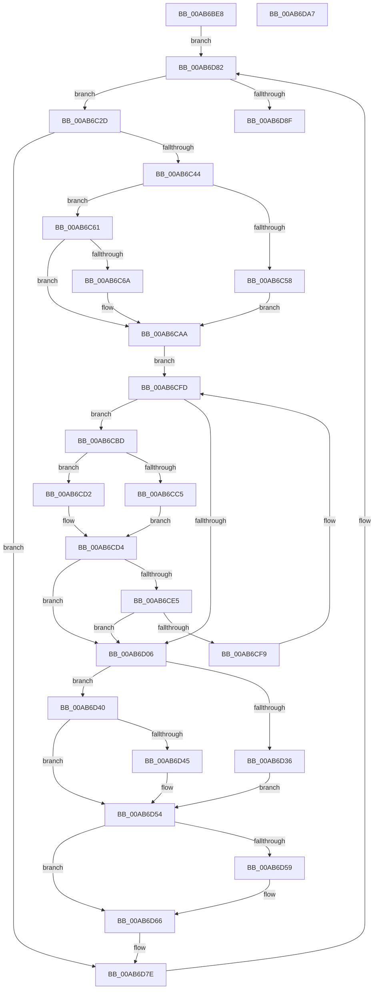

# PnpLogVetoInformation

- RVA: `0x00AB6BE8`–`0x00AB6DA8` (길이 `448` bytes)
- VA: `0x0000000140AB6BE8`
- 실행 섹션: `PAGE`
- PDB 이름 있음: `예`; PDB Function 태그: `아니요`
- unwind 정보 RVA: `0x000BCF10`
- 디코드: `131`개 명령, `448/448` bytes 표시
- 미해석 바이트: `0` (있으면 어셈블리에 `.byte`로 보존)

> 이 문서는 커널 이미지의 기계어와 PDB 기호를 분석해 생성했습니다. 4번과 5번은 함수 원형과 자료형을 바이너리 사용 방식에서 추정한 C 해석이며 원본 소스 복구 결과는 아닙니다.

## 1. Dependencies

- 직접 호출 지점: **17**; 고유 호출 대상: **14**
- 직접 호출자로 확인된 함수: **1**
- RIP 상대 이미지 참조: **1**

### Outgoing calls
- `0x00AB6C20` → [RtlInitUnicodeString](../../text/42/RtlInitUnicodeString_function_0042A780.md) (function, `0x0042A780`)
- `0x00AB6C37` → [PsLookupProcessByProcessId](../8A/PsLookupProcessByProcessId_function_008A2AA0.md) (function, `0x008A2AA0`)
- `0x00AB6C4F` → [PsGetAllocatedFullProcessImageName](../96/PsGetAllocatedFullProcessImageName_function_00960530.md) (function, `0x00960530`)
- `0x00AB6C79` → [ExFreePoolWithTag](../../poolcode/B8/ExFreePoolWithTag_function_00B82870.md) (function, `0x00B82870`)
- `0x00AB6C89` → [PsGetProcessImageFileName](../../text/45/PsGetProcessImageFileName_function_00453720.md) (function, `0x00453720`)
- `0x00AB6C95` → [RtlInitAnsiString](../../text/47/RtlInitAnsiString_function_00470F40.md) (function, `0x00470F40`)
- `0x00AB6CA5` → [RtlAnsiStringToUnicodeString](../90/RtlAnsiStringToUnicodeString_function_0090BEA0.md) (function, `0x0090BEA0`)
- `0x00AB6CB3` → [IopAllocateUnicodeString](../95/IopAllocateUnicodeString_function_00951F0C.md) (function, `0x00951F0C`)
- `0x00AB6CDC` → [RtlAppendUnicodeStringToString](../../text/40/RtlAppendUnicodeStringToString_function_0040FA50.md) (function, `0x0040FA50`)
- `0x00AB6CF0` → [RtlAppendUnicodeToString](../../text/40/RtlAppendUnicodeToString_function_0040F990.md) (function, `0x0040F990`)
- `0x00AB6D09` → [PnpGetProcessCommandLine](../73/PnpGetProcessCommandLine_function_00737FF4.md) (function, `0x00737FF4`)
- `0x00AB6D2C` → [PnpDiagnosticTraceAppVeto](../../text/5A/PnpDiagnosticTraceAppVeto_function_005A86FC.md) (function, `0x005A86FC`)
- `0x00AB6D39` → [RtlFreeAnsiString](../9C/RtlFreeAnsiString_function_009C0800.md) (function, `0x009C0800`)
- `0x00AB6D4A` → [ExFreePoolWithTag](../../poolcode/B8/ExFreePoolWithTag_function_00B82870.md) (function, `0x00B82870`)
- `0x00AB6D61` → [ExFreePoolWithTag](../../poolcode/B8/ExFreePoolWithTag_function_00B82870.md) (function, `0x00B82870`)
- `0x00AB6D6A` → [RtlFreeAnsiString](../9C/RtlFreeAnsiString_function_009C0800.md) (function, `0x009C0800`)
- `0x00AB6D77` → [ObfDereferenceObjectWithTag](../../text/2F/ObfDereferenceObjectWithTag_function_002F78E0.md) (function, `0x002F78E0`)

### Direct callers
- [PipSendQueryRemoveIrpAndCheckOpenHandles](../74/PipSendQueryRemoveIrpAndCheckOpenHandles_function_007443E8.md) at `0x007445BB`

### Static image references
- `0x00AB6CE5` → RVA `0x00AFCA20` (` ?? ::NNGAKEGL::`string'`; read)

## 2. Other-region calls and transfers

- 다른 실행 섹션으로 향하는 call: **10**
  - `0x00AB6C20` → [RtlInitUnicodeString](../../text/42/RtlInitUnicodeString_function_0042A780.md) (`PAGE` → `.text`)
  - `0x00AB6C79` → [ExFreePoolWithTag](../../poolcode/B8/ExFreePoolWithTag_function_00B82870.md) (`PAGE` → `POOLCODE`)
  - `0x00AB6C89` → [PsGetProcessImageFileName](../../text/45/PsGetProcessImageFileName_function_00453720.md) (`PAGE` → `.text`)
  - `0x00AB6C95` → [RtlInitAnsiString](../../text/47/RtlInitAnsiString_function_00470F40.md) (`PAGE` → `.text`)
  - `0x00AB6CDC` → [RtlAppendUnicodeStringToString](../../text/40/RtlAppendUnicodeStringToString_function_0040FA50.md) (`PAGE` → `.text`)
  - `0x00AB6CF0` → [RtlAppendUnicodeToString](../../text/40/RtlAppendUnicodeToString_function_0040F990.md) (`PAGE` → `.text`)
  - `0x00AB6D2C` → [PnpDiagnosticTraceAppVeto](../../text/5A/PnpDiagnosticTraceAppVeto_function_005A86FC.md) (`PAGE` → `.text`)
  - `0x00AB6D4A` → [ExFreePoolWithTag](../../poolcode/B8/ExFreePoolWithTag_function_00B82870.md) (`PAGE` → `POOLCODE`)
  - `0x00AB6D61` → [ExFreePoolWithTag](../../poolcode/B8/ExFreePoolWithTag_function_00B82870.md) (`PAGE` → `POOLCODE`)
  - `0x00AB6D77` → [ObfDereferenceObjectWithTag](../../text/2F/ObfDereferenceObjectWithTag_function_002F78E0.md) (`PAGE` → `.text`)
- 별도 외부 분기/꼬리 이동을 확인하지 못했습니다.

## 3. Assembly (complete function range)

```asm
00AB6BE8  48 89 5C 24 08                  mov qword ptr [rsp + 8], rbx
00AB6BED  55                              push rbp
00AB6BEE  56                              push rsi
00AB6BEF  57                              push rdi
00AB6BF0  41 54                           push r12
00AB6BF2  41 55                           push r13
00AB6BF4  41 56                           push r14
00AB6BF6  41 57                           push r15
00AB6BF8  48 8B EC                        mov rbp, rsp
00AB6BFB  48 83 EC 60                     sub rsp, 0x60
00AB6BFF  0F 57 C0                        xorps xmm0, xmm0
00AB6C02  33 F6                           xor esi, esi
00AB6C04  4C 8B FA                        mov r15, rdx
00AB6C07  48 89 75 48                     mov qword ptr [rbp + 0x48], rsi
00AB6C0B  4C 8B E9                        mov r13, rcx
00AB6C0E  48 89 75 50                     mov qword ptr [rbp + 0x50], rsi
00AB6C12  33 D2                           xor edx, edx
00AB6C14  48 8D 4D D0                     lea rcx, [rbp - 0x30]
00AB6C18  0F 11 45 F0                     movups xmmword ptr [rbp - 0x10], xmm0
00AB6C1C  0F 11 45 D0                     movups xmmword ptr [rbp - 0x30], xmm0
00AB6C20  E8 5B 3B 97 FF                  call 0x14042a780
00AB6C25  49 8B 07                        mov rax, qword ptr [r15]
00AB6C28  E9 55 01 00 00                  jmp 0x140ab6d82
00AB6C2D  8B 4F 10                        mov ecx, dword ptr [rdi + 0x10]
00AB6C30  48 8D 55 50                     lea rdx, [rbp + 0x50]
00AB6C34  44 8A E6                        mov r12b, sil
00AB6C37  E8 64 BE DE FF                  call 0x1408a2aa0
00AB6C3C  85 C0                           test eax, eax
00AB6C3E  0F 88 3A 01 00 00               js 0x140ab6d7e
00AB6C44  4C 8B 75 50                     mov r14, qword ptr [rbp + 0x50]
00AB6C48  48 8D 55 48                     lea rdx, [rbp + 0x48]
00AB6C4C  49 8B CE                        mov rcx, r14
00AB6C4F  E8 DC 98 EA FF                  call 0x140960530
00AB6C54  85 C0                           test eax, eax
00AB6C56  79 09                           jns 0x140ab6c61
00AB6C58  48 8B DE                        mov rbx, rsi
00AB6C5B  48 89 5D 48                     mov qword ptr [rbp + 0x48], rbx
00AB6C5F  EB 49                           jmp 0x140ab6caa
00AB6C61  48 8B 5D 48                     mov rbx, qword ptr [rbp + 0x48]
00AB6C65  66 39 33                        cmp word ptr [rbx], si
00AB6C68  75 40                           jne 0x140ab6caa
00AB6C6A  0F 57 C0                        xorps xmm0, xmm0
00AB6C6D  33 D2                           xor edx, edx
00AB6C6F  48 8B CB                        mov rcx, rbx
00AB6C72  41 B4 01                        mov r12b, 1
00AB6C75  0F 11 45 E0                     movups xmmword ptr [rbp - 0x20], xmm0
00AB6C79  E8 F2 BB 0C 00                  call 0x140b82870
00AB6C7E  48 8D 5D F0                     lea rbx, [rbp - 0x10]
00AB6C82  49 8B CE                        mov rcx, r14
00AB6C85  48 89 5D 48                     mov qword ptr [rbp + 0x48], rbx
00AB6C89  E8 92 CA 99 FF                  call 0x140453720
00AB6C8E  48 8B D0                        mov rdx, rax
00AB6C91  48 8D 4D E0                     lea rcx, [rbp - 0x20]
00AB6C95  E8 A6 A2 9B FF                  call 0x140470f40
00AB6C9A  45 8A C4                        mov r8b, r12b
00AB6C9D  48 8D 55 E0                     lea rdx, [rbp - 0x20]
00AB6CA1  48 8D 4D F0                     lea rcx, [rbp - 0x10]
00AB6CA5  E8 F6 51 E5 FF                  call 0x14090bea0
00AB6CAA  BA 90 0C 00 00                  mov edx, 0xc90
00AB6CAF  48 8D 4D D0                     lea rcx, [rbp - 0x30]
00AB6CB3  E8 54 B2 E9 FF                  call 0x140951f0c
00AB6CB8  48 8B 07                        mov rax, qword ptr [rdi]
00AB6CBB  EB 40                           jmp 0x140ab6cfd
00AB6CBD  48 8B 06                        mov rax, qword ptr [rsi]
00AB6CC0  48 85 C0                        test rax, rax
00AB6CC3  74 0D                           je 0x140ab6cd2
00AB6CC5  48 8B 80 38 01 00 00            mov rax, qword ptr [rax + 0x138]
00AB6CCC  48 8B 50 28                     mov rdx, qword ptr [rax + 0x28]
00AB6CD0  EB 02                           jmp 0x140ab6cd4
00AB6CD2  33 D2                           xor edx, edx
00AB6CD4  48 83 C2 28                     add rdx, 0x28
00AB6CD8  48 8D 4D D0                     lea rcx, [rbp - 0x30]
00AB6CDC  E8 6F 8D 95 FF                  call 0x14040fa50
00AB6CE1  85 C0                           test eax, eax
00AB6CE3  78 21                           js 0x140ab6d06
00AB6CE5  48 8D 15 34 5D 04 00            lea rdx, [rip + 0x45d34]
00AB6CEC  48 8D 4D D0                     lea rcx, [rbp - 0x30]
00AB6CF0  E8 9B 8C 95 FF                  call 0x14040f990
00AB6CF5  85 C0                           test eax, eax
00AB6CF7  78 0D                           js 0x140ab6d06
00AB6CF9  48 8B 46 08                     mov rax, qword ptr [rsi + 8]
00AB6CFD  48 8D 70 F8                     lea rsi, [rax - 8]
00AB6D01  48 3B F8                        cmp rdi, rax
00AB6D04  75 B7                           jne 0x140ab6cbd
00AB6D06  49 8B CE                        mov rcx, r14
00AB6D09  E8 E6 12 C8 FF                  call 0x140737ff4
00AB6D0E  41 8B 96 D0 01 00 00            mov edx, dword ptr [r14 + 0x1d0]
00AB6D15  48 8B F0                        mov rsi, rax
00AB6D18  48 8D 45 D0                     lea rax, [rbp - 0x30]
00AB6D1C  4D 8B CD                        mov r9, r13
00AB6D1F  48 89 44 24 28                  mov qword ptr [rsp + 0x28], rax
00AB6D24  4C 8B C3                        mov r8, rbx
00AB6D27  48 89 74 24 20                  mov qword ptr [rsp + 0x20], rsi
00AB6D2C  E8 CB 19 AF FF                  call 0x1405a86fc
00AB6D31  45 84 E4                        test r12b, r12b
00AB6D34  74 0A                           je 0x140ab6d40
00AB6D36  48 8B CB                        mov rcx, rbx
00AB6D39  E8 C2 9A F0 FF                  call 0x1409c0800
00AB6D3E  EB 14                           jmp 0x140ab6d54
00AB6D40  48 85 DB                        test rbx, rbx
00AB6D43  74 0F                           je 0x140ab6d54
00AB6D45  33 D2                           xor edx, edx
00AB6D47  48 8B CB                        mov rcx, rbx
00AB6D4A  E8 21 BB 0C 00                  call 0x140b82870
00AB6D4F  48 83 65 48 00                  and qword ptr [rbp + 0x48], 0
00AB6D54  48 85 F6                        test rsi, rsi
00AB6D57  74 0D                           je 0x140ab6d66
00AB6D59  BA 50 6E 70 4F                  mov edx, 0x4f706e50
00AB6D5E  48 8B CE                        mov rcx, rsi
00AB6D61  E8 0A BB 0C 00                  call 0x140b82870
00AB6D66  48 8D 4D D0                     lea rcx, [rbp - 0x30]
00AB6D6A  E8 91 9A F0 FF                  call 0x1409c0800
00AB6D6F  BA 44 66 6C 74                  mov edx, 0x746c6644
00AB6D74  49 8B CE                        mov rcx, r14
00AB6D77  E8 64 0B 84 FF                  call 0x1402f78e0
00AB6D7C  33 F6                           xor esi, esi
00AB6D7E  48 8B 47 18                     mov rax, qword ptr [rdi + 0x18]
00AB6D82  48 8D 78 E8                     lea rdi, [rax - 0x18]
00AB6D86  4C 3B F8                        cmp r15, rax
00AB6D89  0F 85 9E FE FF FF               jne 0x140ab6c2d
00AB6D8F  48 8B 9C 24 A0 00 00 00         mov rbx, qword ptr [rsp + 0xa0]
00AB6D97  48 83 C4 60                     add rsp, 0x60
00AB6D9B  41 5F                           pop r15
00AB6D9D  41 5E                           pop r14
00AB6D9F  41 5D                           pop r13
00AB6DA1  41 5C                           pop r12
00AB6DA3  5F                              pop rdi
00AB6DA4  5E                              pop rsi
00AB6DA5  5D                              pop rbp
00AB6DA6  C3                              ret
00AB6DA7  CC                              int3
```

## 4. C-style interpretation (structured pseudocode)

```c
__int64 __fastcall PnpLogVetoInformation(__int64 a1, __int64 a2)
{
    __int64 result;
    __int64 v_r12;
    __int64 v_rbx;
    __int64 v_rsi;
    __int64 v_rsp;
    unsigned __int64 v_stack_m48;
    unsigned __int64 v_stack_m58;
    unsigned __int64 v_stack_m68;
    unsigned __int64 v_stack_m70;
    unsigned __int64 v_stack_m78;
    unsigned __int64 v_stack_p10;
    unsigned __int64 v_stack_p18;
    unsigned __int64 v_stack_p8;

    v_stack_p8 = v_rbx;
    v_rsp = (v_rsp) - (96);
    v_rsi = 0;
    v_stack_p10 = 0;
    v_stack_p18 = 0;
    a2 = 0;
    v_stack_m48 = v_xmm0;
    v_stack_m68 = v_xmm0;
    result = RtlInitUnicodeString(v_stack_m68, a2, a3, a4);
    goto loc_00AB6D82;
loc_00AB6C2D:
    result = PsLookupProcessByProcessId((unsigned int)(*(unsigned int *)(v_rdi + 16)), v_stack_p18, a3, a4);
    if (sign_flag) goto loc_00AB6D7E;
    result = PsGetAllocatedFullProcessImageName(v_stack_p18, v_stack_p10, a3, a4);
    if (!sign_flag) goto loc_00AB6C61;
    v_stack_p10 = 0;
    goto loc_00AB6CAA;
loc_00AB6C61:
    v_rbx = v_stack_p10;
    v_r12 = 0;
    if ((*(unsigned __int16 *)(v_stack_p10)) == 0) {
        a2 = 0;
        a1 = v_stack_p10;
        v_r12 = 1;
        v_stack_m58 = v_xmm0;
        result = ExFreePoolWithTag(a1, a2, a3, a4);
        v_rbx = v_stack_m48;
        a1 = v_stack_p18;
        v_stack_p10 = v_rbx;
        result = PsGetProcessImageFileName(a1, a2, a3, a4);
        a2 = result;
        a1 = v_stack_m58;
        result = RtlInitAnsiString(a1, a2, a3, a4);
        a3 = (unsigned __int8)(v_r12);
        a2 = v_stack_m58;
        a1 = v_stack_m48;
        result = RtlAnsiStringToUnicodeString(a1, a2, a3, a4);
    }
    result = IopAllocateUnicodeString(v_stack_m68, (unsigned int)(0xC90ULL), a3, a4);
    goto loc_00AB6CFD;
loc_00AB6CBD:
    if (*(unsigned __int64 *)(v_rsi) == 0) goto loc_00AB6CD2;
    goto loc_00AB6CD4;
loc_00AB6CD2:
    a2 = 0;
loc_00AB6CD4:
    a2 = (a2) + (40);
    result = RtlAppendUnicodeStringToString(v_stack_m68, a2, a3, a4);
    if (sign_flag) goto loc_00AB6D06;
    result = RtlAppendUnicodeToString(v_stack_m68, v_rip + 286004, a3, a4);
    if (sign_flag) goto loc_00AB6D06;
loc_00AB6CFD:
    if (v_rdi != (*(unsigned __int64 *)(v_rsi + 8))) goto loc_00AB6CBD;
loc_00AB6D06:
    result = PnpGetProcessCommandLine(v_stack_p18, v_rip + 286004, a3, a4);
    v_stack_m70 = v_stack_m68;
    v_stack_m78 = result;
    result = PnpDiagnosticTraceAppVeto(v_stack_p18, (unsigned int)(*(unsigned int *)(v_stack_p18 + 464)), v_rbx, a1);
    if ((unsigned __int8)(v_r12) == 0) goto loc_00AB6D40;
    result = RtlFreeAnsiString(v_rbx, (unsigned int)(*(unsigned int *)(v_stack_p18 + 464)), v_rbx, a1);
    goto loc_00AB6D54;
loc_00AB6D40:
    if (v_rbx != 0) {
        a2 = 0;
        a1 = v_rbx;
        result = ExFreePoolWithTag(a1, a2, v_rbx, a1);
    }
    if (result != 0) {
        a2 = 0x4F706E50ULL;
        a1 = result;
        result = ExFreePoolWithTag(a1, a2, v_rbx, a1);
    }
    result = RtlFreeAnsiString(v_stack_m68, a2, v_rbx, a1);
    result = ObfDereferenceObjectWithTag(v_stack_p18, (unsigned int)(0x746C6644ULL), v_rbx, a1);
    v_rsi = 0;
loc_00AB6D7E:
loc_00AB6D82:
    if (a2 != (*(unsigned __int64 *)(v_rdi + 24))) goto loc_00AB6C2D;
    v_rsp = (v_rsp) + (96);
    return *(unsigned __int64 *)(v_rdi + 24);
}
```

## 5. (Beta) C Style

```c
int64_t PnpLogVetoInformation(int64_t Arg1, void *Arg2)
{
    uint8_t *arg2 = (uint8_t *)Arg2;

    int64_t result;
    int64_t local_r12;
    int64_t local_rbx;
    int64_t local_rsi;
    int64_t local_rsp;
    uint64_t v_stack_m48;
    uint64_t v_stack_m58;
    uint64_t v_stack_m68;
    uint64_t v_stack_m70;
    uint64_t v_stack_m78;
    uint64_t v_stack_p10;
    uint64_t v_stack_p18;
    uint64_t v_stack_p8;

    v_stack_p8 = local_rbx;
    local_rsp = (local_rsp) - (96);
    local_rsi = 0;
    v_stack_p10 = 0;
    v_stack_p18 = 0;
    Arg2 = 0;
    v_stack_m48 = v_xmm0;
    v_stack_m68 = v_xmm0;
    result = RtlInitUnicodeString(v_stack_m68, Arg2, a3, a4);
    goto loc_00AB6D82;
loc_00AB6C2D:
    result = PsLookupProcessByProcessId((uint32_t)(*(uint32_t *)(local_rdi + 0x10)), v_stack_p18, a3, a4);
    if (sign_flag) goto loc_00AB6D7E;
    result = PsGetAllocatedFullProcessImageName(v_stack_p18, v_stack_p10, a3, a4);
    if (!sign_flag) goto loc_00AB6C61;
    v_stack_p10 = 0;
    goto loc_00AB6CAA;
loc_00AB6C61:
    local_rbx = v_stack_p10;
    local_r12 = 0;
    if ((*(uint16_t *)(v_stack_p10)) == 0) {
        Arg2 = 0;
        Arg1 = v_stack_p10;
        local_r12 = 1;
        v_stack_m58 = v_xmm0;
        result = ExFreePoolWithTag(Arg1, Arg2, a3, a4);
        local_rbx = v_stack_m48;
        Arg1 = v_stack_p18;
        v_stack_p10 = local_rbx;
        result = PsGetProcessImageFileName(Arg1, Arg2, a3, a4);
        Arg2 = result;
        Arg1 = v_stack_m58;
        result = RtlInitAnsiString(Arg1, Arg2, a3, a4);
        a3 = (uint8_t)(local_r12);
        Arg2 = v_stack_m58;
        Arg1 = v_stack_m48;
        result = RtlAnsiStringToUnicodeString(Arg1, Arg2, a3, a4);
    }
    result = IopAllocateUnicodeString(v_stack_m68, (uint32_t)(0xC90ULL), a3, a4);
    goto loc_00AB6CFD;
loc_00AB6CBD:
    if (*(uint64_t *)(local_rsi) == 0) goto loc_00AB6CD2;
    goto loc_00AB6CD4;
loc_00AB6CD2:
    Arg2 = 0;
loc_00AB6CD4:
    Arg2 = (Arg2) + (40);
    result = RtlAppendUnicodeStringToString(v_stack_m68, Arg2, a3, a4);
    if (sign_flag) goto loc_00AB6D06;
    result = RtlAppendUnicodeToString(v_stack_m68, v_rip + 286004, a3, a4);
    if (sign_flag) goto loc_00AB6D06;
loc_00AB6CFD:
    if (local_rdi != (*(uint64_t *)(local_rsi + 0x8))) goto loc_00AB6CBD;
loc_00AB6D06:
    result = PnpGetProcessCommandLine(v_stack_p18, v_rip + 286004, a3, a4);
    v_stack_m70 = v_stack_m68;
    v_stack_m78 = result;
    result = PnpDiagnosticTraceAppVeto(v_stack_p18, (uint32_t)(*(uint32_t *)(v_stack_p18 + 0x1D0)), local_rbx, Arg1);
    if ((uint8_t)(local_r12) == 0) goto loc_00AB6D40;
    result = RtlFreeAnsiString(local_rbx, (uint32_t)(*(uint32_t *)(v_stack_p18 + 0x1D0)), local_rbx, Arg1);
    goto loc_00AB6D54;
loc_00AB6D40:
    if (local_rbx != 0) {
        Arg2 = 0;
        Arg1 = local_rbx;
        result = ExFreePoolWithTag(Arg1, Arg2, local_rbx, Arg1);
    }
    if (result != 0) {
        Arg2 = 0x4F706E50ULL;
        Arg1 = result;
        result = ExFreePoolWithTag(Arg1, Arg2, local_rbx, Arg1);
    }
    result = RtlFreeAnsiString(v_stack_m68, Arg2, local_rbx, Arg1);
    result = ObfDereferenceObjectWithTag(v_stack_p18, (uint32_t)(0x746C6644ULL), local_rbx, Arg1);
    local_rsi = 0;
loc_00AB6D7E:
loc_00AB6D82:
    if (Arg2 != (*(uint64_t *)(local_rdi + 0x18))) goto loc_00AB6C2D;
    local_rsp = (local_rsp) + (96);
    return *(uint64_t *)(local_rdi + 0x18);
}
```

### 관측된 메모리 오프셋

구조체 형식이 확인되지 않은 접근은 인자 기준의 오프셋으로만 기록했습니다.

| 기준 인자 | 오프셋 표현 | 폭 (bit) | 접근 |
|---|---:|---:|---|
| `Arg2` | `+ 0x0` | `64` | `R` |

## 6. Execution-region graph

[열기: 2D/3D 그래프와 함수 탐색 컨트롤 패널](../../../control-panel.html?section=page&rva=0x00AB6BE8&view=graph)

- 2D 그래프는 위에서 아래로 흐르고, 3D 그래프는 빈 공간을 드래그해 회전합니다. Shift+드래그는 이동, 휠은 확대·축소, 함수 노드 선택은 대상 보고서 이동입니다.

### Static fallback


