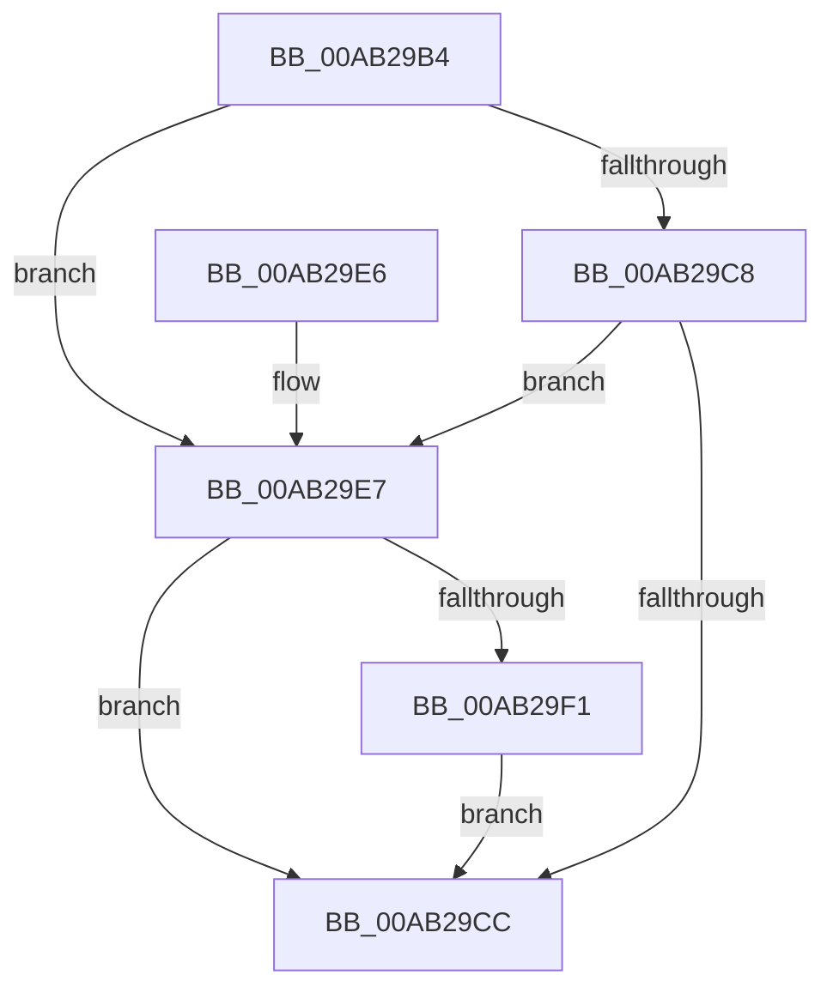

# PopClearSystemSleepCheckpoint

- RVA: `0x00AB29B4`–`0x00AB2A1E` (길이 `106` bytes)
- VA: `0x0000000140AB29B4`
- 실행 섹션: `PAGE`
- PDB 이름 있음: `예`; PDB Function 태그: `아니요`
- unwind 정보 RVA: `0x000BC988`
- 디코드: `30`개 명령, `106/106` bytes 표시
- 미해석 바이트: `0` (있으면 어셈블리에 `.byte`로 보존)

> 이 문서는 커널 이미지의 기계어와 PDB 기호를 분석해 생성했습니다. 4번과 5번은 함수 원형과 자료형을 바이너리 사용 방식에서 추정한 C 해석이며 원본 소스 복구 결과는 아닙니다.

## 1. Dependencies

- 직접 호출 지점: **1**; 고유 호출 대상: **1**
- 직접 호출자로 확인된 함수: **2**
- RIP 상대 이미지 참조: **7**

### Outgoing calls
- `0x00AB2A0D` → [ExSetFirmwareEnvironmentVariable](../7C/ExSetFirmwareEnvironmentVariable_function_007CAE70.md) (function, `0x007CAE70`)

### Direct callers
- [PopUnlockAfterSleepWorker](../../pagelk/B7/PopUnlockAfterSleepWorker_function_00B782A0.md) at `0x00B78348`
- [PopCheckShutdownMarker](../../init/C3/PopCheckShutdownMarker_function_00C3DAD4.md) at `0x00C3DF69`

### Static image references
- `0x00AB29BA` → RVA `0x00F0C9D4` (`.data`; read)
- `0x00AB29CC` → RVA `0x00F0C9D4` (`.data`; write)
- `0x00AB29D4` → RVA `0x00F0C9DC` (`.data`; write)
- `0x00AB29DA` → RVA `0x00F0C2E8` (`.data`; read/write)
- `0x00AB29E7` → RVA `0x00F0C9CC` (`.data`; read)
- `0x00AB29FF` → RVA `0x000260A8` (`.rdata`; read)
- `0x00AB2A06` → RVA `0x0000B420` (`.rdata`; read)

## 2. Other-region calls and transfers

- 다른 실행 섹션으로 향하는 call: **0**
- 별도 외부 분기/꼬리 이동을 확인하지 못했습니다.

## 3. Assembly (complete function range)

```asm
00AB29B4  40 53                           push rbx
00AB29B6  48 83 EC 30                     sub rsp, 0x30
00AB29BA  8B 05 14 A0 45 00               mov eax, dword ptr [rip + 0x45a014]
00AB29C0  33 DB                           xor ebx, ebx
00AB29C2  8B D3                           mov edx, ebx
00AB29C4  85 C0                           test eax, eax
00AB29C6  75 1F                           jne 0x140ab29e7
00AB29C8  84 C9                           test cl, cl
00AB29CA  75 1B                           jne 0x140ab29e7
00AB29CC  89 1D 02 A0 45 00               mov dword ptr [rip + 0x45a002], ebx
00AB29D2  8B C2                           mov eax, edx
00AB29D4  89 1D 02 A0 45 00               mov dword ptr [rip + 0x45a002], ebx
00AB29DA  87 1D 08 99 45 00               xchg dword ptr [rip + 0x459908], ebx
00AB29E0  48 83 C4 30                     add rsp, 0x30
00AB29E4  5B                              pop rbx
00AB29E5  C3                              ret
00AB29E6  CC                              int3
00AB29E7  8B 05 DF 9F 45 00               mov eax, dword ptr [rip + 0x459fdf]
00AB29ED  A8 02                           test al, 2
00AB29EF  75 DB                           jne 0x140ab29cc
00AB29F1  45 33 C9                        xor r9d, r9d
00AB29F4  C7 44 24 20 01 00 00 00         mov dword ptr [rsp + 0x20], 1
00AB29FC  45 33 C0                        xor r8d, r8d
00AB29FF  48 8D 15 A2 36 57 FF            lea rdx, [rip - 0xa8c95e]
00AB2A06  48 8D 0D 13 8A 55 FF            lea rcx, [rip - 0xaa75ed]
00AB2A0D  E8 5E 84 D1 FF                  call 0x1407cae70
00AB2A12  3D 00 01 00 C0                  cmp eax, 0xc0000100
00AB2A17  8B D0                           mov edx, eax
00AB2A19  0F 44 D3                        cmove edx, ebx
00AB2A1C  EB AE                           jmp 0x140ab29cc
```

## 4. C-style interpretation (structured pseudocode)

```c
__int64 __fastcall PopClearSystemSleepCheckpoint(unsigned __int8 a1, __int64 a2, int a3, int a4)
{
    __int64 result;
    __int64 v_rbx;
    __int64 v_rsp;
    unsigned int v_stack_p20;

    v_rsp = (v_rsp) - (48);
    v_rbx = 0;
    if ((unsigned int)((unsigned int)(*(unsigned int *)(v_rip + 4562964))) != 0) goto loc_00AB29E7;
    if (a1 != 0) goto loc_00AB29E7;
loc_00AB29CC:
    *(unsigned int *)(v_rip + 4562946) = 0;
    *(unsigned int *)(v_rip + 4562946) = 0;
    v_rsp = (v_rsp) + (48);
    return 0;
loc_00AB29E7:
    if ((((unsigned __int8)((unsigned int)(*(unsigned int *)(v_rip + 4562911)))) & (2)) != 0) goto loc_00AB29CC;
    a4 = 0;
    v_stack_p20 = 1;
    a3 = 0;
    result = ExSetFirmwareEnvironmentVariable(v_rip - 11171309, v_rip - 11061598, a3, a4);
    a2 = (unsigned int)((unsigned int)(result));
    if (((unsigned int)(result)) == 0xC0000100ULL) { a2 = 0; }
    goto loc_00AB29CC;
}
```

## 5. (Beta) C Style

```c
int64_t PopClearSystemSleepCheckpoint(uint8_t Arg1, int64_t Arg2, int32_t Arg3, int32_t Arg4)
{
    int64_t result;
    int64_t local_rbx;
    int64_t local_rsp;
    uint32_t v_stack_p20;

    local_rsp = (local_rsp) - (48);
    local_rbx = 0;
    if ((uint32_t)((uint32_t)(*(uint32_t *)(v_rip + 0x45A014))) != 0) goto loc_00AB29E7;
    if (Arg1 != 0) goto loc_00AB29E7;
loc_00AB29CC:
    *(uint32_t *)(v_rip + 0x45A002) = 0;
    *(uint32_t *)(v_rip + 0x45A002) = 0;
    local_rsp = (local_rsp) + (48);
    return 0;
loc_00AB29E7:
    if ((((uint8_t)((uint32_t)(*(uint32_t *)(v_rip + 0x459FDF)))) & (2)) != 0) goto loc_00AB29CC;
    Arg4 = 0;
    v_stack_p20 = 1;
    Arg3 = 0;
    result = ExSetFirmwareEnvironmentVariable(v_rip - 11171309, v_rip - 11061598, Arg3, Arg4);
    Arg2 = (uint32_t)((uint32_t)(result));
    if (((uint32_t)(result)) == 0xC0000100ULL) { Arg2 = 0; }
    goto loc_00AB29CC;
}
```

## 6. Execution-region graph

[열기: 2D/3D 그래프와 함수 탐색 컨트롤 패널](../../../control-panel.html?section=page&rva=0x00AB29B4&view=graph)

- 2D 그래프는 위에서 아래로 흐르고, 3D 그래프는 빈 공간을 드래그해 회전합니다. Shift+드래그는 이동, 휠은 확대·축소, 함수 노드 선택은 대상 보고서 이동입니다.

### Static fallback


