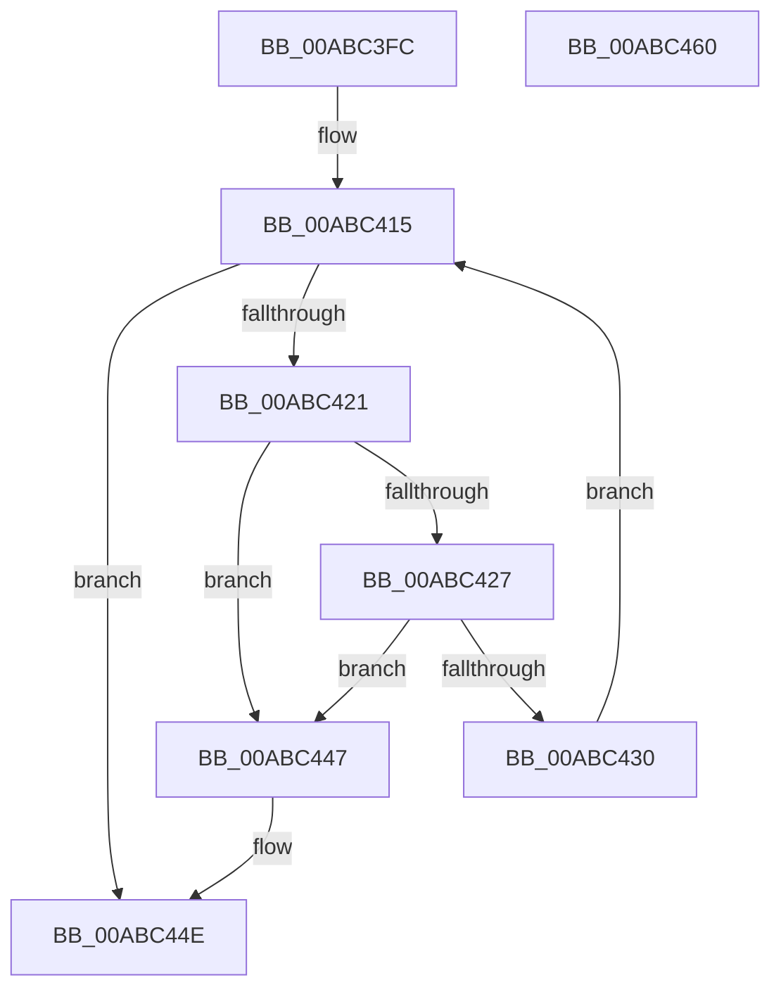

# PopClearTransitionCheckpoints

- RVA: `0x00ABC3FC`–`0x00ABC461` (길이 `101` bytes)
- VA: `0x0000000140ABC3FC`
- 실행 섹션: `PAGE`
- PDB 이름 있음: `예`; PDB Function 태그: `아니요`
- unwind 정보 RVA: `0x0005CF00`
- 디코드: `26`개 명령, `101/101` bytes 표시
- 미해석 바이트: `0` (있으면 어셈블리에 `.byte`로 보존)

> 이 문서는 커널 이미지의 기계어와 PDB 기호를 분석해 생성했습니다. 4번과 5번은 함수 원형과 자료형을 바이너리 사용 방식에서 추정한 C 해석이며 원본 소스 복구 결과는 아닙니다.

## 1. Dependencies

- 직접 호출 지점: **3**; 고유 호출 대상: **3**
- 직접 호출자로 확인된 함수: **1**
- RIP 상대 이미지 참조: **3**

### Outgoing calls
- `0x00ABC409` → [PopAcquireRwLockExclusive](../../text/43/PopAcquireRwLockExclusive_function_00430B44.md) (function, `0x00430B44`)
- `0x00ABC440` → [ExFreePoolWithTag](../../poolcode/B8/ExFreePoolWithTag_function_00B82870.md) (function, `0x00B82870`)
- `0x00ABC455` → [PopReleaseRwLock](../../text/2D/PopReleaseRwLock_function_002DFBBC.md) (function, `0x002DFBBC`)

### Direct callers
- [PopUnlockAfterSleepWorker](../../pagelk/B7/PopUnlockAfterSleepWorker_function_00B782A0.md) at `0x00B7833C`

### Static image references
- `0x00ABC402` → RVA `0x00F0F0B0` (`.data`; read)
- `0x00ABC40E` → RVA `0x00F0F090` (`.data`; read)
- `0x00ABC430` → RVA `0x00F0F090` (`.data`; write)

## 2. Other-region calls and transfers

- 다른 실행 섹션으로 향하는 call: **3**
  - `0x00ABC409` → [PopAcquireRwLockExclusive](../../text/43/PopAcquireRwLockExclusive_function_00430B44.md) (`PAGE` → `.text`)
  - `0x00ABC440` → [ExFreePoolWithTag](../../poolcode/B8/ExFreePoolWithTag_function_00B82870.md) (`PAGE` → `POOLCODE`)
  - `0x00ABC455` → [PopReleaseRwLock](../../text/2D/PopReleaseRwLock_function_002DFBBC.md) (`PAGE` → `.text`)
- 별도 외부 분기/꼬리 이동을 확인하지 못했습니다.

## 3. Assembly (complete function range)

```asm
00ABC3FC  40 53                           push rbx
00ABC3FE  48 83 EC 20                     sub rsp, 0x20
00ABC402  48 8D 0D A7 2C 45 00            lea rcx, [rip + 0x452ca7]
00ABC409  E8 36 47 97 FF                  call 0x140430b44
00ABC40E  48 8D 1D 7B 2C 45 00            lea rbx, [rip + 0x452c7b]
00ABC415  48 8B 0D 74 2C 45 00            mov rcx, qword ptr [rip + 0x452c74]
00ABC41C  48 3B CB                        cmp rcx, rbx
00ABC41F  74 2D                           je 0x140abc44e
00ABC421  48 39 59 08                     cmp qword ptr [rcx + 8], rbx
00ABC425  75 20                           jne 0x140abc447
00ABC427  48 8B 01                        mov rax, qword ptr [rcx]
00ABC42A  48 39 48 08                     cmp qword ptr [rax + 8], rcx
00ABC42E  75 17                           jne 0x140abc447
00ABC430  48 89 05 59 2C 45 00            mov qword ptr [rip + 0x452c59], rax
00ABC437  BA 50 4B 43 50                  mov edx, 0x50434b50
00ABC43C  48 89 58 08                     mov qword ptr [rax + 8], rbx
00ABC440  E8 2B 64 0C 00                  call 0x140b82870
00ABC445  EB CE                           jmp 0x140abc415
00ABC447  B9 03 00 00 00                  mov ecx, 3
00ABC44C  CD 29                           int 0x29
00ABC44E  48 8D 0D 5B 2C 45 00            lea rcx, [rip + 0x452c5b]
00ABC455  E8 62 37 82 FF                  call 0x1402dfbbc
00ABC45A  48 83 C4 20                     add rsp, 0x20
00ABC45E  5B                              pop rbx
00ABC45F  C3                              ret
00ABC460  CC                              int3
```

## 4. C-style interpretation (structured pseudocode)

```c
__int64 __fastcall PopClearTransitionCheckpoints(void)
{
    __int64 result;
    __int64 v_rsp;

    v_rsp = (v_rsp) - (32);
    result = PopAcquireRwLockExclusive(v_rip + 4533415, a2, a3, a4);
loc_00ABC415:
    if ((*(unsigned __int64 *)(v_rip + 4533364)) == (v_rip + 4533371)) goto loc_00ABC44E;
    if ((*(unsigned __int64 *)(*(unsigned __int64 *)(v_rip + 4533364) + 8)) != (v_rip + 4533371)) goto loc_00ABC447;
    if ((*(unsigned __int64 *)(*(unsigned __int64 *)(*(unsigned __int64 *)(v_rip + 4533364)) + 8)) != (*(unsigned __int64 *)(v_rip + 4533364))) goto loc_00ABC447;
    *(unsigned __int64 *)(v_rip + 4533337) = *(unsigned __int64 *)(*(unsigned __int64 *)(v_rip + 4533364));
    *(unsigned __int64 *)(*(unsigned __int64 *)(*(unsigned __int64 *)(v_rip + 4533364)) + 8) = v_rip + 4533371;
    result = ExFreePoolWithTag(*(unsigned __int64 *)(v_rip + 4533364), (unsigned int)(0x50434B50ULL), a3, a4);
    goto loc_00ABC415;
loc_00ABC447:
loc_00ABC44E:
    result = PopReleaseRwLock(v_rip + 4533339, (unsigned int)(0x50434B50ULL), a3, a4);
    v_rsp = (v_rsp) + (32);
    return result;
}
```

## 5. (Beta) C Style

```c
void PopClearTransitionCheckpoints(void)
{
    int64_t result;
    int64_t local_rsp;

    local_rsp = (local_rsp) - (32);
    result = PopAcquireRwLockExclusive(v_rip + 4533415, a2, a3, a4);
loc_00ABC415:
    if ((*(uint64_t *)(v_rip + 0x452C74)) == (v_rip + 4533371)) goto loc_00ABC44E;
    if ((*(uint64_t *)(*(uint64_t *)(v_rip + 0x452C74) + 0x8)) != (v_rip + 4533371)) goto loc_00ABC447;
    if ((*(uint64_t *)(*(uint64_t *)(*(uint64_t *)(v_rip + 0x452C74)) + 0x8)) != (*(uint64_t *)(v_rip + 0x452C74))) goto loc_00ABC447;
    *(uint64_t *)(v_rip + 0x452C59) = *(uint64_t *)(*(uint64_t *)(v_rip + 0x452C74));
    *(uint64_t *)(*(uint64_t *)(*(uint64_t *)(v_rip + 0x452C74)) + 0x8) = v_rip + 4533371;
    result = ExFreePoolWithTag(*(uint64_t *)(v_rip + 0x452C74), (uint32_t)(0x50434B50ULL), a3, a4);
    goto loc_00ABC415;
loc_00ABC447:
loc_00ABC44E:
    result = PopReleaseRwLock(v_rip + 4533339, (uint32_t)(0x50434B50ULL), a3, a4);
    local_rsp = (local_rsp) + (32);
    return result;
}
```

## 6. Execution-region graph

[열기: 2D/3D 그래프와 함수 탐색 컨트롤 패널](../../../control-panel.html?section=page&rva=0x00ABC3FC&view=graph)

- 2D 그래프는 위에서 아래로 흐르고, 3D 그래프는 빈 공간을 드래그해 회전합니다. Shift+드래그는 이동, 휠은 확대·축소, 함수 노드 선택은 대상 보고서 이동입니다.

### Static fallback


