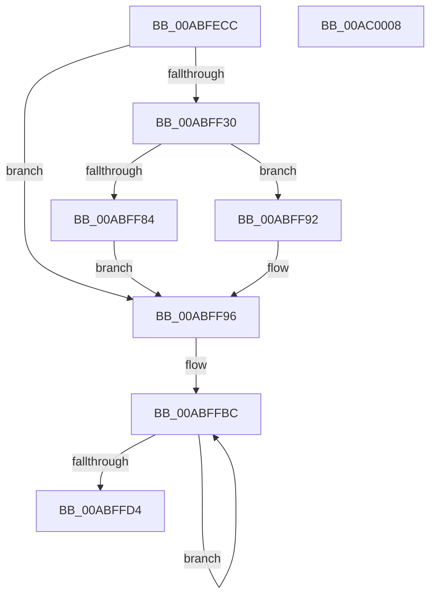

# PopDiagTraceCsConsumption

- RVA: `0x00ABFECC`–`0x00AC0009` (길이 `317` bytes)
- VA: `0x0000000140ABFECC`
- 실행 섹션: `PAGE`
- PDB 이름 있음: `예`; PDB Function 태그: `아니요`
- unwind 정보 RVA: `0x000BD7A0`
- 디코드: `85`개 명령, `317/317` bytes 표시
- 미해석 바이트: `0` (있으면 어셈블리에 `.byte`로 보존)

> 이 문서는 커널 이미지의 기계어와 PDB 기호를 분석해 생성했습니다. 4번과 5번은 함수 원형과 자료형을 바이너리 사용 방식에서 추정한 C 해석이며 원본 소스 복구 결과는 아닙니다.

## 1. Dependencies

- 직접 호출 지점: **2**; 고유 호출 대상: **2**
- 직접 호출자로 확인된 함수: **1**
- RIP 상대 이미지 참조: **3**

### Outgoing calls
- `0x00ABFFEE` → [EtwWrite](../../text/41/EtwWrite_function_0041C720.md) (function, `0x0041C720`)
- `0x00ABFFFA` → [_security_check_cookie](../../text/6A/_security_check_cookie_function_006AC640.md) (function, `0x006AC640`)

### Direct callers
- [PopCaptureSleepStudyStatistics](../../text/43/PopCaptureSleepStudyStatistics_function_004399F4.md) at `0x00439F68`

### Static image references
- `0x00ABFEDA` → RVA `0x00E0A740` (`.data`; read)
- `0x00ABFFD4` → RVA `0x00F0B408` (`.data`; read)
- `0x00ABFFE7` → RVA `0x0001E800` (`.rdata`; read)

## 2. Other-region calls and transfers

- 다른 실행 섹션으로 향하는 call: **2**
  - `0x00ABFFEE` → [EtwWrite](../../text/41/EtwWrite_function_0041C720.md) (`PAGE` → `.text`)
  - `0x00ABFFFA` → [_security_check_cookie](../../text/6A/_security_check_cookie_function_006AC640.md) (`PAGE` → `.text`)
- 별도 외부 분기/꼬리 이동을 확인하지 못했습니다.

## 3. Assembly (complete function range)

```asm
00ABFECC  40 55                           push rbp
00ABFECE  48 8D 6C 24 A9                  lea rbp, [rsp - 0x57]
00ABFED3  48 81 EC 90 00 00 00            sub rsp, 0x90
00ABFEDA  48 8B 05 5F A8 34 00            mov rax, qword ptr [rip + 0x34a85f]
00ABFEE1  48 33 C4                        xor rax, rsp
00ABFEE4  48 89 45 47                     mov qword ptr [rbp + 0x47], rax
00ABFEE8  4C 8B 41 20                     mov r8, qword ptr [rcx + 0x20]
00ABFEEC  0F 57 C0                        xorps xmm0, xmm0
00ABFEEF  8B 01                           mov eax, dword ptr [rcx]
00ABFEF1  44 8B 49 38                     mov r9d, dword ptr [rcx + 0x38]
00ABFEF5  4C 8B 91 90 00 00 00            mov r10, qword ptr [rcx + 0x90]
00ABFEFC  44 8A 99 88 00 00 00            mov r11b, byte ptr [rcx + 0x88]
00ABFF03  0F 11 45 F7                     movups xmmword ptr [rbp - 9], xmm0
00ABFF07  89 45 F7                        mov dword ptr [rbp - 9], eax
00ABFF0A  48 B8 51 AE 4D 87 72 C6 54 1E   movabs rax, 0x1e54c672874dae51
00ABFF14  49 F7 E0                        mul r8
00ABFF17  49 8B C0                        mov rax, r8
00ABFF1A  48 2B C2                        sub rax, rdx
00ABFF1D  48 D1 E8                        shr rax, 1
00ABFF20  48 03 C2                        add rax, rdx
00ABFF23  48 C1 E8 19                     shr rax, 0x19
00ABFF27  66 89 45 FB                     mov word ptr [rbp - 5], ax
00ABFF2B  4D 85 C0                        test r8, r8
00ABFF2E  74 66                           je 0x140abff96
00ABFF30  48 6B 41 28 64                  imul rax, qword ptr [rcx + 0x28], 0x64
00ABFF35  33 D2                           xor edx, edx
00ABFF37  49 F7 F0                        div r8
00ABFF3A  33 D2                           xor edx, edx
00ABFF3C  88 45 FD                        mov byte ptr [rbp - 3], al
00ABFF3F  48 6B 41 30 64                  imul rax, qword ptr [rcx + 0x30], 0x64
00ABFF44  49 F7 F0                        div r8
00ABFF47  33 D2                           xor edx, edx
00ABFF49  88 45 FE                        mov byte ptr [rbp - 2], al
00ABFF4C  48 6B 41 40 64                  imul rax, qword ptr [rcx + 0x40], 0x64
00ABFF51  49 F7 F0                        div r8
00ABFF54  33 D2                           xor edx, edx
00ABFF56  88 45 01                        mov byte ptr [rbp + 1], al
00ABFF59  48 6B 41 48 64                  imul rax, qword ptr [rcx + 0x48], 0x64
00ABFF5E  49 F7 F0                        div r8
00ABFF61  33 D2                           xor edx, edx
00ABFF63  88 45 02                        mov byte ptr [rbp + 2], al
00ABFF66  48 6B 41 58 64                  imul rax, qword ptr [rcx + 0x58], 0x64
00ABFF6B  49 F7 F0                        div r8
00ABFF6E  33 D2                           xor edx, edx
00ABFF70  88 45 04                        mov byte ptr [rbp + 4], al
00ABFF73  48 6B 41 60 64                  imul rax, qword ptr [rcx + 0x60], 0x64
00ABFF78  49 F7 F0                        div r8
00ABFF7B  88 45 05                        mov byte ptr [rbp + 5], al
00ABFF7E  49 83 FA FF                     cmp r10, -1
00ABFF82  74 0E                           je 0x140abff92
00ABFF84  49 6B C2 64                     imul rax, r10, 0x64
00ABFF88  33 D2                           xor edx, edx
00ABFF8A  49 F7 F0                        div r8
00ABFF8D  88 45 06                        mov byte ptr [rbp + 6], al
00ABFF90  EB 04                           jmp 0x140abff96
00ABFF92  C6 45 06 FF                     mov byte ptr [rbp + 6], 0xff
00ABFF96  B8 FF FF 00 00                  mov eax, 0xffff
00ABFF9B  44 88 5D 03                     mov byte ptr [rbp + 3], r11b
00ABFF9F  44 3B C8                        cmp r9d, eax
00ABFFA2  48 8D 4D F7                     lea rcx, [rbp - 9]
00ABFFA6  44 0F 47 C8                     cmova r9d, eax
00ABFFAA  48 8D 45 13                     lea rax, [rbp + 0x13]
00ABFFAE  66 44 89 4D FF                  mov word ptr [rbp - 1], r9w
00ABFFB3  41 B9 04 00 00 00               mov r9d, 4
00ABFFB9  41 8B D1                        mov edx, r9d
00ABFFBC  83 20 00                        and dword ptr [rax], 0
00ABFFBF  48 89 48 F4                     mov qword ptr [rax - 0xc], rcx
00ABFFC3  49 03 C9                        add rcx, r9
00ABFFC6  44 89 48 FC                     mov dword ptr [rax - 4], r9d
00ABFFCA  48 8D 40 10                     lea rax, [rax + 0x10]
00ABFFCE  48 83 EA 01                     sub rdx, 1
00ABFFD2  75 E8                           jne 0x140abffbc
00ABFFD4  48 8B 0D 2D B4 44 00            mov rcx, qword ptr [rip + 0x44b42d]
00ABFFDB  48 8D 45 07                     lea rax, [rbp + 7]
00ABFFDF  45 33 C0                        xor r8d, r8d
00ABFFE2  48 89 44 24 20                  mov qword ptr [rsp + 0x20], rax
00ABFFE7  48 8D 15 12 E8 55 FF            lea rdx, [rip - 0xaa17ee]
00ABFFEE  E8 2D C7 95 FF                  call 0x14041c720
00ABFFF3  48 8B 4D 47                     mov rcx, qword ptr [rbp + 0x47]
00ABFFF7  48 33 CC                        xor rcx, rsp
00ABFFFA  E8 41 C6 BE FF                  call 0x1406ac640
00ABFFFF  48 81 C4 90 00 00 00            add rsp, 0x90
00AC0006  5D                              pop rbp
00AC0007  C3                              ret
00AC0008  CC                              int3
```

## 4. C-style interpretation (structured pseudocode)

```c
__int64 __fastcall PopDiagTraceCsConsumption(__int64 a1, __int64 a2)
{
    __int64 result;
    __int64 v_rsp;
    unsigned __int64 v_stack_m18;
    unsigned __int64 v_stack_m4C;
    unsigned __int64 v_stack_m58;
    unsigned __int8 v_stack_m59;
    unsigned __int8 v_stack_m5A;
    unsigned __int8 v_stack_m5B;
    unsigned __int8 v_stack_m5C;
    unsigned __int8 v_stack_m5D;
    unsigned __int8 v_stack_m5E;
    unsigned __int64 v_stack_m5F;
    unsigned __int16 v_stack_m60;
    unsigned __int8 v_stack_m61;
    unsigned __int8 v_stack_m62;
    unsigned __int16 v_stack_m64;
    unsigned __int64 v_stack_m68;
    unsigned __int64 v_stack_m78;

    v_rsp = (v_rsp) - (144);
    result = (*(unsigned __int64 *)(v_rip + 3450975)) ^ (v_rsp);
    v_stack_m18 = result;
    v_stack_m68 = v_xmm0;
    v_stack_m68 = (unsigned int)((unsigned int)(*(unsigned int *)(a1)));
    result = (*(unsigned __int64 *)(a1 + 32)) - (a2);
    result = (result) >> (1);
    result = (result) + (a2);
    result = (result) >> (25);
    v_stack_m64 = (unsigned __int16)(result);
    if (*(unsigned __int64 *)(a1 + 32) == 0) goto loc_00ABFF96;
    result = (result) * (*(unsigned __int64 *)(a1 + 40));
    a2 = 0;
    a2 = 0;
    v_stack_m62 = (unsigned __int8)(result);
    result = (result) * (*(unsigned __int64 *)(a1 + 48));
    a2 = 0;
    v_stack_m61 = (unsigned __int8)(result);
    result = (result) * (*(unsigned __int64 *)(a1 + 64));
    a2 = 0;
    v_stack_m5E = (unsigned __int8)(result);
    result = (result) * (*(unsigned __int64 *)(a1 + 72));
    a2 = 0;
    v_stack_m5D = (unsigned __int8)(result);
    result = (result) * (*(unsigned __int64 *)(a1 + 88));
    a2 = 0;
    v_stack_m5B = (unsigned __int8)(result);
    result = (result) * (*(unsigned __int64 *)(a1 + 96));
    v_stack_m5A = (unsigned __int8)(result);
    if ((*(unsigned __int64 *)(a1 + 144)) == -1) goto loc_00ABFF92;
    result = (result) * (*(unsigned __int64 *)(a1 + 144));
    a2 = 0;
    v_stack_m59 = (unsigned __int8)(result);
    goto loc_00ABFF96;
loc_00ABFF92:
    v_stack_m59 = 255;
loc_00ABFF96:
    v_stack_m5C = (unsigned __int8)(*(unsigned __int8 *)(a1 + 136));
    a4 = (unsigned int)(*(unsigned int *)(a1 + 56));
    if (((unsigned int)((unsigned int)(*(unsigned int *)(a1 + 56)))) > ((unsigned int)((unsigned int)(0xFFFFULL)))) { a4 = (unsigned int)((unsigned int)(0xFFFFULL)); }
    v_stack_m60 = (unsigned __int16)(a4);
loc_00ABFFBC:
    *(unsigned __int64 *)(v_stack_m4C - 12) = v_stack_m68;
    a1 = (v_stack_m68) + (4);
    *(unsigned int *)(v_stack_m4C - 4) = 4;
    a2 = (4) - (1);
    if (condition_is_not_equal) goto loc_00ABFFBC;
    a3 = 0;
    v_stack_m78 = v_stack_m58;
    result = EtwWrite(*(unsigned __int64 *)(v_rip + 4502573), v_rip - 11147246, a3, 4);
    a1 = (v_stack_m18) ^ (v_rsp);
    result = _security_check_cookie(a1, v_rip - 11147246, a3, 4);
    v_rsp = (v_rsp) + (144);
    return result;
}
```

## 5. (Beta) C Style

```c
int64_t PopDiagTraceCsConsumption(void *Arg1, int64_t Arg2)
{
    uint8_t *arg1 = (uint8_t *)Arg1;

    int64_t result;
    int64_t local_rsp;
    uint64_t v_stack_m18;
    uint64_t v_stack_m4C;
    uint64_t v_stack_m58;
    uint8_t v_stack_m59;
    uint8_t v_stack_m5A;
    uint8_t v_stack_m5B;
    uint8_t v_stack_m5C;
    uint8_t v_stack_m5D;
    uint8_t v_stack_m5E;
    uint64_t v_stack_m5F;
    uint16_t v_stack_m60;
    uint8_t v_stack_m61;
    uint8_t v_stack_m62;
    uint16_t v_stack_m64;
    uint64_t v_stack_m68;
    uint64_t v_stack_m78;

    local_rsp = (local_rsp) - (144);
    result = (*(uint64_t *)(v_rip + 0x34A85F)) ^ (local_rsp);
    v_stack_m18 = result;
    v_stack_m68 = v_xmm0;
    v_stack_m68 = (uint32_t)((uint32_t)(*(uint32_t *)(arg1)));
    result = (*(uint64_t *)(arg1 + 0x20)) - (Arg2);
    result = (result) >> (1);
    result = (result) + (Arg2);
    result = (result) >> (25);
    v_stack_m64 = (uint16_t)(result);
    if (*(uint64_t *)(arg1 + 0x20) == 0) goto loc_00ABFF96;
    result = (result) * (*(uint64_t *)(arg1 + 0x28));
    Arg2 = 0;
    Arg2 = 0;
    v_stack_m62 = (uint8_t)(result);
    result = (result) * (*(uint64_t *)(arg1 + 0x30));
    Arg2 = 0;
    v_stack_m61 = (uint8_t)(result);
    result = (result) * (*(uint64_t *)(arg1 + 0x40));
    Arg2 = 0;
    v_stack_m5E = (uint8_t)(result);
    result = (result) * (*(uint64_t *)(arg1 + 0x48));
    Arg2 = 0;
    v_stack_m5D = (uint8_t)(result);
    result = (result) * (*(uint64_t *)(arg1 + 0x58));
    Arg2 = 0;
    v_stack_m5B = (uint8_t)(result);
    result = (result) * (*(uint64_t *)(arg1 + 0x60));
    v_stack_m5A = (uint8_t)(result);
    if ((*(uint64_t *)(arg1 + 0x90)) == -1) goto loc_00ABFF92;
    result = (result) * (*(uint64_t *)(arg1 + 0x90));
    Arg2 = 0;
    v_stack_m59 = (uint8_t)(result);
    goto loc_00ABFF96;
loc_00ABFF92:
    v_stack_m59 = 255;
loc_00ABFF96:
    v_stack_m5C = (uint8_t)(*(uint8_t *)(arg1 + 0x88));
    a4 = (uint32_t)(*(uint32_t *)(arg1 + 0x38));
    if (((uint32_t)((uint32_t)(*(uint32_t *)(arg1 + 0x38)))) > ((uint32_t)((uint32_t)(0xFFFFULL)))) { a4 = (uint32_t)((uint32_t)(0xFFFFULL)); }
    v_stack_m60 = (uint16_t)(a4);
loc_00ABFFBC:
    *(uint64_t *)(v_stack_m4C - 0xC) = v_stack_m68;
    Arg1 = (v_stack_m68) + (4);
    *(uint32_t *)(v_stack_m4C - 0x4) = 4;
    Arg2 = (4) - (1);
    if (condition_is_not_equal) goto loc_00ABFFBC;
    a3 = 0;
    v_stack_m78 = v_stack_m58;
    result = EtwWrite(*(uint64_t *)(v_rip + 0x44B42D), v_rip - 11147246, a3, 4);
    Arg1 = (v_stack_m18) ^ (local_rsp);
    result = _security_check_cookie(Arg1, v_rip - 11147246, a3, 4);
    local_rsp = (local_rsp) + (144);
    return result;
}
```

### 관측된 메모리 오프셋

구조체 형식이 확인되지 않은 접근은 인자 기준의 오프셋으로만 기록했습니다.

| 기준 인자 | 오프셋 표현 | 폭 (bit) | 접근 |
|---|---:|---:|---|
| `Arg1` | `+ 0x0` | `32` | `R` |
| `Arg1` | `+ 0x20` | `64` | `R` |
| `Arg1` | `+ 0x28` | `64` | `R` |
| `Arg1` | `+ 0x30` | `64` | `R` |
| `Arg1` | `+ 0x38` | `32` | `R` |
| `Arg1` | `+ 0x40` | `64` | `R` |
| `Arg1` | `+ 0x48` | `64` | `R` |
| `Arg1` | `+ 0x58` | `64` | `R` |
| `Arg1` | `+ 0x60` | `64` | `R` |
| `Arg1` | `+ 0x88` | `8` | `R` |
| `Arg1` | `+ 0x90` | `64` | `R` |

## 6. Execution-region graph

[열기: 2D/3D 그래프와 함수 탐색 컨트롤 패널](../../../control-panel.html?section=page&rva=0x00ABFECC&view=graph)

- 2D 그래프는 위에서 아래로 흐르고, 3D 그래프는 빈 공간을 드래그해 회전합니다. Shift+드래그는 이동, 휠은 확대·축소, 함수 노드 선택은 대상 보고서 이동입니다.

### Static fallback


