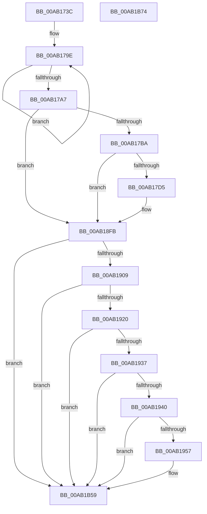

# PopDiagTraceExecutePowerAction

- RVA: `0x00AB173C`–`0x00AB1B75` (길이 `1,081` bytes)
- VA: `0x0000000140AB173C`
- 실행 섹션: `PAGE`
- PDB 이름 있음: `예`; PDB Function 태그: `아니요`
- unwind 정보 RVA: `0x000BC788`
- 디코드: `193`개 명령, `1,081/1,081` bytes 표시
- 미해석 바이트: `0` (있으면 어셈블리에 `.byte`로 보존)

> 이 문서는 커널 이미지의 기계어와 PDB 기호를 분석해 생성했습니다. 4번과 5번은 함수 원형과 자료형을 바이너리 사용 방식에서 추정한 C 해석이며 원본 소스 복구 결과는 아닙니다.

## 1. Dependencies

- 직접 호출 지점: **7**; 고유 호출 대상: **7**
- 직접 호출자로 확인된 함수: **1**
- RIP 상대 이미지 참조: **8**

### Outgoing calls
- `0x00AB1792` → [PsGetProcessImageFileName](../../text/45/PsGetProcessImageFileName_function_00453720.md) (function, `0x00453720`)
- `0x00AB17C8` → [EtwEventEnabled](../../text/39/EtwEventEnabled_function_00392450.md) (function, `0x00392450`)
- `0x00AB18F6` → [EtwWrite](../../text/41/EtwWrite_function_0041C720.md) (function, `0x0041C720`)
- `0x00AB194A` → [tlgKeywordOn](../../text/42/tlgKeywordOn_function_0042EAA0.md) (function, `0x0042EAA0`)
- `0x00AB1B0A` → [tlgCreate1Sz_char](../../text/42/tlgCreate1Sz_char_function_00427304.md) (function, `0x00427304`)
- `0x00AB1B54` → [tlgWriteTransfer_EtwWriteTransfer](../../text/42/tlgWriteTransfer_EtwWriteTransfer_function_004260E0.md) (function, `0x004260E0`)
- `0x00AB1B63` → [_security_check_cookie](../../text/6A/_security_check_cookie_function_006AC640.md) (function, `0x006AC640`)

### Direct callers
- [PopExecutePowerAction](../75/PopExecutePowerAction_function_0075E6B4.md) at `0x0075EBCE`

### Static image references
- `0x00AB175F` → RVA `0x00E0A740` (`.data`; read)
- `0x00AB17A9` → RVA `0x00E67858` (`.data`; read)
- `0x00AB17BA` → RVA `0x00F0B408` (`.data`; read)
- `0x00AB17C1` → RVA `0x0001E1E8` (`.rdata`; read)
- `0x00AB18FB` → RVA `0x00E07748` (`.data`; read)
- `0x00AB1913` → RVA `0x00E07758` (`.data`; read)
- `0x00AB1920` → RVA `0x00E07760` (`.data`; read)
- `0x00AB1B24` → RVA `0x0004A11B` (`.rdata`; read)

## 2. Other-region calls and transfers

- 다른 실행 섹션으로 향하는 call: **7**
  - `0x00AB1792` → [PsGetProcessImageFileName](../../text/45/PsGetProcessImageFileName_function_00453720.md) (`PAGE` → `.text`)
  - `0x00AB17C8` → [EtwEventEnabled](../../text/39/EtwEventEnabled_function_00392450.md) (`PAGE` → `.text`)
  - `0x00AB18F6` → [EtwWrite](../../text/41/EtwWrite_function_0041C720.md) (`PAGE` → `.text`)
  - `0x00AB194A` → [tlgKeywordOn](../../text/42/tlgKeywordOn_function_0042EAA0.md) (`PAGE` → `.text`)
  - `0x00AB1B0A` → [tlgCreate1Sz_char](../../text/42/tlgCreate1Sz_char_function_00427304.md) (`PAGE` → `.text`)
  - `0x00AB1B54` → [tlgWriteTransfer_EtwWriteTransfer](../../text/42/tlgWriteTransfer_EtwWriteTransfer_function_004260E0.md) (`PAGE` → `.text`)
  - `0x00AB1B63` → [_security_check_cookie](../../text/6A/_security_check_cookie_function_006AC640.md) (`PAGE` → `.text`)
- 별도 외부 분기/꼬리 이동을 확인하지 못했습니다.

## 3. Assembly (complete function range)

```asm
00AB173C  48 8B C4                        mov rax, rsp
00AB173F  44 89 48 20                     mov dword ptr [rax + 0x20], r9d
00AB1743  44 89 40 18                     mov dword ptr [rax + 0x18], r8d
00AB1747  89 50 10                        mov dword ptr [rax + 0x10], edx
00AB174A  89 48 08                        mov dword ptr [rax + 8], ecx
00AB174D  55                              push rbp
00AB174E  53                              push rbx
00AB174F  56                              push rsi
00AB1750  57                              push rdi
00AB1751  48 8D A8 58 FE FF FF            lea rbp, [rax - 0x1a8]
00AB1758  48 81 EC 88 02 00 00            sub rsp, 0x288
00AB175F  48 8B 05 DA 8F 35 00            mov rax, qword ptr [rip + 0x358fda]
00AB1766  48 33 C4                        xor rax, rsp
00AB1769  48 89 85 70 01 00 00            mov qword ptr [rbp + 0x170], rax
00AB1770  33 FF                           xor edi, edi
00AB1772  40 38 BD 08 02 00 00            cmp byte ptr [rbp + 0x208], dil
00AB1779  8B C7                           mov eax, edi
00AB177B  0F 95 C0                        setne al
00AB177E  89 44 24 34                     mov dword ptr [rsp + 0x34], eax
00AB1782  65 48 8B 0C 25 88 01 00 00      mov rcx, qword ptr gs:[0x188]
00AB178B  48 8B 89 B8 00 00 00            mov rcx, qword ptr [rcx + 0xb8]
00AB1792  E8 89 1F 9A FF                  call 0x140453720
00AB1797  48 8B D8                        mov rbx, rax
00AB179A  48 83 C9 FF                     or rcx, 0xffffffffffffffff
00AB179E  48 FF C1                        inc rcx
00AB17A1  40 38 3C 08                     cmp byte ptr [rax + rcx], dil
00AB17A5  75 F7                           jne 0x140ab179e
00AB17A7  FF C1                           inc ecx
00AB17A9  40 38 3D A8 60 3B 00            cmp byte ptr [rip + 0x3b60a8], dil
00AB17B0  89 4C 24 30                     mov dword ptr [rsp + 0x30], ecx
00AB17B4  0F 84 41 01 00 00               je 0x140ab18fb
00AB17BA  48 8B 0D 47 9C 45 00            mov rcx, qword ptr [rip + 0x459c47]
00AB17C1  48 8D 15 20 CA 56 FF            lea rdx, [rip - 0xa935e0]
00AB17C8  E8 83 0C 8E FF                  call 0x140392450
00AB17CD  84 C0                           test al, al
00AB17CF  0F 84 26 01 00 00               je 0x140ab18fb
00AB17D5  48 8B 0D 2C 9C 45 00            mov rcx, qword ptr [rip + 0x459c2c]
00AB17DC  48 8D 85 B0 01 00 00            lea rax, [rbp + 0x1b0]
00AB17E3  48 89 45 80                     mov qword ptr [rbp - 0x80], rax
00AB17E7  48 8D 15 FA C9 56 FF            lea rdx, [rip - 0xa93606]
00AB17EE  48 8D 85 B8 01 00 00            lea rax, [rbp + 0x1b8]
00AB17F5  48 C7 45 88 04 00 00 00         mov qword ptr [rbp - 0x78], 4
00AB17FD  48 89 45 90                     mov qword ptr [rbp - 0x70], rax
00AB1801  41 B9 0E 00 00 00               mov r9d, 0xe
00AB1807  48 8D 85 C0 01 00 00            lea rax, [rbp + 0x1c0]
00AB180E  48 C7 45 98 04 00 00 00         mov qword ptr [rbp - 0x68], 4
00AB1816  48 89 45 A0                     mov qword ptr [rbp - 0x60], rax
00AB181A  45 33 C0                        xor r8d, r8d
00AB181D  48 8D 85 C8 01 00 00            lea rax, [rbp + 0x1c8]
00AB1824  48 C7 45 A8 04 00 00 00         mov qword ptr [rbp - 0x58], 4
00AB182C  48 89 45 B0                     mov qword ptr [rbp - 0x50], rax
00AB1830  48 8D 85 D0 01 00 00            lea rax, [rbp + 0x1d0]
00AB1837  48 89 45 C0                     mov qword ptr [rbp - 0x40], rax
00AB183B  48 8D 85 D8 01 00 00            lea rax, [rbp + 0x1d8]
00AB1842  48 89 45 D0                     mov qword ptr [rbp - 0x30], rax
00AB1846  48 8D 85 E0 01 00 00            lea rax, [rbp + 0x1e0]
00AB184D  48 89 45 E0                     mov qword ptr [rbp - 0x20], rax
00AB1851  48 8D 85 E8 01 00 00            lea rax, [rbp + 0x1e8]
00AB1858  48 89 45 F0                     mov qword ptr [rbp - 0x10], rax
00AB185C  48 8D 85 F0 01 00 00            lea rax, [rbp + 0x1f0]
00AB1863  48 89 45 00                     mov qword ptr [rbp], rax
00AB1867  48 8D 85 F8 01 00 00            lea rax, [rbp + 0x1f8]
00AB186E  48 89 45 10                     mov qword ptr [rbp + 0x10], rax
00AB1872  48 8D 85 00 02 00 00            lea rax, [rbp + 0x200]
00AB1879  48 89 45 20                     mov qword ptr [rbp + 0x20], rax
00AB187D  48 8D 44 24 34                  lea rax, [rsp + 0x34]
00AB1882  48 89 45 30                     mov qword ptr [rbp + 0x30], rax
00AB1886  48 8D 44 24 30                  lea rax, [rsp + 0x30]
00AB188B  48 89 45 40                     mov qword ptr [rbp + 0x40], rax
00AB188F  8B 44 24 30                     mov eax, dword ptr [rsp + 0x30]
00AB1893  89 45 58                        mov dword ptr [rbp + 0x58], eax
00AB1896  48 8D 45 80                     lea rax, [rbp - 0x80]
00AB189A  48 89 44 24 20                  mov qword ptr [rsp + 0x20], rax
00AB189F  48 C7 45 B8 04 00 00 00         mov qword ptr [rbp - 0x48], 4
00AB18A7  48 C7 45 C8 04 00 00 00         mov qword ptr [rbp - 0x38], 4
00AB18AF  48 C7 45 D8 04 00 00 00         mov qword ptr [rbp - 0x28], 4
00AB18B7  48 C7 45 E8 04 00 00 00         mov qword ptr [rbp - 0x18], 4
00AB18BF  48 C7 45 F8 04 00 00 00         mov qword ptr [rbp - 8], 4
00AB18C7  48 C7 45 08 04 00 00 00         mov qword ptr [rbp + 8], 4
00AB18CF  48 C7 45 18 04 00 00 00         mov qword ptr [rbp + 0x18], 4
00AB18D7  48 C7 45 28 04 00 00 00         mov qword ptr [rbp + 0x28], 4
00AB18DF  48 C7 45 38 04 00 00 00         mov qword ptr [rbp + 0x38], 4
00AB18E7  48 C7 45 48 04 00 00 00         mov qword ptr [rbp + 0x48], 4
00AB18EF  48 89 5D 50                     mov qword ptr [rbp + 0x50], rbx
00AB18F3  89 7D 5C                        mov dword ptr [rbp + 0x5c], edi
00AB18F6  E8 25 AE 96 FF                  call 0x14041c720
00AB18FB  8B 15 47 5E 35 00               mov edx, dword ptr [rip + 0x355e47]
00AB1901  85 D2                           test edx, edx
00AB1903  0F 84 50 02 00 00               je 0x140ab1b59
00AB1909  49 B8 00 00 00 00 00 80 00 00   movabs r8, 0x800000000000
00AB1913  4C 85 05 3E 5E 35 00            test qword ptr [rip + 0x355e3e], r8
00AB191A  0F 84 39 02 00 00               je 0x140ab1b59
00AB1920  48 8B 05 39 5E 35 00            mov rax, qword ptr [rip + 0x355e39]
00AB1927  49 23 C0                        and rax, r8
00AB192A  48 3B 05 2F 5E 35 00            cmp rax, qword ptr [rip + 0x355e2f]
00AB1931  0F 85 22 02 00 00               jne 0x140ab1b59
00AB1937  83 FA 05                        cmp edx, 5
00AB193A  0F 86 19 02 00 00               jbe 0x140ab1b59
00AB1940  49 8B D0                        mov rdx, r8
00AB1943  48 8D 0D FE 5D 35 00            lea rcx, [rip + 0x355dfe]
00AB194A  E8 51 D1 97 FF                  call 0x14042eaa0
00AB194F  84 C0                           test al, al
00AB1951  0F 84 02 02 00 00               je 0x140ab1b59
00AB1957  8B 85 B0 01 00 00               mov eax, dword ptr [rbp + 0x1b0]
00AB195D  48 8D 8D 50 01 00 00            lea rcx, [rbp + 0x150]
00AB1964  89 44 24 38                     mov dword ptr [rsp + 0x38], eax
00AB1968  48 8B D3                        mov rdx, rbx
00AB196B  48 8D 44 24 38                  lea rax, [rsp + 0x38]
00AB1970  48 C7 85 88 00 00 00 04 00 00 00  mov qword ptr [rbp + 0x88], 4
00AB197B  48 89 85 80 00 00 00            mov qword ptr [rbp + 0x80], rax
00AB1982  8B 85 B8 01 00 00               mov eax, dword ptr [rbp + 0x1b8]
00AB1988  89 44 24 3C                     mov dword ptr [rsp + 0x3c], eax
00AB198C  48 8D 44 24 3C                  lea rax, [rsp + 0x3c]
00AB1991  48 89 85 90 00 00 00            mov qword ptr [rbp + 0x90], rax
00AB1998  8B 85 C0 01 00 00               mov eax, dword ptr [rbp + 0x1c0]
00AB199E  89 44 24 40                     mov dword ptr [rsp + 0x40], eax
00AB19A2  48 8D 44 24 40                  lea rax, [rsp + 0x40]
00AB19A7  48 89 85 A0 00 00 00            mov qword ptr [rbp + 0xa0], rax
00AB19AE  8B 85 C8 01 00 00               mov eax, dword ptr [rbp + 0x1c8]
00AB19B4  89 44 24 44                     mov dword ptr [rsp + 0x44], eax
00AB19B8  48 8D 44 24 44                  lea rax, [rsp + 0x44]
00AB19BD  48 89 85 B0 00 00 00            mov qword ptr [rbp + 0xb0], rax
00AB19C4  8B 85 D0 01 00 00               mov eax, dword ptr [rbp + 0x1d0]
00AB19CA  89 44 24 48                     mov dword ptr [rsp + 0x48], eax
00AB19CE  48 8D 44 24 48                  lea rax, [rsp + 0x48]
00AB19D3  48 89 85 C0 00 00 00            mov qword ptr [rbp + 0xc0], rax
00AB19DA  8B 85 D8 01 00 00               mov eax, dword ptr [rbp + 0x1d8]
00AB19E0  89 44 24 4C                     mov dword ptr [rsp + 0x4c], eax
00AB19E4  48 8D 44 24 4C                  lea rax, [rsp + 0x4c]
00AB19E9  48 89 85 D0 00 00 00            mov qword ptr [rbp + 0xd0], rax
00AB19F0  8B 85 E0 01 00 00               mov eax, dword ptr [rbp + 0x1e0]
00AB19F6  89 44 24 50                     mov dword ptr [rsp + 0x50], eax
00AB19FA  48 8D 44 24 50                  lea rax, [rsp + 0x50]
00AB19FF  48 89 85 E0 00 00 00            mov qword ptr [rbp + 0xe0], rax
00AB1A06  8B 85 E8 01 00 00               mov eax, dword ptr [rbp + 0x1e8]
00AB1A0C  89 44 24 54                     mov dword ptr [rsp + 0x54], eax
00AB1A10  48 8D 44 24 54                  lea rax, [rsp + 0x54]
00AB1A15  48 89 85 F0 00 00 00            mov qword ptr [rbp + 0xf0], rax
00AB1A1C  8B 85 F0 01 00 00               mov eax, dword ptr [rbp + 0x1f0]
00AB1A22  89 44 24 58                     mov dword ptr [rsp + 0x58], eax
00AB1A26  48 8D 44 24 58                  lea rax, [rsp + 0x58]
00AB1A2B  48 89 85 00 01 00 00            mov qword ptr [rbp + 0x100], rax
00AB1A32  8B 85 F8 01 00 00               mov eax, dword ptr [rbp + 0x1f8]
00AB1A38  89 44 24 5C                     mov dword ptr [rsp + 0x5c], eax
00AB1A3C  48 8D 44 24 5C                  lea rax, [rsp + 0x5c]
00AB1A41  48 89 85 10 01 00 00            mov qword ptr [rbp + 0x110], rax
00AB1A48  8B 85 00 02 00 00               mov eax, dword ptr [rbp + 0x200]
00AB1A4E  89 44 24 60                     mov dword ptr [rsp + 0x60], eax
00AB1A52  48 8D 44 24 60                  lea rax, [rsp + 0x60]
00AB1A57  48 89 85 20 01 00 00            mov qword ptr [rbp + 0x120], rax
00AB1A5E  8B 44 24 34                     mov eax, dword ptr [rsp + 0x34]
00AB1A62  89 44 24 64                     mov dword ptr [rsp + 0x64], eax
00AB1A66  48 8D 44 24 64                  lea rax, [rsp + 0x64]
00AB1A6B  48 89 85 30 01 00 00            mov qword ptr [rbp + 0x130], rax
00AB1A72  8B 44 24 30                     mov eax, dword ptr [rsp + 0x30]
00AB1A76  89 44 24 68                     mov dword ptr [rsp + 0x68], eax
00AB1A7A  48 8D 44 24 68                  lea rax, [rsp + 0x68]
00AB1A7F  48 89 85 40 01 00 00            mov qword ptr [rbp + 0x140], rax
00AB1A86  48 C7 85 98 00 00 00 04 00 00 00  mov qword ptr [rbp + 0x98], 4
00AB1A91  48 C7 85 A8 00 00 00 04 00 00 00  mov qword ptr [rbp + 0xa8], 4
00AB1A9C  48 C7 85 B8 00 00 00 04 00 00 00  mov qword ptr [rbp + 0xb8], 4
00AB1AA7  48 C7 85 C8 00 00 00 04 00 00 00  mov qword ptr [rbp + 0xc8], 4
00AB1AB2  48 C7 85 D8 00 00 00 04 00 00 00  mov qword ptr [rbp + 0xd8], 4
00AB1ABD  48 C7 85 E8 00 00 00 04 00 00 00  mov qword ptr [rbp + 0xe8], 4
00AB1AC8  48 C7 85 F8 00 00 00 04 00 00 00  mov qword ptr [rbp + 0xf8], 4
00AB1AD3  48 C7 85 08 01 00 00 04 00 00 00  mov qword ptr [rbp + 0x108], 4
00AB1ADE  48 C7 85 18 01 00 00 04 00 00 00  mov qword ptr [rbp + 0x118], 4
00AB1AE9  48 C7 85 28 01 00 00 04 00 00 00  mov qword ptr [rbp + 0x128], 4
00AB1AF4  48 C7 85 38 01 00 00 04 00 00 00  mov qword ptr [rbp + 0x138], 4
00AB1AFF  48 C7 85 48 01 00 00 04 00 00 00  mov qword ptr [rbp + 0x148], 4
00AB1B0A  E8 F5 57 97 FF                  call 0x140427304
00AB1B0F  48 8D 44 24 70                  lea rax, [rsp + 0x70]
00AB1B14  48 C7 44 24 70 00 00 00 01      mov qword ptr [rsp + 0x70], 0x1000000
00AB1B1D  48 89 85 60 01 00 00            mov qword ptr [rbp + 0x160], rax
00AB1B24  48 8D 15 F0 85 59 FF            lea rdx, [rip - 0xa67a10]
00AB1B2B  48 8D 45 60                     lea rax, [rbp + 0x60]
00AB1B2F  48 C7 85 68 01 00 00 08 00 00 00  mov qword ptr [rbp + 0x168], 8
00AB1B3A  48 89 44 24 28                  mov qword ptr [rsp + 0x28], rax
00AB1B3F  48 8D 0D 02 5C 35 00            lea rcx, [rip + 0x355c02]
00AB1B46  45 33 C9                        xor r9d, r9d
00AB1B49  C7 44 24 20 11 00 00 00         mov dword ptr [rsp + 0x20], 0x11
00AB1B51  45 33 C0                        xor r8d, r8d
00AB1B54  E8 87 45 97 FF                  call 0x1404260e0
00AB1B59  48 8B 8D 70 01 00 00            mov rcx, qword ptr [rbp + 0x170]
00AB1B60  48 33 CC                        xor rcx, rsp
00AB1B63  E8 D8 AA BF FF                  call 0x1406ac640
00AB1B68  48 81 C4 88 02 00 00            add rsp, 0x288
00AB1B6F  5F                              pop rdi
00AB1B70  5E                              pop rsi
00AB1B71  5B                              pop rbx
00AB1B72  5D                              pop rbp
00AB1B73  C3                              ret
00AB1B74  CC                              int3
```

## 4. C-style interpretation (structured pseudocode)

```c
__int64 __fastcall PopDiagTraceExecutePowerAction(int a1, int a2, int a3, int a4)
{
    __int64 result;
    __int64 v_rdi;
    __int64 v_rsp;
    unsigned __int64 v_stack_m238;
    unsigned int v_stack_m240;
    unsigned int v_stack_m244;
    unsigned int v_stack_m248;
    unsigned int v_stack_m24C;
    unsigned int v_stack_m250;
    unsigned int v_stack_m254;
    unsigned int v_stack_m258;
    unsigned int v_stack_m25C;
    unsigned int v_stack_m260;
    unsigned int v_stack_m264;
    unsigned int v_stack_m268;
    unsigned int v_stack_m26C;
    unsigned int v_stack_m270;
    unsigned int v_stack_m274;
    unsigned int v_stack_m278;
    unsigned __int64 v_stack_m280;
    unsigned __int64 v_stack_m288;

    *(unsigned int *)(v_rsp + 32) = a4;
    *(unsigned int *)(v_rsp + 24) = a3;
    *(unsigned int *)(v_rsp + 16) = a2;
    *(unsigned int *)(v_rsp + 8) = a1;
    v_rsp = (v_rsp) - (648);
    result = (*(unsigned __int64 *)(v_rip + 3510234)) ^ (v_rsp);
    *(unsigned __int64 *)(v_rsp - 424 + 368) = result;
    v_rdi = 0;
    result = ((*(unsigned __int8 *)(v_rsp - 424 + 520)) != 0) ? 1 : 0;
    v_stack_m274 = (unsigned int)(result);
    result = PsGetProcessImageFileName(*(unsigned __int64 *)(*(unsigned __int64 *)(gs_base + (0 + 392)) + 184), a2, a3, a4);
    a1 = (*(unsigned __int64 *)(*(unsigned __int64 *)(gs_base + (0 + 392)) + 184)) | (-1);
loc_00AB179E:
    a1 = (a1) + 1;
    if ((*(unsigned __int8 *)(result + a1 * 1)) != 0) goto loc_00AB179E;
    a1 = (unsigned int)((a1) + 1);
    v_stack_m278 = a1;
    if ((*(unsigned __int8 *)(v_rip + 3891368)) == 0) goto loc_00AB18FB;
    result = EtwEventEnabled(*(unsigned __int64 *)(v_rip + 4561991), v_rip - 11089376, a3, a4);
    if ((unsigned __int8)(result) != 0) {
        a1 = *(unsigned __int64 *)(v_rip + 4561964);
        result = v_rsp - 424 + 432;
        *(unsigned __int64 *)(v_rsp - 424 - 128) = result;
        a2 = v_rip - 11089414;
        result = v_rsp - 424 + 440;
        *(unsigned __int64 *)(v_rsp - 424 - 120) = 4;
        *(unsigned __int64 *)(v_rsp - 424 - 112) = result;
        a4 = 14;
        result = v_rsp - 424 + 448;
        *(unsigned __int64 *)(v_rsp - 424 - 104) = 4;
        *(unsigned __int64 *)(v_rsp - 424 - 96) = result;
        a3 = 0;
        result = v_rsp - 424 + 456;
        *(unsigned __int64 *)(v_rsp - 424 - 88) = 4;
        *(unsigned __int64 *)(v_rsp - 424 - 80) = result;
        result = v_rsp - 424 + 464;
        *(unsigned __int64 *)(v_rsp - 424 - 64) = result;
        result = v_rsp - 424 + 472;
        *(unsigned __int64 *)(v_rsp - 424 - 48) = result;
        result = v_rsp - 424 + 480;
        *(unsigned __int64 *)(v_rsp - 424 - 32) = result;
        result = v_rsp - 424 + 488;
        *(unsigned __int64 *)(v_rsp - 424 - 16) = result;
        result = v_rsp - 424 + 496;
        *(unsigned __int64 *)(v_rsp - 424) = result;
        result = v_rsp - 424 + 504;
        *(unsigned __int64 *)(v_rsp - 424 + 16) = result;
        result = v_rsp - 424 + 512;
        *(unsigned __int64 *)(v_rsp - 424 + 32) = result;
        result = v_stack_m274;
        *(unsigned __int64 *)(v_rsp - 424 + 48) = result;
        result = v_stack_m278;
        *(unsigned __int64 *)(v_rsp - 424 + 64) = result;
        result = v_stack_m278;
        *(unsigned int *)(v_rsp - 424 + 88) = (unsigned int)(result);
        result = v_rsp - 424 - 128;
        v_stack_m288 = result;
        *(unsigned __int64 *)(v_rsp - 424 - 72) = 4;
        *(unsigned __int64 *)(v_rsp - 424 - 56) = 4;
        *(unsigned __int64 *)(v_rsp - 424 - 40) = 4;
        *(unsigned __int64 *)(v_rsp - 424 - 24) = 4;
        *(unsigned __int64 *)(v_rsp - 424 - 8) = 4;
        *(unsigned __int64 *)(v_rsp - 424 + 8) = 4;
        *(unsigned __int64 *)(v_rsp - 424 + 24) = 4;
        *(unsigned __int64 *)(v_rsp - 424 + 40) = 4;
        *(unsigned __int64 *)(v_rsp - 424 + 56) = 4;
        *(unsigned __int64 *)(v_rsp - 424 + 72) = 4;
        *(unsigned __int64 *)(v_rsp - 424 + 80) = result;
        *(unsigned int *)(v_rsp - 424 + 92) = 0;
        result = EtwWrite(a1, a2, a3, a4);
    }
    if ((unsigned int)((unsigned int)(*(unsigned int *)(v_rip + 3497543))) == 0) goto loc_00AB1B59;
    if (((*(unsigned __int64 *)(v_rip + 3497534)) & (0)) == 0) goto loc_00AB1B59;
    result = (*(unsigned __int64 *)(v_rip + 3497529)) & (0);
    if (result != (*(unsigned __int64 *)(v_rip + 3497519))) goto loc_00AB1B59;
    if (((unsigned int)((unsigned int)(*(unsigned int *)(v_rip + 3497543)))) <= 5) goto loc_00AB1B59;
    result = tlgKeywordOn(v_rip + 3497470, 0, a3, a4);
    if ((unsigned __int8)(result) != 0) {
        result = *(unsigned int *)(v_rsp - 424 + 432);
        a1 = v_rsp - 424 + 336;
        v_stack_m270 = (unsigned int)(result);
        a2 = result;
        result = v_stack_m270;
        *(unsigned __int64 *)(v_rsp - 424 + 136) = 4;
        *(unsigned __int64 *)(v_rsp - 424 + 128) = result;
        result = *(unsigned int *)(v_rsp - 424 + 440);
        v_stack_m26C = (unsigned int)(result);
        result = v_stack_m26C;
        *(unsigned __int64 *)(v_rsp - 424 + 144) = result;
        result = *(unsigned int *)(v_rsp - 424 + 448);
        v_stack_m268 = (unsigned int)(result);
        result = v_stack_m268;
        *(unsigned __int64 *)(v_rsp - 424 + 160) = result;
        result = *(unsigned int *)(v_rsp - 424 + 456);
        v_stack_m264 = (unsigned int)(result);
        result = v_stack_m264;
        *(unsigned __int64 *)(v_rsp - 424 + 176) = result;
        result = *(unsigned int *)(v_rsp - 424 + 464);
        v_stack_m260 = (unsigned int)(result);
        result = v_stack_m260;
        *(unsigned __int64 *)(v_rsp - 424 + 192) = result;
        result = *(unsigned int *)(v_rsp - 424 + 472);
        v_stack_m25C = (unsigned int)(result);
        result = v_stack_m25C;
        *(unsigned __int64 *)(v_rsp - 424 + 208) = result;
        result = *(unsigned int *)(v_rsp - 424 + 480);
        v_stack_m258 = (unsigned int)(result);
        result = v_stack_m258;
        *(unsigned __int64 *)(v_rsp - 424 + 224) = result;
        result = *(unsigned int *)(v_rsp - 424 + 488);
        v_stack_m254 = (unsigned int)(result);
        result = v_stack_m254;
        *(unsigned __int64 *)(v_rsp - 424 + 240) = result;
        result = *(unsigned int *)(v_rsp - 424 + 496);
        v_stack_m250 = (unsigned int)(result);
        result = v_stack_m250;
        *(unsigned __int64 *)(v_rsp - 424 + 256) = result;
        result = *(unsigned int *)(v_rsp - 424 + 504);
        v_stack_m24C = (unsigned int)(result);
        result = v_stack_m24C;
        *(unsigned __int64 *)(v_rsp - 424 + 272) = result;
        result = *(unsigned int *)(v_rsp - 424 + 512);
        v_stack_m248 = (unsigned int)(result);
        result = v_stack_m248;
        *(unsigned __int64 *)(v_rsp - 424 + 288) = result;
        result = v_stack_m274;
        v_stack_m244 = (unsigned int)(result);
        result = v_stack_m244;
        *(unsigned __int64 *)(v_rsp - 424 + 304) = result;
        result = v_stack_m278;
        v_stack_m240 = (unsigned int)(result);
        result = v_stack_m240;
        *(unsigned __int64 *)(v_rsp - 424 + 320) = result;
        *(unsigned __int64 *)(v_rsp - 424 + 152) = 4;
        *(unsigned __int64 *)(v_rsp - 424 + 168) = 4;
        *(unsigned __int64 *)(v_rsp - 424 + 184) = 4;
        *(unsigned __int64 *)(v_rsp - 424 + 200) = 4;
        *(unsigned __int64 *)(v_rsp - 424 + 216) = 4;
        *(unsigned __int64 *)(v_rsp - 424 + 232) = 4;
        *(unsigned __int64 *)(v_rsp - 424 + 248) = 4;
        *(unsigned __int64 *)(v_rsp - 424 + 264) = 4;
        *(unsigned __int64 *)(v_rsp - 424 + 280) = 4;
        *(unsigned __int64 *)(v_rsp - 424 + 296) = 4;
        *(unsigned __int64 *)(v_rsp - 424 + 312) = 4;
        *(unsigned __int64 *)(v_rsp - 424 + 328) = 4;
        result = tlgCreate1Sz_char(a1, a2, a3, a4);
        result = v_stack_m238;
        v_stack_m238 = 0x1000000ULL;
        *(unsigned __int64 *)(v_rsp - 424 + 352) = result;
        a2 = v_rip - 10910224;
        result = v_rsp - 424 + 96;
        *(unsigned __int64 *)(v_rsp - 424 + 360) = 8;
        v_stack_m280 = result;
        a1 = v_rip + 3496962;
        a4 = 0;
        v_stack_m288 = 17;
        a3 = 0;
        result = tlgWriteTransfer_EtwWriteTransfer(a1, a2, a3, a4);
    }
    a1 = (*(unsigned __int64 *)(v_rsp - 424 + 368)) ^ (v_rsp);
    result = _security_check_cookie(a1, a2, a3, a4);
    v_rsp = (v_rsp) + (648);
    return result;
}
```

## 5. (Beta) C Style

```c
int64_t PopDiagTraceExecutePowerAction(int32_t Arg1, int32_t Arg2, int32_t Arg3, int32_t Arg4)
{
    int64_t result;
    int64_t local_rdi;
    int64_t local_rsp;
    uint64_t v_stack_m238;
    uint32_t v_stack_m240;
    uint32_t v_stack_m244;
    uint32_t v_stack_m248;
    uint32_t v_stack_m24C;
    uint32_t v_stack_m250;
    uint32_t v_stack_m254;
    uint32_t v_stack_m258;
    uint32_t v_stack_m25C;
    uint32_t v_stack_m260;
    uint32_t v_stack_m264;
    uint32_t v_stack_m268;
    uint32_t v_stack_m26C;
    uint32_t v_stack_m270;
    uint32_t v_stack_m274;
    uint32_t v_stack_m278;
    uint64_t v_stack_m280;
    uint64_t v_stack_m288;

    *(uint32_t *)(local_rsp + 0x20) = Arg4;
    *(uint32_t *)(local_rsp + 0x18) = Arg3;
    *(uint32_t *)(local_rsp + 0x10) = Arg2;
    *(uint32_t *)(local_rsp + 0x8) = Arg1;
    local_rsp = (local_rsp) - (648);
    result = (*(uint64_t *)(v_rip + 0x358FDA)) ^ (local_rsp);
    *(uint64_t *)(local_rsp - 0x1A8 + 0x170) = result;
    local_rdi = 0;
    result = ((*(uint8_t *)(local_rsp - 0x1A8 + 0x208)) != 0) ? 1 : 0;
    v_stack_m274 = (uint32_t)(result);
    result = PsGetProcessImageFileName(*(uint64_t *)(*(uint64_t *)(gs_base + (0 + 0x188)) + 0xB8), Arg2, Arg3, Arg4);
    Arg1 = (*(uint64_t *)(*(uint64_t *)(gs_base + (0 + 0x188)) + 0xB8)) | (-1);
loc_00AB179E:
    Arg1 = (Arg1) + 1;
    if ((*(uint8_t *)(result + Arg1 * 1)) != 0) goto loc_00AB179E;
    Arg1 = (uint32_t)((Arg1) + 1);
    v_stack_m278 = Arg1;
    if ((*(uint8_t *)(v_rip + 0x3B60A8)) == 0) goto loc_00AB18FB;
    result = EtwEventEnabled(*(uint64_t *)(v_rip + 0x459C47), v_rip - 11089376, Arg3, Arg4);
    if ((uint8_t)(result) != 0) {
        Arg1 = *(uint64_t *)(v_rip + 0x459C2C);
        result = local_rsp - 424 + 432;
        *(uint64_t *)(local_rsp - 0x1A8 - 0x80) = result;
        Arg2 = v_rip - 11089414;
        result = local_rsp - 424 + 440;
        *(uint64_t *)(local_rsp - 0x1A8 - 0x78) = 4;
        *(uint64_t *)(local_rsp - 0x1A8 - 0x70) = result;
        Arg4 = 14;
        result = local_rsp - 424 + 448;
        *(uint64_t *)(local_rsp - 0x1A8 - 0x68) = 4;
        *(uint64_t *)(local_rsp - 0x1A8 - 0x60) = result;
        Arg3 = 0;
        result = local_rsp - 424 + 456;
        *(uint64_t *)(local_rsp - 0x1A8 - 0x58) = 4;
        *(uint64_t *)(local_rsp - 0x1A8 - 0x50) = result;
        result = local_rsp - 424 + 464;
        *(uint64_t *)(local_rsp - 0x1A8 - 0x40) = result;
        result = local_rsp - 424 + 472;
        *(uint64_t *)(local_rsp - 0x1A8 - 0x30) = result;
        result = local_rsp - 424 + 480;
        *(uint64_t *)(local_rsp - 0x1A8 - 0x20) = result;
        result = local_rsp - 424 + 488;
        *(uint64_t *)(local_rsp - 0x1A8 - 0x10) = result;
        result = local_rsp - 424 + 496;
        *(uint64_t *)(local_rsp - 0x1A8) = result;
        result = local_rsp - 424 + 504;
        *(uint64_t *)(local_rsp - 0x1A8 + 0x10) = result;
        result = local_rsp - 424 + 512;
        *(uint64_t *)(local_rsp - 0x1A8 + 0x20) = result;
        result = v_stack_m274;
        *(uint64_t *)(local_rsp - 0x1A8 + 0x30) = result;
        result = v_stack_m278;
        *(uint64_t *)(local_rsp - 0x1A8 + 0x40) = result;
        result = v_stack_m278;
        *(uint32_t *)(local_rsp - 0x1A8 + 0x58) = (uint32_t)(result);
        result = local_rsp - 424 - 128;
        v_stack_m288 = result;
        *(uint64_t *)(local_rsp - 0x1A8 - 0x48) = 4;
        *(uint64_t *)(local_rsp - 0x1A8 - 0x38) = 4;
        *(uint64_t *)(local_rsp - 0x1A8 - 0x28) = 4;
        *(uint64_t *)(local_rsp - 0x1A8 - 0x18) = 4;
        *(uint64_t *)(local_rsp - 0x1A8 - 0x8) = 4;
        *(uint64_t *)(local_rsp - 0x1A8 + 0x8) = 4;
        *(uint64_t *)(local_rsp - 0x1A8 + 0x18) = 4;
        *(uint64_t *)(local_rsp - 0x1A8 + 0x28) = 4;
        *(uint64_t *)(local_rsp - 0x1A8 + 0x38) = 4;
        *(uint64_t *)(local_rsp - 0x1A8 + 0x48) = 4;
        *(uint64_t *)(local_rsp - 0x1A8 + 0x50) = result;
        *(uint32_t *)(local_rsp - 0x1A8 + 0x5C) = 0;
        result = EtwWrite(Arg1, Arg2, Arg3, Arg4);
    }
    if ((uint32_t)((uint32_t)(*(uint32_t *)(v_rip + 0x355E47))) == 0) goto loc_00AB1B59;
    if (((*(uint64_t *)(v_rip + 0x355E3E)) & (0)) == 0) goto loc_00AB1B59;
    result = (*(uint64_t *)(v_rip + 0x355E39)) & (0);
    if (result != (*(uint64_t *)(v_rip + 0x355E2F))) goto loc_00AB1B59;
    if (((uint32_t)((uint32_t)(*(uint32_t *)(v_rip + 0x355E47)))) <= 5) goto loc_00AB1B59;
    result = tlgKeywordOn(v_rip + 3497470, 0, Arg3, Arg4);
    if ((uint8_t)(result) != 0) {
        result = *(uint32_t *)(local_rsp - 0x1A8 + 0x1B0);
        Arg1 = local_rsp - 424 + 336;
        v_stack_m270 = (uint32_t)(result);
        Arg2 = result;
        result = v_stack_m270;
        *(uint64_t *)(local_rsp - 0x1A8 + 0x88) = 4;
        *(uint64_t *)(local_rsp - 0x1A8 + 0x80) = result;
        result = *(uint32_t *)(local_rsp - 0x1A8 + 0x1B8);
        v_stack_m26C = (uint32_t)(result);
        result = v_stack_m26C;
        *(uint64_t *)(local_rsp - 0x1A8 + 0x90) = result;
        result = *(uint32_t *)(local_rsp - 0x1A8 + 0x1C0);
        v_stack_m268 = (uint32_t)(result);
        result = v_stack_m268;
        *(uint64_t *)(local_rsp - 0x1A8 + 0xA0) = result;
        result = *(uint32_t *)(local_rsp - 0x1A8 + 0x1C8);
        v_stack_m264 = (uint32_t)(result);
        result = v_stack_m264;
        *(uint64_t *)(local_rsp - 0x1A8 + 0xB0) = result;
        result = *(uint32_t *)(local_rsp - 0x1A8 + 0x1D0);
        v_stack_m260 = (uint32_t)(result);
        result = v_stack_m260;
        *(uint64_t *)(local_rsp - 0x1A8 + 0xC0) = result;
        result = *(uint32_t *)(local_rsp - 0x1A8 + 0x1D8);
        v_stack_m25C = (uint32_t)(result);
        result = v_stack_m25C;
        *(uint64_t *)(local_rsp - 0x1A8 + 0xD0) = result;
        result = *(uint32_t *)(local_rsp - 0x1A8 + 0x1E0);
        v_stack_m258 = (uint32_t)(result);
        result = v_stack_m258;
        *(uint64_t *)(local_rsp - 0x1A8 + 0xE0) = result;
        result = *(uint32_t *)(local_rsp - 0x1A8 + 0x1E8);
        v_stack_m254 = (uint32_t)(result);
        result = v_stack_m254;
        *(uint64_t *)(local_rsp - 0x1A8 + 0xF0) = result;
        result = *(uint32_t *)(local_rsp - 0x1A8 + 0x1F0);
        v_stack_m250 = (uint32_t)(result);
        result = v_stack_m250;
        *(uint64_t *)(local_rsp - 0x1A8 + 0x100) = result;
        result = *(uint32_t *)(local_rsp - 0x1A8 + 0x1F8);
        v_stack_m24C = (uint32_t)(result);
        result = v_stack_m24C;
        *(uint64_t *)(local_rsp - 0x1A8 + 0x110) = result;
        result = *(uint32_t *)(local_rsp - 0x1A8 + 0x200);
        v_stack_m248 = (uint32_t)(result);
        result = v_stack_m248;
        *(uint64_t *)(local_rsp - 0x1A8 + 0x120) = result;
        result = v_stack_m274;
        v_stack_m244 = (uint32_t)(result);
        result = v_stack_m244;
        *(uint64_t *)(local_rsp - 0x1A8 + 0x130) = result;
        result = v_stack_m278;
        v_stack_m240 = (uint32_t)(result);
        result = v_stack_m240;
        *(uint64_t *)(local_rsp - 0x1A8 + 0x140) = result;
        *(uint64_t *)(local_rsp - 0x1A8 + 0x98) = 4;
        *(uint64_t *)(local_rsp - 0x1A8 + 0xA8) = 4;
        *(uint64_t *)(local_rsp - 0x1A8 + 0xB8) = 4;
        *(uint64_t *)(local_rsp - 0x1A8 + 0xC8) = 4;
        *(uint64_t *)(local_rsp - 0x1A8 + 0xD8) = 4;
        *(uint64_t *)(local_rsp - 0x1A8 + 0xE8) = 4;
        *(uint64_t *)(local_rsp - 0x1A8 + 0xF8) = 4;
        *(uint64_t *)(local_rsp - 0x1A8 + 0x108) = 4;
        *(uint64_t *)(local_rsp - 0x1A8 + 0x118) = 4;
        *(uint64_t *)(local_rsp - 0x1A8 + 0x128) = 4;
        *(uint64_t *)(local_rsp - 0x1A8 + 0x138) = 4;
        *(uint64_t *)(local_rsp - 0x1A8 + 0x148) = 4;
        result = tlgCreate1Sz_char(Arg1, Arg2, Arg3, Arg4);
        result = v_stack_m238;
        v_stack_m238 = 0x1000000ULL;
        *(uint64_t *)(local_rsp - 0x1A8 + 0x160) = result;
        Arg2 = v_rip - 10910224;
        result = local_rsp - 424 + 96;
        *(uint64_t *)(local_rsp - 0x1A8 + 0x168) = 8;
        v_stack_m280 = result;
        Arg1 = v_rip + 3496962;
        Arg4 = 0;
        v_stack_m288 = 17;
        Arg3 = 0;
        result = tlgWriteTransfer_EtwWriteTransfer(Arg1, Arg2, Arg3, Arg4);
    }
    Arg1 = (*(uint64_t *)(local_rsp - 0x1A8 + 0x170)) ^ (local_rsp);
    result = _security_check_cookie(Arg1, Arg2, Arg3, Arg4);
    local_rsp = (local_rsp) + (648);
    return result;
}
```

## 6. Execution-region graph

[열기: 2D/3D 그래프와 함수 탐색 컨트롤 패널](../../../control-panel.html?section=page&rva=0x00AB173C&view=graph)

- 2D 그래프는 위에서 아래로 흐르고, 3D 그래프는 빈 공간을 드래그해 회전합니다. Shift+드래그는 이동, 휠은 확대·축소, 함수 노드 선택은 대상 보고서 이동입니다.

### Static fallback


