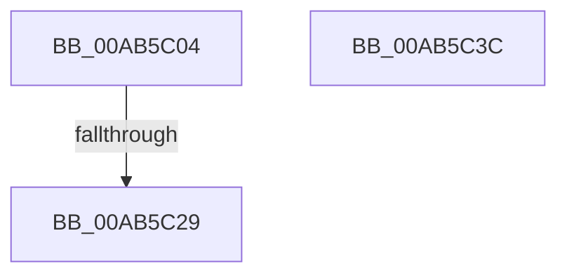

# PopDiagTraceKernelQueriesAllowed

- RVA: `0x00AB5C04`–`0x00AB5C3D` (길이 `57` bytes)
- VA: `0x0000000140AB5C04`
- 실행 섹션: `PAGE`
- PDB 이름 있음: `예`; PDB Function 태그: `예`
- unwind 정보 RVA: `0x000A06A8`
- 디코드: `15`개 명령, `57/57` bytes 표시
- 미해석 바이트: `0` (있으면 어셈블리에 `.byte`로 보존)

> 이 문서는 커널 이미지의 기계어와 PDB 기호를 분석해 생성했습니다. 4번과 5번은 함수 원형과 자료형을 바이너리 사용 방식에서 추정한 C 해석이며 원본 소스 복구 결과는 아닙니다.

## 1. Dependencies

- 직접 호출 지점: **1**; 고유 호출 대상: **1**
- 직접 호출자로 확인된 함수: **1**
- RIP 상대 이미지 참조: **2**

### Outgoing calls
- `0x00AB5C31` → [_security_check_cookie](../../text/6A/_security_check_cookie_function_006AC640.md) (function, `0x006AC640`)

### Direct callers
- [PopTransitionSystemPowerStateEx](../../pagelk/B7/PopTransitionSystemPowerStateEx_function_00B7E8C0.md) at `0x00B7EDC4`

### Static image references
- `0x00AB5C0A` → RVA `0x00E0A740` (`.data`; read)
- `0x00AB5C19` → RVA `0x00E67858` (`.data`; read)

## 2. Other-region calls and transfers

- 다른 실행 섹션으로 향하는 call: **1**
  - `0x00AB5C31` → [_security_check_cookie](../../text/6A/_security_check_cookie_function_006AC640.md) (`PAGE` → `.text`)
- call이 아닌 외부 분기/꼬리 이동: **1**
  - `0x00AB5C23` → [sub_00B4AA28](../B4/Unknown_function_00B4AA28.md) (`tail-transfer`)

## 3. Assembly (complete function range)

```asm
00AB5C04  40 53                           push rbx
00AB5C06  48 83 EC 50                     sub rsp, 0x50
00AB5C0A  48 8B 05 2F 4B 35 00            mov rax, qword ptr [rip + 0x354b2f]
00AB5C11  48 33 C4                        xor rax, rsp
00AB5C14  48 89 44 24 48                  mov qword ptr [rsp + 0x48], rax
00AB5C19  80 3D 38 1C 3B 00 00            cmp byte ptr [rip + 0x3b1c38], 0
00AB5C20  0F B6 D9                        movzx ebx, cl
00AB5C23  0F 85 FF 4D 09 00               jne 0x140b4aa28
00AB5C29  48 8B 4C 24 48                  mov rcx, qword ptr [rsp + 0x48]
00AB5C2E  48 33 CC                        xor rcx, rsp
00AB5C31  E8 0A 6A BF FF                  call 0x1406ac640
00AB5C36  48 83 C4 50                     add rsp, 0x50
00AB5C3A  5B                              pop rbx
00AB5C3B  C3                              ret
00AB5C3C  CC                              int3
```

## 4. C-style interpretation (structured pseudocode)

```c
__int64 __fastcall PopDiagTraceKernelQueriesAllowed(unsigned __int8 a1)
{
    __int64 result;
    __int64 v_rsp;
    unsigned __int64 v_stack_m10;

    v_rsp = (v_rsp) - (80);
    result = (*(unsigned __int64 *)(v_rip + 3492655)) ^ (v_rsp);
    v_stack_m10 = result;
    a1 = (v_stack_m10) ^ (v_rsp);
    result = _security_check_cookie(a1, a2, a3, a4);
    v_rsp = (v_rsp) + (80);
    return result;
}
```

## 5. (Beta) C Style

```c
int64_t PopDiagTraceKernelQueriesAllowed(uint8_t Arg1)
{
    int64_t result;
    int64_t local_rsp;
    uint64_t v_stack_m10;

    local_rsp = (local_rsp) - (80);
    result = (*(uint64_t *)(v_rip + 0x354B2F)) ^ (local_rsp);
    v_stack_m10 = result;
    Arg1 = (v_stack_m10) ^ (local_rsp);
    result = _security_check_cookie(Arg1, a2, a3, a4);
    local_rsp = (local_rsp) + (80);
    return result;
}
```

## 6. Execution-region graph

[열기: 2D/3D 그래프와 함수 탐색 컨트롤 패널](../../../control-panel.html?section=page&rva=0x00AB5C04&view=graph)

- 2D 그래프는 위에서 아래로 흐르고, 3D 그래프는 빈 공간을 드래그해 회전합니다. Shift+드래그는 이동, 휠은 확대·축소, 함수 노드 선택은 대상 보고서 이동입니다.

### Static fallback


