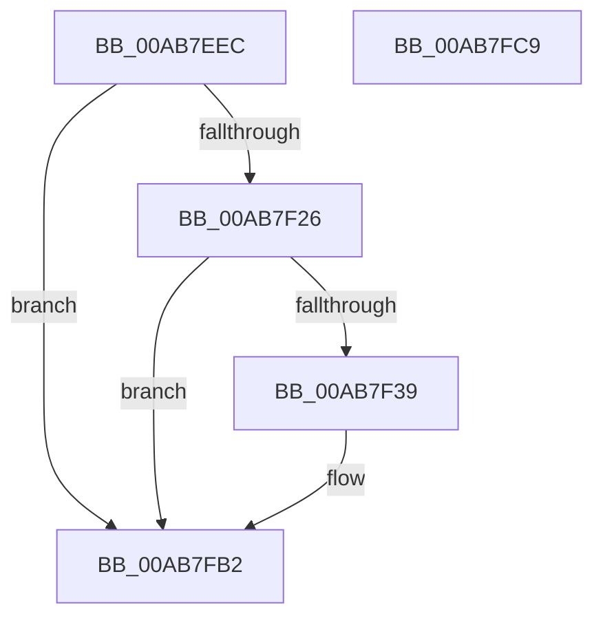

# PopDiagTraceTripPointExceeded

- RVA: `0x00AB7EEC`–`0x00AB7FCA` (길이 `222` bytes)
- VA: `0x0000000140AB7EEC`
- 실행 섹션: `PAGE`
- PDB 이름 있음: `예`; PDB Function 태그: `아니요`
- unwind 정보 RVA: `0x000BD108`
- 디코드: `55`개 명령, `222/222` bytes 표시
- 미해석 바이트: `0` (있으면 어셈블리에 `.byte`로 보존)

> 이 문서는 커널 이미지의 기계어와 PDB 기호를 분석해 생성했습니다. 4번과 5번은 함수 원형과 자료형을 바이너리 사용 방식에서 추정한 C 해석이며 원본 소스 복구 결과는 아닙니다.

## 1. Dependencies

- 직접 호출 지점: **3**; 고유 호출 대상: **3**
- 직접 호출자로 확인된 함수: **4**
- RIP 상대 이미지 참조: **3**

### Outgoing calls
- `0x00AB7F30` → [EtwEventEnabled](../../text/39/EtwEventEnabled_function_00392450.md) (function, `0x00392450`)
- `0x00AB7FAD` → [EtwWrite](../../text/41/EtwWrite_function_0041C720.md) (function, `0x0041C720`)
- `0x00AB7FB9` → [_security_check_cookie](../../text/6A/_security_check_cookie_function_006AC640.md) (function, `0x006AC640`)

### Direct callers
- [PopDiagTraceZoneCriticalTripPointExceeded](../76/PopDiagTraceZoneCriticalTripPointExceeded_function_007637D8.md) at `0x00763877`
- [PopDiagTraceZoneCriticalTripPointExceeded](../76/PopDiagTraceZoneCriticalTripPointExceeded_function_007637D8.md) at `0x007638A2`
- [PopDiagTraceZoneS4TripPointExceeded](../76/PopDiagTraceZoneS4TripPointExceeded_function_007638CC.md) at `0x0076396B`
- [PopDiagTraceZoneS4TripPointExceeded](../76/PopDiagTraceZoneS4TripPointExceeded_function_007638CC.md) at `0x00763996`
- [PopThermalProcessUsermodeEvent](PopThermalProcessUsermodeEvent_function_00AB7D58.md) at `0x00AB7DA5`
- [PopThermalProcessUsermodeEvent](PopThermalProcessUsermodeEvent_function_00AB7D58.md) at `0x00AB7DBA`
- [PopDiagTraceUsermodeTripPointExceeded](PopDiagTraceUsermodeTripPointExceeded_function_00AB7E74.md) at `0x00AB7EA8`
- [PopDiagTraceUsermodeTripPointExceeded](PopDiagTraceUsermodeTripPointExceeded_function_00AB7E74.md) at `0x00AB7ECA`

### Static image references
- `0x00AB7F05` → RVA `0x00E0A740` (`.data`; read)
- `0x00AB7F13` → RVA `0x00E67858` (`.data`; read)
- `0x00AB7F26` → RVA `0x00F0B408` (`.data`; read)

## 2. Other-region calls and transfers

- 다른 실행 섹션으로 향하는 call: **3**
  - `0x00AB7F30` → [EtwEventEnabled](../../text/39/EtwEventEnabled_function_00392450.md) (`PAGE` → `.text`)
  - `0x00AB7FAD` → [EtwWrite](../../text/41/EtwWrite_function_0041C720.md) (`PAGE` → `.text`)
  - `0x00AB7FB9` → [_security_check_cookie](../../text/6A/_security_check_cookie_function_006AC640.md) (`PAGE` → `.text`)
- 별도 외부 분기/꼬리 이동을 확인하지 못했습니다.

## 3. Assembly (complete function range)

```asm
00AB7EEC  44 89 44 24 18                  mov dword ptr [rsp + 0x18], r8d
00AB7EF1  66 89 4C 24 08                  mov word ptr [rsp + 8], cx
00AB7EF6  55                              push rbp
00AB7EF7  53                              push rbx
00AB7EF8  57                              push rdi
00AB7EF9  48 8D 6C 24 B9                  lea rbp, [rsp - 0x47]
00AB7EFE  48 81 EC 90 00 00 00            sub rsp, 0x90
00AB7F05  48 8B 05 34 28 35 00            mov rax, qword ptr [rip + 0x352834]
00AB7F0C  48 33 C4                        xor rax, rsp
00AB7F0F  48 89 45 37                     mov qword ptr [rbp + 0x37], rax
00AB7F13  80 3D 3E F9 3A 00 00            cmp byte ptr [rip + 0x3af93e], 0
00AB7F1A  49 8B D9                        mov rbx, r9
00AB7F1D  48 8B FA                        mov rdi, rdx
00AB7F20  0F 84 8C 00 00 00               je 0x140ab7fb2
00AB7F26  48 8B 0D DB 34 45 00            mov rcx, qword ptr [rip + 0x4534db]
00AB7F2D  48 8B D3                        mov rdx, rbx
00AB7F30  E8 1B A5 8D FF                  call 0x140392450
00AB7F35  84 C0                           test al, al
00AB7F37  74 79                           je 0x140ab7fb2
00AB7F39  83 65 03 00                     and dword ptr [rbp + 3], 0
00AB7F3D  48 8D 45 67                     lea rax, [rbp + 0x67]
00AB7F41  83 65 13 00                     and dword ptr [rbp + 0x13], 0
00AB7F45  41 B9 04 00 00 00               mov r9d, 4
00AB7F4B  48 89 45 F7                     mov qword ptr [rbp - 9], rax
00AB7F4F  45 33 C0                        xor r8d, r8d
00AB7F52  0F B7 45 67                     movzx eax, word ptr [rbp + 0x67]
00AB7F56  48 8B D3                        mov rdx, rbx
00AB7F59  03 C0                           add eax, eax
00AB7F5B  C7 45 FF 02 00 00 00            mov dword ptr [rbp - 1], 2
00AB7F62  89 45 0F                        mov dword ptr [rbp + 0xf], eax
00AB7F65  48 B8 14 00 00 00 80 F7 FF FF   movabs rax, 0xfffff78000000014
00AB7F6F  48 89 7D 07                     mov qword ptr [rbp + 7], rdi
00AB7F73  48 8B 00                        mov rax, qword ptr [rax]
00AB7F76  83 65 23 00                     and dword ptr [rbp + 0x23], 0
00AB7F7A  83 65 33 00                     and dword ptr [rbp + 0x33], 0
00AB7F7E  48 8B 0D 83 34 45 00            mov rcx, qword ptr [rip + 0x453483]
00AB7F85  48 89 45 E7                     mov qword ptr [rbp - 0x19], rax
00AB7F89  48 8D 45 E7                     lea rax, [rbp - 0x19]
00AB7F8D  48 89 45 17                     mov qword ptr [rbp + 0x17], rax
00AB7F91  48 8D 45 77                     lea rax, [rbp + 0x77]
00AB7F95  48 89 45 27                     mov qword ptr [rbp + 0x27], rax
00AB7F99  48 8D 45 F7                     lea rax, [rbp - 9]
00AB7F9D  48 89 44 24 20                  mov qword ptr [rsp + 0x20], rax
00AB7FA2  C7 45 1F 08 00 00 00            mov dword ptr [rbp + 0x1f], 8
00AB7FA9  44 89 4D 2F                     mov dword ptr [rbp + 0x2f], r9d
00AB7FAD  E8 6E 47 96 FF                  call 0x14041c720
00AB7FB2  48 8B 4D 37                     mov rcx, qword ptr [rbp + 0x37]
00AB7FB6  48 33 CC                        xor rcx, rsp
00AB7FB9  E8 82 46 BF FF                  call 0x1406ac640
00AB7FBE  48 81 C4 90 00 00 00            add rsp, 0x90
00AB7FC5  5F                              pop rdi
00AB7FC6  5B                              pop rbx
00AB7FC7  5D                              pop rbp
00AB7FC8  C3                              ret
00AB7FC9  CC                              int3
```

## 4. C-style interpretation (structured pseudocode)

```c
__int64 __fastcall PopDiagTraceTripPointExceeded(unsigned __int16 a1, __int64 a2, int a3, __int64 a4)
{
    __int64 result;
    __int64 v_rsp;
    unsigned __int64 v_stack_m28;
    unsigned int v_stack_m2C;
    unsigned int v_stack_m30;
    unsigned __int64 v_stack_m38;
    unsigned int v_stack_m3C;
    unsigned int v_stack_m40;
    unsigned __int64 v_stack_m48;
    unsigned int v_stack_m4C;
    unsigned int v_stack_m50;
    unsigned __int64 v_stack_m58;
    unsigned int v_stack_m5C;
    unsigned __int64 v_stack_m5F;
    unsigned int v_stack_m60;
    unsigned __int64 v_stack_m68;
    unsigned __int64 v_stack_m78;
    unsigned __int64 v_stack_m88;
    unsigned int v_stack_p18;
    unsigned __int16 v_stack_p8;

    v_stack_p18 = a3;
    v_stack_p8 = a1;
    v_rsp = (v_rsp) - (144);
    result = (*(unsigned __int64 *)(v_rip + 3483700)) ^ (v_rsp);
    v_stack_m28 = result;
    if ((*(unsigned __int8 *)(v_rip + 3864894)) == 0) goto loc_00AB7FB2;
    result = EtwEventEnabled(*(unsigned __int64 *)(v_rip + 4535515), a4, a3, a4);
    if ((unsigned __int8)(result) != 0) {
        result = v_stack_p8;
        a4 = 4;
        v_stack_m68 = result;
        a3 = 0;
        result = v_stack_p8;
        a2 = a4;
        result = (unsigned int)((result) + ((unsigned int)(result)));
        v_stack_m60 = 2;
        v_stack_m50 = (unsigned int)(result);
        v_stack_m58 = a2;
        result = *(unsigned __int64 *)(result);
        a1 = *(unsigned __int64 *)(v_rip + 4535427);
        v_stack_m78 = result;
        result = v_stack_m78;
        v_stack_m48 = result;
        result = v_stack_p18;
        v_stack_m38 = result;
        result = v_stack_m68;
        v_stack_m88 = result;
        v_stack_m40 = 8;
        v_stack_m30 = (unsigned int)(a4);
        result = EtwWrite(a1, a2, a3, a4);
    }
    a1 = (v_stack_m28) ^ (v_rsp);
    result = _security_check_cookie(a1, a2, a3, a4);
    v_rsp = (v_rsp) + (144);
    return result;
}
```

## 5. (Beta) C Style

```c
int64_t PopDiagTraceTripPointExceeded(uint16_t Arg1, int64_t Arg2, int32_t Arg3, int64_t Arg4)
{
    int64_t result;
    int64_t local_rsp;
    uint64_t v_stack_m28;
    uint32_t v_stack_m2C;
    uint32_t v_stack_m30;
    uint64_t v_stack_m38;
    uint32_t v_stack_m3C;
    uint32_t v_stack_m40;
    uint64_t v_stack_m48;
    uint32_t v_stack_m4C;
    uint32_t v_stack_m50;
    uint64_t v_stack_m58;
    uint32_t v_stack_m5C;
    uint64_t v_stack_m5F;
    uint32_t v_stack_m60;
    uint64_t v_stack_m68;
    uint64_t v_stack_m78;
    uint64_t v_stack_m88;
    uint32_t v_stack_p18;
    uint16_t v_stack_p8;

    v_stack_p18 = Arg3;
    v_stack_p8 = Arg1;
    local_rsp = (local_rsp) - (144);
    result = (*(uint64_t *)(v_rip + 0x352834)) ^ (local_rsp);
    v_stack_m28 = result;
    if ((*(uint8_t *)(v_rip + 0x3AF93E)) == 0) goto loc_00AB7FB2;
    result = EtwEventEnabled(*(uint64_t *)(v_rip + 0x4534DB), Arg4, Arg3, Arg4);
    if ((uint8_t)(result) != 0) {
        result = v_stack_p8;
        Arg4 = 4;
        v_stack_m68 = result;
        Arg3 = 0;
        result = v_stack_p8;
        Arg2 = Arg4;
        result = (uint32_t)((result) + ((uint32_t)(result)));
        v_stack_m60 = 2;
        v_stack_m50 = (uint32_t)(result);
        v_stack_m58 = Arg2;
        result = *(uint64_t *)(result);
        Arg1 = *(uint64_t *)(v_rip + 0x453483);
        v_stack_m78 = result;
        result = v_stack_m78;
        v_stack_m48 = result;
        result = v_stack_p18;
        v_stack_m38 = result;
        result = v_stack_m68;
        v_stack_m88 = result;
        v_stack_m40 = 8;
        v_stack_m30 = (uint32_t)(Arg4);
        result = EtwWrite(Arg1, Arg2, Arg3, Arg4);
    }
    Arg1 = (v_stack_m28) ^ (local_rsp);
    result = _security_check_cookie(Arg1, Arg2, Arg3, Arg4);
    local_rsp = (local_rsp) + (144);
    return result;
}
```

## 6. Execution-region graph

[열기: 2D/3D 그래프와 함수 탐색 컨트롤 패널](../../../control-panel.html?section=page&rva=0x00AB7EEC&view=graph)

- 2D 그래프는 위에서 아래로 흐르고, 3D 그래프는 빈 공간을 드래그해 회전합니다. Shift+드래그는 이동, 휠은 확대·축소, 함수 노드 선택은 대상 보고서 이동입니다.

### Static fallback


