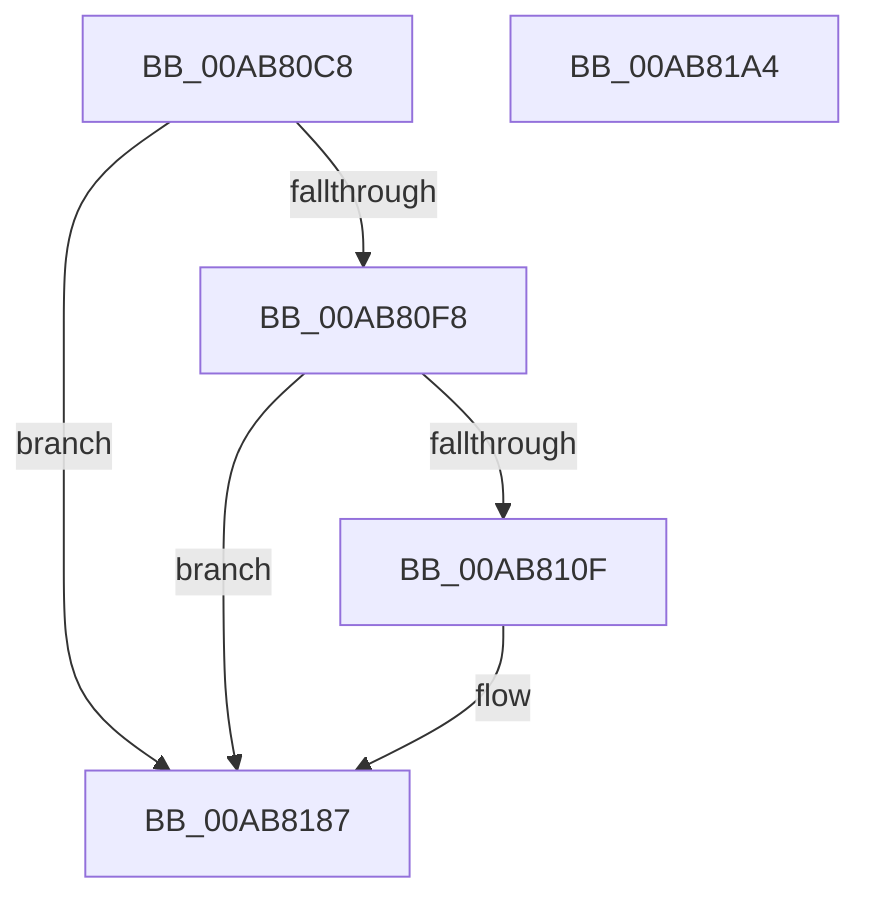

# PopDiagTraceUsermodeThermalEvent

- RVA: `0x00AB80C8`–`0x00AB81A5` (길이 `221` bytes)
- VA: `0x0000000140AB80C8`
- 실행 섹션: `PAGE`
- PDB 이름 있음: `예`; PDB Function 태그: `아니요`
- unwind 정보 RVA: `0x000BD124`
- 디코드: `52`개 명령, `221/221` bytes 표시
- 미해석 바이트: `0` (있으면 어셈블리에 `.byte`로 보존)

> 이 문서는 커널 이미지의 기계어와 PDB 기호를 분석해 생성했습니다. 4번과 5번은 함수 원형과 자료형을 바이너리 사용 방식에서 추정한 C 해석이며 원본 소스 복구 결과는 아닙니다.

## 1. Dependencies

- 직접 호출 지점: **3**; 고유 호출 대상: **3**
- 직접 호출자로 확인된 함수: **1**
- RIP 상대 이미지 참조: **4**

### Outgoing calls
- `0x00AB8106` → [EtwEventEnabled](../../text/39/EtwEventEnabled_function_00392450.md) (function, `0x00392450`)
- `0x00AB8182` → [EtwWrite](../../text/41/EtwWrite_function_0041C720.md) (function, `0x0041C720`)
- `0x00AB818E` → [_security_check_cookie](../../text/6A/_security_check_cookie_function_006AC640.md) (function, `0x006AC640`)

### Direct callers
- [PopThermalProcessUsermodeEvent](PopThermalProcessUsermodeEvent_function_00AB7D58.md) at `0x00AB7D74`

### Static image references
- `0x00AB80DA` → RVA `0x00E0A740` (`.data`; read)
- `0x00AB80E8` → RVA `0x00E67858` (`.data`; read)
- `0x00AB80F8` → RVA `0x00F0B408` (`.data`; read)
- `0x00AB80FF` → RVA `0x00021720` (`.rdata`; read)

## 2. Other-region calls and transfers

- 다른 실행 섹션으로 향하는 call: **3**
  - `0x00AB8106` → [EtwEventEnabled](../../text/39/EtwEventEnabled_function_00392450.md) (`PAGE` → `.text`)
  - `0x00AB8182` → [EtwWrite](../../text/41/EtwWrite_function_0041C720.md) (`PAGE` → `.text`)
  - `0x00AB818E` → [_security_check_cookie](../../text/6A/_security_check_cookie_function_006AC640.md) (`PAGE` → `.text`)
- 별도 외부 분기/꼬리 이동을 확인하지 못했습니다.

## 3. Assembly (complete function range)

```asm
00AB80C8  48 89 5C 24 08                  mov qword ptr [rsp + 8], rbx
00AB80CD  55                              push rbp
00AB80CE  48 8D 6C 24 A9                  lea rbp, [rsp - 0x57]
00AB80D3  48 81 EC 90 00 00 00            sub rsp, 0x90
00AB80DA  48 8B 05 5F 26 35 00            mov rax, qword ptr [rip + 0x35265f]
00AB80E1  48 33 C4                        xor rax, rsp
00AB80E4  48 89 45 47                     mov qword ptr [rbp + 0x47], rax
00AB80E8  80 3D 69 F7 3A 00 00            cmp byte ptr [rip + 0x3af769], 0
00AB80EF  48 8B D9                        mov rbx, rcx
00AB80F2  0F 84 8F 00 00 00               je 0x140ab8187
00AB80F8  48 8B 0D 09 33 45 00            mov rcx, qword ptr [rip + 0x453309]
00AB80FF  48 8D 15 1A 96 56 FF            lea rdx, [rip - 0xa969e6]
00AB8106  E8 45 A3 8D FF                  call 0x140392450
00AB810B  84 C0                           test al, al
00AB810D  74 78                           je 0x140ab8187
00AB810F  83 65 03 00                     and dword ptr [rbp + 3], 0
00AB8113  48 8D 4B 0C                     lea rcx, [rbx + 0xc]
00AB8117  83 65 13 00                     and dword ptr [rbp + 0x13], 0
00AB811B  48 8D 43 0E                     lea rax, [rbx + 0xe]
00AB811F  83 65 23 00                     and dword ptr [rbp + 0x23], 0
00AB8123  48 8D 15 F6 95 56 FF            lea rdx, [rip - 0xa96a0a]
00AB812A  83 65 33 00                     and dword ptr [rbp + 0x33], 0
00AB812E  45 33 C0                        xor r8d, r8d
00AB8131  83 65 43 00                     and dword ptr [rbp + 0x43], 0
00AB8135  48 89 45 07                     mov qword ptr [rbp + 7], rax
00AB8139  0F B7 01                        movzx eax, word ptr [rcx]
00AB813C  03 C0                           add eax, eax
00AB813E  48 89 4D F7                     mov qword ptr [rbp - 9], rcx
00AB8142  B9 04 00 00 00                  mov ecx, 4
00AB8147  89 45 0F                        mov dword ptr [rbp + 0xf], eax
00AB814A  48 8D 43 04                     lea rax, [rbx + 4]
00AB814E  89 4D 1F                        mov dword ptr [rbp + 0x1f], ecx
00AB8151  48 89 45 27                     mov qword ptr [rbp + 0x27], rax
00AB8155  48 8D 43 08                     lea rax, [rbx + 8]
00AB8159  48 89 45 37                     mov qword ptr [rbp + 0x37], rax
00AB815D  48 8D 45 F7                     lea rax, [rbp - 9]
00AB8161  89 4D 2F                        mov dword ptr [rbp + 0x2f], ecx
00AB8164  44 8D 49 01                     lea r9d, [rcx + 1]
00AB8168  89 4D 3F                        mov dword ptr [rbp + 0x3f], ecx
00AB816B  48 8B 0D 96 32 45 00            mov rcx, qword ptr [rip + 0x453296]
00AB8172  48 89 44 24 20                  mov qword ptr [rsp + 0x20], rax
00AB8177  C7 45 FF 02 00 00 00            mov dword ptr [rbp - 1], 2
00AB817E  48 89 5D 17                     mov qword ptr [rbp + 0x17], rbx
00AB8182  E8 99 45 96 FF                  call 0x14041c720
00AB8187  48 8B 4D 47                     mov rcx, qword ptr [rbp + 0x47]
00AB818B  48 33 CC                        xor rcx, rsp
00AB818E  E8 AD 44 BF FF                  call 0x1406ac640
00AB8193  48 8B 9C 24 A0 00 00 00         mov rbx, qword ptr [rsp + 0xa0]
00AB819B  48 81 C4 90 00 00 00            add rsp, 0x90
00AB81A2  5D                              pop rbp
00AB81A3  C3                              ret
00AB81A4  CC                              int3
```

## 4. C-style interpretation (structured pseudocode)

```c
__int64 __fastcall PopDiagTraceUsermodeThermalEvent(__int64 a1, __int64 a2, int a3)
{
    __int64 result;
    __int64 v_rsp;
    unsigned __int64 v_stack_m18;
    unsigned int v_stack_m1C;
    unsigned int v_stack_m20;
    unsigned __int64 v_stack_m28;
    unsigned int v_stack_m2C;
    unsigned int v_stack_m30;
    unsigned __int64 v_stack_m38;
    unsigned int v_stack_m3C;
    unsigned int v_stack_m40;
    unsigned __int64 v_stack_m48;
    unsigned int v_stack_m4C;
    unsigned int v_stack_m50;
    unsigned __int64 v_stack_m58;
    unsigned int v_stack_m5C;
    unsigned __int64 v_stack_m5F;
    unsigned int v_stack_m60;
    unsigned __int64 v_stack_m68;
    unsigned __int64 v_stack_m78;
    unsigned __int64 v_stack_p8;

    v_stack_p8 = v_rbx;
    v_rsp = (v_rsp) - (144);
    result = (*(unsigned __int64 *)(v_rip + 3483231)) ^ (v_rsp);
    v_stack_m18 = result;
    if ((*(unsigned __int8 *)(v_rip + 3864425)) == 0) goto loc_00AB8187;
    result = EtwEventEnabled(*(unsigned __int64 *)(v_rip + 4535049), v_rip - 11102694, a3, a4);
    if ((unsigned __int8)(result) != 0) {
        a1 = a1 + 12;
        result = a1 + 14;
        a2 = v_rip - 11102730;
        a3 = 0;
        v_stack_m58 = result;
        result = *(unsigned __int16 *)(a1);
        result = (unsigned int)((result) + ((unsigned int)(result)));
        v_stack_m68 = a1;
        a1 = 4;
        v_stack_m50 = (unsigned int)(result);
        result = a1 + 4;
        v_stack_m40 = (unsigned int)(a1);
        v_stack_m38 = result;
        result = a1 + 8;
        v_stack_m28 = result;
        result = v_stack_m68;
        v_stack_m30 = (unsigned int)(a1);
        a4 = a1 + 1;
        v_stack_m20 = (unsigned int)(a1);
        a1 = *(unsigned __int64 *)(v_rip + 4534934);
        v_stack_m78 = result;
        v_stack_m60 = 2;
        v_stack_m48 = a1;
        result = EtwWrite(a1, a2, a3, a4);
    }
    a1 = (v_stack_m18) ^ (v_rsp);
    result = _security_check_cookie(a1, a2, a3, a4);
    v_rsp = (v_rsp) + (144);
    return result;
}
```

## 5. (Beta) C Style

```c
int64_t PopDiagTraceUsermodeThermalEvent(void *Arg1, int64_t Arg2, int32_t Arg3)
{
    uint8_t *arg1 = (uint8_t *)Arg1;

    int64_t result;
    int64_t local_rsp;
    uint64_t v_stack_m18;
    uint32_t v_stack_m1C;
    uint32_t v_stack_m20;
    uint64_t v_stack_m28;
    uint32_t v_stack_m2C;
    uint32_t v_stack_m30;
    uint64_t v_stack_m38;
    uint32_t v_stack_m3C;
    uint32_t v_stack_m40;
    uint64_t v_stack_m48;
    uint32_t v_stack_m4C;
    uint32_t v_stack_m50;
    uint64_t v_stack_m58;
    uint32_t v_stack_m5C;
    uint64_t v_stack_m5F;
    uint32_t v_stack_m60;
    uint64_t v_stack_m68;
    uint64_t v_stack_m78;
    uint64_t v_stack_p8;

    v_stack_p8 = local_rbx;
    local_rsp = (local_rsp) - (144);
    result = (*(uint64_t *)(v_rip + 0x35265F)) ^ (local_rsp);
    v_stack_m18 = result;
    if ((*(uint8_t *)(v_rip + 0x3AF769)) == 0) goto loc_00AB8187;
    result = EtwEventEnabled(*(uint64_t *)(v_rip + 0x453309), v_rip - 11102694, Arg3, a4);
    if ((uint8_t)(result) != 0) {
        Arg1 = Arg1 + 12;
        result = Arg1 + 14;
        Arg2 = v_rip - 11102730;
        Arg3 = 0;
        v_stack_m58 = result;
        result = *(uint16_t *)(arg1);
        result = (uint32_t)((result) + ((uint32_t)(result)));
        v_stack_m68 = Arg1;
        Arg1 = 4;
        v_stack_m50 = (uint32_t)(result);
        result = Arg1 + 4;
        v_stack_m40 = (uint32_t)(Arg1);
        v_stack_m38 = result;
        result = Arg1 + 8;
        v_stack_m28 = result;
        result = v_stack_m68;
        v_stack_m30 = (uint32_t)(Arg1);
        a4 = Arg1 + 1;
        v_stack_m20 = (uint32_t)(Arg1);
        Arg1 = *(uint64_t *)(v_rip + 0x453296);
        v_stack_m78 = result;
        v_stack_m60 = 2;
        v_stack_m48 = Arg1;
        result = EtwWrite(Arg1, Arg2, Arg3, a4);
    }
    Arg1 = (v_stack_m18) ^ (local_rsp);
    result = _security_check_cookie(Arg1, Arg2, Arg3, a4);
    local_rsp = (local_rsp) + (144);
    return result;
}
```

### 관측된 메모리 오프셋

구조체 형식이 확인되지 않은 접근은 인자 기준의 오프셋으로만 기록했습니다.

| 기준 인자 | 오프셋 표현 | 폭 (bit) | 접근 |
|---|---:|---:|---|
| `Arg1` | `+ 0x0` | `16` | `R` |
| `Arg1` | `+ 0x4` | `64` | `R` |
| `Arg1` | `+ 0x8` | `64` | `R` |
| `Arg1` | `+ 0xC` | `64` | `R` |
| `Arg1` | `+ 0xE` | `64` | `R` |

## 6. Execution-region graph

[열기: 2D/3D 그래프와 함수 탐색 컨트롤 패널](../../../control-panel.html?section=page&rva=0x00AB80C8&view=graph)

- 2D 그래프는 위에서 아래로 흐르고, 3D 그래프는 빈 공간을 드래그해 회전합니다. Shift+드래그는 이동, 휠은 확대·축소, 함수 노드 선택은 대상 보고서 이동입니다.

### Static fallback


