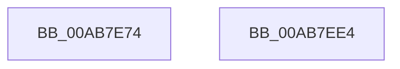

# PopDiagTraceUsermodeTripPointExceeded

- RVA: `0x00AB7E74`–`0x00AB7EE5` (길이 `113` bytes)
- VA: `0x0000000140AB7E74`
- 실행 섹션: `PAGE`
- PDB 이름 있음: `예`; PDB Function 태그: `아니요`
- unwind 정보 RVA: `0x0005C954`
- 디코드: `29`개 명령, `113/113` bytes 표시
- 미해석 바이트: `0` (있으면 어셈블리에 `.byte`로 보존)

> 이 문서는 커널 이미지의 기계어와 PDB 기호를 분석해 생성했습니다. 4번과 5번은 함수 원형과 자료형을 바이너리 사용 방식에서 추정한 C 해석이며 원본 소스 복구 결과는 아닙니다.

## 1. Dependencies

- 직접 호출 지점: **2**; 고유 호출 대상: **1**
- 직접 호출자로 확인된 함수: **1**
- RIP 상대 이미지 참조: **4**

### Outgoing calls
- `0x00AB7EA8` → [PopDiagTraceTripPointExceeded](PopDiagTraceTripPointExceeded_function_00AB7EEC.md) (function, `0x00AB7EEC`)
- `0x00AB7ECA` → [PopDiagTraceTripPointExceeded](PopDiagTraceTripPointExceeded_function_00AB7EEC.md) (function, `0x00AB7EEC`)

### Direct callers
- [PopThermalProcessUsermodeEvent](PopThermalProcessUsermodeEvent_function_00AB7D58.md) at `0x00AB7E15`

### Static image references
- `0x00AB7E8B` → RVA `0x0001E2C8` (`.rdata`; read)
- `0x00AB7E94` → RVA `0x0001E2B8` (`.rdata`; read)
- `0x00AB7EAF` → RVA `0x0001E298` (`.rdata`; read)
- `0x00AB7EB6` → RVA `0x0001E2A8` (`.rdata`; read)

## 2. Other-region calls and transfers

- 다른 실행 섹션으로 향하는 call: **0**
- 별도 외부 분기/꼬리 이동을 확인하지 못했습니다.

## 3. Assembly (complete function range)

```asm
00AB7E74  48 89 5C 24 08                  mov qword ptr [rsp + 8], rbx
00AB7E79  48 89 6C 24 10                  mov qword ptr [rsp + 0x10], rbp
00AB7E7E  48 89 74 24 18                  mov qword ptr [rsp + 0x18], rsi
00AB7E83  57                              push rdi
00AB7E84  48 83 EC 20                     sub rsp, 0x20
00AB7E88  41 8A D9                        mov bl, r9b
00AB7E8B  48 8D 05 36 64 56 FF            lea rax, [rip - 0xa99bca]
00AB7E92  84 DB                           test bl, bl
00AB7E94  4C 8D 0D 1D 64 56 FF            lea r9, [rip - 0xa99be3]
00AB7E9B  41 8B F8                        mov edi, r8d
00AB7E9E  48 8B F2                        mov rsi, rdx
00AB7EA1  4C 0F 44 C8                     cmove r9, rax
00AB7EA5  0F B7 E9                        movzx ebp, cx
00AB7EA8  E8 3F 00 00 00                  call 0x140ab7eec
00AB7EAD  84 DB                           test bl, bl
00AB7EAF  48 8D 05 E2 63 56 FF            lea rax, [rip - 0xa99c1e]
00AB7EB6  4C 8D 0D EB 63 56 FF            lea r9, [rip - 0xa99c15]
00AB7EBD  44 8B C7                        mov r8d, edi
00AB7EC0  4C 0F 44 C8                     cmove r9, rax
00AB7EC4  48 8B D6                        mov rdx, rsi
00AB7EC7  0F B7 CD                        movzx ecx, bp
00AB7ECA  E8 1D 00 00 00                  call 0x140ab7eec
00AB7ECF  48 8B 5C 24 30                  mov rbx, qword ptr [rsp + 0x30]
00AB7ED4  48 8B 6C 24 38                  mov rbp, qword ptr [rsp + 0x38]
00AB7ED9  48 8B 74 24 40                  mov rsi, qword ptr [rsp + 0x40]
00AB7EDE  48 83 C4 20                     add rsp, 0x20
00AB7EE2  5F                              pop rdi
00AB7EE3  C3                              ret
00AB7EE4  CC                              int3
```

## 4. C-style interpretation (structured pseudocode)

```c
__int64 __fastcall PopDiagTraceUsermodeTripPointExceeded(unsigned __int16 a1, __int64 a2, int a3, unsigned __int8 a4)
{
    __int64 result;
    __int64 v_rsp;
    unsigned __int64 v_stack_p10;
    unsigned __int64 v_stack_p18;
    unsigned __int64 v_stack_p8;

    v_stack_p8 = v_rbx;
    v_stack_p10 = v_rbp;
    v_stack_p18 = v_rsi;
    v_rsp = (v_rsp) - (32);
    a4 = v_rip - 11115491;
    if (a4 == 0) { a4 = v_rip - 11115466; }
    result = PopDiagTraceTripPointExceeded(a1, a2, a3, a4);
    a4 = v_rip - 11115541;
    if (a4 == 0) { a4 = v_rip - 11115550; }
    result = PopDiagTraceTripPointExceeded(a1, a2, (unsigned int)((unsigned int)((unsigned int)(a3))), a4);
    v_rsp = (v_rsp) + (32);
    return result;
}
```

## 5. (Beta) C Style

```c
int64_t PopDiagTraceUsermodeTripPointExceeded(uint16_t Arg1, int64_t Arg2, int32_t Arg3, uint8_t Arg4)
{
    int64_t result;
    int64_t local_rsp;
    uint64_t v_stack_p10;
    uint64_t v_stack_p18;
    uint64_t v_stack_p8;

    v_stack_p8 = local_rbx;
    v_stack_p10 = local_rbp;
    v_stack_p18 = local_rsi;
    local_rsp = (local_rsp) - (32);
    Arg4 = v_rip - 11115491;
    if (Arg4 == 0) { Arg4 = v_rip - 11115466; }
    result = PopDiagTraceTripPointExceeded(Arg1, Arg2, Arg3, Arg4);
    Arg4 = v_rip - 11115541;
    if (Arg4 == 0) { Arg4 = v_rip - 11115550; }
    result = PopDiagTraceTripPointExceeded(Arg1, Arg2, (uint32_t)((uint32_t)((uint32_t)(Arg3))), Arg4);
    local_rsp = (local_rsp) + (32);
    return result;
}
```

## 6. Execution-region graph

[열기: 2D/3D 그래프와 함수 탐색 컨트롤 패널](../../../control-panel.html?section=page&rva=0x00AB7E74&view=graph)

- 2D 그래프는 위에서 아래로 흐르고, 3D 그래프는 빈 공간을 드래그해 회전합니다. Shift+드래그는 이동, 휠은 확대·축소, 함수 노드 선택은 대상 보고서 이동입니다.

### Static fallback


