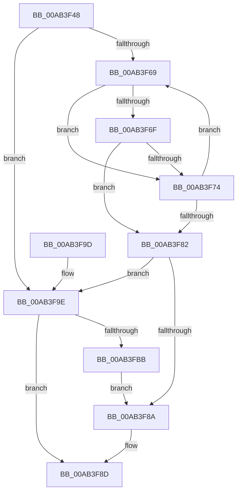

# PopDirectedDripsDiagInsertErrorRecord

- RVA: `0x00AB3F48`–`0x00AB3FCA` (길이 `130` bytes)
- VA: `0x0000000140AB3F48`
- 실행 섹션: `PAGE`
- PDB 이름 있음: `예`; PDB Function 태그: `아니요`
- unwind 정보 RVA: `0x00084A08`
- 디코드: `41`개 명령, `130/130` bytes 표시
- 미해석 바이트: `0` (있으면 어셈블리에 `.byte`로 보존)

> 이 문서는 커널 이미지의 기계어와 PDB 기호를 분석해 생성했습니다. 4번과 5번은 함수 원형과 자료형을 바이너리 사용 방식에서 추정한 C 해석이며 원본 소스 복구 결과는 아닙니다.

## 1. Dependencies

- 직접 호출 지점: **1**; 고유 호출 대상: **1**
- 직접 호출자로 확인된 함수: **2**
- RIP 상대 이미지 참조: **0**

### Outgoing calls
- `0x00AB3FAE` → [ExAllocatePool2](../../poolcode/B8/ExAllocatePool2_function_00B820F0.md) (function, `0x00B820F0`)

### Direct callers
- [PopDirectedDripsDiagTraceBroadcastFailureDevice](../77/PopDirectedDripsDiagTraceBroadcastFailureDevice_function_0077127C.md) at `0x0077130E`
- [PopDirectedDripsDiagTraceProblemDevice](../77/PopDirectedDripsDiagTraceProblemDevice_function_0077135C.md) at `0x007713EF`

### Static image references
- 디코드된 RIP-relative 메모리 참조가 없습니다.

## 2. Other-region calls and transfers

- 다른 실행 섹션으로 향하는 call: **1**
  - `0x00AB3FAE` → [ExAllocatePool2](../../poolcode/B8/ExAllocatePool2_function_00B820F0.md) (`PAGE` → `POOLCODE`)
- 별도 외부 분기/꼬리 이동을 확인하지 못했습니다.

## 3. Assembly (complete function range)

```asm
00AB3F48  48 89 5C 24 08                  mov qword ptr [rsp + 8], rbx
00AB3F4D  48 89 74 24 10                  mov qword ptr [rsp + 0x10], rsi
00AB3F52  57                              push rdi
00AB3F53  48 83 EC 20                     sub rsp, 0x20
00AB3F57  48 8D 59 18                     lea rbx, [rcx + 0x18]
00AB3F5B  41 8B F8                        mov edi, r8d
00AB3F5E  48 8B 0B                        mov rcx, qword ptr [rbx]
00AB3F61  48 8B F2                        mov rsi, rdx
00AB3F64  48 85 C9                        test rcx, rcx
00AB3F67  74 35                           je 0x140ab3f9e
00AB3F69  48 39 71 08                     cmp qword ptr [rcx + 8], rsi
00AB3F6D  75 05                           jne 0x140ab3f74
00AB3F6F  39 79 10                        cmp dword ptr [rcx + 0x10], edi
00AB3F72  74 0E                           je 0x140ab3f82
00AB3F74  48 8B 01                        mov rax, qword ptr [rcx]
00AB3F77  48 8B D9                        mov rbx, rcx
00AB3F7A  48 8B C8                        mov rcx, rax
00AB3F7D  48 85 C0                        test rax, rax
00AB3F80  75 E7                           jne 0x140ab3f69
00AB3F82  48 8B 03                        mov rax, qword ptr [rbx]
00AB3F85  48 85 C0                        test rax, rax
00AB3F88  74 14                           je 0x140ab3f9e
00AB3F8A  FF 40 14                        inc dword ptr [rax + 0x14]
00AB3F8D  48 8B 5C 24 30                  mov rbx, qword ptr [rsp + 0x30]
00AB3F92  48 8B 74 24 38                  mov rsi, qword ptr [rsp + 0x38]
00AB3F97  48 83 C4 20                     add rsp, 0x20
00AB3F9B  5F                              pop rdi
00AB3F9C  C3                              ret
00AB3F9D  CC                              int3
00AB3F9E  BA 18 00 00 00                  mov edx, 0x18
00AB3FA3  41 B8 50 64 69 67               mov r8d, 0x67696450
00AB3FA9  B9 00 01 00 00                  mov ecx, 0x100
00AB3FAE  E8 3D E1 0C 00                  call 0x140b820f0
00AB3FB3  48 89 03                        mov qword ptr [rbx], rax
00AB3FB6  48 85 C0                        test rax, rax
00AB3FB9  74 D2                           je 0x140ab3f8d
00AB3FBB  48 89 70 08                     mov qword ptr [rax + 8], rsi
00AB3FBF  48 8B 03                        mov rax, qword ptr [rbx]
00AB3FC2  89 78 10                        mov dword ptr [rax + 0x10], edi
00AB3FC5  48 8B 03                        mov rax, qword ptr [rbx]
00AB3FC8  EB C0                           jmp 0x140ab3f8a
```

## 4. C-style interpretation (structured pseudocode)

```c
__int64 __fastcall PopDirectedDripsDiagInsertErrorRecord(__int64 a1, __int64 a2, int a3)
{
    __int64 result;
    __int64 v_rsp;
    unsigned __int64 v_stack_p10;
    unsigned __int64 v_stack_p8;

    v_stack_p8 = v_rbx;
    v_stack_p10 = v_rsi;
    v_rsp = (v_rsp) - (32);
    if (*(unsigned __int64 *)(a1 + 24) == 0) goto loc_00AB3F9E;
loc_00AB3F69:
    if ((*(unsigned __int64 *)(*(unsigned __int64 *)(a1 + 24) + 8)) != a2) goto loc_00AB3F74;
    if ((*(unsigned int *)(*(unsigned __int64 *)(a1 + 24) + 16)) == ((unsigned int)((unsigned int)(a3)))) goto loc_00AB3F82;
loc_00AB3F74:
    if (*(unsigned __int64 *)(*(unsigned __int64 *)(a1 + 24)) != 0) goto loc_00AB3F69;
loc_00AB3F82:
    if (*(unsigned __int64 *)(*(unsigned __int64 *)(a1 + 24)) == 0) goto loc_00AB3F9E;
loc_00AB3F8A:
loc_00AB3F8D:
    v_rsp = (v_rsp) + (32);
    return *(unsigned __int64 *)(*(unsigned __int64 *)(a1 + 24));
loc_00AB3F9E:
    result = ExAllocatePool2(256, 24, (unsigned int)(0x67696450ULL), a4);
    *(unsigned __int64 *)(v_stack_p8) = result;
    if (result == 0) goto loc_00AB3F8D;
    *(unsigned __int64 *)(result + 8) = v_stack_p10;
    *(unsigned int *)(*(unsigned __int64 *)(v_stack_p8) + 16) = (unsigned int)((unsigned int)(a3));
    goto loc_00AB3F8A;
}
```

## 5. (Beta) C Style

```c
int64_t PopDirectedDripsDiagInsertErrorRecord(void *Arg1, int64_t Arg2, int32_t Arg3)
{
    uint8_t *arg1 = (uint8_t *)Arg1;

    int64_t result;
    int64_t local_rsp;
    uint64_t v_stack_p10;
    uint64_t v_stack_p8;

    v_stack_p8 = local_rbx;
    v_stack_p10 = local_rsi;
    local_rsp = (local_rsp) - (32);
    if (*(uint64_t *)(arg1 + 0x18) == 0) goto loc_00AB3F9E;
loc_00AB3F69:
    if ((*(uint64_t *)(*(uint64_t *)(arg1 + 0x18) + 0x8)) != Arg2) goto loc_00AB3F74;
    if ((*(uint32_t *)(*(uint64_t *)(arg1 + 0x18) + 0x10)) == ((uint32_t)((uint32_t)(Arg3)))) goto loc_00AB3F82;
loc_00AB3F74:
    if (*(uint64_t *)(*(uint64_t *)(arg1 + 0x18)) != 0) goto loc_00AB3F69;
loc_00AB3F82:
    if (*(uint64_t *)(*(uint64_t *)(arg1 + 0x18)) == 0) goto loc_00AB3F9E;
loc_00AB3F8A:
loc_00AB3F8D:
    local_rsp = (local_rsp) + (32);
    return *(uint64_t *)(*(uint64_t *)(arg1 + 0x18));
loc_00AB3F9E:
    result = ExAllocatePool2(256, 24, (uint32_t)(0x67696450ULL), a4);
    *(uint64_t *)(v_stack_p8) = result;
    if (result == 0) goto loc_00AB3F8D;
    *(uint64_t *)(result + 0x8) = v_stack_p10;
    *(uint32_t *)(*(uint64_t *)(v_stack_p8) + 0x10) = (uint32_t)((uint32_t)(Arg3));
    goto loc_00AB3F8A;
}
```

### 관측된 메모리 오프셋

구조체 형식이 확인되지 않은 접근은 인자 기준의 오프셋으로만 기록했습니다.

| 기준 인자 | 오프셋 표현 | 폭 (bit) | 접근 |
|---|---:|---:|---|
| `Arg1` | `+ 0x0` | `64` | `R` |
| `Arg1` | `+ 0x18` | `64` | `R` |

## 6. Execution-region graph

[열기: 2D/3D 그래프와 함수 탐색 컨트롤 패널](../../../control-panel.html?section=page&rva=0x00AB3F48&view=graph)

- 2D 그래프는 위에서 아래로 흐르고, 3D 그래프는 빈 공간을 드래그해 회전합니다. Shift+드래그는 이동, 휠은 확대·축소, 함수 노드 선택은 대상 보고서 이동입니다.

### Static fallback


