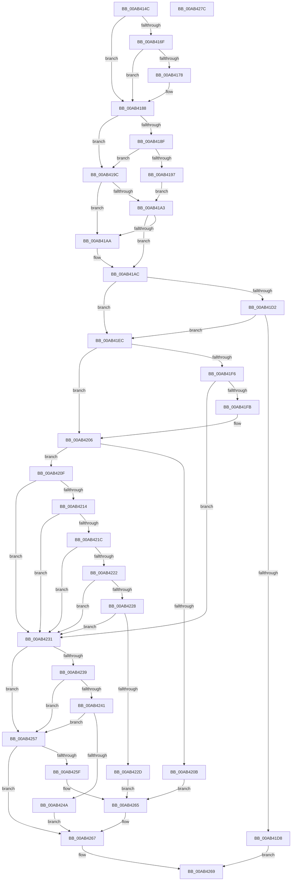

# PopEsEvaluateNextStateV2

- RVA: `0x00AB414C`–`0x00AB427D` (길이 `305` bytes)
- VA: `0x0000000140AB414C`
- 실행 섹션: `PAGE`
- PDB 이름 있음: `예`; PDB Function 태그: `아니요`
- unwind 정보 RVA: `0x000701D4`
- 디코드: `97`개 명령, `305/305` bytes 표시
- 미해석 바이트: `0` (있으면 어셈블리에 `.byte`로 보존)

> 이 문서는 커널 이미지의 기계어와 PDB 기호를 분석해 생성했습니다. 4번과 5번은 함수 원형과 자료형을 바이너리 사용 방식에서 추정한 C 해석이며 원본 소스 복구 결과는 아닙니다.

## 1. Dependencies

- 직접 호출 지점: **1**; 고유 호출 대상: **1**
- 직접 호출자로 확인된 함수: **1**
- RIP 상대 이미지 참조: **7**

### Outgoing calls
- `0x00AB41C9` → [PopEsOverrideSetByGroupPolicy](PopEsOverrideSetByGroupPolicy_function_00AB4284.md) (function, `0x00AB4284`)

### Direct callers
- [PopEsUpdateState](../../text/5D/PopEsUpdateState_function_005DA018.md) at `0x005DA06E`

### Static image references
- `0x00AB418F` → RVA `0x00F0CE50` (`.data`; read)
- `0x00AB41B7` → RVA `0x00E0B864` (`.data`; write)
- `0x00AB41EC` → RVA `0x00E0B860` (`.data`; read)
- `0x00AB4200` → RVA `0x00E0B860` (`.data`; write)
- `0x00AB4231` → RVA `0x00F0CE54` (`.data`; read)
- `0x00AB4241` → RVA `0x00E67A04` (`.data`; read)
- `0x00AB4257` → RVA `0x00F08410` (`.data`; read)

## 2. Other-region calls and transfers

- 다른 실행 섹션으로 향하는 call: **0**
- 별도 외부 분기/꼬리 이동을 확인하지 못했습니다.

## 3. Assembly (complete function range)

```asm
00AB414C  48 89 5C 24 10                  mov qword ptr [rsp + 0x10], rbx
00AB4151  48 89 6C 24 18                  mov qword ptr [rsp + 0x18], rbp
00AB4156  56                              push rsi
00AB4157  57                              push rdi
00AB4158  41 56                           push r14
00AB415A  48 83 EC 20                     sub rsp, 0x20
00AB415E  33 DB                           xor ebx, ebx
00AB4160  48 8B FA                        mov rdi, rdx
00AB4163  4C 8B F1                        mov r14, rcx
00AB4166  8B C3                           mov eax, ebx
00AB4168  89 1A                           mov dword ptr [rdx], ebx
00AB416A  38 59 01                        cmp byte ptr [rcx + 1], bl
00AB416D  74 19                           je 0x140ab4188
00AB416F  44 8B 41 08                     mov r8d, dword ptr [rcx + 8]
00AB4173  45 85 C0                        test r8d, r8d
00AB4176  74 10                           je 0x140ab4188
00AB4178  6B 49 0C 64                     imul ecx, dword ptr [rcx + 0xc], 0x64
00AB417C  41 8B C0                        mov eax, r8d
00AB417F  D1 E8                           shr eax, 1
00AB4181  33 D2                           xor edx, edx
00AB4183  03 C1                           add eax, ecx
00AB4185  41 F7 F0                        div r8d
00AB4188  41 8A 0E                        mov cl, byte ptr [r14]
00AB418B  84 C9                           test cl, cl
00AB418D  75 0D                           jne 0x140ab419c
00AB418F  3B 05 BB 8C 45 00               cmp eax, dword ptr [rip + 0x458cbb]
00AB4195  77 05                           ja 0x140ab419c
00AB4197  40 B5 01                        mov bpl, 1
00AB419A  EB 07                           jmp 0x140ab41a3
00AB419C  40 8A EB                        mov bpl, bl
00AB419F  84 C9                           test cl, cl
00AB41A1  75 07                           jne 0x140ab41aa
00AB41A3  83 F8 14                        cmp eax, 0x14
00AB41A6  B0 01                           mov al, 1
00AB41A8  76 02                           jbe 0x140ab41ac
00AB41AA  8A C3                           mov al, bl
00AB41AC  F6 D8                           neg al
00AB41AE  88 5C 24 40                     mov byte ptr [rsp + 0x40], bl
00AB41B2  48 8D 4C 24 40                  lea rcx, [rsp + 0x40]
00AB41B7  C7 05 A3 76 35 00 02 00 00 00   mov dword ptr [rip + 0x3576a3], 2
00AB41C1  1B F6                           sbb esi, esi
00AB41C3  83 E6 70                        and esi, 0x70
00AB41C6  83 EE 80                        sub esi, -0x80
00AB41C9  E8 B6 00 00 00                  call 0x140ab4284
00AB41CE  85 C0                           test eax, eax
00AB41D0  78 1A                           js 0x140ab41ec
00AB41D2  38 5C 24 40                     cmp byte ptr [rsp + 0x40], bl
00AB41D6  74 14                           je 0x140ab41ec
00AB41D8  C7 07 20 00 00 00               mov dword ptr [rdi], 0x20
00AB41DE  8B C6                           mov eax, esi
00AB41E0  C7 05 7A 76 35 00 01 00 00 00   mov dword ptr [rip + 0x35767a], 1
00AB41EA  EB 7D                           jmp 0x140ab4269
00AB41EC  8B 05 6E 76 35 00               mov eax, dword ptr [rip + 0x35766e]
00AB41F2  85 C0                           test eax, eax
00AB41F4  75 10                           jne 0x140ab4206
00AB41F6  41 38 1E                        cmp byte ptr [r14], bl
00AB41F9  74 36                           je 0x140ab4231
00AB41FB  B8 02 00 00 00                  mov eax, 2
00AB4200  89 05 5A 76 35 00               mov dword ptr [rip + 0x35765a], eax
00AB4206  83 F8 01                        cmp eax, 1
00AB4209  75 04                           jne 0x140ab420f
00AB420B  89 07                           mov dword ptr [rdi], eax
00AB420D  EB 56                           jmp 0x140ab4265
00AB420F  83 F8 02                        cmp eax, 2
00AB4212  75 1D                           jne 0x140ab4231
00AB4214  39 1D 36 8C 45 00               cmp dword ptr [rip + 0x458c36], ebx
00AB421A  76 15                           jbe 0x140ab4231
00AB421C  41 38 5E 01                     cmp byte ptr [r14 + 1], bl
00AB4220  74 0F                           je 0x140ab4231
00AB4222  41 39 5E 08                     cmp dword ptr [r14 + 8], ebx
00AB4226  76 09                           jbe 0x140ab4231
00AB4228  40 84 ED                        test bpl, bpl
00AB422B  74 04                           je 0x140ab4231
00AB422D  89 07                           mov dword ptr [rdi], eax
00AB422F  EB 34                           jmp 0x140ab4265
00AB4231  38 1D 1D 8C 45 00               cmp byte ptr [rip + 0x458c1d], bl
00AB4237  74 1E                           je 0x140ab4257
00AB4239  39 1D 11 8C 45 00               cmp dword ptr [rip + 0x458c11], ebx
00AB423F  76 16                           jbe 0x140ab4257
00AB4241  83 3D BC 37 3B 00 01            cmp dword ptr [rip + 0x3b37bc], 1
00AB4248  75 0D                           jne 0x140ab4257
00AB424A  BB F0 00 00 00                  mov ebx, 0xf0
00AB424F  C7 07 08 00 00 00               mov dword ptr [rdi], 8
00AB4255  EB 10                           jmp 0x140ab4267
00AB4257  38 1D B3 41 45 00               cmp byte ptr [rip + 0x4541b3], bl
00AB425D  74 08                           je 0x140ab4267
00AB425F  C7 07 10 00 00 00               mov dword ptr [rdi], 0x10
00AB4265  8B DE                           mov ebx, esi
00AB4267  8B C3                           mov eax, ebx
00AB4269  48 8B 5C 24 48                  mov rbx, qword ptr [rsp + 0x48]
00AB426E  48 8B 6C 24 50                  mov rbp, qword ptr [rsp + 0x50]
00AB4273  48 83 C4 20                     add rsp, 0x20
00AB4277  41 5E                           pop r14
00AB4279  5F                              pop rdi
00AB427A  5E                              pop rsi
00AB427B  C3                              ret
00AB427C  CC                              int3
```

## 4. C-style interpretation (structured pseudocode)

```c
__int64 __fastcall PopEsEvaluateNextStateV2(__int64 a1, __int64 a2)
{
    __int64 result;
    __int64 v_rbx;
    __int64 v_rsi;
    __int64 v_rsp;
    unsigned __int64 v_stack_p10;
    unsigned __int64 v_stack_p18;
    unsigned __int8 v_stack_p8;

    v_stack_p10 = v_rbx;
    v_stack_p18 = v_rbp;
    v_rsp = (v_rsp) - (32);
    v_rbx = 0;
    *(unsigned int *)(a2) = 0;
    if ((*(unsigned __int8 *)(a1 + 1)) == 0) goto loc_00AB4188;
    result = 0;
    if ((unsigned int)((unsigned int)(*(unsigned int *)(a1 + 8))) != 0) {
        a1 = (unsigned int)((a1) * (*(unsigned int *)(a1 + 12)));
        result = (unsigned int)((unsigned int)(*(unsigned int *)(a1 + 8)));
        result = (unsigned int)((result) >> (1));
        a2 = 0;
        result = (unsigned int)((result) + ((unsigned int)(a1)));
    }
    if ((unsigned __int8)(*(unsigned __int8 *)(a1)) != 0) goto loc_00AB419C;
    if (((unsigned int)(result)) > (*(unsigned int *)(v_rip + 4558011))) goto loc_00AB419C;
    goto loc_00AB41A3;
loc_00AB419C:
    if ((unsigned __int8)(*(unsigned __int8 *)(a1)) != 0) goto loc_00AB41AA;
loc_00AB41A3:
    result = 1;
    if (((unsigned int)(result)) >= = 20) {
        result = 0;
    }
    result = (unsigned __int8)(-(result));
    v_stack_p8 = 0;
    *(unsigned int *)(v_rip + 3503779) = 2;
    v_rsi = (unsigned int)((v_rsi) & (112));
    v_rsi = (unsigned int)((v_rsi) - (-128));
    result = PopEsOverrideSetByGroupPolicy(v_stack_p8, a2, (unsigned int)(*(unsigned int *)(a1 + 8)), a4);
    if (sign_flag) goto loc_00AB41EC;
    if (v_stack_p8 == 0) goto loc_00AB41EC;
    *(unsigned int *)(a2) = 32;
    *(unsigned int *)(v_rip + 3503738) = 1;
    goto loc_00AB4269;
loc_00AB41EC:
    if ((unsigned int)((unsigned int)(*(unsigned int *)(v_rip + 3503726))) != 0) goto loc_00AB4206;
    if ((*(unsigned __int8 *)(a1)) == 0) goto loc_00AB4231;
    *(unsigned int *)(v_rip + 3503706) = 2;
loc_00AB4206:
    if (2 != 1) goto loc_00AB420F;
    *(unsigned int *)(a2) = 2;
    goto loc_00AB4265;
loc_00AB420F:
    if (2 != 2) goto loc_00AB4231;
    if ((*(unsigned int *)(v_rip + 4557878)) <= 0) goto loc_00AB4231;
    if ((*(unsigned __int8 *)(a1 + 1)) == 0) goto loc_00AB4231;
    if ((*(unsigned int *)(a1 + 8)) <= 0) goto loc_00AB4231;
    if (0 == 0) goto loc_00AB4231;
    *(unsigned int *)(a2) = 2;
    goto loc_00AB4265;
loc_00AB4231:
    if ((*(unsigned __int8 *)(v_rip + 4557853)) == 0) goto loc_00AB4257;
    if ((*(unsigned int *)(v_rip + 4557841)) <= 0) goto loc_00AB4257;
    if ((*(unsigned int *)(v_rip + 3880892)) != 1) goto loc_00AB4257;
    *(unsigned int *)(a2) = 8;
    goto loc_00AB4267;
loc_00AB4257:
    if ((*(unsigned __int8 *)(v_rip + 4538803)) == 240) goto loc_00AB4267;
    *(unsigned int *)(a2) = 16;
loc_00AB4265:
loc_00AB4267:
loc_00AB4269:
    v_rsp = (v_rsp) + (32);
    return (unsigned int)((unsigned int)((unsigned int)((unsigned int)(v_rsi))));
}
```

## 5. (Beta) C Style

```c
int64_t PopEsEvaluateNextStateV2(void *Arg1, void *Arg2)
{
    uint8_t *arg1 = (uint8_t *)Arg1;
    uint8_t *arg2 = (uint8_t *)Arg2;

    int64_t result;
    int64_t local_rbx;
    int64_t local_rsi;
    int64_t local_rsp;
    uint64_t v_stack_p10;
    uint64_t v_stack_p18;
    uint8_t v_stack_p8;

    v_stack_p10 = local_rbx;
    v_stack_p18 = local_rbp;
    local_rsp = (local_rsp) - (32);
    local_rbx = 0;
    *(uint32_t *)(arg2) = 0;
    if ((*(uint8_t *)(arg1 + 0x1)) == 0) goto loc_00AB4188;
    result = 0;
    if ((uint32_t)((uint32_t)(*(uint32_t *)(arg1 + 0x8))) != 0) {
        Arg1 = (uint32_t)((Arg1) * (*(uint32_t *)(arg1 + 0xC)));
        result = (uint32_t)((uint32_t)(*(uint32_t *)(arg1 + 0x8)));
        result = (uint32_t)((result) >> (1));
        Arg2 = 0;
        result = (uint32_t)((result) + ((uint32_t)(Arg1)));
    }
    if ((uint8_t)(*(uint8_t *)(arg1)) != 0) goto loc_00AB419C;
    if (((uint32_t)(result)) > (*(uint32_t *)(v_rip + 0x458CBB))) goto loc_00AB419C;
    goto loc_00AB41A3;
loc_00AB419C:
    if ((uint8_t)(*(uint8_t *)(arg1)) != 0) goto loc_00AB41AA;
loc_00AB41A3:
    result = 1;
    if (((uint32_t)(result)) >= = 20) {
        result = 0;
    }
    result = (uint8_t)(-(result));
    v_stack_p8 = 0;
    *(uint32_t *)(v_rip + 0x3576A3) = 2;
    local_rsi = (uint32_t)((local_rsi) & (112));
    local_rsi = (uint32_t)((local_rsi) - (-128));
    result = PopEsOverrideSetByGroupPolicy(v_stack_p8, Arg2, (uint32_t)(*(uint32_t *)(arg1 + 0x8)), a4);
    if (sign_flag) goto loc_00AB41EC;
    if (v_stack_p8 == 0) goto loc_00AB41EC;
    *(uint32_t *)(arg2) = 32;
    *(uint32_t *)(v_rip + 0x35767A) = 1;
    goto loc_00AB4269;
loc_00AB41EC:
    if ((uint32_t)((uint32_t)(*(uint32_t *)(v_rip + 0x35766E))) != 0) goto loc_00AB4206;
    if ((*(uint8_t *)(arg1)) == 0) goto loc_00AB4231;
    *(uint32_t *)(v_rip + 0x35765A) = 2;
loc_00AB4206:
    if (2 != 1) goto loc_00AB420F;
    *(uint32_t *)(arg2) = 2;
    goto loc_00AB4265;
loc_00AB420F:
    if (2 != 2) goto loc_00AB4231;
    if ((*(uint32_t *)(v_rip + 0x458C36)) <= 0) goto loc_00AB4231;
    if ((*(uint8_t *)(arg1 + 0x1)) == 0) goto loc_00AB4231;
    if ((*(uint32_t *)(arg1 + 0x8)) <= 0) goto loc_00AB4231;
    if (0 == 0) goto loc_00AB4231;
    *(uint32_t *)(arg2) = 2;
    goto loc_00AB4265;
loc_00AB4231:
    if ((*(uint8_t *)(v_rip + 0x458C1D)) == 0) goto loc_00AB4257;
    if ((*(uint32_t *)(v_rip + 0x458C11)) <= 0) goto loc_00AB4257;
    if ((*(uint32_t *)(v_rip + 0x3B37BC)) != 1) goto loc_00AB4257;
    *(uint32_t *)(arg2) = 8;
    goto loc_00AB4267;
loc_00AB4257:
    if ((*(uint8_t *)(v_rip + 0x4541B3)) == 240) goto loc_00AB4267;
    *(uint32_t *)(arg2) = 16;
loc_00AB4265:
loc_00AB4267:
loc_00AB4269:
    local_rsp = (local_rsp) + (32);
    return (uint32_t)((uint32_t)((uint32_t)((uint32_t)(local_rsi))));
}
```

### 관측된 메모리 오프셋

구조체 형식이 확인되지 않은 접근은 인자 기준의 오프셋으로만 기록했습니다.

| 기준 인자 | 오프셋 표현 | 폭 (bit) | 접근 |
|---|---:|---:|---|
| `Arg1` | `+ 0x0` | `8` | `R` |
| `Arg1` | `+ 0x1` | `8` | `R` |
| `Arg1` | `+ 0x8` | `32` | `R` |
| `Arg1` | `+ 0xC` | `32` | `R` |
| `Arg2` | `+ 0x0` | `32` | `W` |

## 6. Execution-region graph

[열기: 2D/3D 그래프와 함수 탐색 컨트롤 패널](../../../control-panel.html?section=page&rva=0x00AB414C&view=graph)

- 2D 그래프는 위에서 아래로 흐르고, 3D 그래프는 빈 공간을 드래그해 회전합니다. Shift+드래그는 이동, 휠은 확대·축소, 함수 노드 선택은 대상 보고서 이동입니다.

### Static fallback


