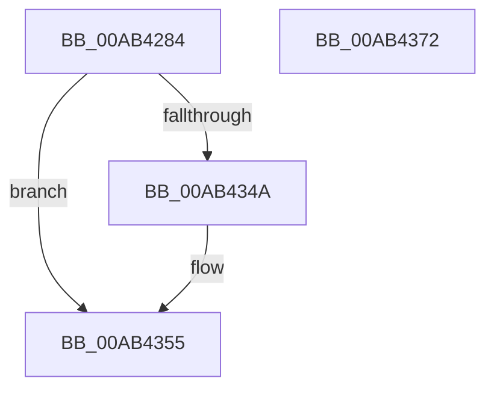

# PopEsOverrideSetByGroupPolicy

- RVA: `0x00AB4284`–`0x00AB4373` (길이 `239` bytes)
- VA: `0x0000000140AB4284`
- 실행 섹션: `PAGE`
- PDB 이름 있음: `예`; PDB Function 태그: `아니요`
- unwind 정보 RVA: `0x000BCBD0`
- 디코드: `54`개 명령, `239/239` bytes 표시
- 미해석 바이트: `0` (있으면 어셈블리에 `.byte`로 보존)

> 이 문서는 커널 이미지의 기계어와 PDB 기호를 분석해 생성했습니다. 4번과 5번은 함수 원형과 자료형을 바이너리 사용 방식에서 추정한 C 해석이며 원본 소스 복구 결과는 아닙니다.

## 1. Dependencies

- 직접 호출 지점: **2**; 고유 호출 대상: **2**
- 직접 호출자로 확인된 함수: **1**
- RIP 상대 이미지 참조: **12**

### Outgoing calls
- `0x00AB433F` → [PopReadRegKeyValue](../../text/4B/PopReadRegKeyValue_function_004B5F64.md) (function, `0x004B5F64`)
- `0x00AB435C` → [_security_check_cookie](../../text/6A/_security_check_cookie_function_006AC640.md) (function, `0x006AC640`)

### Direct callers
- [PopEsEvaluateNextStateV2](PopEsEvaluateNextStateV2_function_00AB414C.md) at `0x00AB41C9`

### Static image references
- `0x00AB4296` → RVA `0x00E0A740` (`.data`; read)
- `0x00AB42A4` → RVA `0x00B02E60` (` ?? ::NNGAKEGL::`string'`; read)
- `0x00AB42AF` → RVA `0x00B02E70` (`PAGE`; read)
- `0x00AB42BC` → RVA `0x00B02E50` (`PAGE`; read)
- `0x00AB42D0` → RVA `0x00B02E80` (`PAGE`; read)
- `0x00AB42DB` → RVA `0x00B02E90` (`PAGE`; read)
- `0x00AB42E6` → RVA `0x00B02EA0` (`PAGE`; read)
- `0x00AB42F1` → RVA `0x00B02EB0` (`PAGE`; read)
- `0x00AB42FC` → RVA `0x00B02EC0` (`PAGE`; read)
- `0x00AB4307` → RVA `0x00B02ED0` (`PAGE`; read)
- `0x00AB4312` → RVA `0x00B02E30` (` ?? ::NNGAKEGL::`string'`; read)
- `0x00AB4324` → RVA `0x00B02E40` (`PAGE`; read)

## 2. Other-region calls and transfers

- 다른 실행 섹션으로 향하는 call: **2**
  - `0x00AB433F` → [PopReadRegKeyValue](../../text/4B/PopReadRegKeyValue_function_004B5F64.md) (`PAGE` → `.text`)
  - `0x00AB435C` → [_security_check_cookie](../../text/6A/_security_check_cookie_function_006AC640.md) (`PAGE` → `.text`)
- 별도 외부 분기/꼬리 이동을 확인하지 못했습니다.

## 3. Assembly (complete function range)

```asm
00AB4284  48 89 5C 24 10                  mov qword ptr [rsp + 0x10], rbx
00AB4289  55                              push rbp
00AB428A  48 8D 6C 24 A9                  lea rbp, [rsp - 0x57]
00AB428F  48 81 EC F0 00 00 00            sub rsp, 0xf0
00AB4296  48 8B 05 A3 64 35 00            mov rax, qword ptr [rip + 0x3564a3]
00AB429D  48 33 C4                        xor rax, rsp
00AB42A0  48 89 45 47                     mov qword ptr [rbp + 0x47], rax
00AB42A4  0F 28 05 B5 EB 04 00            movaps xmm0, xmmword ptr [rip + 0x4ebb5]
00AB42AB  48 8D 55 9F                     lea rdx, [rbp - 0x61]
00AB42AF  0F 28 0D BA EB 04 00            movaps xmm1, xmmword ptr [rip + 0x4ebba]
00AB42B6  41 B8 04 00 00 00               mov r8d, 4
00AB42BC  8B 05 8E EB 04 00               mov eax, dword ptr [rip + 0x4eb8e]
00AB42C2  48 8B D9                        mov rbx, rcx
00AB42C5  83 65 97 00                     and dword ptr [rbp - 0x69], 0
00AB42C9  45 8B C8                        mov r9d, r8d
00AB42CC  0F 29 45 C7                     movaps xmmword ptr [rbp - 0x39], xmm0
00AB42D0  0F 28 05 A9 EB 04 00            movaps xmm0, xmmword ptr [rip + 0x4eba9]
00AB42D7  0F 29 4D D7                     movaps xmmword ptr [rbp - 0x29], xmm1
00AB42DB  0F 28 0D AE EB 04 00            movaps xmm1, xmmword ptr [rip + 0x4ebae]
00AB42E2  0F 29 45 E7                     movaps xmmword ptr [rbp - 0x19], xmm0
00AB42E6  0F 28 05 B3 EB 04 00            movaps xmm0, xmmword ptr [rip + 0x4ebb3]
00AB42ED  0F 29 4D F7                     movaps xmmword ptr [rbp - 9], xmm1
00AB42F1  0F 28 0D B8 EB 04 00            movaps xmm1, xmmword ptr [rip + 0x4ebb8]
00AB42F8  0F 29 45 07                     movaps xmmword ptr [rbp + 7], xmm0
00AB42FC  0F 28 05 BD EB 04 00            movaps xmm0, xmmword ptr [rip + 0x4ebbd]
00AB4303  0F 29 4D 17                     movaps xmmword ptr [rbp + 0x17], xmm1
00AB4307  0F 28 0D C2 EB 04 00            movaps xmm1, xmmword ptr [rip + 0x4ebc2]
00AB430E  0F 29 45 27                     movaps xmmword ptr [rbp + 0x27], xmm0
00AB4312  0F 10 05 17 EB 04 00            movups xmm0, xmmword ptr [rip + 0x4eb17]
00AB4319  89 45 BF                        mov dword ptr [rbp - 0x41], eax
00AB431C  48 8D 45 97                     lea rax, [rbp - 0x69]
00AB4320  0F 29 4D 37                     movaps xmmword ptr [rbp + 0x37], xmm1
00AB4324  0F 10 0D 15 EB 04 00            movups xmm1, xmmword ptr [rip + 0x4eb15]
00AB432B  C6 01 00                        mov byte ptr [rcx], 0
00AB432E  48 8D 4D C7                     lea rcx, [rbp - 0x39]
00AB4332  0F 11 45 9F                     movups xmmword ptr [rbp - 0x61], xmm0
00AB4336  48 89 44 24 20                  mov qword ptr [rsp + 0x20], rax
00AB433B  0F 11 4D AF                     movups xmmword ptr [rbp - 0x51], xmm1
00AB433F  E8 20 1C A0 FF                  call 0x1404b5f64
00AB4344  8B C8                           mov ecx, eax
00AB4346  85 C0                           test eax, eax
00AB4348  78 0B                           js 0x140ab4355
00AB434A  83 7D 97 01                     cmp dword ptr [rbp - 0x69], 1
00AB434E  0F 94 C0                        sete al
00AB4351  88 03                           mov byte ptr [rbx], al
00AB4353  8B C1                           mov eax, ecx
00AB4355  48 8B 4D 47                     mov rcx, qword ptr [rbp + 0x47]
00AB4359  48 33 CC                        xor rcx, rsp
00AB435C  E8 DF 82 BF FF                  call 0x1406ac640
00AB4361  48 8B 9C 24 08 01 00 00         mov rbx, qword ptr [rsp + 0x108]
00AB4369  48 81 C4 F0 00 00 00            add rsp, 0xf0
00AB4370  5D                              pop rbp
00AB4371  C3                              ret
00AB4372  CC                              int3
```

## 4. C-style interpretation (structured pseudocode)

```c
__int64 __fastcall PopEsOverrideSetByGroupPolicy(__int64 a1)
{
    __int64 result;
    __int64 v_rsp;
    unsigned __int64 v_stack_m18;
    unsigned __int64 v_stack_m28;
    unsigned __int64 v_stack_m38;
    unsigned __int64 v_stack_m48;
    unsigned __int64 v_stack_m58;
    unsigned __int64 v_stack_m5F;
    unsigned __int64 v_stack_m68;
    unsigned __int64 v_stack_m78;
    unsigned __int64 v_stack_m88;
    unsigned __int64 v_stack_m98;
    unsigned int v_stack_mA0;
    unsigned __int64 v_stack_mB0;
    unsigned __int64 v_stack_mC0;
    unsigned int v_stack_mC8;
    unsigned __int64 v_stack_mD8;
    unsigned __int64 v_stack_p10;

    v_stack_p10 = v_rbx;
    v_rsp = (v_rsp) - (240);
    result = (*(unsigned __int64 *)(v_rip + 3499171)) ^ (v_rsp);
    v_stack_m18 = result;
    v_stack_m98 = v_xmm0;
    v_stack_m88 = v_xmm1;
    v_stack_m78 = v_xmm0;
    v_stack_m68 = v_xmm1;
    v_stack_m58 = v_xmm0;
    v_stack_m48 = v_xmm1;
    v_stack_m38 = v_xmm0;
    v_stack_mA0 = (unsigned int)((unsigned int)(*(unsigned int *)(v_rip + 322446)));
    v_stack_m28 = v_xmm1;
    *(unsigned __int8 *)(a1) = 0;
    v_stack_mC0 = v_xmm0;
    v_stack_mD8 = v_stack_mC8;
    v_stack_mB0 = v_xmm1;
    result = PopReadRegKeyValue(v_stack_m98, v_stack_mC0, 4, 4);
    if (!(sign_flag)) {
        result = (v_stack_mC8 == 1) ? 1 : 0;
        *(unsigned __int8 *)(a1) = (unsigned __int8)(result);
        result = (unsigned int)((unsigned int)((unsigned int)(result)));
    }
    a1 = (v_stack_m18) ^ (v_rsp);
    result = _security_check_cookie(a1, v_stack_mC0, 4, 4);
    v_rsp = (v_rsp) + (240);
    return result;
}
```

## 5. (Beta) C Style

```c
int64_t PopEsOverrideSetByGroupPolicy(void *Arg1)
{
    uint8_t *arg1 = (uint8_t *)Arg1;

    int64_t result;
    int64_t local_rsp;
    uint64_t v_stack_m18;
    uint64_t v_stack_m28;
    uint64_t v_stack_m38;
    uint64_t v_stack_m48;
    uint64_t v_stack_m58;
    uint64_t v_stack_m5F;
    uint64_t v_stack_m68;
    uint64_t v_stack_m78;
    uint64_t v_stack_m88;
    uint64_t v_stack_m98;
    uint32_t v_stack_mA0;
    uint64_t v_stack_mB0;
    uint64_t v_stack_mC0;
    uint32_t v_stack_mC8;
    uint64_t v_stack_mD8;
    uint64_t v_stack_p10;

    v_stack_p10 = local_rbx;
    local_rsp = (local_rsp) - (240);
    result = (*(uint64_t *)(v_rip + 0x3564A3)) ^ (local_rsp);
    v_stack_m18 = result;
    v_stack_m98 = v_xmm0;
    v_stack_m88 = v_xmm1;
    v_stack_m78 = v_xmm0;
    v_stack_m68 = v_xmm1;
    v_stack_m58 = v_xmm0;
    v_stack_m48 = v_xmm1;
    v_stack_m38 = v_xmm0;
    v_stack_mA0 = (uint32_t)((uint32_t)(*(uint32_t *)(v_rip + 0x4EB8E)));
    v_stack_m28 = v_xmm1;
    *(uint8_t *)(arg1) = 0;
    v_stack_mC0 = v_xmm0;
    v_stack_mD8 = v_stack_mC8;
    v_stack_mB0 = v_xmm1;
    result = PopReadRegKeyValue(v_stack_m98, v_stack_mC0, 4, 4);
    if (!(sign_flag)) {
        result = (v_stack_mC8 == 1) ? 1 : 0;
        *(uint8_t *)(arg1) = (uint8_t)(result);
        result = (uint32_t)((uint32_t)((uint32_t)(result)));
    }
    Arg1 = (v_stack_m18) ^ (local_rsp);
    result = _security_check_cookie(Arg1, v_stack_mC0, 4, 4);
    local_rsp = (local_rsp) + (240);
    return result;
}
```

### 관측된 메모리 오프셋

구조체 형식이 확인되지 않은 접근은 인자 기준의 오프셋으로만 기록했습니다.

| 기준 인자 | 오프셋 표현 | 폭 (bit) | 접근 |
|---|---:|---:|---|
| `Arg1` | `+ 0x0` | `8` | `W` |

## 6. Execution-region graph

[열기: 2D/3D 그래프와 함수 탐색 컨트롤 패널](../../../control-panel.html?section=page&rva=0x00AB4284&view=graph)

- 2D 그래프는 위에서 아래로 흐르고, 3D 그래프는 빈 공간을 드래그해 회전합니다. Shift+드래그는 이동, 휠은 확대·축소, 함수 노드 선택은 대상 보고서 이동입니다.

### Static fallback


