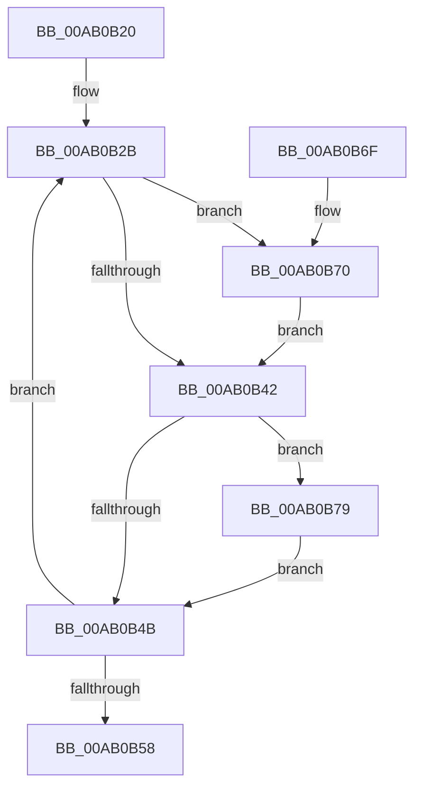

# PopExternalMonitorUpdatedWorker

- RVA: `0x00AB0B20`–`0x00AB0B80` (길이 `96` bytes)
- VA: `0x0000000140AB0B20`
- 실행 섹션: `PAGE`
- PDB 이름 있음: `예`; PDB Function 태그: `아니요`
- unwind 정보 RVA: `0x00070B1C`
- 디코드: `26`개 명령, `96/96` bytes 표시
- 미해석 바이트: `0` (있으면 어셈블리에 `.byte`로 보존)

> 이 문서는 커널 이미지의 기계어와 PDB 기호를 분석해 생성했습니다. 4번과 5번은 함수 원형과 자료형을 바이너리 사용 방식에서 추정한 C 해석이며 원본 소스 복구 결과는 아닙니다.

## 1. Dependencies

- 직접 호출 지점: **8**; 고유 호출 대상: **6**
- 직접 호출자로 확인된 함수: **0**
- RIP 상대 이미지 참조: **3**

### Outgoing calls
- `0x00AB0B26` → [PopAcquirePolicyLock](../../pagelk/B7/PopAcquirePolicyLock_function_00B783C0.md) (function, `0x00B783C0`)
- `0x00AB0B31` → [PopReleasePolicyLock](../../pagelk/B7/PopReleasePolicyLock_function_00B78410.md) (function, `0x00B78410`)
- `0x00AB0B42` → [PopIsPlatformAoAcCapable](../../text/49/PopIsPlatformAoAcCapable_function_0049BF40.md) (function, `0x0049BF40`)
- `0x00AB0B4B` → [PopAcquirePolicyLock](../../pagelk/B7/PopAcquirePolicyLock_function_00B783C0.md) (function, `0x00B783C0`)
- `0x00AB0B5F` → [PopOkayToQueueNextWorkItem](../../text/4A/PopOkayToQueueNextWorkItem_function_004AED54.md) (function, `0x004AED54`)
- `0x00AB0B64` → [PopReleasePolicyLock](../../pagelk/B7/PopReleasePolicyLock_function_00B78410.md) (function, `0x00B78410`)
- `0x00AB0B72` → [guard_dispatch_icall](../../text/6B/guard_dispatch_icall_function_006BAAD0.md) (function, `0x006BAAD0`)
- `0x00AB0B79` → [PopEvaluateInputSuppressionAction](../76/PopEvaluateInputSuppressionAction_function_00765454.md) (function, `0x00765454`)

### Direct callers
- 이 함수 시작 RVA로 연결되는 직접 call은 확인되지 않았습니다. 간접 호출은 완전히 역산할 수 없습니다.

### Static image references
- `0x00AB0B2B` → RVA `0x00E67A54` (`.data`; read)
- `0x00AB0B36` → RVA `0x00E67838` (`.data`; read)
- `0x00AB0B58` → RVA `0x00F092A0` (`.data`; read)

## 2. Other-region calls and transfers

- 다른 실행 섹션으로 향하는 call: **7**
  - `0x00AB0B26` → [PopAcquirePolicyLock](../../pagelk/B7/PopAcquirePolicyLock_function_00B783C0.md) (`PAGE` → `PAGELK`)
  - `0x00AB0B31` → [PopReleasePolicyLock](../../pagelk/B7/PopReleasePolicyLock_function_00B78410.md) (`PAGE` → `PAGELK`)
  - `0x00AB0B42` → [PopIsPlatformAoAcCapable](../../text/49/PopIsPlatformAoAcCapable_function_0049BF40.md) (`PAGE` → `.text`)
  - `0x00AB0B4B` → [PopAcquirePolicyLock](../../pagelk/B7/PopAcquirePolicyLock_function_00B783C0.md) (`PAGE` → `PAGELK`)
  - `0x00AB0B5F` → [PopOkayToQueueNextWorkItem](../../text/4A/PopOkayToQueueNextWorkItem_function_004AED54.md) (`PAGE` → `.text`)
  - `0x00AB0B64` → [PopReleasePolicyLock](../../pagelk/B7/PopReleasePolicyLock_function_00B78410.md) (`PAGE` → `PAGELK`)
  - `0x00AB0B72` → [guard_dispatch_icall](../../text/6B/guard_dispatch_icall_function_006BAAD0.md) (`PAGE` → `.text`)
- 별도 외부 분기/꼬리 이동을 확인하지 못했습니다.

## 3. Assembly (complete function range)

```asm
00AB0B20  40 53                           push rbx
00AB0B22  48 83 EC 20                     sub rsp, 0x20
00AB0B26  E8 95 78 0C 00                  call 0x140b783c0
00AB0B2B  8A 1D 23 6F 3B 00               mov bl, byte ptr [rip + 0x3b6f23]
00AB0B31  E8 DA 78 0C 00                  call 0x140b78410
00AB0B36  48 8B 05 FB 6C 3B 00            mov rax, qword ptr [rip + 0x3b6cfb]
00AB0B3D  48 85 C0                        test rax, rax
00AB0B40  75 2E                           jne 0x140ab0b70
00AB0B42  E8 F9 B3 9E FF                  call 0x14049bf40
00AB0B47  84 C0                           test al, al
00AB0B49  75 2E                           jne 0x140ab0b79
00AB0B4B  E8 70 78 0C 00                  call 0x140b783c0
00AB0B50  3A 1D FE 6E 3B 00               cmp bl, byte ptr [rip + 0x3b6efe]
00AB0B56  75 D3                           jne 0x140ab0b2b
00AB0B58  48 8D 0D 41 87 45 00            lea rcx, [rip + 0x458741]
00AB0B5F  E8 F0 E1 9F FF                  call 0x1404aed54
00AB0B64  E8 A7 78 0C 00                  call 0x140b78410
00AB0B69  48 83 C4 20                     add rsp, 0x20
00AB0B6D  5B                              pop rbx
00AB0B6E  C3                              ret
00AB0B6F  CC                              int3
00AB0B70  8A CB                           mov cl, bl
00AB0B72  E8 59 9F C0 FF                  call 0x1406baad0
00AB0B77  EB C9                           jmp 0x140ab0b42
00AB0B79  E8 D6 48 CB FF                  call 0x140765454
00AB0B7E  EB CB                           jmp 0x140ab0b4b
```

## 4. C-style interpretation (structured pseudocode)

```c
__int64 __fastcall PopExternalMonitorUpdatedWorker(void)
{
    __int64 result;
    __int64 v_rsp;

    v_rsp = (v_rsp) - (32);
    result = PopAcquirePolicyLock(a1, a2, a3, a4);
loc_00AB0B2B:
    result = PopReleasePolicyLock(a1, a2, a3, a4);
    if (*(unsigned __int64 *)(v_rip + 3894523) != 0) goto loc_00AB0B70;
loc_00AB0B42:
    result = PopIsPlatformAoAcCapable(a1, a2, a3, a4);
    if ((unsigned __int8)(result) != 0) goto loc_00AB0B79;
loc_00AB0B4B:
    result = PopAcquirePolicyLock(a1, a2, a3, a4);
    if (((unsigned __int8)(*(unsigned __int8 *)(v_rip + 3895075))) != (*(unsigned __int8 *)(v_rip + 3895038))) goto loc_00AB0B2B;
    result = PopOkayToQueueNextWorkItem(v_rip + 4556609, a2, a3, a4);
    result = PopReleasePolicyLock(v_rip + 4556609, a2, a3, a4);
    v_rsp = (v_rsp) + (32);
    return result;
loc_00AB0B70:
    result = guard_dispatch_icall((unsigned __int8)(*(unsigned __int8 *)(v_rip + 3895075)), a2, a3, a4);
    goto loc_00AB0B42;
loc_00AB0B79:
    result = PopEvaluateInputSuppressionAction((unsigned __int8)(*(unsigned __int8 *)(v_rip + 3895075)), a2, a3, a4);
    goto loc_00AB0B4B;
}
```

## 5. (Beta) C Style

```c
void PopExternalMonitorUpdatedWorker(void)
{
    int64_t result;
    int64_t local_rsp;

    local_rsp = (local_rsp) - (32);
    result = PopAcquirePolicyLock(a1, a2, a3, a4);
loc_00AB0B2B:
    result = PopReleasePolicyLock(a1, a2, a3, a4);
    if (*(uint64_t *)(v_rip + 0x3B6CFB) != 0) goto loc_00AB0B70;
loc_00AB0B42:
    result = PopIsPlatformAoAcCapable(a1, a2, a3, a4);
    if ((uint8_t)(result) != 0) goto loc_00AB0B79;
loc_00AB0B4B:
    result = PopAcquirePolicyLock(a1, a2, a3, a4);
    if (((uint8_t)(*(uint8_t *)(v_rip + 0x3B6F23))) != (*(uint8_t *)(v_rip + 0x3B6EFE))) goto loc_00AB0B2B;
    result = PopOkayToQueueNextWorkItem(v_rip + 4556609, a2, a3, a4);
    result = PopReleasePolicyLock(v_rip + 4556609, a2, a3, a4);
    local_rsp = (local_rsp) + (32);
    return result;
loc_00AB0B70:
    result = guard_dispatch_icall((uint8_t)(*(uint8_t *)(v_rip + 0x3B6F23)), a2, a3, a4);
    goto loc_00AB0B42;
loc_00AB0B79:
    result = PopEvaluateInputSuppressionAction((uint8_t)(*(uint8_t *)(v_rip + 0x3B6F23)), a2, a3, a4);
    goto loc_00AB0B4B;
}
```

## 6. Execution-region graph

[열기: 2D/3D 그래프와 함수 탐색 컨트롤 패널](../../../control-panel.html?section=page&rva=0x00AB0B20&view=graph)

- 2D 그래프는 위에서 아래로 흐르고, 3D 그래프는 빈 공간을 드래그해 회전합니다. Shift+드래그는 이동, 휠은 확대·축소, 함수 노드 선택은 대상 보고서 이동입니다.

### Static fallback


