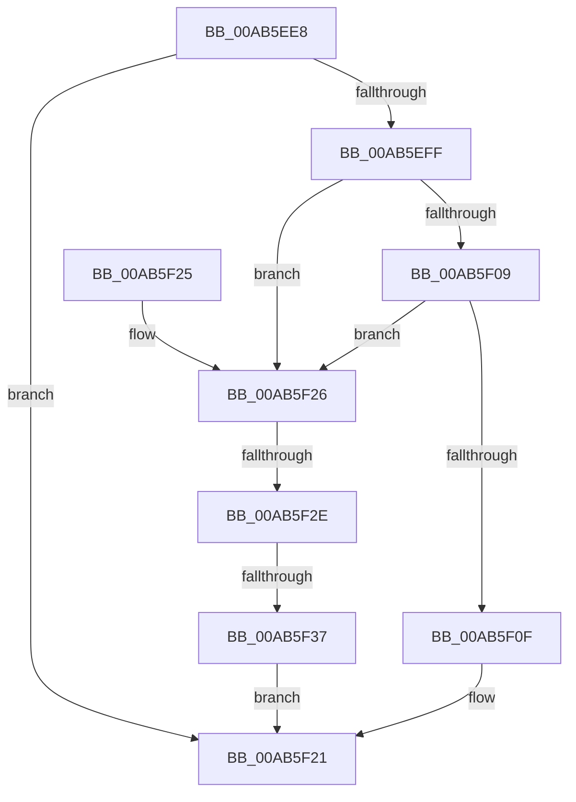

# PopFindNextSystemPowerState

- RVA: `0x00AB5EE8`–`0x00AB5F3F` (길이 `87` bytes)
- VA: `0x0000000140AB5EE8`
- 실행 섹션: `PAGE`
- PDB 이름 있음: `예`; PDB Function 태그: `예`
- unwind 정보 RVA: `0x000DB714`
- 디코드: `22`개 명령, `87/87` bytes 표시
- 미해석 바이트: `0` (있으면 어셈블리에 `.byte`로 보존)

> 이 문서는 커널 이미지의 기계어와 PDB 기호를 분석해 생성했습니다. 4번과 5번은 함수 원형과 자료형을 바이너리 사용 방식에서 추정한 C 해석이며 원본 소스 복구 결과는 아닙니다.

## 1. Dependencies

- 직접 호출 지점: **0**; 고유 호출 대상: **0**
- 직접 호출자로 확인된 함수: **1**
- RIP 상대 이미지 참조: **4**

### Outgoing calls
- 직접 디코드된 call 명령이 없습니다.

### Direct callers
- [PopTransitionSystemPowerStateEx](../../pagelk/B7/PopTransitionSystemPowerStateEx_function_00B7E8C0.md) at `0x00B7EDEB`
- [PopTransitionSystemPowerStateEx](../../pagelk/B7/PopTransitionSystemPowerStateEx_function_00B7E8C0.md) at `0x00B7EE33`

### Static image references
- `0x00AB5EE8` → RVA `0x00F0BD70` (`.data`; read)
- `0x00AB5EF4` → RVA `0x00F0BD6C` (`.data`; write)
- `0x00AB5EFF` → RVA `0x00F0BD4C` (`.data`; read)
- `0x00AB5F13` → RVA `0x00F0BD4C` (`.data`; read/write)

## 2. Other-region calls and transfers

- 다른 실행 섹션으로 향하는 call: **0**
- call이 아닌 외부 분기/꼬리 이동: **2**
  - `0x00AB5F28` → `0x00B4AA8A` (`tail-transfer`)
  - `0x00AB5F31` → `0x00B4AA8A` (`tail-transfer`)

## 3. Assembly (complete function range)

```asm
00AB5EE8  8B 05 82 5E 45 00               mov eax, dword ptr [rip + 0x455e82]
00AB5EEE  41 B9 01 00 00 00               mov r9d, 1
00AB5EF4  89 05 72 5E 45 00               mov dword ptr [rip + 0x455e72], eax
00AB5EFA  41 3B C1                        cmp eax, r9d
00AB5EFD  75 22                           jne 0x140ab5f21
00AB5EFF  8B 05 47 5E 45 00               mov eax, dword ptr [rip + 0x455e47]
00AB5F05  85 C0                           test eax, eax
00AB5F07  79 1D                           jns 0x140ab5f26
00AB5F09  41 80 38 00                     cmp byte ptr [r8], 0
00AB5F0D  74 17                           je 0x140ab5f26
00AB5F0F  41 C6 00 00                     mov byte ptr [r8], 0
00AB5F13  0F BA 35 31 5E 45 00 1C         btr dword ptr [rip + 0x455e31], 0x1c
00AB5F1B  89 0D 4B 5E 45 00               mov dword ptr [rip + 0x455e4b], ecx
00AB5F21  41 8A C1                        mov al, r9b
00AB5F24  C3                              ret
00AB5F25  CC                              int3
00AB5F26  84 D2                           test dl, dl
00AB5F28  0F 84 5C 4B 09 00               je 0x140b4aa8a
00AB5F2E  83 F9 05                        cmp ecx, 5
00AB5F31  0F 85 53 4B 09 00               jne 0x140b4aa8a
00AB5F37  89 0D 2F 5E 45 00               mov dword ptr [rip + 0x455e2f], ecx
00AB5F3D  EB E2                           jmp 0x140ab5f21
```

## 4. C-style interpretation (structured pseudocode)

```c
__int64 __fastcall PopFindNextSystemPowerState(int a1, unsigned __int8 a2, __int64 a3)
{
    *(unsigned int *)(v_rip + 4546162) = (unsigned int)((unsigned int)(*(unsigned int *)(v_rip + 4546178)));
    if (((unsigned int)((unsigned int)(*(unsigned int *)(v_rip + 4546178)))) != 1) goto loc_00AB5F21;
    if (!sign_flag) goto loc_00AB5F26;
    if ((*(unsigned __int8 *)(a3)) == 0) goto loc_00AB5F26;
    *(unsigned __int8 *)(a3) = 0;
    *(unsigned int *)(v_rip + 4546123) = a1;
loc_00AB5F21:
    return 1;
loc_00AB5F26:
    *(unsigned int *)(v_rip + 4546095) = a1;
    goto loc_00AB5F21;
}
```

## 5. (Beta) C Style

```c
int64_t PopFindNextSystemPowerState(int32_t Arg1, uint8_t Arg2, void *Arg3)
{
    uint8_t *arg3 = (uint8_t *)Arg3;

    *(uint32_t *)(v_rip + 0x455E72) = (uint32_t)((uint32_t)(*(uint32_t *)(v_rip + 0x455E82)));
    if (((uint32_t)((uint32_t)(*(uint32_t *)(v_rip + 0x455E82)))) != 1) goto loc_00AB5F21;
    if (!sign_flag) goto loc_00AB5F26;
    if ((*(uint8_t *)(arg3)) == 0) goto loc_00AB5F26;
    *(uint8_t *)(arg3) = 0;
    *(uint32_t *)(v_rip + 0x455E4B) = Arg1;
loc_00AB5F21:
    return 1;
loc_00AB5F26:
    *(uint32_t *)(v_rip + 0x455E2F) = Arg1;
    goto loc_00AB5F21;
}
```

### 관측된 메모리 오프셋

구조체 형식이 확인되지 않은 접근은 인자 기준의 오프셋으로만 기록했습니다.

| 기준 인자 | 오프셋 표현 | 폭 (bit) | 접근 |
|---|---:|---:|---|
| `Arg3` | `+ 0x0` | `8` | `R` |
| `Arg3` | `+ 0x0` | `8` | `W` |

## 6. Execution-region graph

[열기: 2D/3D 그래프와 함수 탐색 컨트롤 패널](../../../control-panel.html?section=page&rva=0x00AB5EE8&view=graph)

- 2D 그래프는 위에서 아래로 흐르고, 3D 그래프는 빈 공간을 드래그해 회전합니다. Shift+드래그는 이동, 휠은 확대·축소, 함수 노드 선택은 대상 보고서 이동입니다.

### Static fallback


