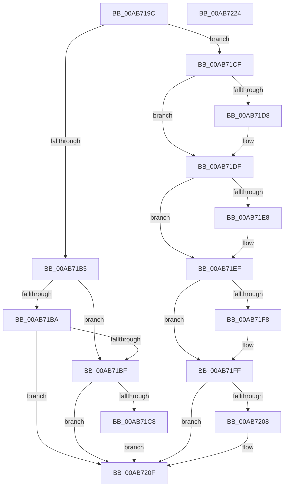

# PopFreeWakeSource

- RVA: `0x00AB719C`–`0x00AB7225` (길이 `137` bytes)
- VA: `0x0000000140AB719C`
- 실행 섹션: `PAGE`
- PDB 이름 있음: `예`; PDB Function 태그: `아니요`
- unwind 정보 RVA: `0x0005CAAC`
- 디코드: `45`개 명령, `137/137` bytes 표시
- 미해석 바이트: `0` (있으면 어셈블리에 `.byte`로 보존)

> 이 문서는 커널 이미지의 기계어와 PDB 기호를 분석해 생성했습니다. 4번과 5번은 함수 원형과 자료형을 바이너리 사용 방식에서 추정한 C 해석이며 원본 소스 복구 결과는 아닙니다.

## 1. Dependencies

- 직접 호출 지점: **6**; 고유 호출 대상: **2**
- 직접 호출자로 확인된 함수: **3**
- RIP 상대 이미지 참조: **0**

### Outgoing calls
- `0x00AB71C8` → [ExDeleteWakeTimerInfo](../../text/65/ExDeleteWakeTimerInfo_function_00659254.md) (function, `0x00659254`)
- `0x00AB71DA` → [ExFreePoolWithTag](../../poolcode/B8/ExFreePoolWithTag_function_00B82870.md) (function, `0x00B82870`)
- `0x00AB71EA` → [ExFreePoolWithTag](../../poolcode/B8/ExFreePoolWithTag_function_00B82870.md) (function, `0x00B82870`)
- `0x00AB71FA` → [ExFreePoolWithTag](../../poolcode/B8/ExFreePoolWithTag_function_00B82870.md) (function, `0x00B82870`)
- `0x00AB720A` → [ExFreePoolWithTag](../../poolcode/B8/ExFreePoolWithTag_function_00B82870.md) (function, `0x00B82870`)
- `0x00AB7214` → [ExFreePoolWithTag](../../poolcode/B8/ExFreePoolWithTag_function_00B82870.md) (function, `0x00B82870`)

### Direct callers
- [PopUnlinkWakeSources](PopUnlinkWakeSources_function_00AB7148.md) at `0x00AB7177`
- [PopProcessDeviceWakeSource](../../pagelk/B6/PopProcessDeviceWakeSource_function_00B6C534.md) at `0x00B6C6C1`
- [PopProcessWakeSourceWork](../../pagelk/B7/PopProcessWakeSourceWork_function_00B7C488.md) at `0x00B7C568`

### Static image references
- 디코드된 RIP-relative 메모리 참조가 없습니다.

## 2. Other-region calls and transfers

- 다른 실행 섹션으로 향하는 call: **6**
  - `0x00AB71C8` → [ExDeleteWakeTimerInfo](../../text/65/ExDeleteWakeTimerInfo_function_00659254.md) (`PAGE` → `.text`)
  - `0x00AB71DA` → [ExFreePoolWithTag](../../poolcode/B8/ExFreePoolWithTag_function_00B82870.md) (`PAGE` → `POOLCODE`)
  - `0x00AB71EA` → [ExFreePoolWithTag](../../poolcode/B8/ExFreePoolWithTag_function_00B82870.md) (`PAGE` → `POOLCODE`)
  - `0x00AB71FA` → [ExFreePoolWithTag](../../poolcode/B8/ExFreePoolWithTag_function_00B82870.md) (`PAGE` → `POOLCODE`)
  - `0x00AB720A` → [ExFreePoolWithTag](../../poolcode/B8/ExFreePoolWithTag_function_00B82870.md) (`PAGE` → `POOLCODE`)
  - `0x00AB7214` → [ExFreePoolWithTag](../../poolcode/B8/ExFreePoolWithTag_function_00B82870.md) (`PAGE` → `POOLCODE`)
- 별도 외부 분기/꼬리 이동을 확인하지 못했습니다.

## 3. Assembly (complete function range)

```asm
00AB719C  48 89 5C 24 08                  mov qword ptr [rsp + 8], rbx
00AB71A1  57                              push rdi
00AB71A2  48 83 EC 20                     sub rsp, 0x20
00AB71A6  48 8B D9                        mov rbx, rcx
00AB71A9  BF 4D 65 6D 20                  mov edi, 0x206d654d
00AB71AE  8B 49 10                        mov ecx, dword ptr [rcx + 0x10]
00AB71B1  85 C9                           test ecx, ecx
00AB71B3  74 1A                           je 0x140ab71cf
00AB71B5  83 E9 02                        sub ecx, 2
00AB71B8  74 05                           je 0x140ab71bf
00AB71BA  83 F9 01                        cmp ecx, 1
00AB71BD  75 50                           jne 0x140ab720f
00AB71BF  48 8B 4B 18                     mov rcx, qword ptr [rbx + 0x18]
00AB71C3  48 85 C9                        test rcx, rcx
00AB71C6  74 47                           je 0x140ab720f
00AB71C8  E8 87 20 BA FF                  call 0x140659254
00AB71CD  EB 40                           jmp 0x140ab720f
00AB71CF  48 8B 4B 20                     mov rcx, qword ptr [rbx + 0x20]
00AB71D3  48 85 C9                        test rcx, rcx
00AB71D6  74 07                           je 0x140ab71df
00AB71D8  8B D7                           mov edx, edi
00AB71DA  E8 91 B6 0C 00                  call 0x140b82870
00AB71DF  48 8B 4B 30                     mov rcx, qword ptr [rbx + 0x30]
00AB71E3  48 85 C9                        test rcx, rcx
00AB71E6  74 07                           je 0x140ab71ef
00AB71E8  8B D7                           mov edx, edi
00AB71EA  E8 81 B6 0C 00                  call 0x140b82870
00AB71EF  48 8B 4B 40                     mov rcx, qword ptr [rbx + 0x40]
00AB71F3  48 85 C9                        test rcx, rcx
00AB71F6  74 07                           je 0x140ab71ff
00AB71F8  8B D7                           mov edx, edi
00AB71FA  E8 71 B6 0C 00                  call 0x140b82870
00AB71FF  48 8B 4B 68                     mov rcx, qword ptr [rbx + 0x68]
00AB7203  48 85 C9                        test rcx, rcx
00AB7206  74 07                           je 0x140ab720f
00AB7208  8B D7                           mov edx, edi
00AB720A  E8 61 B6 0C 00                  call 0x140b82870
00AB720F  8B D7                           mov edx, edi
00AB7211  48 8B CB                        mov rcx, rbx
00AB7214  E8 57 B6 0C 00                  call 0x140b82870
00AB7219  48 8B 5C 24 30                  mov rbx, qword ptr [rsp + 0x30]
00AB721E  48 83 C4 20                     add rsp, 0x20
00AB7222  5F                              pop rdi
00AB7223  C3                              ret
00AB7224  CC                              int3
```

## 4. C-style interpretation (structured pseudocode)

```c
__int64 __fastcall PopFreeWakeSource(__int64 a1)
{
    __int64 result;
    __int64 v_rsp;
    unsigned __int64 v_stack_p8;

    v_stack_p8 = v_rbx;
    v_rsp = (v_rsp) - (32);
    if ((unsigned int)((unsigned int)(*(unsigned int *)(a1 + 16))) == 0) goto loc_00AB71CF;
    a1 = (unsigned int)(((unsigned int)(*(unsigned int *)(a1 + 16))) - (2));
    if (condition_is_equal) goto loc_00AB71BF;
    if (((unsigned int)(a1)) != 1) goto loc_00AB720F;
loc_00AB71BF:
    if (*(unsigned __int64 *)(a1 + 24) == 0) goto loc_00AB720F;
    result = ExDeleteWakeTimerInfo(*(unsigned __int64 *)(a1 + 24), a2, a3, a4);
    goto loc_00AB720F;
loc_00AB71CF:
    if (*(unsigned __int64 *)(a1 + 32) != 0) {
        a2 = (unsigned int)((unsigned int)(0x206D654DULL));
        result = ExFreePoolWithTag(*(unsigned __int64 *)(a1 + 32), a2, a3, a4);
    }
    if (*(unsigned __int64 *)(a1 + 48) != 0) {
        a2 = (unsigned int)((unsigned int)(0x206D654DULL));
        result = ExFreePoolWithTag(*(unsigned __int64 *)(a1 + 48), a2, a3, a4);
    }
    if (*(unsigned __int64 *)(a1 + 64) != 0) {
        a2 = (unsigned int)((unsigned int)(0x206D654DULL));
        result = ExFreePoolWithTag(*(unsigned __int64 *)(a1 + 64), a2, a3, a4);
    }
    if (*(unsigned __int64 *)(a1 + 104) != 0) {
        a2 = (unsigned int)((unsigned int)(0x206D654DULL));
        result = ExFreePoolWithTag(*(unsigned __int64 *)(a1 + 104), a2, a3, a4);
    }
    result = ExFreePoolWithTag(a1, (unsigned int)((unsigned int)((unsigned int)(0x206D654DULL))), a3, a4);
    v_rsp = (v_rsp) + (32);
    return result;
}
```

## 5. (Beta) C Style

```c
int64_t PopFreeWakeSource(void *Arg1)
{
    uint8_t *arg1 = (uint8_t *)Arg1;

    int64_t result;
    int64_t local_rsp;
    uint64_t v_stack_p8;

    v_stack_p8 = local_rbx;
    local_rsp = (local_rsp) - (32);
    if ((uint32_t)((uint32_t)(*(uint32_t *)(arg1 + 0x10))) == 0) goto loc_00AB71CF;
    Arg1 = (uint32_t)(((uint32_t)(*(uint32_t *)(arg1 + 0x10))) - (2));
    if (condition_is_equal) goto loc_00AB71BF;
    if (((uint32_t)(Arg1)) != 1) goto loc_00AB720F;
loc_00AB71BF:
    if (*(uint64_t *)(arg1 + 0x18) == 0) goto loc_00AB720F;
    result = ExDeleteWakeTimerInfo(*(uint64_t *)(arg1 + 0x18), a2, a3, a4);
    goto loc_00AB720F;
loc_00AB71CF:
    if (*(uint64_t *)(arg1 + 0x20) != 0) {
        a2 = (uint32_t)((uint32_t)(0x206D654DULL));
        result = ExFreePoolWithTag(*(uint64_t *)(arg1 + 0x20), a2, a3, a4);
    }
    if (*(uint64_t *)(arg1 + 0x30) != 0) {
        a2 = (uint32_t)((uint32_t)(0x206D654DULL));
        result = ExFreePoolWithTag(*(uint64_t *)(arg1 + 0x30), a2, a3, a4);
    }
    if (*(uint64_t *)(arg1 + 0x40) != 0) {
        a2 = (uint32_t)((uint32_t)(0x206D654DULL));
        result = ExFreePoolWithTag(*(uint64_t *)(arg1 + 0x40), a2, a3, a4);
    }
    if (*(uint64_t *)(arg1 + 0x68) != 0) {
        a2 = (uint32_t)((uint32_t)(0x206D654DULL));
        result = ExFreePoolWithTag(*(uint64_t *)(arg1 + 0x68), a2, a3, a4);
    }
    result = ExFreePoolWithTag(Arg1, (uint32_t)((uint32_t)((uint32_t)(0x206D654DULL))), a3, a4);
    local_rsp = (local_rsp) + (32);
    return result;
}
```

### 관측된 메모리 오프셋

구조체 형식이 확인되지 않은 접근은 인자 기준의 오프셋으로만 기록했습니다.

| 기준 인자 | 오프셋 표현 | 폭 (bit) | 접근 |
|---|---:|---:|---|
| `Arg1` | `+ 0x10` | `32` | `R` |
| `Arg1` | `+ 0x18` | `64` | `R` |
| `Arg1` | `+ 0x20` | `64` | `R` |
| `Arg1` | `+ 0x30` | `64` | `R` |
| `Arg1` | `+ 0x40` | `64` | `R` |
| `Arg1` | `+ 0x68` | `64` | `R` |

## 6. Execution-region graph

[열기: 2D/3D 그래프와 함수 탐색 컨트롤 패널](../../../control-panel.html?section=page&rva=0x00AB719C&view=graph)

- 2D 그래프는 위에서 아래로 흐르고, 3D 그래프는 빈 공간을 드래그해 회전합니다. Shift+드래그는 이동, 휠은 확대·축소, 함수 노드 선택은 대상 보고서 이동입니다.

### Static fallback


