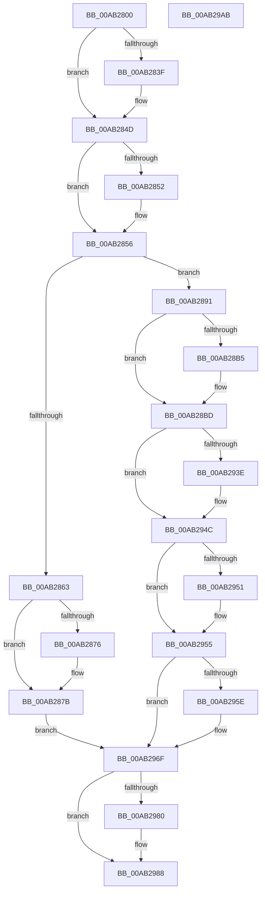

# PopFxUpdateVetoMaskWork

- RVA: `0x00AB2800`–`0x00AB29AC` (길이 `428` bytes)
- VA: `0x0000000140AB2800`
- 실행 섹션: `PAGE`
- PDB 이름 있음: `예`; PDB Function 태그: `아니요`
- unwind 정보 RVA: `0x00060130`
- 디코드: `109`개 명령, `428/428` bytes 표시
- 미해석 바이트: `0` (있으면 어셈블리에 `.byte`로 보존)

> 이 문서는 커널 이미지의 기계어와 PDB 기호를 분석해 생성했습니다. 4번과 5번은 함수 원형과 자료형을 바이너리 사용 방식에서 추정한 C 해석이며 원본 소스 복구 결과는 아닙니다.

## 1. Dependencies

- 직접 호출 지점: **16**; 고유 호출 대상: **12**
- 직접 호출자로 확인된 함수: **0**
- RIP 상대 이미지 참조: **9**

### Outgoing calls
- `0x00AB282F` → [KeAbPreAcquire](../../text/21/KeAbPreAcquire_function_00210230.md) (function, `0x00210230`)
- `0x00AB2848` → [ExfAcquirePushLockExclusiveEx](../../text/20/ExfAcquirePushLockExclusiveEx_function_0020FC90.md) (function, `0x0020FC90`)
- `0x00AB289E` → [KeResetEvent](../../text/24/KeResetEvent_function_00248350.md) (function, `0x00248350`)
- `0x00AB28B8` → [ExfTryToWakePushLock](../../text/26/ExfTryToWakePushLock_function_00265DD0.md) (function, `0x00265DD0`)
- `0x00AB28C0` → [KeAbPostRelease](../../text/2E/KeAbPostRelease_function_002E1600.md) (function, `0x002E1600`)
- `0x00AB28D0` → [PoFxActivateDevice](../../text/4A/PoFxActivateDevice_function_004A0DAC.md) (function, `0x004A0DAC`)
- `0x00AB28DB` → [PopPepUpdateDripsDeviceVetoMask](../../text/4B/PopPepUpdateDripsDeviceVetoMask_function_004B079C.md) (function, `0x004B079C`)
- `0x00AB28E3` → [PoFxIdleDevice](../../text/48/PoFxIdleDevice_function_00483EE8.md) (function, `0x00483EE8`)
- `0x00AB28F0` → [PopFxDereferenceDevice](../../text/27/PopFxDereferenceDevice_function_0027038C.md) (function, `0x0027038C`)
- `0x00AB28FD` → [ExFreePoolWithTag](../../poolcode/B8/ExFreePoolWithTag_function_00B82870.md) (function, `0x00B82870`)
- `0x00AB2921` → [ZwUpdateWnfStateData](../../text/6B/ZwUpdateWnfStateData_function_006B0D10.md) (function, `0x006B0D10`)
- `0x00AB292E` → [KeAbPreAcquire](../../text/21/KeAbPreAcquire_function_00210230.md) (function, `0x00210230`)
- `0x00AB2947` → [ExfAcquirePushLockExclusiveEx](../../text/20/ExfAcquirePushLockExclusiveEx_function_0020FC90.md) (function, `0x0020FC90`)
- `0x00AB296A` → [KeSetEvent](../../text/33/KeSetEvent_function_0033F310.md) (function, `0x0033F310`)
- `0x00AB2983` → [ExfTryToWakePushLock](../../text/26/ExfTryToWakePushLock_function_00265DD0.md) (function, `0x00265DD0`)
- `0x00AB298B` → [KeAbPostRelease](../../text/2E/KeAbPostRelease_function_002E1600.md) (function, `0x002E1600`)

### Direct callers
- 이 함수 시작 RVA로 연결되는 직접 call은 확인되지 않았습니다. 간접 호출은 완전히 역산할 수 없습니다.

### Static image references
- `0x00AB281D` → RVA `0x00F0E500` (`.data`; read)
- `0x00AB285A` → RVA `0x00F0E518` (`.data`; read)
- `0x00AB2863` → RVA `0x00F0E510` (`.data`; read)
- `0x00AB286A` → RVA `0x00F0E508` (`.data`; read)
- `0x00AB2885` → RVA `0x00F0E510` (`.data`; write)
- `0x00AB2891` → RVA `0x00F0E51C` (`.data`; read/write)
- `0x00AB2897` → RVA `0x00F0E520` (`.data`; read)
- `0x00AB28A6` → RVA `0x00F0E500` (`.data`; read/write)
- `0x00AB2907` → RVA `0x0001E230` (`.rdata`; read)

## 2. Other-region calls and transfers

- 다른 실행 섹션으로 향하는 call: **16**
  - `0x00AB282F` → [KeAbPreAcquire](../../text/21/KeAbPreAcquire_function_00210230.md) (`PAGE` → `.text`)
  - `0x00AB2848` → [ExfAcquirePushLockExclusiveEx](../../text/20/ExfAcquirePushLockExclusiveEx_function_0020FC90.md) (`PAGE` → `.text`)
  - `0x00AB289E` → [KeResetEvent](../../text/24/KeResetEvent_function_00248350.md) (`PAGE` → `.text`)
  - `0x00AB28B8` → [ExfTryToWakePushLock](../../text/26/ExfTryToWakePushLock_function_00265DD0.md) (`PAGE` → `.text`)
  - `0x00AB28C0` → [KeAbPostRelease](../../text/2E/KeAbPostRelease_function_002E1600.md) (`PAGE` → `.text`)
  - `0x00AB28D0` → [PoFxActivateDevice](../../text/4A/PoFxActivateDevice_function_004A0DAC.md) (`PAGE` → `.text`)
  - `0x00AB28DB` → [PopPepUpdateDripsDeviceVetoMask](../../text/4B/PopPepUpdateDripsDeviceVetoMask_function_004B079C.md) (`PAGE` → `.text`)
  - `0x00AB28E3` → [PoFxIdleDevice](../../text/48/PoFxIdleDevice_function_00483EE8.md) (`PAGE` → `.text`)
  - `0x00AB28F0` → [PopFxDereferenceDevice](../../text/27/PopFxDereferenceDevice_function_0027038C.md) (`PAGE` → `.text`)
  - `0x00AB28FD` → [ExFreePoolWithTag](../../poolcode/B8/ExFreePoolWithTag_function_00B82870.md) (`PAGE` → `POOLCODE`)
  - `0x00AB2921` → [ZwUpdateWnfStateData](../../text/6B/ZwUpdateWnfStateData_function_006B0D10.md) (`PAGE` → `.text`)
  - `0x00AB292E` → [KeAbPreAcquire](../../text/21/KeAbPreAcquire_function_00210230.md) (`PAGE` → `.text`)
  - `0x00AB2947` → [ExfAcquirePushLockExclusiveEx](../../text/20/ExfAcquirePushLockExclusiveEx_function_0020FC90.md) (`PAGE` → `.text`)
  - `0x00AB296A` → [KeSetEvent](../../text/33/KeSetEvent_function_0033F310.md) (`PAGE` → `.text`)
  - `0x00AB2983` → [ExfTryToWakePushLock](../../text/26/ExfTryToWakePushLock_function_00265DD0.md) (`PAGE` → `.text`)
  - `0x00AB298B` → [KeAbPostRelease](../../text/2E/KeAbPostRelease_function_002E1600.md) (`PAGE` → `.text`)
- 별도 외부 분기/꼬리 이동을 확인하지 못했습니다.

## 3. Assembly (complete function range)

```asm
00AB2800  48 8B C4                        mov rax, rsp
00AB2803  48 89 58 08                     mov qword ptr [rax + 8], rbx
00AB2807  48 89 68 10                     mov qword ptr [rax + 0x10], rbp
00AB280B  48 89 70 18                     mov qword ptr [rax + 0x18], rsi
00AB280F  48 89 78 20                     mov qword ptr [rax + 0x20], rdi
00AB2813  41 56                           push r14
00AB2815  48 83 EC 40                     sub rsp, 0x40
00AB2819  48 8B 69 10                     mov rbp, qword ptr [rcx + 0x10]
00AB281D  4C 8D 35 DC BC 45 00            lea r14, [rip + 0x45bcdc]
00AB2824  48 8B F1                        mov rsi, rcx
00AB2827  45 33 C0                        xor r8d, r8d
00AB282A  49 8B CE                        mov rcx, r14
00AB282D  33 D2                           xor edx, edx
00AB282F  E8 FC D9 75 FF                  call 0x140210230
00AB2834  F0 49 0F BA 2E 00               lock bts qword ptr [r14], 0
00AB283A  48 8B D8                        mov rbx, rax
00AB283D  73 0E                           jae 0x140ab284d
00AB283F  4D 8B C6                        mov r8, r14
00AB2842  48 8B D0                        mov rdx, rax
00AB2845  49 8B CE                        mov rcx, r14
00AB2848  E8 43 D4 75 FF                  call 0x14020fc90
00AB284D  48 85 DB                        test rbx, rbx
00AB2850  74 04                           je 0x140ab2856
00AB2852  C6 43 0A 01                     mov byte ptr [rbx + 0xa], 1
00AB2856  48 83 CB FF                     or rbx, 0xffffffffffffffff
00AB285A  80 3D B7 BC 45 00 00            cmp byte ptr [rip + 0x45bcb7], 0
00AB2861  74 2E                           je 0x140ab2891
00AB2863  48 8B 05 A6 BC 45 00            mov rax, qword ptr [rip + 0x45bca6]
00AB286A  48 8D 0D 97 BC 45 00            lea rcx, [rip + 0x45bc97]
00AB2871  48 39 08                        cmp qword ptr [rax], rcx
00AB2874  74 05                           je 0x140ab287b
00AB2876  8D 4B 04                        lea ecx, [rbx + 4]
00AB2879  CD 29                           int 0x29
00AB287B  48 89 0E                        mov qword ptr [rsi], rcx
00AB287E  48 89 46 08                     mov qword ptr [rsi + 8], rax
00AB2882  48 89 30                        mov qword ptr [rax], rsi
00AB2885  48 89 35 84 BC 45 00            mov qword ptr [rip + 0x45bc84], rsi
00AB288C  E9 DE 00 00 00                  jmp 0x140ab296f
00AB2891  FF 05 85 BC 45 00               inc dword ptr [rip + 0x45bc85]
00AB2897  48 8D 0D 82 BC 45 00            lea rcx, [rip + 0x45bc82]
00AB289E  E8 AD 5A 79 FF                  call 0x140248350
00AB28A3  48 8B C3                        mov rax, rbx
00AB28A6  F0 48 0F C1 05 51 BC 45 00      lock xadd qword ptr [rip + 0x45bc51], rax
00AB28AF  24 06                           and al, 6
00AB28B1  3C 02                           cmp al, 2
00AB28B3  75 08                           jne 0x140ab28bd
00AB28B5  49 8B CE                        mov rcx, r14
00AB28B8  E8 13 35 7B FF                  call 0x140265dd0
00AB28BD  49 8B CE                        mov rcx, r14
00AB28C0  E8 3B ED 82 FF                  call 0x1402e1600
00AB28C5  48 8B 45 30                     mov rax, qword ptr [rbp + 0x30]
00AB28C9  48 8B 78 20                     mov rdi, qword ptr [rax + 0x20]
00AB28CD  48 8B CF                        mov rcx, rdi
00AB28D0  E8 D7 E4 9E FF                  call 0x1404a0dac
00AB28D5  8B 56 18                        mov edx, dword ptr [rsi + 0x18]
00AB28D8  48 8B CD                        mov rcx, rbp
00AB28DB  E8 BC DE 9F FF                  call 0x1404b079c
00AB28E0  48 8B CF                        mov rcx, rdi
00AB28E3  E8 00 16 9D FF                  call 0x140483ee8
00AB28E8  BA 02 00 00 00                  mov edx, 2
00AB28ED  48 8B CD                        mov rcx, rbp
00AB28F0  E8 97 DA 7B FF                  call 0x14027038c
00AB28F5  BA 50 46 58 4D                  mov edx, 0x4d584650
00AB28FA  48 8B CE                        mov rcx, rsi
00AB28FD  E8 6E FF 0C 00                  call 0x140b82870
00AB2902  83 64 24 30 00                  and dword ptr [rsp + 0x30], 0
00AB2907  48 8D 0D 22 B9 56 FF            lea rcx, [rip - 0xa946de]
00AB290E  83 64 24 28 00                  and dword ptr [rsp + 0x28], 0
00AB2913  45 33 C9                        xor r9d, r9d
00AB2916  48 83 64 24 20 00               and qword ptr [rsp + 0x20], 0
00AB291C  45 33 C0                        xor r8d, r8d
00AB291F  33 D2                           xor edx, edx
00AB2921  E8 EA E3 BF FF                  call 0x1406b0d10
00AB2926  45 33 C0                        xor r8d, r8d
00AB2929  33 D2                           xor edx, edx
00AB292B  49 8B CE                        mov rcx, r14
00AB292E  E8 FD D8 75 FF                  call 0x140210230
00AB2933  F0 49 0F BA 2E 00               lock bts qword ptr [r14], 0
00AB2939  48 8B F8                        mov rdi, rax
00AB293C  73 0E                           jae 0x140ab294c
00AB293E  4D 8B C6                        mov r8, r14
00AB2941  48 8B D0                        mov rdx, rax
00AB2944  49 8B CE                        mov rcx, r14
00AB2947  E8 44 D3 75 FF                  call 0x14020fc90
00AB294C  48 85 FF                        test rdi, rdi
00AB294F  74 04                           je 0x140ab2955
00AB2951  C6 47 0A 01                     mov byte ptr [rdi + 0xa], 1
00AB2955  83 2D C0 BB 45 00 01            sub dword ptr [rip + 0x45bbc0], 1
00AB295C  75 11                           jne 0x140ab296f
00AB295E  45 33 C0                        xor r8d, r8d
00AB2961  48 8D 0D B8 BB 45 00            lea rcx, [rip + 0x45bbb8]
00AB2968  33 D2                           xor edx, edx
00AB296A  E8 A1 C9 88 FF                  call 0x14033f310
00AB296F  F0 48 0F C1 1D 88 BB 45 00      lock xadd qword ptr [rip + 0x45bb88], rbx
00AB2978  80 E3 06                        and bl, 6
00AB297B  80 FB 02                        cmp bl, 2
00AB297E  75 08                           jne 0x140ab2988
00AB2980  49 8B CE                        mov rcx, r14
00AB2983  E8 48 34 7B FF                  call 0x140265dd0
00AB2988  49 8B CE                        mov rcx, r14
00AB298B  E8 70 EC 82 FF                  call 0x1402e1600
00AB2990  48 8B 5C 24 50                  mov rbx, qword ptr [rsp + 0x50]
00AB2995  48 8B 6C 24 58                  mov rbp, qword ptr [rsp + 0x58]
00AB299A  48 8B 74 24 60                  mov rsi, qword ptr [rsp + 0x60]
00AB299F  48 8B 7C 24 68                  mov rdi, qword ptr [rsp + 0x68]
00AB29A4  48 83 C4 40                     add rsp, 0x40
00AB29A8  41 5E                           pop r14
00AB29AA  C3                              ret
00AB29AB  CC                              int3
```

## 4. C-style interpretation (structured pseudocode)

```c
__int64 __fastcall PopFxUpdateVetoMaskWork(__int64 a1, int a2, int a3, int a4)
{
    __int64 result;
    __int64 v_rbx;
    __int64 v_rsp;
    unsigned int v_stack_m18;
    unsigned int v_stack_m20;
    unsigned __int64 v_stack_m28;
    unsigned __int64 v_stack_p10;
    unsigned __int64 v_stack_p18;
    unsigned __int64 v_stack_p20;
    unsigned __int64 v_stack_p8;

    *(unsigned __int64 *)(v_rsp + 8) = v_rbx;
    *(unsigned __int64 *)(v_rsp + 16) = v_rbp;
    *(unsigned __int64 *)(v_rsp + 24) = v_rsi;
    *(unsigned __int64 *)(v_rsp + 32) = v_rdi;
    v_rsp = (v_rsp) - (64);
    a3 = 0;
    a2 = 0;
    result = KeAbPreAcquire(v_rip + 4570332, a2, a3, a4);
    if (!(condition_is_above_or_equal)) {
        a3 = v_rip + 4570332;
        a2 = result;
        a1 = v_rip + 4570332;
        result = ExfAcquirePushLockExclusiveEx(a1, a2, a3, a4);
    }
    if (result != 0) {
        *(unsigned __int8 *)(result + 10) = 1;
    }
    v_rbx = (result) | (-1);
    if ((*(unsigned __int8 *)(v_rip + 4570295)) == 0) goto loc_00AB2891;
    if ((*(unsigned __int64 *)(*(unsigned __int64 *)(v_rip + 4570278))) != (v_rip + 4570263)) {
        a1 = v_rbx + 4;
    }
    *(unsigned __int64 *)(a1) = a1;
    *(unsigned __int64 *)(a1 + 8) = *(unsigned __int64 *)(v_rip + 4570278);
    *(unsigned __int64 *)(*(unsigned __int64 *)(v_rip + 4570278)) = a1;
    *(unsigned __int64 *)(v_rip + 4570244) = a1;
    goto loc_00AB296F;
loc_00AB2891:
    result = KeResetEvent(v_rip + 4570242, a2, a3, a4);
    result = (unsigned __int8)((v_rbx) & (6));
    if (((unsigned __int8)(result)) == 2) {
        a1 = v_rip + 4570332;
        result = ExfTryToWakePushLock(a1, a2, a3, a4);
    }
    result = KeAbPostRelease(v_rip + 4570332, a2, a3, a4);
    result = PoFxActivateDevice(*(unsigned __int64 *)(*(unsigned __int64 *)(*(unsigned __int64 *)(a1 + 16) + 48) + 32), a2, a3, a4);
    result = PopPepUpdateDripsDeviceVetoMask(*(unsigned __int64 *)(a1 + 16), (unsigned int)(*(unsigned int *)(a1 + 24)), a3, a4);
    result = PoFxIdleDevice(*(unsigned __int64 *)(*(unsigned __int64 *)(*(unsigned __int64 *)(a1 + 16) + 48) + 32), (unsigned int)(*(unsigned int *)(a1 + 24)), a3, a4);
    result = PopFxDereferenceDevice(*(unsigned __int64 *)(a1 + 16), 2, a3, a4);
    result = ExFreePoolWithTag(a1, (unsigned int)(0x4D584650ULL), a3, a4);
    a4 = 0;
    a3 = 0;
    a2 = 0;
    result = ZwUpdateWnfStateData(v_rip - 11093726, a2, a3, a4);
    a3 = 0;
    a2 = 0;
    result = KeAbPreAcquire(v_rip + 4570332, a2, a3, a4);
    if (!(condition_is_above_or_equal)) {
        a3 = v_rip + 4570332;
        a2 = result;
        a1 = v_rip + 4570332;
        result = ExfAcquirePushLockExclusiveEx(a1, a2, a3, a4);
    }
    if (result != 0) {
        *(unsigned __int8 *)(result + 10) = 1;
    }
    if (result == 0) {
        a3 = 0;
        a1 = v_rip + 4570040;
        a2 = 0;
        result = KeSetEvent(a1, a2, a3, a4);
    }
    v_rbx = (unsigned __int8)((v_rbx) & (6));
    if (((unsigned __int8)(v_rbx)) == 2) {
        a1 = v_rip + 4570332;
        result = ExfTryToWakePushLock(a1, a2, a3, a4);
    }
    result = KeAbPostRelease(v_rip + 4570332, a2, a3, a4);
    v_rsp = (v_rsp) + (64);
    return result;
}
```

## 5. (Beta) C Style

```c
int64_t PopFxUpdateVetoMaskWork(void *Arg1, int32_t Arg2, int32_t Arg3, int32_t Arg4)
{
    uint8_t *arg1 = (uint8_t *)Arg1;

    int64_t result;
    int64_t local_rbx;
    int64_t local_rsp;
    uint32_t v_stack_m18;
    uint32_t v_stack_m20;
    uint64_t v_stack_m28;
    uint64_t v_stack_p10;
    uint64_t v_stack_p18;
    uint64_t v_stack_p20;
    uint64_t v_stack_p8;

    *(uint64_t *)(local_rsp + 0x8) = local_rbx;
    *(uint64_t *)(local_rsp + 0x10) = local_rbp;
    *(uint64_t *)(local_rsp + 0x18) = local_rsi;
    *(uint64_t *)(local_rsp + 0x20) = local_rdi;
    local_rsp = (local_rsp) - (64);
    Arg3 = 0;
    Arg2 = 0;
    result = KeAbPreAcquire(v_rip + 4570332, Arg2, Arg3, Arg4);
    if (!(condition_is_above_or_equal)) {
        Arg3 = v_rip + 4570332;
        Arg2 = result;
        Arg1 = v_rip + 4570332;
        result = ExfAcquirePushLockExclusiveEx(Arg1, Arg2, Arg3, Arg4);
    }
    if (result != 0) {
        *(uint8_t *)(result + 0xA) = 1;
    }
    local_rbx = (result) | (-1);
    if ((*(uint8_t *)(v_rip + 0x45BCB7)) == 0) goto loc_00AB2891;
    if ((*(uint64_t *)(*(uint64_t *)(v_rip + 0x45BCA6))) != (v_rip + 4570263)) {
        Arg1 = local_rbx + 4;
    }
    *(void **)(arg1) = Arg1;
    *(uint64_t *)(arg1 + 0x8) = *(uint64_t *)(v_rip + 0x45BCA6);
    *(void **)(*(uint64_t *)(v_rip + 0x45BCA6)) = Arg1;
    *(void **)(v_rip + 0x45BC84) = Arg1;
    goto loc_00AB296F;
loc_00AB2891:
    result = KeResetEvent(v_rip + 4570242, Arg2, Arg3, Arg4);
    result = (uint8_t)((local_rbx) & (6));
    if (((uint8_t)(result)) == 2) {
        Arg1 = v_rip + 4570332;
        result = ExfTryToWakePushLock(Arg1, Arg2, Arg3, Arg4);
    }
    result = KeAbPostRelease(v_rip + 4570332, Arg2, Arg3, Arg4);
    result = PoFxActivateDevice(*(uint64_t *)(*(uint64_t *)(*(uint64_t *)(arg1 + 0x10) + 0x30) + 0x20), Arg2, Arg3, Arg4);
    result = PopPepUpdateDripsDeviceVetoMask(*(uint64_t *)(arg1 + 0x10), (uint32_t)(*(uint32_t *)(arg1 + 0x18)), Arg3, Arg4);
    result = PoFxIdleDevice(*(uint64_t *)(*(uint64_t *)(*(uint64_t *)(arg1 + 0x10) + 0x30) + 0x20), (uint32_t)(*(uint32_t *)(arg1 + 0x18)), Arg3, Arg4);
    result = PopFxDereferenceDevice(*(uint64_t *)(arg1 + 0x10), 2, Arg3, Arg4);
    result = ExFreePoolWithTag(Arg1, (uint32_t)(0x4D584650ULL), Arg3, Arg4);
    Arg4 = 0;
    Arg3 = 0;
    Arg2 = 0;
    result = ZwUpdateWnfStateData(v_rip - 11093726, Arg2, Arg3, Arg4);
    Arg3 = 0;
    Arg2 = 0;
    result = KeAbPreAcquire(v_rip + 4570332, Arg2, Arg3, Arg4);
    if (!(condition_is_above_or_equal)) {
        Arg3 = v_rip + 4570332;
        Arg2 = result;
        Arg1 = v_rip + 4570332;
        result = ExfAcquirePushLockExclusiveEx(Arg1, Arg2, Arg3, Arg4);
    }
    if (result != 0) {
        *(uint8_t *)(result + 0xA) = 1;
    }
    if (result == 0) {
        Arg3 = 0;
        Arg1 = v_rip + 4570040;
        Arg2 = 0;
        result = KeSetEvent(Arg1, Arg2, Arg3, Arg4);
    }
    local_rbx = (uint8_t)((local_rbx) & (6));
    if (((uint8_t)(local_rbx)) == 2) {
        Arg1 = v_rip + 4570332;
        result = ExfTryToWakePushLock(Arg1, Arg2, Arg3, Arg4);
    }
    result = KeAbPostRelease(v_rip + 4570332, Arg2, Arg3, Arg4);
    local_rsp = (local_rsp) + (64);
    return result;
}
```

### 관측된 메모리 오프셋

구조체 형식이 확인되지 않은 접근은 인자 기준의 오프셋으로만 기록했습니다.

| 기준 인자 | 오프셋 표현 | 폭 (bit) | 접근 |
|---|---:|---:|---|
| `Arg1` | `+ 0x0` | `64` | `W` |
| `Arg1` | `+ 0x8` | `64` | `W` |
| `Arg1` | `+ 0x10` | `64` | `R` |
| `Arg1` | `+ 0x18` | `32` | `R` |

## 6. Execution-region graph

[열기: 2D/3D 그래프와 함수 탐색 컨트롤 패널](../../../control-panel.html?section=page&rva=0x00AB2800&view=graph)

- 2D 그래프는 위에서 아래로 흐르고, 3D 그래프는 빈 공간을 드래그해 회전합니다. Shift+드래그는 이동, 휠은 확대·축소, 함수 노드 선택은 대상 보고서 이동입니다.

### Static fallback


