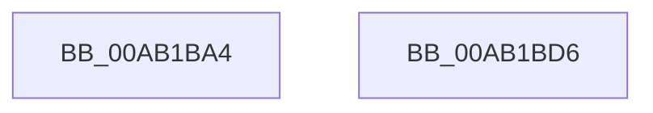

# PopGetEnergyCounter

- RVA: `0x00AB1BA4`–`0x00AB1BD7` (길이 `51` bytes)
- VA: `0x0000000140AB1BA4`
- 실행 섹션: `PAGE`
- PDB 이름 있음: `예`; PDB Function 태그: `아니요`
- unwind 정보 RVA: `0x0005CF00`
- 디코드: `13`개 명령, `51/51` bytes 표시
- 미해석 바이트: `0` (있으면 어셈블리에 `.byte`로 보존)

> 이 문서는 커널 이미지의 기계어와 PDB 기호를 분석해 생성했습니다. 4번과 5번은 함수 원형과 자료형을 바이너리 사용 방식에서 추정한 C 해석이며 원본 소스 복구 결과는 아닙니다.

## 1. Dependencies

- 직접 호출 지점: **2**; 고유 호출 대상: **2**
- 직접 호출자로 확인된 함수: **1**
- RIP 상대 이미지 참조: **2**

### Outgoing calls
- `0x00AB1BB4` → [PopAcquireRwLockShared](../../text/2D/PopAcquireRwLockShared_function_002D9A40.md) (function, `0x002D9A40`)
- `0x00AB1BCB` → [PopReleaseRwLock](../../text/2D/PopReleaseRwLock_function_002DFBBC.md) (function, `0x002DFBBC`)

### Direct callers
- [PopCaptureSleepStudyStatistics](../../text/43/PopCaptureSleepStudyStatistics_function_004399F4.md) at `0x00439C47`

### Static image references
- `0x00AB1BAD` → RVA `0x00F0C238` (`.data`; read)
- `0x00AB1BB9` → RVA `0x00F0C2B0` (`.data`; read)

## 2. Other-region calls and transfers

- 다른 실행 섹션으로 향하는 call: **2**
  - `0x00AB1BB4` → [PopAcquireRwLockShared](../../text/2D/PopAcquireRwLockShared_function_002D9A40.md) (`PAGE` → `.text`)
  - `0x00AB1BCB` → [PopReleaseRwLock](../../text/2D/PopReleaseRwLock_function_002DFBBC.md) (`PAGE` → `.text`)
- 별도 외부 분기/꼬리 이동을 확인하지 못했습니다.

## 3. Assembly (complete function range)

```asm
00AB1BA4  40 53                           push rbx
00AB1BA6  48 83 EC 20                     sub rsp, 0x20
00AB1BAA  48 8B D9                        mov rbx, rcx
00AB1BAD  48 8D 0D 84 A6 45 00            lea rcx, [rip + 0x45a684]
00AB1BB4  E8 87 7E 82 FF                  call 0x1402d9a40
00AB1BB9  0F 10 05 F0 A6 45 00            movups xmm0, xmmword ptr [rip + 0x45a6f0]
00AB1BC0  48 8D 0D 71 A6 45 00            lea rcx, [rip + 0x45a671]
00AB1BC7  F3 0F 7F 03                     movdqu xmmword ptr [rbx], xmm0
00AB1BCB  E8 EC DF 82 FF                  call 0x1402dfbbc
00AB1BD0  48 83 C4 20                     add rsp, 0x20
00AB1BD4  5B                              pop rbx
00AB1BD5  C3                              ret
00AB1BD6  CC                              int3
```

## 4. C-style interpretation (structured pseudocode)

```c
__int64 __fastcall PopGetEnergyCounter(__int64 a1)
{
    __int64 result;
    __int64 v_rsp;

    v_rsp = (v_rsp) - (32);
    result = PopAcquireRwLockShared(v_rip + 4564612, a2, a3, a4);
    *(unsigned __int64 *)(a1) = v_xmm0;
    result = PopReleaseRwLock(v_rip + 4564593, a2, a3, a4);
    v_rsp = (v_rsp) + (32);
    return result;
}
```

## 5. (Beta) C Style

```c
int64_t PopGetEnergyCounter(void *Arg1)
{
    uint8_t *arg1 = (uint8_t *)Arg1;

    int64_t result;
    int64_t local_rsp;

    local_rsp = (local_rsp) - (32);
    result = PopAcquireRwLockShared(v_rip + 4564612, a2, a3, a4);
    *(uint64_t *)(arg1) = v_xmm0;
    result = PopReleaseRwLock(v_rip + 4564593, a2, a3, a4);
    local_rsp = (local_rsp) + (32);
    return result;
}
```

### 관측된 메모리 오프셋

구조체 형식이 확인되지 않은 접근은 인자 기준의 오프셋으로만 기록했습니다.

| 기준 인자 | 오프셋 표현 | 폭 (bit) | 접근 |
|---|---:|---:|---|
| `Arg1` | `+ 0x0` | `128` | `W` |

## 6. Execution-region graph

[열기: 2D/3D 그래프와 함수 탐색 컨트롤 패널](../../../control-panel.html?section=page&rva=0x00AB1BA4&view=graph)

- 2D 그래프는 위에서 아래로 흐르고, 3D 그래프는 빈 공간을 드래그해 회전합니다. Shift+드래그는 이동, 휠은 확대·축소, 함수 노드 선택은 대상 보고서 이동입니다.

### Static fallback


