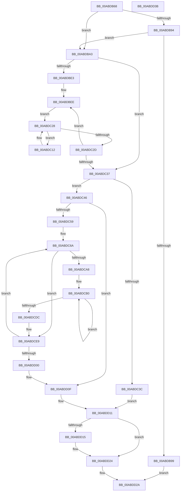

# PopGetWakeSource

- RVA: `0x00ABDB68`–`0x00ABDD3C` (길이 `468` bytes)
- VA: `0x0000000140ABDB68`
- 실행 섹션: `PAGE`
- PDB 이름 있음: `예`; PDB Function 태그: `아니요`
- unwind 정보 RVA: `0x000BD64C`
- 디코드: `133`개 명령, `468/468` bytes 표시
- 미해석 바이트: `0` (있으면 어셈블리에 `.byte`로 보존)

> 이 문서는 커널 이미지의 기계어와 PDB 기호를 분석해 생성했습니다. 4번과 5번은 함수 원형과 자료형을 바이너리 사용 방식에서 추정한 C 해석이며 원본 소스 복구 결과는 아닙니다.

## 1. Dependencies

- 직접 호출 지점: **5**; 고유 호출 대상: **5**
- 직접 호출자로 확인된 함수: **1**
- RIP 상대 이미지 참조: **1**

### Outgoing calls
- `0x00ABDBB8` → [KeWaitForSingleObject](../../text/20/KeWaitForSingleObject_function_0020E6B0.md) (function, `0x0020E6B0`)
- `0x00ABDBC5` → [PopGetCurrentWakeInfos](../../text/4C/PopGetCurrentWakeInfos_function_004C8840.md) (function, `0x004C8840`)
- `0x00ABDC15` → [PopWakeSourceSize](../AD/PopWakeSourceSize_function_00ADA884.md) (function, `0x00ADA884`)
- `0x00ABDCC9` → [PopCopyWakeSource](../75/PopCopyWakeSource_function_0075C558.md) (function, `0x0075C558`)
- `0x00ABDD1F` → [PopDereferenceWakeInfos](../../text/5D/PopDereferenceWakeInfos_function_005D498C.md) (function, `0x005D498C`)

### Direct callers
- [NtPowerInformation](../95/NtPowerInformation_function_00955D80.md) at `0x00956BE0`
- [NtPowerInformation](../95/NtPowerInformation_function_00955D80.md) at `0x00956C25`

### Static image references
- `0x00ABDBA9` → RVA `0x00F0DEC0` (`.data`; read)

## 2. Other-region calls and transfers

- 다른 실행 섹션으로 향하는 call: **3**
  - `0x00ABDBB8` → [KeWaitForSingleObject](../../text/20/KeWaitForSingleObject_function_0020E6B0.md) (`PAGE` → `.text`)
  - `0x00ABDBC5` → [PopGetCurrentWakeInfos](../../text/4C/PopGetCurrentWakeInfos_function_004C8840.md) (`PAGE` → `.text`)
  - `0x00ABDD1F` → [PopDereferenceWakeInfos](../../text/5D/PopDereferenceWakeInfos_function_005D498C.md) (`PAGE` → `.text`)
- 별도 외부 분기/꼬리 이동을 확인하지 못했습니다.

## 3. Assembly (complete function range)

```asm
00ABDB68  48 8B C4                        mov rax, rsp
00ABDB6B  48 89 50 10                     mov qword ptr [rax + 0x10], rdx
00ABDB6F  48 89 48 08                     mov qword ptr [rax + 8], rcx
00ABDB73  53                              push rbx
00ABDB74  55                              push rbp
00ABDB75  56                              push rsi
00ABDB76  57                              push rdi
00ABDB77  41 54                           push r12
00ABDB79  41 55                           push r13
00ABDB7B  41 56                           push r14
00ABDB7D  41 57                           push r15
00ABDB7F  48 83 EC 58                     sub rsp, 0x58
00ABDB83  48 83 60 20 00                  and qword ptr [rax + 0x20], 0
00ABDB88  4C 8B EA                        mov r13, rdx
00ABDB8B  8B 2A                           mov ebp, dword ptr [rdx]
00ABDB8D  48 8B F1                        mov rsi, rcx
00ABDB90  85 ED                           test ebp, ebp
00ABDB92  74 0F                           je 0x140abdba3
00ABDB94  48 85 C9                        test rcx, rcx
00ABDB97  75 0A                           jne 0x140abdba3
00ABDB99  B8 0D 00 00 C0                  mov eax, 0xc000000d
00ABDB9E  E9 87 01 00 00                  jmp 0x140abdd2a
00ABDBA3  48 83 64 24 20 00               and qword ptr [rsp + 0x20], 0
00ABDBA9  48 8D 0D 10 03 45 00            lea rcx, [rip + 0x450310]
00ABDBB0  45 33 C9                        xor r9d, r9d
00ABDBB3  45 33 C0                        xor r8d, r8d
00ABDBB6  33 D2                           xor edx, edx
00ABDBB8  E8 F3 0A 75 FF                  call 0x14020e6b0
00ABDBBD  48 8D 8C 24 B8 00 00 00         lea rcx, [rsp + 0xb8]
00ABDBC5  E8 76 AC A0 FF                  call 0x1404c8840
00ABDBCA  8B D8                           mov ebx, eax
00ABDBCC  89 9C 24 B0 00 00 00            mov dword ptr [rsp + 0xb0], ebx
00ABDBD3  8B F8                           mov edi, eax
00ABDBD5  8D 0C 9D 04 00 00 00            lea ecx, [rbx*4 + 4]
00ABDBDC  4C 63 F1                        movsxd r14, ecx
00ABDBDF  85 C0                           test eax, eax
00ABDBE1  74 54                           je 0x140abdc37
00ABDBE3  4C 8B 94 24 B8 00 00 00         mov r10, qword ptr [rsp + 0xb8]
00ABDBEB  44 8B DB                        mov r11d, ebx
00ABDBEE  49 8B 12                        mov rdx, qword ptr [r10]
00ABDBF1  49 83 C6 07                     add r14, 7
00ABDBF5  49 83 E6 F8                     and r14, 0xfffffffffffffff8
00ABDBF9  8B 42 28                        mov eax, dword ptr [rdx + 0x28]
00ABDBFC  4C 8D 7A 18                     lea r15, [rdx + 0x18]
00ABDC00  4D 8B 0F                        mov r9, qword ptr [r15]
00ABDC03  8D 04 85 04 00 00 00            lea eax, [rax*4 + 4]
00ABDC0A  48 63 C8                        movsxd rcx, eax
00ABDC0D  4C 03 F1                        add r14, rcx
00ABDC10  EB 16                           jmp 0x140abdc28
00ABDC12  49 8B C9                        mov rcx, r9
00ABDC15  E8 6A CC 01 00                  call 0x140ada884
00ABDC1A  4D 8B 09                        mov r9, qword ptr [r9]
00ABDC1D  49 83 C6 07                     add r14, 7
00ABDC21  49 83 E6 F8                     and r14, 0xfffffffffffffff8
00ABDC25  4C 03 F0                        add r14, rax
00ABDC28  4D 3B CF                        cmp r9, r15
00ABDC2B  75 E5                           jne 0x140abdc12
00ABDC2D  49 83 C2 08                     add r10, 8
00ABDC31  49 83 EB 01                     sub r11, 1
00ABDC35  75 B7                           jne 0x140abdbee
00ABDC37  4C 3B F5                        cmp r14, rbp
00ABDC3A  76 0A                           jbe 0x140abdc46
00ABDC3C  BF 23 00 00 C0                  mov edi, 0xc0000023
00ABDC41  E9 CB 00 00 00                  jmp 0x140abdd11
00ABDC46  89 1E                           mov dword ptr [rsi], ebx
00ABDC48  48 8D 6E 04                     lea rbp, [rsi + 4]
00ABDC4C  48 8D 6C 9D 00                  lea rbp, [rbp + rbx*4]
00ABDC51  85 DB                           test ebx, ebx
00ABDC53  0F 84 B6 00 00 00               je 0x140abdd0f
00ABDC59  4C 8B BC 24 B8 00 00 00         mov r15, qword ptr [rsp + 0xb8]
00ABDC61  4C 8D 66 04                     lea r12, [rsi + 4]
00ABDC65  4C 89 7C 24 30                  mov qword ptr [rsp + 0x30], r15
00ABDC6A  49 8B 0F                        mov rcx, qword ptr [r15]
00ABDC6D  4C 8D 6D 07                     lea r13, [rbp + 7]
00ABDC71  49 83 E5 F8                     and r13, 0xfffffffffffffff8
00ABDC75  8B 41 28                        mov eax, dword ptr [rcx + 0x28]
00ABDC78  41 89 45 00                     mov dword ptr [r13], eax
00ABDC7C  41 8B C5                        mov eax, r13d
00ABDC7F  2B C6                           sub eax, esi
00ABDC81  41 89 04 24                     mov dword ptr [r12], eax
00ABDC85  49 8D 45 04                     lea rax, [r13 + 4]
00ABDC89  48 89 44 24 38                  mov qword ptr [rsp + 0x38], rax
00ABDC8E  8B 41 28                        mov eax, dword ptr [rcx + 0x28]
00ABDC91  48 8D 2C 85 04 00 00 00         lea rbp, [rax*4 + 4]
00ABDC99  48 8D 41 18                     lea rax, [rcx + 0x18]
00ABDC9D  49 03 ED                        add rbp, r13
00ABDCA0  48 8B 18                        mov rbx, qword ptr [rax]
00ABDCA3  48 3B D8                        cmp rbx, rax
00ABDCA6  74 41                           je 0x140abdce9
00ABDCA8  48 8B 74 24 38                  mov rsi, qword ptr [rsp + 0x38]
00ABDCAD  4C 8B F8                        mov r15, rax
00ABDCB0  48 83 C5 07                     add rbp, 7
00ABDCB4  4C 8B C3                        mov r8, rbx
00ABDCB7  48 83 E5 F8                     and rbp, 0xfffffffffffffff8
00ABDCBB  8B C5                           mov eax, ebp
00ABDCBD  48 8B CD                        mov rcx, rbp
00ABDCC0  41 2B C5                        sub eax, r13d
00ABDCC3  89 06                           mov dword ptr [rsi], eax
00ABDCC5  48 8D 76 04                     lea rsi, [rsi + 4]
00ABDCC9  E8 8A E8 C9 FF                  call 0x14075c558
00ABDCCE  8B 45 04                        mov eax, dword ptr [rbp + 4]
00ABDCD1  48 8B 1B                        mov rbx, qword ptr [rbx]
00ABDCD4  48 03 E8                        add rbp, rax
00ABDCD7  49 3B DF                        cmp rbx, r15
00ABDCDA  75 D4                           jne 0x140abdcb0
00ABDCDC  48 8B B4 24 A0 00 00 00         mov rsi, qword ptr [rsp + 0xa0]
00ABDCE4  4C 8B 7C 24 30                  mov r15, qword ptr [rsp + 0x30]
00ABDCE9  49 83 C7 08                     add r15, 8
00ABDCED  49 83 C4 04                     add r12, 4
00ABDCF1  4C 89 7C 24 30                  mov qword ptr [rsp + 0x30], r15
00ABDCF6  48 83 EF 01                     sub rdi, 1
00ABDCFA  0F 85 6A FF FF FF               jne 0x140abdc6a
00ABDD00  8B 9C 24 B0 00 00 00            mov ebx, dword ptr [rsp + 0xb0]
00ABDD07  4C 8B AC 24 A8 00 00 00         mov r13, qword ptr [rsp + 0xa8]
00ABDD0F  33 FF                           xor edi, edi
00ABDD11  85 DB                           test ebx, ebx
00ABDD13  74 0F                           je 0x140abdd24
00ABDD15  48 8B 94 24 B8 00 00 00         mov rdx, qword ptr [rsp + 0xb8]
00ABDD1D  8B CB                           mov ecx, ebx
00ABDD1F  E8 68 6C B1 FF                  call 0x1405d498c
00ABDD24  45 89 75 00                     mov dword ptr [r13], r14d
00ABDD28  8B C7                           mov eax, edi
00ABDD2A  48 83 C4 58                     add rsp, 0x58
00ABDD2E  41 5F                           pop r15
00ABDD30  41 5E                           pop r14
00ABDD32  41 5D                           pop r13
00ABDD34  41 5C                           pop r12
00ABDD36  5F                              pop rdi
00ABDD37  5E                              pop rsi
00ABDD38  5D                              pop rbp
00ABDD39  5B                              pop rbx
00ABDD3A  C3                              ret
00ABDD3B  CC                              int3
```

## 4. C-style interpretation (structured pseudocode)

```c
__int64 __fastcall PopGetWakeSource(__int64 a1, __int64 a2, int a3, int a4)
{
    __int64 result;
    __int64 v_r10;
    __int64 v_r11;
    __int64 v_r12;
    __int64 v_r13;
    __int64 v_r14;
    __int64 v_r15;
    __int64 v_rbp;
    __int64 v_rdi;
    __int64 v_rsp;
    unsigned __int64 v_stack_m60;
    unsigned __int64 v_stack_m68;
    unsigned __int64 v_stack_m78;
    unsigned __int64 v_stack_p10;
    unsigned int v_stack_p18;
    unsigned __int64 v_stack_p20;
    unsigned __int64 v_stack_p8;

    *(unsigned __int64 *)(v_rsp + 16) = a2;
    *(unsigned __int64 *)(v_rsp + 8) = a1;
    v_rsp = (v_rsp) - (88);
    if ((unsigned int)((unsigned int)(*(unsigned int *)(a2))) == 0) goto loc_00ABDBA3;
    if (a1 != 0) goto loc_00ABDBA3;
    goto loc_00ABDD2A;
loc_00ABDBA3:
    a4 = 0;
    a3 = 0;
    a2 = 0;
    result = KeWaitForSingleObject(v_rip + 4522768, a2, a3, a4);
    result = PopGetCurrentWakeInfos(v_stack_p20, a2, a3, a4);
    v_stack_p18 = (unsigned int)((unsigned int)((unsigned int)(result)));
    if ((unsigned int)(result) == 0) goto loc_00ABDC37;
loc_00ABDBEE:
    v_r14 = ((int)((unsigned int)((unsigned int)((unsigned int)(result)) * 4 + 4))) + (7);
    v_r14 = (v_r14) & (-8);
    v_r14 = (v_r14) + ((int)((unsigned int)((unsigned int)(*(unsigned int *)(*(unsigned __int64 *)(v_stack_p20) + 40)) * 4 + 4)));
    goto loc_00ABDC28;
loc_00ABDC12:
    result = PopWakeSourceSize(*(unsigned __int64 *)(*(unsigned __int64 *)(v_stack_p20) + 24), *(unsigned __int64 *)(v_stack_p20), a3, *(unsigned __int64 *)(*(unsigned __int64 *)(v_stack_p20) + 24));
    v_r14 = (v_r14) + (7);
    v_r14 = (v_r14) & (-8);
    v_r14 = (v_r14) + (result);
loc_00ABDC28:
    if ((*(unsigned __int64 *)(*(unsigned __int64 *)(*(unsigned __int64 *)(v_stack_p20) + 24))) != (*(unsigned __int64 *)(v_stack_p20) + 24)) goto loc_00ABDC12;
    v_r10 = (v_stack_p20) + (8);
    v_r11 = ((unsigned int)((unsigned int)((unsigned int)((unsigned int)(result))))) - (1);
    if (condition_is_not_equal) goto loc_00ABDBEE;
loc_00ABDC37:
    if (v_r14 <= ((unsigned int)(*(unsigned int *)(a2)))) goto loc_00ABDC46;
    goto loc_00ABDD11;
loc_00ABDC46:
    *(unsigned int *)(a1) = (unsigned int)((unsigned int)((unsigned int)(result)));
    if ((unsigned int)((unsigned int)((unsigned int)(result))) == 0) goto loc_00ABDD0F;
    v_stack_m68 = v_stack_p20;
loc_00ABDC6A:
    v_r13 = (a1 + 4 + (unsigned int)((unsigned int)(result)) * 4 + 7) & (-8);
    *(unsigned int *)(v_r13) = (unsigned int)((unsigned int)(*(unsigned int *)(*(unsigned __int64 *)(v_stack_p20) + 40)));
    result = (unsigned int)(((unsigned int)((unsigned int)(v_r13))) - ((unsigned int)(a1)));
    *(unsigned int *)(a1 + 4) = (unsigned int)(result);
    v_stack_m60 = v_r13 + 4;
    v_rbp = ((unsigned int)(*(unsigned int *)(*(unsigned __int64 *)(v_stack_p20) + 40)) * 4 + 4) + (v_r13);
    if ((*(unsigned __int64 *)(*(unsigned __int64 *)(v_stack_p20) + 24)) == (*(unsigned __int64 *)(v_stack_p20) + 24)) goto loc_00ABDCE9;
loc_00ABDCB0:
    v_rbp = (v_rbp) + (7);
    v_rbp = (v_rbp) & (-8);
    result = (unsigned int)(((unsigned int)((unsigned int)(v_rbp))) - ((unsigned int)(v_r13)));
    *(unsigned int *)(v_stack_m60) = (unsigned int)(result);
    result = PopCopyWakeSource(v_rbp, *(unsigned __int64 *)(v_stack_p20), *(unsigned __int64 *)(*(unsigned __int64 *)(v_stack_p20) + 24), *(unsigned __int64 *)(*(unsigned __int64 *)(*(unsigned __int64 *)(v_stack_p20) + 24)));
    v_rbp = (v_rbp) + ((unsigned int)(*(unsigned int *)(v_rbp + 4)));
    if ((*(unsigned __int64 *)(*(unsigned __int64 *)(*(unsigned __int64 *)(v_stack_p20) + 24))) != (*(unsigned __int64 *)(v_stack_p20) + 24)) goto loc_00ABDCB0;
loc_00ABDCE9:
    v_r15 = (v_stack_m68) + (8);
    v_r12 = (a1 + 4) + (4);
    v_stack_m68 = v_r15;
    v_rdi = ((unsigned int)(0xC0000023ULL)) - (1);
    if (condition_is_not_equal) goto loc_00ABDC6A;
loc_00ABDD0F:
    v_rdi = 0;
loc_00ABDD11:
    result = (unsigned int)(*(unsigned int *)(v_rbp + 4));
    if ((unsigned int)((unsigned int)(v_stack_p18)) != 0) {
        a2 = v_stack_p20;
        a1 = (unsigned int)((unsigned int)(v_stack_p18));
        result = PopDereferenceWakeInfos(a1, a2, *(unsigned __int64 *)(*(unsigned __int64 *)(v_stack_p20) + 24), *(unsigned __int64 *)(*(unsigned __int64 *)(*(unsigned __int64 *)(v_stack_p20) + 24)));
    }
    *(unsigned int *)(v_stack_p10) = (unsigned int)(v_r14);
loc_00ABDD2A:
    v_rsp = (v_rsp) + (88);
    return 0;
}
```

## 5. (Beta) C Style

```c
int64_t PopGetWakeSource(void *Arg1, void *Arg2, int32_t Arg3, int32_t Arg4)
{
    uint8_t *arg1 = (uint8_t *)Arg1;
    uint8_t *arg2 = (uint8_t *)Arg2;

    int64_t result;
    int64_t local_r10;
    int64_t local_r11;
    int64_t local_r12;
    int64_t local_r13;
    int64_t local_r14;
    int64_t local_r15;
    int64_t local_rbp;
    int64_t local_rdi;
    int64_t local_rsp;
    uint64_t v_stack_m60;
    uint64_t v_stack_m68;
    uint64_t v_stack_m78;
    uint64_t v_stack_p10;
    uint32_t v_stack_p18;
    uint64_t v_stack_p20;
    uint64_t v_stack_p8;

    *(void **)(local_rsp + 0x10) = Arg2;
    *(void **)(local_rsp + 0x8) = Arg1;
    local_rsp = (local_rsp) - (88);
    if ((uint32_t)((uint32_t)(*(uint32_t *)(arg2))) == 0) goto loc_00ABDBA3;
    if (Arg1 != NULL) goto loc_00ABDBA3;
    goto loc_00ABDD2A;
loc_00ABDBA3:
    Arg4 = 0;
    Arg3 = 0;
    Arg2 = 0;
    result = KeWaitForSingleObject(v_rip + 4522768, Arg2, Arg3, Arg4);
    result = PopGetCurrentWakeInfos(v_stack_p20, Arg2, Arg3, Arg4);
    v_stack_p18 = (uint32_t)((uint32_t)((uint32_t)(result)));
    if ((uint32_t)(result) == 0) goto loc_00ABDC37;
loc_00ABDBEE:
    local_r14 = ((int32_t)((uint32_t)((uint32_t)((uint32_t)(result)) * 4 + 4))) + (7);
    local_r14 = (local_r14) & (-8);
    local_r14 = (local_r14) + ((int32_t)((uint32_t)((uint32_t)(*(uint32_t *)(*(uint64_t *)(v_stack_p20) + 0x28)) * 4 + 4)));
    goto loc_00ABDC28;
loc_00ABDC12:
    result = PopWakeSourceSize(*(uint64_t *)(*(uint64_t *)(v_stack_p20) + 0x18), *(uint64_t *)(v_stack_p20), Arg3, *(uint64_t *)(*(uint64_t *)(v_stack_p20) + 0x18));
    local_r14 = (local_r14) + (7);
    local_r14 = (local_r14) & (-8);
    local_r14 = (local_r14) + (result);
loc_00ABDC28:
    if ((*(uint64_t *)(*(uint64_t *)(*(uint64_t *)(v_stack_p20) + 0x18))) != (*(uint64_t *)(v_stack_p20) + 24)) goto loc_00ABDC12;
    local_r10 = (v_stack_p20) + (8);
    local_r11 = ((uint32_t)((uint32_t)((uint32_t)((uint32_t)(result))))) - (1);
    if (condition_is_not_equal) goto loc_00ABDBEE;
loc_00ABDC37:
    if (local_r14 <= ((uint32_t)(*(uint32_t *)(arg2)))) goto loc_00ABDC46;
    goto loc_00ABDD11;
loc_00ABDC46:
    *(uint32_t *)(arg1) = (uint32_t)((uint32_t)((uint32_t)(result)));
    if ((uint32_t)((uint32_t)((uint32_t)(result))) == 0) goto loc_00ABDD0F;
    v_stack_m68 = v_stack_p20;
loc_00ABDC6A:
    local_r13 = (Arg1 + 4 + (uint32_t)((uint32_t)(result)) * 4 + 7) & (-8);
    *(uint32_t *)(local_r13) = (uint32_t)((uint32_t)(*(uint32_t *)(*(uint64_t *)(v_stack_p20) + 0x28)));
    result = (uint32_t)(((uint32_t)((uint32_t)(local_r13))) - ((uint32_t)(Arg1)));
    *(uint32_t *)(arg1 + 0x4) = (uint32_t)(result);
    v_stack_m60 = local_r13 + 4;
    local_rbp = ((uint32_t)(*(uint32_t *)(*(uint64_t *)(v_stack_p20) + 0x28)) * 4 + 4) + (local_r13);
    if ((*(uint64_t *)(*(uint64_t *)(v_stack_p20) + 0x18)) == (*(uint64_t *)(v_stack_p20) + 24)) goto loc_00ABDCE9;
loc_00ABDCB0:
    local_rbp = (local_rbp) + (7);
    local_rbp = (local_rbp) & (-8);
    result = (uint32_t)(((uint32_t)((uint32_t)(local_rbp))) - ((uint32_t)(local_r13)));
    *(uint32_t *)(v_stack_m60) = (uint32_t)(result);
    result = PopCopyWakeSource(local_rbp, *(uint64_t *)(v_stack_p20), *(uint64_t *)(*(uint64_t *)(v_stack_p20) + 0x18), *(uint64_t *)(*(uint64_t *)(*(uint64_t *)(v_stack_p20) + 0x18)));
    local_rbp = (local_rbp) + ((uint32_t)(*(uint32_t *)(local_rbp + 0x4)));
    if ((*(uint64_t *)(*(uint64_t *)(*(uint64_t *)(v_stack_p20) + 0x18))) != (*(uint64_t *)(v_stack_p20) + 24)) goto loc_00ABDCB0;
loc_00ABDCE9:
    local_r15 = (v_stack_m68) + (8);
    local_r12 = (Arg1 + 4) + (4);
    v_stack_m68 = local_r15;
    local_rdi = ((uint32_t)(0xC0000023ULL)) - (1);
    if (condition_is_not_equal) goto loc_00ABDC6A;
loc_00ABDD0F:
    local_rdi = 0;
loc_00ABDD11:
    result = (uint32_t)(*(uint32_t *)(local_rbp + 0x4));
    if ((uint32_t)((uint32_t)(v_stack_p18)) != 0) {
        Arg2 = v_stack_p20;
        Arg1 = (uint32_t)((uint32_t)(v_stack_p18));
        result = PopDereferenceWakeInfos(Arg1, Arg2, *(uint64_t *)(*(uint64_t *)(v_stack_p20) + 0x18), *(uint64_t *)(*(uint64_t *)(*(uint64_t *)(v_stack_p20) + 0x18)));
    }
    *(uint32_t *)(v_stack_p10) = (uint32_t)(local_r14);
loc_00ABDD2A:
    local_rsp = (local_rsp) + (88);
    return 0;
}
```

### 관측된 메모리 오프셋

구조체 형식이 확인되지 않은 접근은 인자 기준의 오프셋으로만 기록했습니다.

| 기준 인자 | 오프셋 표현 | 폭 (bit) | 접근 |
|---|---:|---:|---|
| `Arg1` | `+ 0x0` | `32` | `W` |
| `Arg1` | `+ 0x0 + rbx*4` | `64` | `R` |
| `Arg1` | `+ 0x4` | `64` | `R` |
| `Arg2` | `+ 0x0` | `32` | `R` |

## 6. Execution-region graph

[열기: 2D/3D 그래프와 함수 탐색 컨트롤 패널](../../../control-panel.html?section=page&rva=0x00ABDB68&view=graph)

- 2D 그래프는 위에서 아래로 흐르고, 3D 그래프는 빈 공간을 드래그해 회전합니다. Shift+드래그는 이동, 휠은 확대·축소, 함수 노드 선택은 대상 보고서 이동입니다.

### Static fallback


