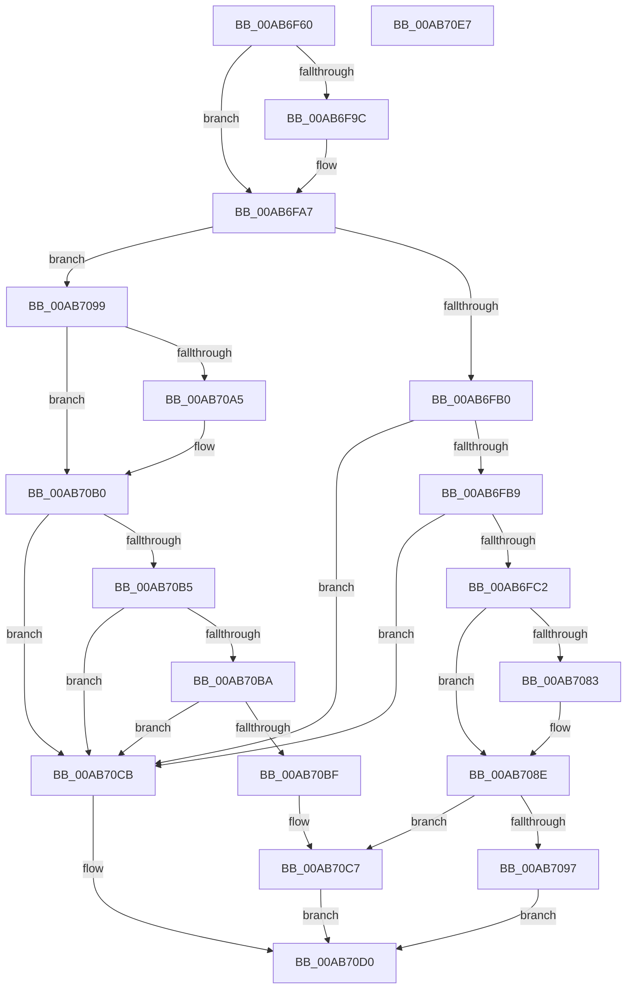

# PopHardDiskPowerSettingCallback

- RVA: `0x00AB6F60`–`0x00AB70E8` (길이 `392` bytes)
- VA: `0x0000000140AB6F60`
- 실행 섹션: `PAGE`
- PDB 이름 있음: `예`; PDB Function 태그: `아니요`
- unwind 정보 RVA: `0x000BCF74`
- 디코드: `103`개 명령, `392/392` bytes 표시
- 미해석 바이트: `0` (있으면 어셈블리에 `.byte`로 보존)

> 이 문서는 커널 이미지의 기계어와 PDB 기호를 분석해 생성했습니다. 4번과 5번은 함수 원형과 자료형을 바이너리 사용 방식에서 추정한 C 해석이며 원본 소스 복구 결과는 아닙니다.

## 1. Dependencies

- 직접 호출 지점: **5**; 고유 호출 대상: **5**
- 직접 호출자로 확인된 함수: **0**
- RIP 상대 이미지 참조: **8**

### Outgoing calls
- `0x00AB6F88` → [memset](../../text/6C/memset_function_006C6C40.md) (function, `0x006C6C40`)
- `0x00AB6FC2` → [PopAcquirePolicyLock](../../pagelk/B7/PopAcquirePolicyLock_function_00B783C0.md) (function, `0x00B783C0`)
- `0x00AB7066` → [PopApplyPolicy](../91/PopApplyPolicy_function_009107B0.md) (function, `0x009107B0`)
- `0x00AB7089` → [PopUpdateDiskIdleTimeoutSetting](../91/PopUpdateDiskIdleTimeoutSetting_function_00912E30.md) (function, `0x00912E30`)
- `0x00AB708E` → [PopReleasePolicyLock](../../pagelk/B7/PopReleasePolicyLock_function_00B78410.md) (function, `0x00B78410`)

### Direct callers
- 이 함수 시작 RVA로 연결되는 직접 call은 확인되지 않았습니다. 간접 호출은 완전히 역산할 수 없습니다.

### Static image references
- `0x00AB6F8D` → RVA `0x00011A78` (`.rdata`; read)
- `0x00AB6F9C` → RVA `0x00011A80` (`.rdata`; read)
- `0x00AB6FC7` → RVA `0x00F0CE68` (`.data`; read)
- `0x00AB707B` → RVA `0x00E0B53C` (`.data`; read)
- `0x00AB7083` → RVA `0x00E0B53C` (`.data`; write)
- `0x00AB7099` → RVA `0x0001E258` (`.rdata`; read)
- `0x00AB70A5` → RVA `0x0001E260` (`.rdata`; read)
- `0x00AB70C1` → RVA `0x00F0CE24` (`.data`; write)

## 2. Other-region calls and transfers

- 다른 실행 섹션으로 향하는 call: **3**
  - `0x00AB6F88` → [memset](../../text/6C/memset_function_006C6C40.md) (`PAGE` → `.text`)
  - `0x00AB6FC2` → [PopAcquirePolicyLock](../../pagelk/B7/PopAcquirePolicyLock_function_00B783C0.md) (`PAGE` → `PAGELK`)
  - `0x00AB708E` → [PopReleasePolicyLock](../../pagelk/B7/PopReleasePolicyLock_function_00B78410.md) (`PAGE` → `PAGELK`)
- 별도 외부 분기/꼬리 이동을 확인하지 못했습니다.

## 3. Assembly (complete function range)

```asm
00AB6F60  48 89 5C 24 08                  mov qword ptr [rsp + 8], rbx
00AB6F65  48 89 74 24 10                  mov qword ptr [rsp + 0x10], rsi
00AB6F6A  57                              push rdi
00AB6F6B  48 81 EC 10 01 00 00            sub rsp, 0x110
00AB6F72  41 8B F0                        mov esi, r8d
00AB6F75  48 8B FA                        mov rdi, rdx
00AB6F78  48 8B D9                        mov rbx, rcx
00AB6F7B  33 D2                           xor edx, edx
00AB6F7D  41 B8 E8 00 00 00               mov r8d, 0xe8
00AB6F83  48 8D 4C 24 20                  lea rcx, [rsp + 0x20]
00AB6F88  E8 B3 FC C0 FF                  call 0x1406c6c40
00AB6F8D  4C 8B 0D E4 AA 55 FF            mov r9, qword ptr [rip - 0xaa551c]
00AB6F94  48 8B 03                        mov rax, qword ptr [rbx]
00AB6F97  4C 2B C8                        sub r9, rax
00AB6F9A  75 0B                           jne 0x140ab6fa7
00AB6F9C  4C 8B 0D DD AA 55 FF            mov r9, qword ptr [rip - 0xaa5523]
00AB6FA3  4C 2B 4B 08                     sub r9, qword ptr [rbx + 8]
00AB6FA7  4D 85 C9                        test r9, r9
00AB6FAA  0F 85 E9 00 00 00               jne 0x140ab7099
00AB6FB0  83 FE 04                        cmp esi, 4
00AB6FB3  0F 85 12 01 00 00               jne 0x140ab70cb
00AB6FB9  48 85 FF                        test rdi, rdi
00AB6FBC  0F 84 09 01 00 00               je 0x140ab70cb
00AB6FC2  E8 F9 13 0C 00                  call 0x140b783c0
00AB6FC7  48 8B 05 9A 5E 45 00            mov rax, qword ptr [rip + 0x455e9a]
00AB6FCE  48 8D 4C 24 20                  lea rcx, [rsp + 0x20]
00AB6FD3  8D 56 7C                        lea edx, [rsi + 0x7c]
00AB6FD6  4C 8D 44 24 20                  lea r8, [rsp + 0x20]
00AB6FDB  44 8D 4A 68                     lea r9d, [rdx + 0x68]
00AB6FDF  0F 10 00                        movups xmm0, xmmword ptr [rax]
00AB6FE2  0F 10 48 10                     movups xmm1, xmmword ptr [rax + 0x10]
00AB6FE6  0F 11 01                        movups xmmword ptr [rcx], xmm0
00AB6FE9  0F 10 40 20                     movups xmm0, xmmword ptr [rax + 0x20]
00AB6FED  0F 11 49 10                     movups xmmword ptr [rcx + 0x10], xmm1
00AB6FF1  0F 10 48 30                     movups xmm1, xmmword ptr [rax + 0x30]
00AB6FF5  0F 11 41 20                     movups xmmword ptr [rcx + 0x20], xmm0
00AB6FF9  0F 10 40 40                     movups xmm0, xmmword ptr [rax + 0x40]
00AB6FFD  0F 11 49 30                     movups xmmword ptr [rcx + 0x30], xmm1
00AB7001  0F 10 48 50                     movups xmm1, xmmword ptr [rax + 0x50]
00AB7005  0F 11 41 40                     movups xmmword ptr [rcx + 0x40], xmm0
00AB7009  0F 10 40 60                     movups xmm0, xmmword ptr [rax + 0x60]
00AB700D  0F 11 49 50                     movups xmmword ptr [rcx + 0x50], xmm1
00AB7011  0F 11 41 60                     movups xmmword ptr [rcx + 0x60], xmm0
00AB7015  48 03 CA                        add rcx, rdx
00AB7018  0F 10 40 70                     movups xmm0, xmmword ptr [rax + 0x70]
00AB701C  48 03 C2                        add rax, rdx
00AB701F  33 D2                           xor edx, edx
00AB7021  0F 11 41 F0                     movups xmmword ptr [rcx - 0x10], xmm0
00AB7025  0F 10 08                        movups xmm1, xmmword ptr [rax]
00AB7028  0F 10 40 10                     movups xmm0, xmmword ptr [rax + 0x10]
00AB702C  0F 11 09                        movups xmmword ptr [rcx], xmm1
00AB702F  0F 10 48 20                     movups xmm1, xmmword ptr [rax + 0x20]
00AB7033  0F 11 41 10                     movups xmmword ptr [rcx + 0x10], xmm0
00AB7037  0F 10 40 30                     movups xmm0, xmmword ptr [rax + 0x30]
00AB703B  0F 11 49 20                     movups xmmword ptr [rcx + 0x20], xmm1
00AB703F  0F 10 48 40                     movups xmm1, xmmword ptr [rax + 0x40]
00AB7043  0F 11 41 30                     movups xmmword ptr [rcx + 0x30], xmm0
00AB7047  0F 10 40 50                     movups xmm0, xmmword ptr [rax + 0x50]
00AB704B  48 8B 40 60                     mov rax, qword ptr [rax + 0x60]
00AB704F  0F 11 49 40                     movups xmmword ptr [rcx + 0x40], xmm1
00AB7053  0F 11 41 50                     movups xmmword ptr [rcx + 0x50], xmm0
00AB7057  48 89 41 60                     mov qword ptr [rcx + 0x60], rax
00AB705B  B1 01                           mov cl, 1
00AB705D  8B 07                           mov eax, dword ptr [rdi]
00AB705F  89 84 24 F4 00 00 00            mov dword ptr [rsp + 0xf4], eax
00AB7066  E8 45 97 E5 FF                  call 0x1409107b0
00AB706B  83 C9 FF                        or ecx, 0xffffffff
00AB706E  8B D8                           mov ebx, eax
00AB7070  69 07 E8 03 00 00               imul eax, dword ptr [rdi], 0x3e8
00AB7076  85 C0                           test eax, eax
00AB7078  0F 44 C1                        cmove eax, ecx
00AB707B  3B 05 BB 44 35 00               cmp eax, dword ptr [rip + 0x3544bb]
00AB7081  74 0B                           je 0x140ab708e
00AB7083  89 05 B3 44 35 00               mov dword ptr [rip + 0x3544b3], eax
00AB7089  E8 A2 BD E5 FF                  call 0x140912e30
00AB708E  E8 7D 13 0C 00                  call 0x140b78410
00AB7093  85 DB                           test ebx, ebx
00AB7095  79 30                           jns 0x140ab70c7
00AB7097  EB 37                           jmp 0x140ab70d0
00AB7099  48 8B 0D B8 71 56 FF            mov rcx, qword ptr [rip - 0xa98e48]
00AB70A0  48 2B C8                        sub rcx, rax
00AB70A3  75 0B                           jne 0x140ab70b0
00AB70A5  48 8B 0D B4 71 56 FF            mov rcx, qword ptr [rip - 0xa98e4c]
00AB70AC  48 2B 4B 08                     sub rcx, qword ptr [rbx + 8]
00AB70B0  48 85 C9                        test rcx, rcx
00AB70B3  75 16                           jne 0x140ab70cb
00AB70B5  83 FE 04                        cmp esi, 4
00AB70B8  75 11                           jne 0x140ab70cb
00AB70BA  48 85 FF                        test rdi, rdi
00AB70BD  74 0C                           je 0x140ab70cb
00AB70BF  8B 07                           mov eax, dword ptr [rdi]
00AB70C1  89 05 5D 5D 45 00               mov dword ptr [rip + 0x455d5d], eax
00AB70C7  33 DB                           xor ebx, ebx
00AB70C9  EB 05                           jmp 0x140ab70d0
00AB70CB  BB 0D 00 00 C0                  mov ebx, 0xc000000d
00AB70D0  4C 8D 9C 24 10 01 00 00         lea r11, [rsp + 0x110]
00AB70D8  8B C3                           mov eax, ebx
00AB70DA  49 8B 5B 10                     mov rbx, qword ptr [r11 + 0x10]
00AB70DE  49 8B 73 18                     mov rsi, qword ptr [r11 + 0x18]
00AB70E2  49 8B E3                        mov rsp, r11
00AB70E5  5F                              pop rdi
00AB70E6  C3                              ret
00AB70E7  CC                              int3
```

## 4. C-style interpretation (structured pseudocode)

```c
__int64 __fastcall PopHardDiskPowerSettingCallback(__int64 a1, __int64 a2, int a3)
{
    __int64 result;
    __int64 v_rbx;
    __int64 v_rsp;
    unsigned int v_stack_m24;
    unsigned __int64 v_stack_m8;
    unsigned __int64 v_stack_mF8;
    unsigned __int64 v_stack_p10;
    unsigned __int64 v_stack_p8;

    v_stack_p8 = v_rbx;
    v_stack_p10 = v_rsi;
    v_rsp = (v_rsp) - (272);
    a2 = 0;
    result = memset(v_stack_mF8, a2, 232, a4);
    a4 = (*(unsigned __int64 *)(v_rip - 11162908)) - (*(unsigned __int64 *)(a1));
    if (!(condition_is_not_equal)) {
        a4 = *(unsigned __int64 *)(v_rip - 11162915);
        a4 = (a4) - (*(unsigned __int64 *)(a1 + 8));
    }
    if (a4 != 0) goto loc_00AB7099;
    if (((unsigned int)((unsigned int)(a3))) != 4) goto loc_00AB70CB;
    if (0 == 0) goto loc_00AB70CB;
    result = PopAcquirePolicyLock(v_stack_mF8, a2, 232, a4);
    *(unsigned __int64 *)(v_stack_mF8) = v_xmm0;
    *(unsigned __int64 *)(v_stack_mF8 + 16) = v_xmm1;
    *(unsigned __int64 *)(v_stack_mF8 + 32) = v_xmm0;
    *(unsigned __int64 *)(v_stack_mF8 + 48) = v_xmm1;
    *(unsigned __int64 *)(v_stack_mF8 + 64) = v_xmm0;
    *(unsigned __int64 *)(v_stack_mF8 + 80) = v_xmm1;
    *(unsigned __int64 *)(v_stack_mF8 + 96) = v_xmm0;
    a1 = (v_stack_mF8) + ((unsigned int)(a3) + 124);
    result = (*(unsigned __int64 *)(v_rip + 4546202)) + ((unsigned int)(a3) + 124);
    a2 = 0;
    *(unsigned __int64 *)(a1 - 16) = v_xmm0;
    *(unsigned __int64 *)(a1) = v_xmm1;
    *(unsigned __int64 *)(a1 + 16) = v_xmm0;
    *(unsigned __int64 *)(a1 + 32) = v_xmm1;
    *(unsigned __int64 *)(a1 + 48) = v_xmm0;
    *(unsigned __int64 *)(a1 + 64) = v_xmm1;
    *(unsigned __int64 *)(a1 + 80) = v_xmm0;
    *(unsigned __int64 *)(a1 + 96) = *(unsigned __int64 *)(result + 96);
    v_stack_m24 = (unsigned int)((unsigned int)(*(unsigned int *)(a2)));
    result = PopApplyPolicy(1, a2, v_stack_mF8, (unsigned int)(a3) + 124 + 104);
    a1 = (unsigned int)((1) | (0xFFFFFFFFULL));
    result = (unsigned int)((result) * (*(unsigned int *)(a2)));
    if ((unsigned int)(result) == 0) { result = (unsigned int)(a1); }
    if (((unsigned int)(result)) != (*(unsigned int *)(v_rip + 3491003))) {
        *(unsigned int *)(v_rip + 3490995) = (unsigned int)(result);
        result = PopUpdateDiskIdleTimeoutSetting(a1, a2, v_stack_mF8, (unsigned int)(a3) + 124 + 104);
    }
    result = PopReleasePolicyLock(a1, a2, v_stack_mF8, (unsigned int)(a3) + 124 + 104);
    if (!sign_flag) goto loc_00AB70C7;
    goto loc_00AB70D0;
loc_00AB7099:
    a1 = (*(unsigned __int64 *)(v_rip - 11112008)) - (result);
    if (!(condition_is_not_equal)) {
        a1 = *(unsigned __int64 *)(v_rip - 11112012);
        a1 = (a1) - (*(unsigned __int64 *)((unsigned int)((unsigned int)(result)) + 8));
    }
    if (a1 != 0) goto loc_00AB70CB;
    if (((unsigned int)((unsigned int)(a3))) != 4) goto loc_00AB70CB;
    if (0 == 0) goto loc_00AB70CB;
    *(unsigned int *)(v_rip + 4545885) = (unsigned int)((unsigned int)(*(unsigned int *)(a2)));
loc_00AB70C7:
    v_rbx = 0;
    goto loc_00AB70D0;
loc_00AB70CB:
loc_00AB70D0:
    return (unsigned int)((unsigned int)((unsigned int)(0xC000000DULL)));
}
```

## 5. (Beta) C Style

```c
int64_t PopHardDiskPowerSettingCallback(void *Arg1, int64_t Arg2, int32_t Arg3)
{
    uint8_t *arg1 = (uint8_t *)Arg1;

    int64_t result;
    int64_t local_rbx;
    int64_t local_rsp;
    uint32_t v_stack_m24;
    uint64_t v_stack_m8;
    uint64_t v_stack_mF8;
    uint64_t v_stack_p10;
    uint64_t v_stack_p8;

    v_stack_p8 = local_rbx;
    v_stack_p10 = local_rsi;
    local_rsp = (local_rsp) - (272);
    Arg2 = 0;
    result = memset(v_stack_mF8, Arg2, 232, a4);
    a4 = (*(uint64_t *)(v_rip - 0xAA551C)) - (*(uint64_t *)(arg1));
    if (!(condition_is_not_equal)) {
        a4 = *(uint64_t *)(v_rip - 0xAA5523);
        a4 = (a4) - (*(uint64_t *)(arg1 + 0x8));
    }
    if (a4 != 0) goto loc_00AB7099;
    if (((uint32_t)((uint32_t)(Arg3))) != 4) goto loc_00AB70CB;
    if (0 == 0) goto loc_00AB70CB;
    result = PopAcquirePolicyLock(v_stack_mF8, Arg2, 232, a4);
    *(uint64_t *)(v_stack_mF8) = v_xmm0;
    *(uint64_t *)(v_stack_mF8 + 0x10) = v_xmm1;
    *(uint64_t *)(v_stack_mF8 + 0x20) = v_xmm0;
    *(uint64_t *)(v_stack_mF8 + 0x30) = v_xmm1;
    *(uint64_t *)(v_stack_mF8 + 0x40) = v_xmm0;
    *(uint64_t *)(v_stack_mF8 + 0x50) = v_xmm1;
    *(uint64_t *)(v_stack_mF8 + 0x60) = v_xmm0;
    Arg1 = (v_stack_mF8) + ((uint32_t)(Arg3) + 124);
    result = (*(uint64_t *)(v_rip + 0x455E9A)) + ((uint32_t)(Arg3) + 124);
    Arg2 = 0;
    *(uint64_t *)(arg1 - 0x10) = v_xmm0;
    *(uint64_t *)(arg1) = v_xmm1;
    *(uint64_t *)(arg1 + 0x10) = v_xmm0;
    *(uint64_t *)(arg1 + 0x20) = v_xmm1;
    *(uint64_t *)(arg1 + 0x30) = v_xmm0;
    *(uint64_t *)(arg1 + 0x40) = v_xmm1;
    *(uint64_t *)(arg1 + 0x50) = v_xmm0;
    *(uint64_t *)(arg1 + 0x60) = *(uint64_t *)(result + 0x60);
    v_stack_m24 = (uint32_t)((uint32_t)(*(uint32_t *)(Arg2)));
    result = PopApplyPolicy(1, Arg2, v_stack_mF8, (uint32_t)(Arg3) + 124 + 104);
    Arg1 = (uint32_t)((1) | (0xFFFFFFFFULL));
    result = (uint32_t)((result) * (*(uint32_t *)(Arg2)));
    if ((uint32_t)(result) == 0) { result = (uint32_t)(Arg1); }
    if (((uint32_t)(result)) != (*(uint32_t *)(v_rip + 0x3544BB))) {
        *(uint32_t *)(v_rip + 0x3544B3) = (uint32_t)(result);
        result = PopUpdateDiskIdleTimeoutSetting(Arg1, Arg2, v_stack_mF8, (uint32_t)(Arg3) + 124 + 104);
    }
    result = PopReleasePolicyLock(Arg1, Arg2, v_stack_mF8, (uint32_t)(Arg3) + 124 + 104);
    if (!sign_flag) goto loc_00AB70C7;
    goto loc_00AB70D0;
loc_00AB7099:
    Arg1 = (*(uint64_t *)(v_rip - 0xA98E48)) - (result);
    if (!(condition_is_not_equal)) {
        Arg1 = *(uint64_t *)(v_rip - 0xA98E4C);
        Arg1 = (Arg1) - (*(uint64_t *)((uint32_t)((uint32_t)(result)) + 0x8));
    }
    if (Arg1 != NULL) goto loc_00AB70CB;
    if (((uint32_t)((uint32_t)(Arg3))) != 4) goto loc_00AB70CB;
    if (0 == 0) goto loc_00AB70CB;
    *(uint32_t *)(v_rip + 0x455D5D) = (uint32_t)((uint32_t)(*(uint32_t *)(Arg2)));
loc_00AB70C7:
    local_rbx = 0;
    goto loc_00AB70D0;
loc_00AB70CB:
loc_00AB70D0:
    return (uint32_t)((uint32_t)((uint32_t)(0xC000000DULL)));
}
```

### 관측된 메모리 오프셋

구조체 형식이 확인되지 않은 접근은 인자 기준의 오프셋으로만 기록했습니다.

| 기준 인자 | 오프셋 표현 | 폭 (bit) | 접근 |
|---|---:|---:|---|
| `Arg1` | `+ 0x0` | `64` | `R` |
| `Arg1` | `+ 0x8` | `64` | `R` |

## 6. Execution-region graph

[열기: 2D/3D 그래프와 함수 탐색 컨트롤 패널](../../../control-panel.html?section=page&rva=0x00AB6F60&view=graph)

- 2D 그래프는 위에서 아래로 흐르고, 3D 그래프는 빈 공간을 드래그해 회전합니다. Shift+드래그는 이동, 휠은 확대·축소, 함수 노드 선택은 대상 보고서 이동입니다.

### Static fallback


