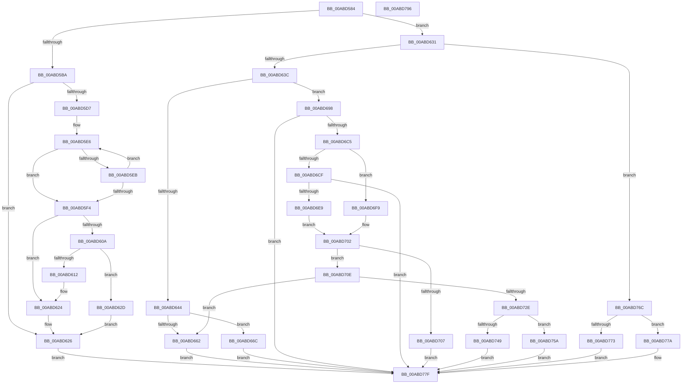

# PopIdleWakeGenerateDescriptionString

- RVA: `0x00ABD584`–`0x00ABD797` (길이 `531` bytes)
- VA: `0x0000000140ABD584`
- 실행 섹션: `PAGE`
- PDB 이름 있음: `예`; PDB Function 태그: `아니요`
- unwind 정보 RVA: `0x000BD5B4`
- 디코드: `142`개 명령, `531/531` bytes 표시
- 미해석 바이트: `0` (있으면 어셈블리에 `.byte`로 보존)

> 이 문서는 커널 이미지의 기계어와 PDB 기호를 분석해 생성했습니다. 4번과 5번은 함수 원형과 자료형을 바이너리 사용 방식에서 추정한 C 해석이며 원본 소스 복구 결과는 아닙니다.

## 1. Dependencies

- 직접 호출 지점: **8**; 고유 호출 대상: **4**
- 직접 호출자로 확인된 함수: **1**
- RIP 상대 이미지 참조: **4**

### Outgoing calls
- `0x00ABD654` → [ExAllocatePool2](../../poolcode/B8/ExAllocatePool2_function_00B820F0.md) (function, `0x00B820F0`)
- `0x00ABD68E` → [RtlUnicodeStringPrintf](../../text/48/RtlUnicodeStringPrintf_function_0048B984.md) (function, `0x0048B984`)
- `0x00ABD6B8` → [RtlStringCbLengthW](../../text/45/RtlStringCbLengthW_function_004575EC.md) (function, `0x004575EC`)
- `0x00ABD6DC` → [RtlStringCbLengthW](../../text/45/RtlStringCbLengthW_function_004575EC.md) (function, `0x004575EC`)
- `0x00ABD71C` → [ExAllocatePool2](../../poolcode/B8/ExAllocatePool2_function_00B820F0.md) (function, `0x00B820F0`)
- `0x00ABD753` → [RtlUnicodeStringPrintf](../../text/48/RtlUnicodeStringPrintf_function_0048B984.md) (function, `0x0048B984`)
- `0x00ABD765` → [RtlUnicodeStringPrintf](../../text/48/RtlUnicodeStringPrintf_function_0048B984.md) (function, `0x0048B984`)
- `0x00ABD773` → [PopIdleWakeGenerateInterruptDescriptionString](../A9/PopIdleWakeGenerateInterruptDescriptionString_function_00A98748.md) (function, `0x00A98748`)

### Direct callers
- [sub_00B4A99E](../B4/Unknown_function_00B4A99E.md) at `0x00B4A9E8`

### Static image references
- `0x00ABD5BD` → RVA `0x00000000` (`image boundary/outside`; read)
- `0x00ABD674` → RVA `0x00B02F60` (` ?? ::NNGAKEGL::`string'`; read)
- `0x00ABD74C` → RVA `0x00B02F20` (` ?? ::NNGAKEGL::`string'`; read)
- `0x00ABD75E` → RVA `0x00B02FC0` (` ?? ::NNGAKEGL::`string'`; read)

## 2. Other-region calls and transfers

- 다른 실행 섹션으로 향하는 call: **7**
  - `0x00ABD654` → [ExAllocatePool2](../../poolcode/B8/ExAllocatePool2_function_00B820F0.md) (`PAGE` → `POOLCODE`)
  - `0x00ABD68E` → [RtlUnicodeStringPrintf](../../text/48/RtlUnicodeStringPrintf_function_0048B984.md) (`PAGE` → `.text`)
  - `0x00ABD6B8` → [RtlStringCbLengthW](../../text/45/RtlStringCbLengthW_function_004575EC.md) (`PAGE` → `.text`)
  - `0x00ABD6DC` → [RtlStringCbLengthW](../../text/45/RtlStringCbLengthW_function_004575EC.md) (`PAGE` → `.text`)
  - `0x00ABD71C` → [ExAllocatePool2](../../poolcode/B8/ExAllocatePool2_function_00B820F0.md) (`PAGE` → `POOLCODE`)
  - `0x00ABD753` → [RtlUnicodeStringPrintf](../../text/48/RtlUnicodeStringPrintf_function_0048B984.md) (`PAGE` → `.text`)
  - `0x00ABD765` → [RtlUnicodeStringPrintf](../../text/48/RtlUnicodeStringPrintf_function_0048B984.md) (`PAGE` → `.text`)
- 별도 외부 분기/꼬리 이동을 확인하지 못했습니다.

## 3. Assembly (complete function range)

```asm
00ABD584  48 8B C4                        mov rax, rsp
00ABD587  48 89 58 18                     mov qword ptr [rax + 0x18], rbx
00ABD58B  48 89 68 20                     mov qword ptr [rax + 0x20], rbp
00ABD58F  56                              push rsi
00ABD590  57                              push rdi
00ABD591  41 54                           push r12
00ABD593  41 56                           push r14
00ABD595  41 57                           push r15
00ABD597  48 83 EC 20                     sub rsp, 0x20
00ABD59B  33 DB                           xor ebx, ebx
00ABD59D  48 8D BA 00 03 00 00            lea rdi, [rdx + 0x300]
00ABD5A4  48 89 58 08                     mov qword ptr [rax + 8], rbx
00ABD5A8  4C 8B FA                        mov r15, rdx
00ABD5AB  48 89 58 10                     mov qword ptr [rax + 0x10], rbx
00ABD5AF  48 8B F1                        mov rsi, rcx
00ABD5B2  48 63 01                        movsxd rax, dword ptr [rcx]
00ABD5B5  83 F8 0B                        cmp eax, 0xb
00ABD5B8  77 77                           ja 0x140abd631
00ABD5BA  0F AE E8                        lfence
00ABD5BD  48 8D 0D 3C 2A 54 FF            lea rcx, [rip - 0xabd5c4]
00ABD5C4  0F 57 C0                        xorps xmm0, xmm0
00ABD5C7  4C 8B 8C C1 60 DD B4 00         mov r9, qword ptr [rcx + rax*8 + 0xb4dd60]
00ABD5CF  0F 11 07                        movups xmmword ptr [rdi], xmm0
00ABD5D2  4D 85 C9                        test r9, r9
00ABD5D5  74 4F                           je 0x140abd626
00ABD5D7  B9 FF 7F 00 00                  mov ecx, 0x7fff
00ABD5DC  44 8D 53 02                     lea r10d, [rbx + 2]
00ABD5E0  44 8B C1                        mov r8d, ecx
00ABD5E3  49 8B C1                        mov rax, r9
00ABD5E6  66 39 18                        cmp word ptr [rax], bx
00ABD5E9  74 09                           je 0x140abd5f4
00ABD5EB  49 03 C2                        add rax, r10
00ABD5EE  49 83 E8 01                     sub r8, 1
00ABD5F2  75 F2                           jne 0x140abd5e6
00ABD5F4  49 8B C0                        mov rax, r8
00ABD5F7  48 F7 D8                        neg rax
00ABD5FA  B8 0D 00 00 C0                  mov eax, 0xc000000d
00ABD5FF  1B D2                           sbb edx, edx
00ABD601  F7 D2                           not edx
00ABD603  23 D0                           and edx, eax
00ABD605  4D 85 C0                        test r8, r8
00ABD608  74 1A                           je 0x140abd624
00ABD60A  49 2B C8                        sub rcx, r8
00ABD60D  48 85 FF                        test rdi, rdi
00ABD610  74 1B                           je 0x140abd62d
00ABD612  66 03 C9                        add cx, cx
00ABD615  4C 89 4F 08                     mov qword ptr [rdi + 8], r9
00ABD619  66 89 0F                        mov word ptr [rdi], cx
00ABD61C  66 41 03 CA                     add cx, r10w
00ABD620  66 89 4F 02                     mov word ptr [rdi + 2], cx
00ABD624  8B DA                           mov ebx, edx
00ABD626  8B C3                           mov eax, ebx
00ABD628  E9 52 01 00 00                  jmp 0x140abd77f
00ABD62D  8B D8                           mov ebx, eax
00ABD62F  EB F5                           jmp 0x140abd626
00ABD631  3D 81 00 00 00                  cmp eax, 0x81
00ABD636  0F 85 30 01 00 00               jne 0x140abd76c
00ABD63C  0F B6 41 08                     movzx eax, byte ptr [rcx + 8]
00ABD640  3C 14                           cmp al, 0x14
00ABD642  72 54                           jb 0x140abd698
00ABD644  BA 40 00 00 00                  mov edx, 0x40
00ABD649  B9 00 01 00 00                  mov ecx, 0x100
00ABD64E  41 B8 50 64 69 67               mov r8d, 0x67696450
00ABD654  E8 97 4A 0C 00                  call 0x140b820f0
00ABD659  48 89 47 08                     mov qword ptr [rdi + 8], rax
00ABD65D  48 85 C0                        test rax, rax
00ABD660  75 0A                           jne 0x140abd66c
00ABD662  B8 9A 00 00 C0                  mov eax, 0xc000009a
00ABD667  E9 13 01 00 00                  jmp 0x140abd77f
00ABD66C  41 C6 87 F8 02 00 00 01         mov byte ptr [r15 + 0x2f8], 1
00ABD674  48 8D 15 E5 58 04 00            lea rdx, [rip + 0x458e5]
00ABD67B  C7 07 00 00 40 00               mov dword ptr [rdi], 0x400000
00ABD681  48 8B CF                        mov rcx, rdi
00ABD684  44 0F B6 4E 0A                  movzx r9d, byte ptr [rsi + 0xa]
00ABD689  44 0F B6 46 08                  movzx r8d, byte ptr [rsi + 8]
00ABD68E  E8 F1 E2 9C FF                  call 0x14048b984
00ABD693  E9 E7 00 00 00                  jmp 0x140abd77f
00ABD698  48 8D 0D 61 29 54 FF            lea rcx, [rip - 0xabd69f]
00ABD69F  41 BB FF FF 00 00               mov r11d, 0xffff
00ABD6A5  4C 8B A4 C1 10 04 B5 00         mov r12, qword ptr [rcx + rax*8 + 0xb50410]
00ABD6AD  4C 8D 44 24 50                  lea r8, [rsp + 0x50]
00ABD6B2  49 8B CC                        mov rcx, r12
00ABD6B5  41 8B D3                        mov edx, r11d
00ABD6B8  E8 2F 9F 99 FF                  call 0x1404575ec
00ABD6BD  85 C0                           test eax, eax
00ABD6BF  0F 88 BA 00 00 00               js 0x140abd77f
00ABD6C5  80 7E 08 03                     cmp byte ptr [rsi + 8], 3
00ABD6C9  4C 8D 76 0A                     lea r14, [rsi + 0xa]
00ABD6CD  75 2A                           jne 0x140abd6f9
00ABD6CF  4C 8D 44 24 58                  lea r8, [rsp + 0x58]
00ABD6D4  BA 80 00 00 00                  mov edx, 0x80
00ABD6D9  49 8B CE                        mov rcx, r14
00ABD6DC  E8 0B 9F 99 FF                  call 0x1404575ec
00ABD6E1  85 C0                           test eax, eax
00ABD6E3  0F 88 96 00 00 00               js 0x140abd77f
00ABD6E9  48 8B 6C 24 58                  mov rbp, qword ptr [rsp + 0x58]
00ABD6EE  48 83 C5 2A                     add rbp, 0x2a
00ABD6F2  48 03 6C 24 50                  add rbp, qword ptr [rsp + 0x50]
00ABD6F7  EB 09                           jmp 0x140abd702
00ABD6F9  48 8B 6C 24 50                  mov rbp, qword ptr [rsp + 0x50]
00ABD6FE  48 83 C5 30                     add rbp, 0x30
00ABD702  49 3B EB                        cmp rbp, r11
00ABD705  76 07                           jbe 0x140abd70e
00ABD707  B8 05 00 00 80                  mov eax, 0x80000005
00ABD70C  EB 71                           jmp 0x140abd77f
00ABD70E  41 B8 50 64 69 67               mov r8d, 0x67696450
00ABD714  48 8B D5                        mov rdx, rbp
00ABD717  B9 00 01 00 00                  mov ecx, 0x100
00ABD71C  E8 CF 49 0C 00                  call 0x140b820f0
00ABD721  48 89 47 08                     mov qword ptr [rdi + 8], rax
00ABD725  48 85 C0                        test rax, rax
00ABD728  0F 84 34 FF FF FF               je 0x140abd662
00ABD72E  41 C6 87 F8 02 00 00 01         mov byte ptr [r15 + 0x2f8], 1
00ABD736  4D 8B C4                        mov r8, r12
00ABD739  66 89 1F                        mov word ptr [rdi], bx
00ABD73C  48 8B CF                        mov rcx, rdi
00ABD73F  66 89 6F 02                     mov word ptr [rdi + 2], bp
00ABD743  80 7E 08 03                     cmp byte ptr [rsi + 8], 3
00ABD747  75 11                           jne 0x140abd75a
00ABD749  4D 8B CE                        mov r9, r14
00ABD74C  48 8D 15 CD 57 04 00            lea rdx, [rip + 0x457cd]
00ABD753  E8 2C E2 9C FF                  call 0x14048b984
00ABD758  EB 25                           jmp 0x140abd77f
00ABD75A  45 0F B6 0E                     movzx r9d, byte ptr [r14]
00ABD75E  48 8D 15 5B 58 04 00            lea rdx, [rip + 0x4585b]
00ABD765  E8 1A E2 9C FF                  call 0x14048b984
00ABD76A  EB 13                           jmp 0x140abd77f
00ABD76C  3D 80 00 00 00                  cmp eax, 0x80
00ABD771  75 07                           jne 0x140abd77a
00ABD773  E8 D0 AF FD FF                  call 0x140a98748
00ABD778  EB 05                           jmp 0x140abd77f
00ABD77A  B8 0D 00 00 C0                  mov eax, 0xc000000d
00ABD77F  48 8B 5C 24 60                  mov rbx, qword ptr [rsp + 0x60]
00ABD784  48 8B 6C 24 68                  mov rbp, qword ptr [rsp + 0x68]
00ABD789  48 83 C4 20                     add rsp, 0x20
00ABD78D  41 5F                           pop r15
00ABD78F  41 5E                           pop r14
00ABD791  41 5C                           pop r12
00ABD793  5F                              pop rdi
00ABD794  5E                              pop rsi
00ABD795  C3                              ret
00ABD796  CC                              int3
```

## 4. C-style interpretation (structured pseudocode)

```c
__int64 __fastcall PopIdleWakeGenerateDescriptionString(__int64 a1, __int64 a2)
{
    __int64 result;
    __int64 v_rbp;
    __int64 v_rbx;
    __int64 v_rsp;
    unsigned __int64 v_stack_p10;
    unsigned __int64 v_stack_p18;
    unsigned __int64 v_stack_p20;
    unsigned __int64 v_stack_p8;

    *(unsigned __int64 *)(v_rsp + 24) = v_rbx;
    *(unsigned __int64 *)(v_rsp + 32) = v_rbp;
    v_rsp = (v_rsp) - (32);
    v_rbx = 0;
    *(unsigned __int64 *)(v_rsp + 8) = 0;
    *(unsigned __int64 *)(v_rsp + 16) = 0;
    if (((unsigned int)((int)(*(unsigned int *)(a1)))) > 11) goto loc_00ABD631;
    *(unsigned __int64 *)(a2 + 768) = v_xmm0;
    if (*(unsigned __int64 *)(v_rip - 11261380 + (int)(*(unsigned int *)(a1)) * 8 + 11853152) == 0) goto loc_00ABD626;
loc_00ABD5E6:
    if ((*(unsigned __int16 *)(*(unsigned __int64 *)(v_rip - 11261380 + (int)(*(unsigned int *)(a1)) * 8 + 11853152))) == 0) goto loc_00ABD5F4;
    result = (*(unsigned __int64 *)(v_rip - 11261380 + (int)(*(unsigned int *)(a1)) * 8 + 11853152)) + (v_rbx + 2);
    a3 = ((unsigned int)((unsigned int)((unsigned int)(0x7FFFULL)))) - (1);
    if (condition_is_not_equal) goto loc_00ABD5E6;
loc_00ABD5F4:
    result = -(a3);
    a2 = (unsigned int)(~(a2));
    a2 = (unsigned int)((a2) & ((unsigned int)((unsigned int)(0xC000000DULL))));
    if (a3 == 0) goto loc_00ABD624;
    a1 = ((unsigned int)(0x7FFFULL)) - (a3);
    if (a2 + 768 == 0) goto loc_00ABD62D;
    a1 = (unsigned __int16)((a1) + ((unsigned __int16)(a1)));
    *(unsigned __int64 *)(a2 + 768 + 8) = *(unsigned __int64 *)(v_rip - 11261380 + (int)(*(unsigned int *)(a1)) * 8 + 11853152);
    *(unsigned __int16 *)(a2 + 768) = (unsigned __int16)(a1);
    a1 = (unsigned __int16)((a1) + ((unsigned __int16)(v_rbx + 2)));
    *(unsigned __int16 *)(a2 + 768 + 2) = (unsigned __int16)(a1);
loc_00ABD624:
loc_00ABD626:
    goto loc_00ABD77F;
loc_00ABD62D:
    goto loc_00ABD626;
loc_00ABD631:
    if (((unsigned int)((unsigned int)((unsigned int)((unsigned int)((unsigned int)(a2)))))) != 129) goto loc_00ABD76C;
    if (((unsigned __int8)(*(unsigned __int8 *)(a1 + 8))) < 20) goto loc_00ABD698;
    result = ExAllocatePool2(256, 64, (unsigned int)(0x67696450ULL), *(unsigned __int64 *)(v_rip - 11261380 + (int)(*(unsigned int *)(a1)) * 8 + 11853152));
    *(unsigned __int64 *)(a2 + 768 + 8) = result;
    if (result != 0) goto loc_00ABD66C;
loc_00ABD662:
    goto loc_00ABD77F;
loc_00ABD66C:
    *(unsigned __int8 *)(a2 + 760) = 1;
    *(unsigned int *)(a2 + 768) = 0x400000ULL;
    result = RtlUnicodeStringPrintf(a2 + 768, v_rip + 284901, *(unsigned __int8 *)(a1 + 8), *(unsigned __int8 *)(a1 + 10));
    goto loc_00ABD77F;
loc_00ABD698:
    result = RtlStringCbLengthW(*(unsigned __int64 *)(v_rip - 11261599 + result * 8 + 11863056), (unsigned int)((unsigned int)((unsigned int)(0xFFFFULL))), v_stack_p8, *(unsigned __int8 *)(a1 + 10));
    if (sign_flag) goto loc_00ABD77F;
    if ((*(unsigned __int8 *)(a1 + 8)) != 3) goto loc_00ABD6F9;
    result = RtlStringCbLengthW(a1 + 10, 128, v_stack_p10, *(unsigned __int8 *)(a1 + 10));
    if (sign_flag) goto loc_00ABD77F;
    v_rbp = (v_stack_p10) + (42);
    v_rbp = (v_rbp) + (v_stack_p8);
    goto loc_00ABD702;
loc_00ABD6F9:
    v_rbp = (v_stack_p8) + (48);
loc_00ABD702:
    if (v_rbp <= ((unsigned int)(0xFFFFULL))) goto loc_00ABD70E;
    goto loc_00ABD77F;
loc_00ABD70E:
    result = ExAllocatePool2(256, v_rbp, (unsigned int)(0x67696450ULL), *(unsigned __int8 *)(a1 + 10));
    *(unsigned __int64 *)(a2 + 768 + 8) = result;
    if (result == 0) goto loc_00ABD662;
    *(unsigned __int8 *)(a2 + 760) = 1;
    *(unsigned __int16 *)(a2 + 768) = (unsigned __int16)((unsigned int)((unsigned int)((unsigned int)((unsigned int)((unsigned int)((unsigned int)(a2)))))));
    *(unsigned __int16 *)(a2 + 768 + 2) = (unsigned __int16)(v_rbp);
    if ((*(unsigned __int8 *)(a1 + 8)) != 3) goto loc_00ABD75A;
    result = RtlUnicodeStringPrintf(a2 + 768, v_rip + 284621, *(unsigned __int64 *)(v_rip - 11261599 + result * 8 + 11863056), a1 + 10);
    goto loc_00ABD77F;
loc_00ABD75A:
    result = RtlUnicodeStringPrintf(a2 + 768, v_rip + 284763, *(unsigned __int64 *)(v_rip - 11261599 + result * 8 + 11863056), *(unsigned __int8 *)(a1 + 10));
    goto loc_00ABD77F;
loc_00ABD76C:
    if (((unsigned int)(result)) != 128) goto loc_00ABD77A;
    result = PopIdleWakeGenerateInterruptDescriptionString(a2 + 768, v_rip + 284763, *(unsigned __int64 *)(v_rip - 11261599 + result * 8 + 11863056), *(unsigned __int8 *)(a1 + 10));
    goto loc_00ABD77F;
loc_00ABD77A:
loc_00ABD77F:
    v_rsp = (v_rsp) + (32);
    return (unsigned int)(0xC000000DULL);
}
```

## 5. (Beta) C Style

```c
int64_t PopIdleWakeGenerateDescriptionString(void *Arg1, void *Arg2)
{
    uint8_t *arg1 = (uint8_t *)Arg1;
    uint8_t *arg2 = (uint8_t *)Arg2;

    int64_t result;
    int64_t local_rbp;
    int64_t local_rbx;
    int64_t local_rsp;
    uint64_t v_stack_p10;
    uint64_t v_stack_p18;
    uint64_t v_stack_p20;
    uint64_t v_stack_p8;

    *(uint64_t *)(local_rsp + 0x18) = local_rbx;
    *(uint64_t *)(local_rsp + 0x20) = local_rbp;
    local_rsp = (local_rsp) - (32);
    local_rbx = 0;
    *(uint64_t *)(local_rsp + 0x8) = 0;
    *(uint64_t *)(local_rsp + 0x10) = 0;
    if (((uint32_t)((int32_t)(*(uint32_t *)(arg1)))) > 11) goto loc_00ABD631;
    *(uint64_t *)(arg2 + 0x300) = v_xmm0;
    if (*(uint64_t *)(v_rip - 0xABD5C4 + (int32_t)(*(uint32_t *)(arg1)) * 8 + 0xB4DD60) == 0) goto loc_00ABD626;
loc_00ABD5E6:
    if ((*(uint16_t *)(*(uint64_t *)(v_rip - 0xABD5C4 + (int32_t)(*(uint32_t *)(arg1)) * 8 + 0xB4DD60))) == 0) goto loc_00ABD5F4;
    result = (*(uint64_t *)(v_rip - 0xABD5C4 + (int32_t)(*(uint32_t *)(arg1)) * 8 + 0xB4DD60)) + (local_rbx + 2);
    a3 = ((uint32_t)((uint32_t)((uint32_t)(0x7FFFULL)))) - (1);
    if (condition_is_not_equal) goto loc_00ABD5E6;
loc_00ABD5F4:
    result = -(a3);
    Arg2 = (uint32_t)(~(Arg2));
    Arg2 = (uint32_t)((Arg2) & ((uint32_t)((uint32_t)(0xC000000DULL))));
    if (a3 == 0) goto loc_00ABD624;
    Arg1 = ((uint32_t)(0x7FFFULL)) - (a3);
    if (Arg2 + 768 == 0) goto loc_00ABD62D;
    Arg1 = (uint16_t)((Arg1) + ((uint16_t)(Arg1)));
    *(uint64_t *)(arg2 + 0x300 + 0x8) = *(uint64_t *)(v_rip - 0xABD5C4 + (int32_t)(*(uint32_t *)(arg1)) * 8 + 0xB4DD60);
    *(uint16_t *)(arg2 + 0x300) = (uint16_t)(Arg1);
    Arg1 = (uint16_t)((Arg1) + ((uint16_t)(local_rbx + 2)));
    *(uint16_t *)(arg2 + 0x300 + 0x2) = (uint16_t)(Arg1);
loc_00ABD624:
loc_00ABD626:
    goto loc_00ABD77F;
loc_00ABD62D:
    goto loc_00ABD626;
loc_00ABD631:
    if (((uint32_t)((uint32_t)((uint32_t)((uint32_t)((uint32_t)(Arg2)))))) != 129) goto loc_00ABD76C;
    if (((uint8_t)(*(uint8_t *)(arg1 + 0x8))) < 20) goto loc_00ABD698;
    result = ExAllocatePool2(256, 64, (uint32_t)(0x67696450ULL), *(uint64_t *)(v_rip - 0xABD5C4 + (int32_t)(*(uint32_t *)(arg1)) * 8 + 0xB4DD60));
    *(uint64_t *)(arg2 + 0x300 + 0x8) = result;
    if (result != 0) goto loc_00ABD66C;
loc_00ABD662:
    goto loc_00ABD77F;
loc_00ABD66C:
    *(uint8_t *)(arg2 + 0x2F8) = 1;
    *(uint32_t *)(arg2 + 0x300) = 0x400000ULL;
    result = RtlUnicodeStringPrintf(Arg2 + 768, v_rip + 284901, *(uint8_t *)(arg1 + 0x8), *(uint8_t *)(arg1 + 0xA));
    goto loc_00ABD77F;
loc_00ABD698:
    result = RtlStringCbLengthW(*(uint64_t *)(v_rip - 0xABD69F + result * 8 + 0xB50410), (uint32_t)((uint32_t)((uint32_t)(0xFFFFULL))), v_stack_p8, *(uint8_t *)(arg1 + 0xA));
    if (sign_flag) goto loc_00ABD77F;
    if ((*(uint8_t *)(arg1 + 0x8)) != 3) goto loc_00ABD6F9;
    result = RtlStringCbLengthW(Arg1 + 10, 128, v_stack_p10, *(uint8_t *)(arg1 + 0xA));
    if (sign_flag) goto loc_00ABD77F;
    local_rbp = (v_stack_p10) + (42);
    local_rbp = (local_rbp) + (v_stack_p8);
    goto loc_00ABD702;
loc_00ABD6F9:
    local_rbp = (v_stack_p8) + (48);
loc_00ABD702:
    if (local_rbp <= ((uint32_t)(0xFFFFULL))) goto loc_00ABD70E;
    goto loc_00ABD77F;
loc_00ABD70E:
    result = ExAllocatePool2(256, local_rbp, (uint32_t)(0x67696450ULL), *(uint8_t *)(arg1 + 0xA));
    *(uint64_t *)(arg2 + 0x300 + 0x8) = result;
    if (result == 0) goto loc_00ABD662;
    *(uint8_t *)(arg2 + 0x2F8) = 1;
    *(uint16_t *)(arg2 + 0x300) = (uint16_t)((uint32_t)((uint32_t)((uint32_t)((uint32_t)((uint32_t)((uint32_t)(Arg2)))))));
    *(uint16_t *)(arg2 + 0x300 + 0x2) = (uint16_t)(local_rbp);
    if ((*(uint8_t *)(arg1 + 0x8)) != 3) goto loc_00ABD75A;
    result = RtlUnicodeStringPrintf(Arg2 + 768, v_rip + 284621, *(uint64_t *)(v_rip - 0xABD69F + result * 8 + 0xB50410), Arg1 + 10);
    goto loc_00ABD77F;
loc_00ABD75A:
    result = RtlUnicodeStringPrintf(Arg2 + 768, v_rip + 284763, *(uint64_t *)(v_rip - 0xABD69F + result * 8 + 0xB50410), *(uint8_t *)(arg1 + 0xA));
    goto loc_00ABD77F;
loc_00ABD76C:
    if (((uint32_t)(result)) != 128) goto loc_00ABD77A;
    result = PopIdleWakeGenerateInterruptDescriptionString(Arg2 + 768, v_rip + 284763, *(uint64_t *)(v_rip - 0xABD69F + result * 8 + 0xB50410), *(uint8_t *)(arg1 + 0xA));
    goto loc_00ABD77F;
loc_00ABD77A:
loc_00ABD77F:
    local_rsp = (local_rsp) + (32);
    return (uint32_t)(0xC000000DULL);
}
```

### 관측된 메모리 오프셋

구조체 형식이 확인되지 않은 접근은 인자 기준의 오프셋으로만 기록했습니다.

| 기준 인자 | 오프셋 표현 | 폭 (bit) | 접근 |
|---|---:|---:|---|
| `Arg1` | `+ 0x0` | `8` | `R` |
| `Arg1` | `+ 0x0` | `32` | `R` |
| `Arg1` | `+ 0x8` | `8` | `R` |
| `Arg1` | `+ 0xA` | `8` | `R` |
| `Arg1` | `+ 0xA` | `64` | `R` |
| `Arg2` | `+ 0x0` | `16` | `W` |
| `Arg2` | `+ 0x0` | `32` | `W` |
| `Arg2` | `+ 0x0` | `128` | `R` |
| `Arg2` | `+ 0x2` | `16` | `W` |
| `Arg2` | `+ 0x8` | `64` | `W` |
| `Arg2` | `+ 0x2F8` | `8` | `W` |
| `Arg2` | `+ 0x300` | `64` | `R` |

## 6. Execution-region graph

[열기: 2D/3D 그래프와 함수 탐색 컨트롤 패널](../../../control-panel.html?section=page&rva=0x00ABD584&view=graph)

- 2D 그래프는 위에서 아래로 흐르고, 3D 그래프는 빈 공간을 드래그해 회전합니다. Shift+드래그는 이동, 휠은 확대·축소, 함수 노드 선택은 대상 보고서 이동입니다.

### Static fallback


