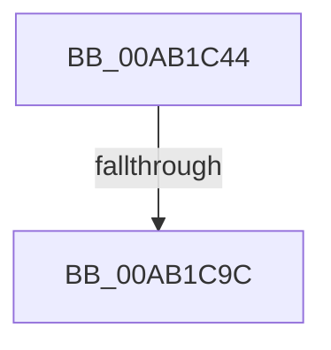

# PopIdleWakeSourceAccountingToDiagnostic

- RVA: `0x00AB1C44`–`0x00AB1CAC` (길이 `104` bytes)
- VA: `0x0000000140AB1C44`
- 실행 섹션: `PAGE`
- PDB 이름 있음: `예`; PDB Function 태그: `예`
- unwind 정보 RVA: `0x000BC874`
- 디코드: `25`개 명령, `104/104` bytes 표시
- 미해석 바이트: `0` (있으면 어셈블리에 `.byte`로 보존)

> 이 문서는 커널 이미지의 기계어와 PDB 기호를 분석해 생성했습니다. 4번과 5번은 함수 원형과 자료형을 바이너리 사용 방식에서 추정한 C 해석이며 원본 소스 복구 결과는 아닙니다.

## 1. Dependencies

- 직접 호출 지점: **1**; 고유 호출 대상: **1**
- 직접 호출자로 확인된 함수: **1**
- RIP 상대 이미지 참조: **0**

### Outgoing calls
- `0x00AB1C64` → [memset](../../text/6C/memset_function_006C6C40.md) (function, `0x006C6C40`)

### Direct callers
- [PopIdleWakeNotifyModernStandbyExitWorker](../AA/PopIdleWakeNotifyModernStandbyExitWorker_function_00AA55E0.md) at `0x00AA5854`

### Static image references
- 디코드된 RIP-relative 메모리 참조가 없습니다.

## 2. Other-region calls and transfers

- 다른 실행 섹션으로 향하는 call: **1**
  - `0x00AB1C64` → [memset](../../text/6C/memset_function_006C6C40.md) (`PAGE` → `.text`)
- call이 아닌 외부 분기/꼬리 이동: **2**
  - `0x00AB1C96` → [sub_00B4A99E](../B4/Unknown_function_00B4A99E.md) (`tail-transfer`)
  - `0x00AB1CA7` → [sub_00B4A99E + 0x3](../B4/Unknown_function_00B4A99E.md) (`tail-transfer`)

## 3. Assembly (complete function range)

```asm
00AB1C44  48 89 5C 24 08                  mov qword ptr [rsp + 8], rbx
00AB1C49  48 89 74 24 10                  mov qword ptr [rsp + 0x10], rsi
00AB1C4E  57                              push rdi
00AB1C4F  48 83 EC 20                     sub rsp, 0x20
00AB1C53  48 8B DA                        mov rbx, rdx
00AB1C56  48 8B F1                        mov rsi, rcx
00AB1C59  48 8B CB                        mov rcx, rbx
00AB1C5C  33 D2                           xor edx, edx
00AB1C5E  41 B8 98 04 00 00               mov r8d, 0x498
00AB1C64  E8 D7 4F C1 FF                  call 0x1406c6c40
00AB1C69  8B 06                           mov eax, dword ptr [rsi]
00AB1C6B  33 FF                           xor edi, edi
00AB1C6D  89 03                           mov dword ptr [rbx], eax
00AB1C6F  0F B7 D7                        movzx edx, di
00AB1C72  8B 86 98 01 00 00               mov eax, dword ptr [rsi + 0x198]
00AB1C78  89 43 04                        mov dword ptr [rbx + 4], eax
00AB1C7B  0F B7 83 50 03 00 00            movzx eax, word ptr [rbx + 0x350]
00AB1C82  48 83 C0 55                     add rax, 0x55
00AB1C86  4C 8D 04 80                     lea r8, [rax + rax*4]
00AB1C8A  66 42 89 14 43                  mov word ptr [rbx + r8*2], dx
00AB1C8F  66 3B 96 90 00 00 00            cmp dx, word ptr [rsi + 0x90]
00AB1C96  0F 83 02 8D 09 00               jae 0x140b4a99e
00AB1C9C  0F B7 C2                        movzx eax, dx
00AB1C9F  48 8B 8C C6 98 00 00 00         mov rcx, qword ptr [rsi + rax*8 + 0x98]
00AB1CA7  E9 F5 8C 09 00                  jmp 0x140b4a9a1
```

## 4. C-style interpretation (structured pseudocode)

```c
__int64 __fastcall PopIdleWakeSourceAccountingToDiagnostic(__int64 a1, __int64 a2)
{
    __int64 result;
    __int64 v_rdi;
    __int64 v_rsp;
    unsigned __int64 v_stack_p10;
    unsigned __int64 v_stack_p8;

    v_stack_p8 = v_rbx;
    v_stack_p10 = v_rsi;
    v_rsp = (v_rsp) - (32);
    a2 = 0;
    result = memset(a2, a2, (unsigned int)(0x498ULL), a4);
    v_rdi = 0;
    *(unsigned int *)(a2) = (unsigned int)((unsigned int)(*(unsigned int *)(a1)));
    *(unsigned int *)(a2 + 4) = (unsigned int)((unsigned int)(*(unsigned int *)(a1 + 408)));
    result = (*(unsigned __int16 *)(a2 + 848)) + (85);
    *(unsigned __int16 *)(a2 + result + result * 4 * 2) = 0;
}
```

## 5. (Beta) C Style

```c
int64_t PopIdleWakeSourceAccountingToDiagnostic(void *Arg1, void *Arg2)
{
    uint8_t *arg1 = (uint8_t *)Arg1;
    uint8_t *arg2 = (uint8_t *)Arg2;

    int64_t result;
    int64_t local_rdi;
    int64_t local_rsp;
    uint64_t v_stack_p10;
    uint64_t v_stack_p8;

    v_stack_p8 = local_rbx;
    v_stack_p10 = local_rsi;
    local_rsp = (local_rsp) - (32);
    Arg2 = 0;
    result = memset(Arg2, Arg2, (uint32_t)(0x498ULL), a4);
    local_rdi = 0;
    *(uint32_t *)(arg2) = (uint32_t)((uint32_t)(*(uint32_t *)(arg1)));
    *(uint32_t *)(arg2 + 0x4) = (uint32_t)((uint32_t)(*(uint32_t *)(arg1 + 0x198)));
    result = (*(uint16_t *)(arg2 + 0x350)) + (85);
    *(uint16_t *)(arg2 + result + result * 4 * 2) = 0;
}
```

### 관측된 메모리 오프셋

구조체 형식이 확인되지 않은 접근은 인자 기준의 오프셋으로만 기록했습니다.

| 기준 인자 | 오프셋 표현 | 폭 (bit) | 접근 |
|---|---:|---:|---|
| `Arg1` | `+ 0x0` | `32` | `R` |
| `Arg1` | `+ 0x90` | `16` | `R` |
| `Arg1` | `+ 0x98 + rax*8` | `64` | `R` |
| `Arg1` | `+ 0x198` | `32` | `R` |
| `Arg2` | `+ 0x0` | `32` | `W` |
| `Arg2` | `+ 0x0 + r8*2` | `16` | `W` |
| `Arg2` | `+ 0x4` | `32` | `W` |
| `Arg2` | `+ 0x350` | `16` | `R` |

## 6. Execution-region graph

[열기: 2D/3D 그래프와 함수 탐색 컨트롤 패널](../../../control-panel.html?section=page&rva=0x00AB1C44&view=graph)

- 2D 그래프는 위에서 아래로 흐르고, 3D 그래프는 빈 공간을 드래그해 회전합니다. Shift+드래그는 이동, 휠은 확대·축소, 함수 노드 선택은 대상 보고서 이동입니다.

### Static fallback


