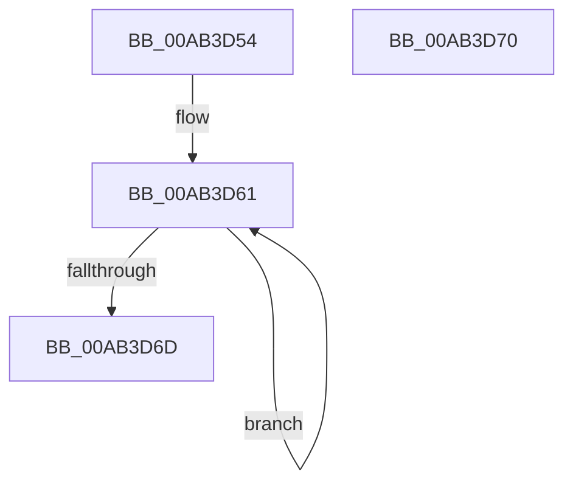

# PopIsDirectedDripsEnabled

- RVA: `0x00AB3D54`–`0x00AB3D71` (길이 `29` bytes)
- VA: `0x0000000140AB3D54`
- 실행 섹션: `PAGE`
- PDB 이름 있음: `예`; PDB Function 태그: `아니요`
- unwind 정보 RVA: `0x000DB714`
- 디코드: `8`개 명령, `29/29` bytes 표시
- 미해석 바이트: `0` (있으면 어셈블리에 `.byte`로 보존)

> 이 문서는 커널 이미지의 기계어와 PDB 기호를 분석해 생성했습니다. 4번과 5번은 함수 원형과 자료형을 바이너리 사용 방식에서 추정한 C 해석이며 원본 소스 복구 결과는 아닙니다.

## 1. Dependencies

- 직접 호출 지점: **0**; 고유 호출 대상: **0**
- 직접 호출자로 확인된 함수: **1**
- RIP 상대 이미지 참조: **1**

### Outgoing calls
- 직접 디코드된 call 명령이 없습니다.

### Direct callers
- [PopDripsWatchdogInitialize](../../init/C4/PopDripsWatchdogInitialize_function_00C43BCC.md) at `0x00C43C25`

### Static image references
- `0x00AB3D54` → RVA `0x00F0EAC0` (`.data`; read)

## 2. Other-region calls and transfers

- 다른 실행 섹션으로 향하는 call: **0**
- 별도 외부 분기/꼬리 이동을 확인하지 못했습니다.

## 3. Assembly (complete function range)

```asm
00AB3D54  0F 0D 0D 65 AD 45 00            prefetchw byte ptr [rip + 0x45ad65]
00AB3D5B  8B 05 5F AD 45 00               mov eax, dword ptr [rip + 0x45ad5f]
00AB3D61  8B C8                           mov ecx, eax
00AB3D63  F0 0F B1 0D 55 AD 45 00         lock cmpxchg dword ptr [rip + 0x45ad55], ecx
00AB3D6B  75 F4                           jne 0x140ab3d61
00AB3D6D  24 01                           and al, 1
00AB3D6F  C3                              ret
00AB3D70  CC                              int3
```

## 4. C-style interpretation (structured pseudocode)

```c
__int64 __fastcall PopIsDirectedDripsEnabled(void)
{
    __int64 result;

loc_00AB3D61:
    if (condition_is_not_equal) goto loc_00AB3D61;
    result = (unsigned __int8)(((unsigned int)(*(unsigned int *)(v_rip + 4566367))) & (1));
    return result;
}
```

## 5. (Beta) C Style

```c
void PopIsDirectedDripsEnabled(void)
{
    int64_t result;

loc_00AB3D61:
    if (condition_is_not_equal) goto loc_00AB3D61;
    result = (uint8_t)(((uint32_t)(*(uint32_t *)(v_rip + 0x45AD5F))) & (1));
    return result;
}
```

## 6. Execution-region graph

[열기: 2D/3D 그래프와 함수 탐색 컨트롤 패널](../../../control-panel.html?section=page&rva=0x00AB3D54&view=graph)

- 2D 그래프는 위에서 아래로 흐르고, 3D 그래프는 빈 공간을 드래그해 회전합니다. Shift+드래그는 이동, 휠은 확대·축소, 함수 노드 선택은 대상 보고서 이동입니다.

### Static fallback


