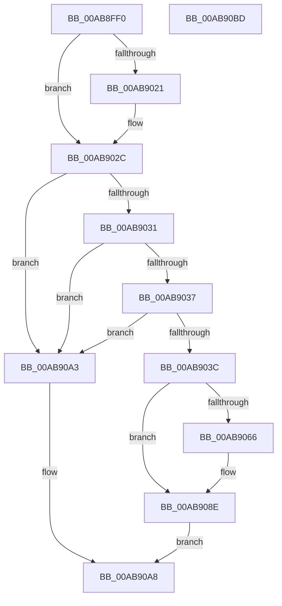

# PopLidSwitchChangeCallback

- RVA: `0x00AB8FF0`–`0x00AB90BE` (길이 `206` bytes)
- VA: `0x0000000140AB8FF0`
- 실행 섹션: `PAGE`
- PDB 이름 있음: `예`; PDB Function 태그: `아니요`
- unwind 정보 RVA: `0x000886E8`
- 디코드: `54`개 명령, `206/206` bytes 표시
- 미해석 바이트: `0` (있으면 어셈블리에 `.byte`로 보존)

> 이 문서는 커널 이미지의 기계어와 PDB 기호를 분석해 생성했습니다. 4번과 5번은 함수 원형과 자료형을 바이너리 사용 방식에서 추정한 C 해석이며 원본 소스 복구 결과는 아닙니다.

## 1. Dependencies

- 직접 호출 지점: **3**; 고유 호출 대상: **3**
- 직접 호출자로 확인된 함수: **0**
- RIP 상대 이미지 참조: **5**

### Outgoing calls
- `0x00AB9089` → [PopInvokeWin32Callout](../91/PopInvokeWin32Callout_function_009125F4.md) (function, `0x009125F4`)
- `0x00AB909A` → [PopQueueWorkItem](../../text/4A/PopQueueWorkItem_function_004A20F8.md) (function, `0x004A20F8`)
- `0x00AB90AF` → [_security_check_cookie](../../text/6A/_security_check_cookie_function_006AC640.md) (function, `0x006AC640`)

### Direct callers
- 이 함수 시작 RVA로 연결되는 직접 call은 확인되지 않았습니다. 간접 호출은 완전히 역산할 수 없습니다.

### Static image references
- `0x00AB8FFC` → RVA `0x00E0A740` (`.data`; read)
- `0x00AB900A` → RVA `0x0001E2D8` (`.rdata`; read)
- `0x00AB9021` → RVA `0x0001E2E0` (`.rdata`; read)
- `0x00AB9046` → RVA `0x00F06628` (`.data`; read)
- `0x00AB9093` → RVA `0x00F0EA40` (`.data`; read)

## 2. Other-region calls and transfers

- 다른 실행 섹션으로 향하는 call: **2**
  - `0x00AB909A` → [PopQueueWorkItem](../../text/4A/PopQueueWorkItem_function_004A20F8.md) (`PAGE` → `.text`)
  - `0x00AB90AF` → [_security_check_cookie](../../text/6A/_security_check_cookie_function_006AC640.md) (`PAGE` → `.text`)
- 별도 외부 분기/꼬리 이동을 확인하지 못했습니다.

## 3. Assembly (complete function range)

```asm
00AB8FF0  40 55                           push rbp
00AB8FF2  48 8B EC                        mov rbp, rsp
00AB8FF5  48 81 EC 80 00 00 00            sub rsp, 0x80
00AB8FFC  48 8B 05 3D 17 35 00            mov rax, qword ptr [rip + 0x35173d]
00AB9003  48 33 C4                        xor rax, rsp
00AB9006  48 89 45 F0                     mov qword ptr [rbp - 0x10], rax
00AB900A  4C 8B 0D C7 52 56 FF            mov r9, qword ptr [rip - 0xa9ad39]
00AB9011  45 33 D2                        xor r10d, r10d
00AB9014  4C 89 55 D8                     mov qword ptr [rbp - 0x28], r10
00AB9018  4C 89 55 E0                     mov qword ptr [rbp - 0x20], r10
00AB901C  4C 2B 09                        sub r9, qword ptr [rcx]
00AB901F  75 0B                           jne 0x140ab902c
00AB9021  4C 8B 0D B8 52 56 FF            mov r9, qword ptr [rip - 0xa9ad48]
00AB9028  4C 2B 49 08                     sub r9, qword ptr [rcx + 8]
00AB902C  4D 85 C9                        test r9, r9
00AB902F  75 72                           jne 0x140ab90a3
00AB9031  41 83 F8 04                     cmp r8d, 4
00AB9035  75 6C                           jne 0x140ab90a3
00AB9037  48 85 D2                        test rdx, rdx
00AB903A  74 67                           je 0x140ab90a3
00AB903C  0F 10 01                        movups xmm0, xmmword ptr [rcx]
00AB903F  8B 02                           mov eax, dword ptr [rdx]
00AB9041  89 45 E8                        mov dword ptr [rbp - 0x18], eax
00AB9044  33 C0                           xor eax, eax
00AB9046  44 38 15 DB D5 44 00            cmp byte ptr [rip + 0x44d5db], r10b
00AB904D  F3 0F 7F 45 D8                  movdqu xmmword ptr [rbp - 0x28], xmm0
00AB9052  89 45 D0                        mov dword ptr [rbp - 0x30], eax
00AB9055  0F 57 C0                        xorps xmm0, xmm0
00AB9058  0F 11 45 A0                     movups xmmword ptr [rbp - 0x60], xmm0
00AB905C  0F 11 45 B0                     movups xmmword ptr [rbp - 0x50], xmm0
00AB9060  0F 11 45 C0                     movups xmmword ptr [rbp - 0x40], xmm0
00AB9064  74 28                           je 0x140ab908e
00AB9066  48 8D 45 D8                     lea rax, [rbp - 0x28]
00AB906A  C7 45 B8 14 00 00 00            mov dword ptr [rbp - 0x48], 0x14
00AB9071  45 8D 41 02                     lea r8d, [r9 + 2]
00AB9075  48 89 45 C0                     mov qword ptr [rbp - 0x40], rax
00AB9079  48 8D 55 A0                     lea rdx, [rbp - 0x60]
00AB907D  44 89 55 C8                     mov dword ptr [rbp - 0x38], r10d
00AB9081  41 8D 49 05                     lea ecx, [r9 + 5]
00AB9085  4C 89 55 D0                     mov qword ptr [rbp - 0x30], r10
00AB9089  E8 66 95 E5 FF                  call 0x1409125f4
00AB908E  BA 01 00 00 00                  mov edx, 1
00AB9093  48 8D 0D A6 59 45 00            lea rcx, [rip + 0x4559a6]
00AB909A  E8 59 90 9E FF                  call 0x1404a20f8
00AB909F  33 C0                           xor eax, eax
00AB90A1  EB 05                           jmp 0x140ab90a8
00AB90A3  B8 0D 00 00 C0                  mov eax, 0xc000000d
00AB90A8  48 8B 4D F0                     mov rcx, qword ptr [rbp - 0x10]
00AB90AC  48 33 CC                        xor rcx, rsp
00AB90AF  E8 8C 35 BF FF                  call 0x1406ac640
00AB90B4  48 81 C4 80 00 00 00            add rsp, 0x80
00AB90BB  5D                              pop rbp
00AB90BC  C3                              ret
00AB90BD  CC                              int3
```

## 4. C-style interpretation (structured pseudocode)

```c
__int64 __fastcall PopLidSwitchChangeCallback(__int64 a1, __int64 a2, int a3)
{
    __int64 result;
    __int64 v_r10;
    __int64 v_rsp;
    unsigned __int64 v_stack_m18;
    unsigned int v_stack_m20;
    unsigned __int64 v_stack_m28;
    unsigned __int64 v_stack_m30;
    unsigned int v_stack_m38;
    unsigned int v_stack_m40;
    unsigned __int64 v_stack_m48;
    unsigned int v_stack_m50;
    unsigned __int64 v_stack_m58;
    unsigned __int64 v_stack_m68;

    v_rsp = (v_rsp) - (128);
    result = (*(unsigned __int64 *)(v_rip + 3479357)) ^ (v_rsp);
    v_stack_m18 = result;
    v_r10 = 0;
    v_stack_m30 = 0;
    v_stack_m28 = 0;
    a4 = (*(unsigned __int64 *)(v_rip - 11119929)) - (*(unsigned __int64 *)(a1));
    if (!(condition_is_not_equal)) {
        a4 = *(unsigned __int64 *)(v_rip - 11119944);
        a4 = (a4) - (*(unsigned __int64 *)(a1 + 8));
    }
    if (a4 != 0) goto loc_00AB90A3;
    if (a3 != 4) goto loc_00AB90A3;
    if (a2 == 0) goto loc_00AB90A3;
    v_stack_m20 = (unsigned int)((unsigned int)(*(unsigned int *)(a2)));
    result = 0;
    v_stack_m30 = v_xmm0;
    v_stack_m38 = 0;
    v_stack_m68 = v_xmm0;
    v_stack_m58 = v_xmm0;
    v_stack_m48 = v_xmm0;
    if ((*(unsigned __int8 *)(v_rip + 4511195)) != 0) {
        result = v_stack_m30;
        v_stack_m50 = 20;
        a3 = a4 + 2;
        v_stack_m48 = result;
        a2 = v_stack_m68;
        v_stack_m40 = 0;
        a1 = a4 + 5;
        v_stack_m38 = 0;
        result = PopInvokeWin32Callout(a1, a2, a3, a4);
    }
    result = PopQueueWorkItem(v_rip + 4544934, 1, a3, a4);
    result = 0;
    goto loc_00AB90A8;
loc_00AB90A3:
loc_00AB90A8:
    a1 = (v_stack_m18) ^ (v_rsp);
    result = _security_check_cookie(a1, 1, a3, a4);
    v_rsp = (v_rsp) + (128);
    return result;
}
```

## 5. (Beta) C Style

```c
int64_t PopLidSwitchChangeCallback(void *Arg1, int64_t Arg2, int32_t Arg3)
{
    uint8_t *arg1 = (uint8_t *)Arg1;

    int64_t result;
    int64_t local_r10;
    int64_t local_rsp;
    uint64_t v_stack_m18;
    uint32_t v_stack_m20;
    uint64_t v_stack_m28;
    uint64_t v_stack_m30;
    uint32_t v_stack_m38;
    uint32_t v_stack_m40;
    uint64_t v_stack_m48;
    uint32_t v_stack_m50;
    uint64_t v_stack_m58;
    uint64_t v_stack_m68;

    local_rsp = (local_rsp) - (128);
    result = (*(uint64_t *)(v_rip + 0x35173D)) ^ (local_rsp);
    v_stack_m18 = result;
    local_r10 = 0;
    v_stack_m30 = 0;
    v_stack_m28 = 0;
    a4 = (*(uint64_t *)(v_rip - 0xA9AD39)) - (*(uint64_t *)(arg1));
    if (!(condition_is_not_equal)) {
        a4 = *(uint64_t *)(v_rip - 0xA9AD48);
        a4 = (a4) - (*(uint64_t *)(arg1 + 0x8));
    }
    if (a4 != 0) goto loc_00AB90A3;
    if (Arg3 != 4) goto loc_00AB90A3;
    if (Arg2 == 0) goto loc_00AB90A3;
    v_stack_m20 = (uint32_t)((uint32_t)(*(uint32_t *)(Arg2)));
    result = 0;
    v_stack_m30 = v_xmm0;
    v_stack_m38 = 0;
    v_stack_m68 = v_xmm0;
    v_stack_m58 = v_xmm0;
    v_stack_m48 = v_xmm0;
    if ((*(uint8_t *)(v_rip + 0x44D5DB)) != 0) {
        result = v_stack_m30;
        v_stack_m50 = 20;
        Arg3 = a4 + 2;
        v_stack_m48 = result;
        Arg2 = v_stack_m68;
        v_stack_m40 = 0;
        Arg1 = a4 + 5;
        v_stack_m38 = 0;
        result = PopInvokeWin32Callout(Arg1, Arg2, Arg3, a4);
    }
    result = PopQueueWorkItem(v_rip + 4544934, 1, Arg3, a4);
    result = 0;
    goto loc_00AB90A8;
loc_00AB90A3:
loc_00AB90A8:
    Arg1 = (v_stack_m18) ^ (local_rsp);
    result = _security_check_cookie(Arg1, 1, Arg3, a4);
    local_rsp = (local_rsp) + (128);
    return result;
}
```

### 관측된 메모리 오프셋

구조체 형식이 확인되지 않은 접근은 인자 기준의 오프셋으로만 기록했습니다.

| 기준 인자 | 오프셋 표현 | 폭 (bit) | 접근 |
|---|---:|---:|---|
| `Arg1` | `+ 0x0` | `64` | `R` |
| `Arg1` | `+ 0x0` | `128` | `R` |
| `Arg1` | `+ 0x8` | `64` | `R` |

## 6. Execution-region graph

[열기: 2D/3D 그래프와 함수 탐색 컨트롤 패널](../../../control-panel.html?section=page&rva=0x00AB8FF0&view=graph)

- 2D 그래프는 위에서 아래로 흐르고, 3D 그래프는 빈 공간을 드래그해 회전합니다. Shift+드래그는 이동, 휠은 확대·축소, 함수 노드 선택은 대상 보고서 이동입니다.

### Static fallback


