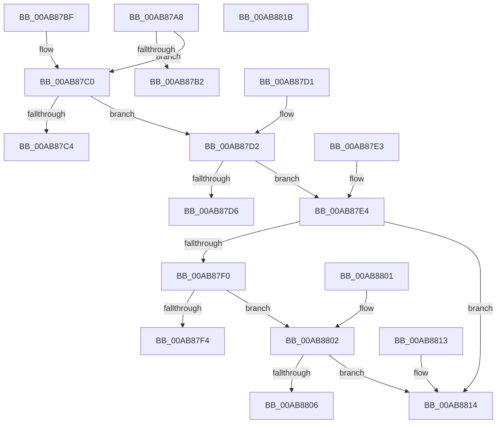

# PopNetEvaluateStateMask

- RVA: `0x00AB87A8`–`0x00AB881C` (길이 `116` bytes)
- VA: `0x0000000140AB87A8`
- 실행 섹션: `PAGE`
- PDB 이름 있음: `예`; PDB Function 태그: `아니요`
- unwind 정보 RVA: `0x000DB714`
- 디코드: `38`개 명령, `116/116` bytes 표시
- 미해석 바이트: `0` (있으면 어셈블리에 `.byte`로 보존)

> 이 문서는 커널 이미지의 기계어와 PDB 기호를 분석해 생성했습니다. 4번과 5번은 함수 원형과 자료형을 바이너리 사용 방식에서 추정한 C 해석이며 원본 소스 복구 결과는 아닙니다.

## 1. Dependencies

- 직접 호출 지점: **0**; 고유 호출 대상: **0**
- 직접 호출자로 확인된 함수: **1**
- RIP 상대 이미지 참조: **2**

### Outgoing calls
- 직접 디코드된 call 명령이 없습니다.

### Direct callers
- [PopNetEvaluationWorkerCallback](../../text/4B/PopNetEvaluationWorkerCallback_function_004BE0B0.md) at `0x004BE0F8`

### Static image references
- `0x00AB87A8` → RVA `0x00F08878` (`.data`; read)
- `0x00AB87E7` → RVA `0x00F0887C` (`.data`; read)

## 2. Other-region calls and transfers

- 다른 실행 섹션으로 향하는 call: **0**
- 별도 외부 분기/꼬리 이동을 확인하지 못했습니다.

## 3. Assembly (complete function range)

```asm
00AB87A8  8B 05 CA 00 45 00               mov eax, dword ptr [rip + 0x4500ca]
00AB87AE  A8 04                           test al, 4
00AB87B0  74 0E                           je 0x140ab87c0
00AB87B2  C7 01 02 00 00 00               mov dword ptr [rcx], 2
00AB87B8  C7 02 02 00 00 00               mov dword ptr [rdx], 2
00AB87BE  C3                              ret
00AB87BF  CC                              int3
00AB87C0  A8 08                           test al, 8
00AB87C2  74 0E                           je 0x140ab87d2
00AB87C4  C7 01 02 00 00 00               mov dword ptr [rcx], 2
00AB87CA  C7 02 03 00 00 00               mov dword ptr [rdx], 3
00AB87D0  C3                              ret
00AB87D1  CC                              int3
00AB87D2  A8 40                           test al, 0x40
00AB87D4  74 0E                           je 0x140ab87e4
00AB87D6  C7 01 02 00 00 00               mov dword ptr [rcx], 2
00AB87DC  C7 02 06 00 00 00               mov dword ptr [rdx], 6
00AB87E2  C3                              ret
00AB87E3  CC                              int3
00AB87E4  45 33 C0                        xor r8d, r8d
00AB87E7  44 38 05 8E 00 45 00            cmp byte ptr [rip + 0x45008e], r8b
00AB87EE  74 24                           je 0x140ab8814
00AB87F0  A8 02                           test al, 2
00AB87F2  74 0E                           je 0x140ab8802
00AB87F4  C7 01 02 00 00 00               mov dword ptr [rcx], 2
00AB87FA  C7 02 01 00 00 00               mov dword ptr [rdx], 1
00AB8800  C3                              ret
00AB8801  CC                              int3
00AB8802  84 C0                           test al, al
00AB8804  79 0E                           jns 0x140ab8814
00AB8806  C7 01 02 00 00 00               mov dword ptr [rcx], 2
00AB880C  C7 02 07 00 00 00               mov dword ptr [rdx], 7
00AB8812  C3                              ret
00AB8813  CC                              int3
00AB8814  44 89 01                        mov dword ptr [rcx], r8d
00AB8817  44 89 02                        mov dword ptr [rdx], r8d
00AB881A  C3                              ret
00AB881B  CC                              int3
```

## 4. C-style interpretation (structured pseudocode)

```c
__int64 __fastcall PopNetEvaluateStateMask(__int64 a1, __int64 a2, int a3)
{
    if ((((unsigned __int8)((unsigned int)(*(unsigned int *)(v_rip + 4522186)))) & (4)) == 0) goto loc_00AB87C0;
    *(unsigned int *)(a1) = 2;
    *(unsigned int *)(a2) = 2;
    return (unsigned int)(*(unsigned int *)(v_rip + 4522186));
loc_00AB87C0:
    if ((((unsigned __int8)((unsigned int)(*(unsigned int *)(v_rip + 4522186)))) & (8)) == 0) goto loc_00AB87D2;
    *(unsigned int *)(a1) = 2;
    *(unsigned int *)(a2) = 3;
    return (unsigned int)(*(unsigned int *)(v_rip + 4522186));
loc_00AB87D2:
    if ((((unsigned __int8)((unsigned int)(*(unsigned int *)(v_rip + 4522186)))) & (64)) == 0) goto loc_00AB87E4;
    *(unsigned int *)(a1) = 2;
    *(unsigned int *)(a2) = 6;
    return (unsigned int)(*(unsigned int *)(v_rip + 4522186));
loc_00AB87E4:
    a3 = 0;
    if ((*(unsigned __int8 *)(v_rip + 4522126)) == 0) goto loc_00AB8814;
    if ((((unsigned __int8)((unsigned int)(*(unsigned int *)(v_rip + 4522186)))) & (2)) == 0) goto loc_00AB8802;
    *(unsigned int *)(a1) = 2;
    *(unsigned int *)(a2) = 1;
    return (unsigned int)(*(unsigned int *)(v_rip + 4522186));
loc_00AB8802:
    if (!sign_flag) goto loc_00AB8814;
    *(unsigned int *)(a1) = 2;
    *(unsigned int *)(a2) = 7;
    return (unsigned int)(*(unsigned int *)(v_rip + 4522186));
loc_00AB8814:
    *(unsigned int *)(a1) = 0;
    *(unsigned int *)(a2) = 0;
    return (unsigned int)(*(unsigned int *)(v_rip + 4522186));
}
```

## 5. (Beta) C Style

```c
int64_t PopNetEvaluateStateMask(void *Arg1, void *Arg2, int32_t Arg3)
{
    uint8_t *arg1 = (uint8_t *)Arg1;
    uint8_t *arg2 = (uint8_t *)Arg2;

    if ((((uint8_t)((uint32_t)(*(uint32_t *)(v_rip + 0x4500CA)))) & (4)) == 0) goto loc_00AB87C0;
    *(uint32_t *)(arg1) = 2;
    *(uint32_t *)(arg2) = 2;
    return (uint32_t)(*(uint32_t *)(v_rip + 0x4500CA));
loc_00AB87C0:
    if ((((uint8_t)((uint32_t)(*(uint32_t *)(v_rip + 0x4500CA)))) & (8)) == 0) goto loc_00AB87D2;
    *(uint32_t *)(arg1) = 2;
    *(uint32_t *)(arg2) = 3;
    return (uint32_t)(*(uint32_t *)(v_rip + 0x4500CA));
loc_00AB87D2:
    if ((((uint8_t)((uint32_t)(*(uint32_t *)(v_rip + 0x4500CA)))) & (64)) == 0) goto loc_00AB87E4;
    *(uint32_t *)(arg1) = 2;
    *(uint32_t *)(arg2) = 6;
    return (uint32_t)(*(uint32_t *)(v_rip + 0x4500CA));
loc_00AB87E4:
    Arg3 = 0;
    if ((*(uint8_t *)(v_rip + 0x45008E)) == 0) goto loc_00AB8814;
    if ((((uint8_t)((uint32_t)(*(uint32_t *)(v_rip + 0x4500CA)))) & (2)) == 0) goto loc_00AB8802;
    *(uint32_t *)(arg1) = 2;
    *(uint32_t *)(arg2) = 1;
    return (uint32_t)(*(uint32_t *)(v_rip + 0x4500CA));
loc_00AB8802:
    if (!sign_flag) goto loc_00AB8814;
    *(uint32_t *)(arg1) = 2;
    *(uint32_t *)(arg2) = 7;
    return (uint32_t)(*(uint32_t *)(v_rip + 0x4500CA));
loc_00AB8814:
    *(uint32_t *)(arg1) = 0;
    *(uint32_t *)(arg2) = 0;
    return (uint32_t)(*(uint32_t *)(v_rip + 0x4500CA));
}
```

### 관측된 메모리 오프셋

구조체 형식이 확인되지 않은 접근은 인자 기준의 오프셋으로만 기록했습니다.

| 기준 인자 | 오프셋 표현 | 폭 (bit) | 접근 |
|---|---:|---:|---|
| `Arg1` | `+ 0x0` | `32` | `W` |
| `Arg2` | `+ 0x0` | `32` | `W` |

## 6. Execution-region graph

[열기: 2D/3D 그래프와 함수 탐색 컨트롤 패널](../../../control-panel.html?section=page&rva=0x00AB87A8&view=graph)

- 2D 그래프는 위에서 아래로 흐르고, 3D 그래프는 빈 공간을 드래그해 회전합니다. Shift+드래그는 이동, 휠은 확대·축소, 함수 노드 선택은 대상 보고서 이동입니다.

### Static fallback


