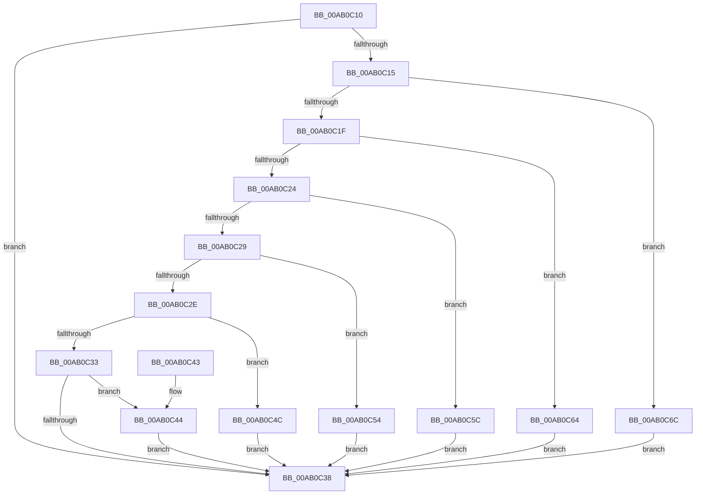

# PopNetIsDisconnectStandbyActive

- RVA: `0x00AB0C10`–`0x00AB0C71` (길이 `97` bytes)
- VA: `0x0000000140AB0C10`
- 실행 섹션: `PAGE`
- PDB 이름 있음: `예`; PDB Function 태그: `아니요`
- unwind 정보 RVA: `0x000DB714`
- 디코드: `31`개 명령, `97/97` bytes 표시
- 미해석 바이트: `0` (있으면 어셈블리에 `.byte`로 보존)

> 이 문서는 커널 이미지의 기계어와 PDB 기호를 분석해 생성했습니다. 4번과 5번은 함수 원형과 자료형을 바이너리 사용 방식에서 추정한 C 해석이며 원본 소스 복구 결과는 아닙니다.

## 1. Dependencies

- 직접 호출 지점: **0**; 고유 호출 대상: **0**
- 직접 호출자로 확인된 함수: **1**
- RIP 상대 이미지 참조: **2**

### Outgoing calls
- 직접 디코드된 call 명령이 없습니다.

### Direct callers
- [PopPdcCsCheckSystemVolumeDevice](../../init/C4/PopPdcCsCheckSystemVolumeDevice_function_00C42D9C.md) at `0x00C42EE4`

### Static image references
- `0x00AB0C15` → RVA `0x00E678E0` (`.data`; read)
- `0x00AB0C38` → RVA `0x00E678DC` (`.data`; read)

## 2. Other-region calls and transfers

- 다른 실행 섹션으로 향하는 call: **0**
- 별도 외부 분기/꼬리 이동을 확인하지 못했습니다.

## 3. Assembly (complete function range)

```asm
00AB0C10  48 85 C9                        test rcx, rcx
00AB0C13  74 23                           je 0x140ab0c38
00AB0C15  8B 15 C5 6C 3B 00               mov edx, dword ptr [rip + 0x3b6cc5]
00AB0C1B  85 D2                           test edx, edx
00AB0C1D  74 4D                           je 0x140ab0c6c
00AB0C1F  83 EA 01                        sub edx, 1
00AB0C22  74 40                           je 0x140ab0c64
00AB0C24  83 EA 01                        sub edx, 1
00AB0C27  74 33                           je 0x140ab0c5c
00AB0C29  83 EA 01                        sub edx, 1
00AB0C2C  74 26                           je 0x140ab0c54
00AB0C2E  83 EA 03                        sub edx, 3
00AB0C31  74 19                           je 0x140ab0c4c
00AB0C33  83 FA 01                        cmp edx, 1
00AB0C36  74 0C                           je 0x140ab0c44
00AB0C38  83 3D 9D 6C 3B 00 02            cmp dword ptr [rip + 0x3b6c9d], 2
00AB0C3F  0F 94 C0                        sete al
00AB0C42  C3                              ret
00AB0C43  CC                              int3
00AB0C44  C7 01 05 00 00 00               mov dword ptr [rcx], 5
00AB0C4A  EB EC                           jmp 0x140ab0c38
00AB0C4C  C7 01 01 00 00 00               mov dword ptr [rcx], 1
00AB0C52  EB E4                           jmp 0x140ab0c38
00AB0C54  C7 01 04 00 00 00               mov dword ptr [rcx], 4
00AB0C5A  EB DC                           jmp 0x140ab0c38
00AB0C5C  C7 01 03 00 00 00               mov dword ptr [rcx], 3
00AB0C62  EB D4                           jmp 0x140ab0c38
00AB0C64  C7 01 02 00 00 00               mov dword ptr [rcx], 2
00AB0C6A  EB CC                           jmp 0x140ab0c38
00AB0C6C  83 21 00                        and dword ptr [rcx], 0
00AB0C6F  EB C7                           jmp 0x140ab0c38
```

## 4. C-style interpretation (structured pseudocode)

```c
__int64 __fastcall PopNetIsDisconnectStandbyActive(__int64 a1)
{
    __int64 result;

    if (a1 == 0) goto loc_00AB0C38;
    if ((unsigned int)((unsigned int)(*(unsigned int *)(v_rip + 3894469))) == 0) goto loc_00AB0C6C;
    a2 = (unsigned int)(((unsigned int)(*(unsigned int *)(v_rip + 3894469))) - (1));
    if (condition_is_equal) goto loc_00AB0C64;
    a2 = (unsigned int)((a2) - (1));
    if (condition_is_equal) goto loc_00AB0C5C;
    a2 = (unsigned int)((a2) - (1));
    if (condition_is_equal) goto loc_00AB0C54;
    a2 = (unsigned int)((a2) - (3));
    if (condition_is_equal) goto loc_00AB0C4C;
    if (((unsigned int)(a2)) == 1) goto loc_00AB0C44;
loc_00AB0C38:
    result = ((*(unsigned int *)(v_rip + 3894429)) == 2) ? 1 : 0;
    return result;
loc_00AB0C44:
    *(unsigned int *)(a1) = 5;
    goto loc_00AB0C38;
loc_00AB0C4C:
    *(unsigned int *)(a1) = 1;
    goto loc_00AB0C38;
loc_00AB0C54:
    *(unsigned int *)(a1) = 4;
    goto loc_00AB0C38;
loc_00AB0C5C:
    *(unsigned int *)(a1) = 3;
    goto loc_00AB0C38;
loc_00AB0C64:
    *(unsigned int *)(a1) = 2;
    goto loc_00AB0C38;
loc_00AB0C6C:
    goto loc_00AB0C38;
}
```

## 5. (Beta) C Style

```c
int64_t PopNetIsDisconnectStandbyActive(int64_t Arg1)
{
    int64_t result;

    if (Arg1 == 0) goto loc_00AB0C38;
    if ((uint32_t)((uint32_t)(*(uint32_t *)(v_rip + 0x3B6CC5))) == 0) goto loc_00AB0C6C;
    a2 = (uint32_t)(((uint32_t)(*(uint32_t *)(v_rip + 0x3B6CC5))) - (1));
    if (condition_is_equal) goto loc_00AB0C64;
    a2 = (uint32_t)((a2) - (1));
    if (condition_is_equal) goto loc_00AB0C5C;
    a2 = (uint32_t)((a2) - (1));
    if (condition_is_equal) goto loc_00AB0C54;
    a2 = (uint32_t)((a2) - (3));
    if (condition_is_equal) goto loc_00AB0C4C;
    if (((uint32_t)(a2)) == 1) goto loc_00AB0C44;
loc_00AB0C38:
    result = ((*(uint32_t *)(v_rip + 0x3B6C9D)) == 2) ? 1 : 0;
    return result;
loc_00AB0C44:
    *(uint32_t *)(Arg1) = 5;
    goto loc_00AB0C38;
loc_00AB0C4C:
    *(uint32_t *)(Arg1) = 1;
    goto loc_00AB0C38;
loc_00AB0C54:
    *(uint32_t *)(Arg1) = 4;
    goto loc_00AB0C38;
loc_00AB0C5C:
    *(uint32_t *)(Arg1) = 3;
    goto loc_00AB0C38;
loc_00AB0C64:
    *(uint32_t *)(Arg1) = 2;
    goto loc_00AB0C38;
loc_00AB0C6C:
    goto loc_00AB0C38;
}
```

## 6. Execution-region graph

[열기: 2D/3D 그래프와 함수 탐색 컨트롤 패널](../../../control-panel.html?section=page&rva=0x00AB0C10&view=graph)

- 2D 그래프는 위에서 아래로 흐르고, 3D 그래프는 빈 공간을 드래그해 회전합니다. Shift+드래그는 이동, 휠은 확대·축소, 함수 노드 선택은 대상 보고서 이동입니다.

### Static fallback


