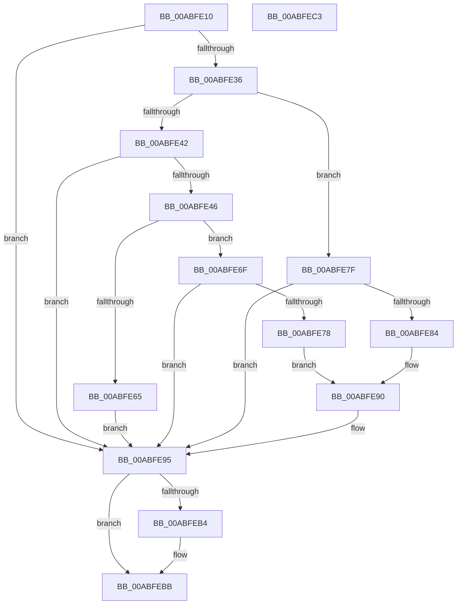

# PopPolicyWorkerActionPromote

- RVA: `0x00ABFE10`–`0x00ABFEC4` (길이 `180` bytes)
- VA: `0x0000000140ABFE10`
- 실행 섹션: `PAGE`
- PDB 이름 있음: `예`; PDB Function 태그: `아니요`
- unwind 정보 RVA: `0x0005CF00`
- 디코드: `46`개 명령, `180/180` bytes 표시
- 미해석 바이트: `0` (있으면 어셈블리에 `.byte`로 보존)

> 이 문서는 커널 이미지의 기계어와 PDB 기호를 분석해 생성했습니다. 4번과 5번은 함수 원형과 자료형을 바이너리 사용 방식에서 추정한 C 해석이며 원본 소스 복구 결과는 아닙니다.

## 1. Dependencies

- 직접 호출 지점: **5**; 고유 호출 대상: **5**
- 직접 호출자로 확인된 함수: **0**
- RIP 상대 이미지 참조: **8**

### Outgoing calls
- `0x00ABFE16` → [PopAcquirePolicyLock](../../pagelk/B7/PopAcquirePolicyLock_function_00B783C0.md) (function, `0x00B783C0`)
- `0x00ABFE5C` → [PopIssueActionRequest](../A9/PopIssueActionRequest_function_00A9CE54.md) (function, `0x00A9CE54`)
- `0x00ABFE86` → [PopSetPowerActionState](../../text/4B/PopSetPowerActionState_function_004BC8A8.md) (function, `0x004BC8A8`)
- `0x00ABFE90` → [PopGetPolicyWorker](../../text/48/PopGetPolicyWorker_function_00482D24.md) (function, `0x00482D24`)
- `0x00ABFE9D` → [PopReleasePolicyLock](../../pagelk/B7/PopReleasePolicyLock_function_00B78410.md) (function, `0x00B78410`)

### Direct callers
- 이 함수 시작 RVA로 연결되는 직접 call은 확인되지 않았습니다. 간접 호출은 완전히 역산할 수 없습니다.

### Static image references
- `0x00ABFE24` → RVA `0x00F0BF10` (`.data`; write)
- `0x00ABFE2B` → RVA `0x00F0BD40` (`.data`; read)
- `0x00ABFE38` → RVA `0x00F0BD41` (`.data`; read)
- `0x00ABFE46` → RVA `0x00F0BD4C` (`.data`; read)
- `0x00ABFE4F` → RVA `0x00F0BD48` (`.data`; read)
- `0x00ABFE56` → RVA `0x00F0BD44` (`.data`; read)
- `0x00ABFE67` → RVA `0x00F0BD40` (`.data`; read/write)
- `0x00ABFE95` → RVA `0x00F0BF10` (`.data`; read/write)

## 2. Other-region calls and transfers

- 다른 실행 섹션으로 향하는 call: **4**
  - `0x00ABFE16` → [PopAcquirePolicyLock](../../pagelk/B7/PopAcquirePolicyLock_function_00B783C0.md) (`PAGE` → `PAGELK`)
  - `0x00ABFE86` → [PopSetPowerActionState](../../text/4B/PopSetPowerActionState_function_004BC8A8.md) (`PAGE` → `.text`)
  - `0x00ABFE90` → [PopGetPolicyWorker](../../text/48/PopGetPolicyWorker_function_00482D24.md) (`PAGE` → `.text`)
  - `0x00ABFE9D` → [PopReleasePolicyLock](../../pagelk/B7/PopReleasePolicyLock_function_00B78410.md) (`PAGE` → `PAGELK`)
- 별도 외부 분기/꼬리 이동을 확인하지 못했습니다.

## 3. Assembly (complete function range)

```asm
00ABFE10  40 53                           push rbx
00ABFE12  48 83 EC 20                     sub rsp, 0x20
00ABFE16  E8 A5 85 0B 00                  call 0x140b783c0
00ABFE1B  65 48 8B 04 25 88 01 00 00      mov rax, qword ptr gs:[0x188]
00ABFE24  48 89 05 E5 C0 44 00            mov qword ptr [rip + 0x44c0e5], rax
00ABFE2B  0F B6 05 0E BF 44 00            movzx eax, byte ptr [rip + 0x44bf0e]
00ABFE32  84 C0                           test al, al
00ABFE34  74 5F                           je 0x140abfe95
00ABFE36  8B D8                           mov ebx, eax
00ABFE38  8A 05 03 BF 44 00               mov al, byte ptr [rip + 0x44bf03]
00ABFE3E  84 C0                           test al, al
00ABFE40  74 3D                           je 0x140abfe7f
00ABFE42  3C 02                           cmp al, 2
00ABFE44  75 4F                           jne 0x140abfe95
00ABFE46  44 8B 0D FF BE 44 00            mov r9d, dword ptr [rip + 0x44beff]
00ABFE4D  B1 01                           mov cl, 1
00ABFE4F  44 8B 05 F2 BE 44 00            mov r8d, dword ptr [rip + 0x44bef2]
00ABFE56  8B 15 E8 BE 44 00               mov edx, dword ptr [rip + 0x44bee8]
00ABFE5C  E8 F3 CF FD FF                  call 0x140a9ce54
00ABFE61  85 C0                           test eax, eax
00ABFE63  78 0A                           js 0x140abfe6f
00ABFE65  F6 D3                           not bl
00ABFE67  20 1D D3 BE 44 00               and byte ptr [rip + 0x44bed3], bl
00ABFE6D  EB 26                           jmp 0x140abfe95
00ABFE6F  80 3D CB BE 44 00 02            cmp byte ptr [rip + 0x44becb], 2
00ABFE76  74 1D                           je 0x140abfe95
00ABFE78  B9 01 00 00 00                  mov ecx, 1
00ABFE7D  EB 11                           jmp 0x140abfe90
00ABFE7F  F6 C3 02                        test bl, 2
00ABFE82  74 11                           je 0x140abfe95
00ABFE84  B1 01                           mov cl, 1
00ABFE86  E8 1D CA 9F FF                  call 0x1404bc8a8
00ABFE8B  B9 02 00 00 00                  mov ecx, 2
00ABFE90  E8 8F 2E 9C FF                  call 0x140482d24
00ABFE95  48 83 25 73 C0 44 00 00         and qword ptr [rip + 0x44c073], 0
00ABFE9D  E8 6E 85 0B 00                  call 0x140b78410
00ABFEA2  65 48 8B 04 25 88 01 00 00      mov rax, qword ptr gs:[0x188]
00ABFEAB  83 B8 E4 01 00 00 00            cmp dword ptr [rax + 0x1e4], 0
00ABFEB2  74 07                           je 0x140abfebb
00ABFEB4  B9 20 00 00 00                  mov ecx, 0x20
00ABFEB9  CD 29                           int 0x29
00ABFEBB  33 C0                           xor eax, eax
00ABFEBD  48 83 C4 20                     add rsp, 0x20
00ABFEC1  5B                              pop rbx
00ABFEC2  C3                              ret
00ABFEC3  CC                              int3
```

## 4. C-style interpretation (structured pseudocode)

```c
__int64 __fastcall PopPolicyWorkerActionPromote(void)
{
    __int64 result;
    __int64 v_rbx;
    __int64 v_rsp;

    v_rsp = (v_rsp) - (32);
    result = PopAcquirePolicyLock(a1, a2, a3, a4);
    *(unsigned __int64 *)(v_rip + 4505829) = *(unsigned __int64 *)(gs_base + (0 + 392));
    if ((unsigned __int8)(*(unsigned __int8 *)(v_rip + 4505358)) == 0) goto loc_00ABFE95;
    if ((unsigned __int8)(*(unsigned __int8 *)(v_rip + 4505347)) == 0) goto loc_00ABFE7F;
    if (((unsigned __int8)(*(unsigned __int8 *)(v_rip + 4505347))) != 2) goto loc_00ABFE95;
    result = PopIssueActionRequest(1, (unsigned int)(*(unsigned int *)(v_rip + 4505320)), (unsigned int)(*(unsigned int *)(v_rip + 4505330)), (unsigned int)(*(unsigned int *)(v_rip + 4505343)));
    if (sign_flag) goto loc_00ABFE6F;
    v_rbx = (unsigned __int8)(~((unsigned int)((unsigned int)(*(unsigned __int8 *)(v_rip + 4505358)))));
    goto loc_00ABFE95;
loc_00ABFE6F:
    if ((*(unsigned __int8 *)(v_rip + 4505291)) == 2) goto loc_00ABFE95;
    goto loc_00ABFE90;
loc_00ABFE7F:
    if ((((unsigned __int8)(v_rbx)) & (2)) == 0) goto loc_00ABFE95;
    result = PopSetPowerActionState(1, (unsigned int)(*(unsigned int *)(v_rip + 4505320)), (unsigned int)(*(unsigned int *)(v_rip + 4505330)), (unsigned int)(*(unsigned int *)(v_rip + 4505343)));
loc_00ABFE90:
    result = PopGetPolicyWorker(2, (unsigned int)(*(unsigned int *)(v_rip + 4505320)), (unsigned int)(*(unsigned int *)(v_rip + 4505330)), (unsigned int)(*(unsigned int *)(v_rip + 4505343)));
loc_00ABFE95:
    result = PopReleasePolicyLock(2, (unsigned int)(*(unsigned int *)(v_rip + 4505320)), (unsigned int)(*(unsigned int *)(v_rip + 4505330)), (unsigned int)(*(unsigned int *)(v_rip + 4505343)));
    if ((*(unsigned int *)(*(unsigned __int64 *)(gs_base + (0 + 392)) + 484)) != 0) {
        a1 = 32;
    }
    result = 0;
    v_rsp = (v_rsp) + (32);
    return result;
}
```

## 5. (Beta) C Style

```c
void PopPolicyWorkerActionPromote(void)
{
    int64_t result;
    int64_t local_rbx;
    int64_t local_rsp;

    local_rsp = (local_rsp) - (32);
    result = PopAcquirePolicyLock(a1, a2, a3, a4);
    *(uint64_t *)(v_rip + 0x44C0E5) = *(uint64_t *)(gs_base + (0 + 0x188));
    if ((uint8_t)(*(uint8_t *)(v_rip + 0x44BF0E)) == 0) goto loc_00ABFE95;
    if ((uint8_t)(*(uint8_t *)(v_rip + 0x44BF03)) == 0) goto loc_00ABFE7F;
    if (((uint8_t)(*(uint8_t *)(v_rip + 0x44BF03))) != 2) goto loc_00ABFE95;
    result = PopIssueActionRequest(1, (uint32_t)(*(uint32_t *)(v_rip + 0x44BEE8)), (uint32_t)(*(uint32_t *)(v_rip + 0x44BEF2)), (uint32_t)(*(uint32_t *)(v_rip + 0x44BEFF)));
    if (sign_flag) goto loc_00ABFE6F;
    local_rbx = (uint8_t)(~((uint32_t)((uint32_t)(*(uint8_t *)(v_rip + 0x44BF0E)))));
    goto loc_00ABFE95;
loc_00ABFE6F:
    if ((*(uint8_t *)(v_rip + 0x44BECB)) == 2) goto loc_00ABFE95;
    goto loc_00ABFE90;
loc_00ABFE7F:
    if ((((uint8_t)(local_rbx)) & (2)) == 0) goto loc_00ABFE95;
    result = PopSetPowerActionState(1, (uint32_t)(*(uint32_t *)(v_rip + 0x44BEE8)), (uint32_t)(*(uint32_t *)(v_rip + 0x44BEF2)), (uint32_t)(*(uint32_t *)(v_rip + 0x44BEFF)));
loc_00ABFE90:
    result = PopGetPolicyWorker(2, (uint32_t)(*(uint32_t *)(v_rip + 0x44BEE8)), (uint32_t)(*(uint32_t *)(v_rip + 0x44BEF2)), (uint32_t)(*(uint32_t *)(v_rip + 0x44BEFF)));
loc_00ABFE95:
    result = PopReleasePolicyLock(2, (uint32_t)(*(uint32_t *)(v_rip + 0x44BEE8)), (uint32_t)(*(uint32_t *)(v_rip + 0x44BEF2)), (uint32_t)(*(uint32_t *)(v_rip + 0x44BEFF)));
    if ((*(uint32_t *)(*(uint64_t *)(gs_base + (0 + 0x188)) + 0x1E4)) != 0) {
        a1 = 32;
    }
    result = 0;
    local_rsp = (local_rsp) + (32);
    return result;
}
```

## 6. Execution-region graph

[열기: 2D/3D 그래프와 함수 탐색 컨트롤 패널](../../../control-panel.html?section=page&rva=0x00ABFE10&view=graph)

- 2D 그래프는 위에서 아래로 흐르고, 3D 그래프는 빈 공간을 드래그해 회전합니다. Shift+드래그는 이동, 휠은 확대·축소, 함수 노드 선택은 대상 보고서 이동입니다.

### Static fallback


