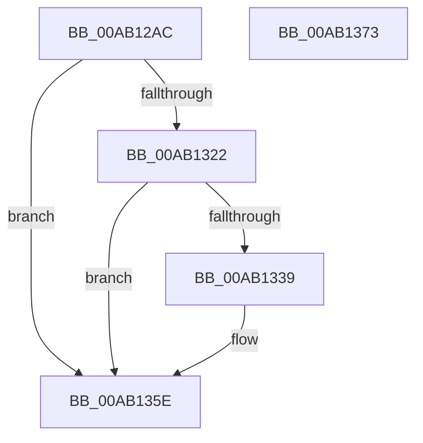

# PopPowerAggregatorDiagTracePdcSleepTransition

- RVA: `0x00AB12AC`–`0x00AB1374` (길이 `200` bytes)
- VA: `0x0000000140AB12AC`
- 실행 섹션: `PAGE`
- PDB 이름 있음: `예`; PDB Function 태그: `아니요`
- unwind 정보 RVA: `0x000BC74C`
- 디코드: `49`개 명령, `200/200` bytes 표시
- 미해석 바이트: `0` (있으면 어셈블리에 `.byte`로 보존)

> 이 문서는 커널 이미지의 기계어와 PDB 기호를 분석해 생성했습니다. 4번과 5번은 함수 원형과 자료형을 바이너리 사용 방식에서 추정한 C 해석이며 원본 소스 복구 결과는 아닙니다.

## 1. Dependencies

- 직접 호출 지점: **3**; 고유 호출 대상: **3**
- 직접 호출자로 확인된 함수: **1**
- RIP 상대 이미지 참조: **4**

### Outgoing calls
- `0x00AB1330` → [EtwEventEnabled](../../text/39/EtwEventEnabled_function_00392450.md) (function, `0x00392450`)
- `0x00AB1359` → [EtwWrite](../../text/41/EtwWrite_function_0041C720.md) (function, `0x0041C720`)
- `0x00AB1365` → [_security_check_cookie](../../text/6A/_security_check_cookie_function_006AC640.md) (function, `0x006AC640`)

### Direct callers
- [PopPowerAggregatorNotifyPdcSleepTransition](PopPowerAggregatorNotifyPdcSleepTransition_function_00AB11E0.md) at `0x00AB127B`

### Static image references
- `0x00AB12BD` → RVA `0x00E0A740` (`.data`; read)
- `0x00AB12DF` → RVA `0x00E67858` (`.data`; read)
- `0x00AB1322` → RVA `0x00F0B408` (`.data`; read)
- `0x00AB1329` → RVA `0x0001E1B8` (`.rdata`; read)

## 2. Other-region calls and transfers

- 다른 실행 섹션으로 향하는 call: **3**
  - `0x00AB1330` → [EtwEventEnabled](../../text/39/EtwEventEnabled_function_00392450.md) (`PAGE` → `.text`)
  - `0x00AB1359` → [EtwWrite](../../text/41/EtwWrite_function_0041C720.md) (`PAGE` → `.text`)
  - `0x00AB1365` → [_security_check_cookie](../../text/6A/_security_check_cookie_function_006AC640.md) (`PAGE` → `.text`)
- 별도 외부 분기/꼬리 이동을 확인하지 못했습니다.

## 3. Assembly (complete function range)

```asm
00AB12AC  89 54 24 10                     mov dword ptr [rsp + 0x10], edx
00AB12B0  55                              push rbp
00AB12B1  48 8D 6C 24 B1                  lea rbp, [rsp - 0x4f]
00AB12B6  48 81 EC A0 00 00 00            sub rsp, 0xa0
00AB12BD  48 8B 05 7C 94 35 00            mov rax, qword ptr [rip + 0x35947c]
00AB12C4  48 33 C4                        xor rax, rsp
00AB12C7  48 89 45 3F                     mov qword ptr [rbp + 0x3f], rax
00AB12CB  83 65 FB 00                     and dword ptr [rbp - 5], 0
00AB12CF  83 65 0B 00                     and dword ptr [rbp + 0xb], 0
00AB12D3  83 65 1B 00                     and dword ptr [rbp + 0x1b], 0
00AB12D7  83 65 2B 00                     and dword ptr [rbp + 0x2b], 0
00AB12DB  83 65 3B 00                     and dword ptr [rbp + 0x3b], 0
00AB12DF  80 3D 72 65 3B 00 00            cmp byte ptr [rip + 0x3b6572], 0
00AB12E6  0F B6 C1                        movzx eax, cl
00AB12E9  B9 04 00 00 00                  mov ecx, 4
00AB12EE  89 45 DF                        mov dword ptr [rbp - 0x21], eax
00AB12F1  48 8D 45 DF                     lea rax, [rbp - 0x21]
00AB12F5  48 89 45 EF                     mov qword ptr [rbp - 0x11], rax
00AB12F9  48 8D 45 67                     lea rax, [rbp + 0x67]
00AB12FD  48 89 45 FF                     mov qword ptr [rbp - 1], rax
00AB1301  48 8D 45 7F                     lea rax, [rbp + 0x7f]
00AB1305  48 89 45 2F                     mov qword ptr [rbp + 0x2f], rax
00AB1309  89 4D F7                        mov dword ptr [rbp - 9], ecx
00AB130C  89 4D 07                        mov dword ptr [rbp + 7], ecx
00AB130F  4C 89 45 0F                     mov qword ptr [rbp + 0xf], r8
00AB1313  89 4D 17                        mov dword ptr [rbp + 0x17], ecx
00AB1316  4C 89 4D 1F                     mov qword ptr [rbp + 0x1f], r9
00AB131A  89 4D 27                        mov dword ptr [rbp + 0x27], ecx
00AB131D  89 4D 37                        mov dword ptr [rbp + 0x37], ecx
00AB1320  74 3C                           je 0x140ab135e
00AB1322  48 8B 0D DF A0 45 00            mov rcx, qword ptr [rip + 0x45a0df]
00AB1329  48 8D 15 88 CE 56 FF            lea rdx, [rip - 0xa93178]
00AB1330  E8 1B 11 8E FF                  call 0x140392450
00AB1335  84 C0                           test al, al
00AB1337  74 25                           je 0x140ab135e
00AB1339  48 8B 0D C8 A0 45 00            mov rcx, qword ptr [rip + 0x45a0c8]
00AB1340  48 8D 45 EF                     lea rax, [rbp - 0x11]
00AB1344  41 B9 05 00 00 00               mov r9d, 5
00AB134A  48 89 44 24 20                  mov qword ptr [rsp + 0x20], rax
00AB134F  45 33 C0                        xor r8d, r8d
00AB1352  48 8D 15 5F CE 56 FF            lea rdx, [rip - 0xa931a1]
00AB1359  E8 C2 B3 96 FF                  call 0x14041c720
00AB135E  48 8B 4D 3F                     mov rcx, qword ptr [rbp + 0x3f]
00AB1362  48 33 CC                        xor rcx, rsp
00AB1365  E8 D6 B2 BF FF                  call 0x1406ac640
00AB136A  48 81 C4 A0 00 00 00            add rsp, 0xa0
00AB1371  5D                              pop rbp
00AB1372  C3                              ret
00AB1373  CC                              int3
```

## 4. C-style interpretation (structured pseudocode)

```c
__int64 __fastcall PopPowerAggregatorDiagTracePdcSleepTransition(unsigned __int8 a1, int a2, __int64 a3, __int64 a4, __int64 a5)
{
    __int64 result;
    __int64 v_rsp;
    unsigned __int64 v_stack_m18;
    unsigned int v_stack_m1C;
    unsigned int v_stack_m20;
    unsigned __int64 v_stack_m28;
    unsigned int v_stack_m2C;
    unsigned int v_stack_m30;
    unsigned __int64 v_stack_m38;
    unsigned int v_stack_m3C;
    unsigned int v_stack_m40;
    unsigned __int64 v_stack_m48;
    unsigned int v_stack_m4C;
    unsigned int v_stack_m50;
    unsigned __int64 v_stack_m57;
    unsigned __int64 v_stack_m58;
    unsigned int v_stack_m5C;
    unsigned int v_stack_m60;
    unsigned __int64 v_stack_m68;
    unsigned int v_stack_m78;
    unsigned __int64 v_stack_m88;
    unsigned int v_stack_p10;

    v_stack_p10 = a2;
    v_rsp = (v_rsp) - (160);
    result = (*(unsigned __int64 *)(v_rip + 3511420)) ^ (v_rsp);
    v_stack_m18 = result;
    v_stack_m78 = a1;
    v_stack_m68 = v_stack_m78;
    v_stack_m58 = v_stack_p10;
    v_stack_m28 = a5;
    v_stack_m60 = 4;
    v_stack_m50 = 4;
    v_stack_m48 = a3;
    v_stack_m40 = 4;
    v_stack_m38 = a4;
    v_stack_m30 = 4;
    v_stack_m20 = 4;
    if ((*(unsigned __int8 *)(v_rip + 3892594)) == 0) goto loc_00AB135E;
    result = EtwEventEnabled(*(unsigned __int64 *)(v_rip + 4563167), v_rip - 11088248, a3, a4);
    if ((unsigned __int8)(result) != 0) {
        a1 = *(unsigned __int64 *)(v_rip + 4563144);
        result = v_stack_m68;
        a4 = 5;
        v_stack_m88 = result;
        a3 = 0;
        a2 = v_rip - 11088289;
        result = EtwWrite(a1, a2, a3, a4);
    }
    a1 = (v_stack_m18) ^ (v_rsp);
    result = _security_check_cookie(a1, a2, a3, a4);
    v_rsp = (v_rsp) + (160);
    return result;
}
```

## 5. (Beta) C Style

```c
int64_t PopPowerAggregatorDiagTracePdcSleepTransition(uint8_t Arg1, int32_t Arg2, int64_t Arg3, int64_t Arg4, int64_t Arg5)
{
    int64_t result;
    int64_t local_rsp;
    uint64_t v_stack_m18;
    uint32_t v_stack_m1C;
    uint32_t v_stack_m20;
    uint64_t v_stack_m28;
    uint32_t v_stack_m2C;
    uint32_t v_stack_m30;
    uint64_t v_stack_m38;
    uint32_t v_stack_m3C;
    uint32_t v_stack_m40;
    uint64_t v_stack_m48;
    uint32_t v_stack_m4C;
    uint32_t v_stack_m50;
    uint64_t v_stack_m57;
    uint64_t v_stack_m58;
    uint32_t v_stack_m5C;
    uint32_t v_stack_m60;
    uint64_t v_stack_m68;
    uint32_t v_stack_m78;
    uint64_t v_stack_m88;
    uint32_t v_stack_p10;

    v_stack_p10 = Arg2;
    local_rsp = (local_rsp) - (160);
    result = (*(uint64_t *)(v_rip + 0x35947C)) ^ (local_rsp);
    v_stack_m18 = result;
    v_stack_m78 = Arg1;
    v_stack_m68 = v_stack_m78;
    v_stack_m58 = v_stack_p10;
    v_stack_m28 = Arg5;
    v_stack_m60 = 4;
    v_stack_m50 = 4;
    v_stack_m48 = Arg3;
    v_stack_m40 = 4;
    v_stack_m38 = Arg4;
    v_stack_m30 = 4;
    v_stack_m20 = 4;
    if ((*(uint8_t *)(v_rip + 0x3B6572)) == 0) goto loc_00AB135E;
    result = EtwEventEnabled(*(uint64_t *)(v_rip + 0x45A0DF), v_rip - 11088248, Arg3, Arg4);
    if ((uint8_t)(result) != 0) {
        Arg1 = *(uint64_t *)(v_rip + 0x45A0C8);
        result = v_stack_m68;
        Arg4 = 5;
        v_stack_m88 = result;
        Arg3 = 0;
        Arg2 = v_rip - 11088289;
        result = EtwWrite(Arg1, Arg2, Arg3, Arg4);
    }
    Arg1 = (v_stack_m18) ^ (local_rsp);
    result = _security_check_cookie(Arg1, Arg2, Arg3, Arg4);
    local_rsp = (local_rsp) + (160);
    return result;
}
```

## 6. Execution-region graph

[열기: 2D/3D 그래프와 함수 탐색 컨트롤 패널](../../../control-panel.html?section=page&rva=0x00AB12AC&view=graph)

- 2D 그래프는 위에서 아래로 흐르고, 3D 그래프는 빈 공간을 드래그해 회전합니다. Shift+드래그는 이동, 휠은 확대·축소, 함수 노드 선택은 대상 보고서 이동입니다.

### Static fallback


