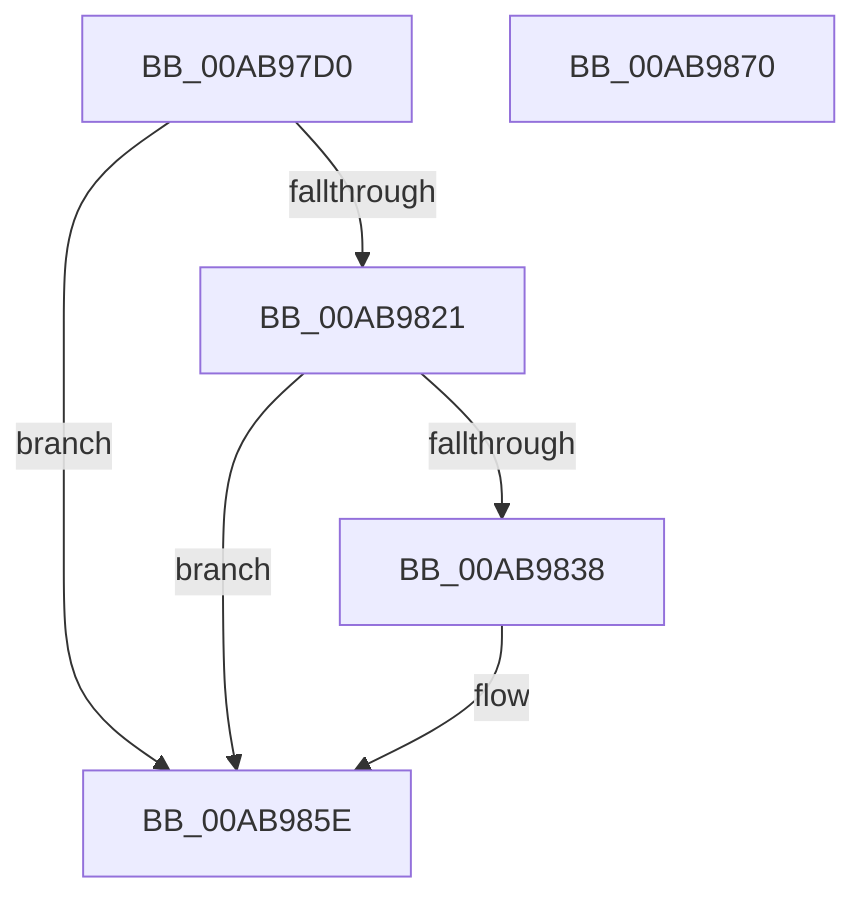

# PopPowerAggregatorDiagTraceSuspendResume

- RVA: `0x00AB97D0`–`0x00AB9871` (길이 `161` bytes)
- VA: `0x0000000140AB97D0`
- 실행 섹션: `PAGE`
- PDB 이름 있음: `예`; PDB Function 태그: `아니요`
- unwind 정보 RVA: `0x000BD314`
- 디코드: `37`개 명령, `161/161` bytes 표시
- 미해석 바이트: `0` (있으면 어셈블리에 `.byte`로 보존)

> 이 문서는 커널 이미지의 기계어와 PDB 기호를 분석해 생성했습니다. 4번과 5번은 함수 원형과 자료형을 바이너리 사용 방식에서 추정한 C 해석이며 원본 소스 복구 결과는 아닙니다.

## 1. Dependencies

- 직접 호출 지점: **3**; 고유 호출 대상: **3**
- 직접 호출자로 확인된 함수: **1**
- RIP 상대 이미지 참조: **4**

### Outgoing calls
- `0x00AB982F` → [EtwEventEnabled](../../text/39/EtwEventEnabled_function_00392450.md) (function, `0x00392450`)
- `0x00AB9859` → [EtwWrite](../../text/41/EtwWrite_function_0041C720.md) (function, `0x0041C720`)
- `0x00AB9866` → [_security_check_cookie](../../text/6A/_security_check_cookie_function_006AC640.md) (function, `0x006AC640`)

### Direct callers
- [PopPowerAggregatorNotifySuspendResume](PopPowerAggregatorNotifySuspendResume_function_00AB9728.md) at `0x00AB9749`

### Static image references
- `0x00AB97DB` → RVA `0x00E0A740` (`.data`; read)
- `0x00AB9814` → RVA `0x00E67858` (`.data`; read)
- `0x00AB9821` → RVA `0x00F0B408` (`.data`; read)
- `0x00AB9828` → RVA `0x0001E2F8` (`.rdata`; read)

## 2. Other-region calls and transfers

- 다른 실행 섹션으로 향하는 call: **3**
  - `0x00AB982F` → [EtwEventEnabled](../../text/39/EtwEventEnabled_function_00392450.md) (`PAGE` → `.text`)
  - `0x00AB9859` → [EtwWrite](../../text/41/EtwWrite_function_0041C720.md) (`PAGE` → `.text`)
  - `0x00AB9866` → [_security_check_cookie](../../text/6A/_security_check_cookie_function_006AC640.md) (`PAGE` → `.text`)
- 별도 외부 분기/꼬리 이동을 확인하지 못했습니다.

## 3. Assembly (complete function range)

```asm
00AB97D0  89 54 24 10                     mov dword ptr [rsp + 0x10], edx
00AB97D4  4C 8B DC                        mov r11, rsp
00AB97D7  48 83 EC 68                     sub rsp, 0x68
00AB97DB  48 8B 05 5E 0F 35 00            mov rax, qword ptr [rip + 0x350f5e]
00AB97E2  48 33 C4                        xor rax, rsp
00AB97E5  48 89 44 24 58                  mov qword ptr [rsp + 0x58], rax
00AB97EA  0F B6 C1                        movzx eax, cl
00AB97ED  B9 04 00 00 00                  mov ecx, 4
00AB97F2  89 44 24 30                     mov dword ptr [rsp + 0x30], eax
00AB97F6  49 8D 43 C8                     lea rax, [r11 - 0x38]
00AB97FA  49 89 43 D0                     mov qword ptr [r11 - 0x30], rax
00AB97FE  49 8D 43 10                     lea rax, [r11 + 0x10]
00AB9802  83 64 24 44 00                  and dword ptr [rsp + 0x44], 0
00AB9807  89 4C 24 40                     mov dword ptr [rsp + 0x40], ecx
00AB980B  49 89 43 E0                     mov qword ptr [r11 - 0x20], rax
00AB980F  83 64 24 54 00                  and dword ptr [rsp + 0x54], 0
00AB9814  80 3D 3D E0 3A 00 00            cmp byte ptr [rip + 0x3ae03d], 0
00AB981B  89 4C 24 50                     mov dword ptr [rsp + 0x50], ecx
00AB981F  74 3D                           je 0x140ab985e
00AB9821  48 8B 0D E0 1B 45 00            mov rcx, qword ptr [rip + 0x451be0]
00AB9828  48 8D 15 C9 4A 56 FF            lea rdx, [rip - 0xa9b537]
00AB982F  E8 1C 8C 8D FF                  call 0x140392450
00AB9834  84 C0                           test al, al
00AB9836  74 26                           je 0x140ab985e
00AB9838  48 8B 0D C9 1B 45 00            mov rcx, qword ptr [rip + 0x451bc9]
00AB983F  48 8D 44 24 38                  lea rax, [rsp + 0x38]
00AB9844  41 B9 02 00 00 00               mov r9d, 2
00AB984A  48 89 44 24 20                  mov qword ptr [rsp + 0x20], rax
00AB984F  45 33 C0                        xor r8d, r8d
00AB9852  48 8D 15 9F 4A 56 FF            lea rdx, [rip - 0xa9b561]
00AB9859  E8 C2 2E 96 FF                  call 0x14041c720
00AB985E  48 8B 4C 24 58                  mov rcx, qword ptr [rsp + 0x58]
00AB9863  48 33 CC                        xor rcx, rsp
00AB9866  E8 D5 2D BF FF                  call 0x1406ac640
00AB986B  48 83 C4 68                     add rsp, 0x68
00AB986F  C3                              ret
00AB9870  CC                              int3
```

## 4. C-style interpretation (structured pseudocode)

```c
__int64 __fastcall PopPowerAggregatorDiagTraceSuspendResume(unsigned __int8 a1, int a2, int a3)
{
    __int64 result;
    __int64 v_rsp;
    unsigned __int64 v_stack_m10;
    unsigned int v_stack_m14;
    unsigned int v_stack_m18;
    unsigned int v_stack_m24;
    unsigned int v_stack_m28;
    unsigned __int64 v_stack_m30;
    unsigned int v_stack_m38;
    unsigned __int64 v_stack_m48;
    unsigned int v_stack_p10;

    v_stack_p10 = a2;
    v_rsp = (v_rsp) - (104);
    result = (*(unsigned __int64 *)(v_rip + 3477342)) ^ (v_rsp);
    v_stack_m10 = result;
    v_stack_m38 = a1;
    *(unsigned __int64 *)(v_rsp - 48) = v_rsp - 56;
    v_stack_m28 = 4;
    *(unsigned __int64 *)(v_rsp - 32) = v_rsp + 16;
    v_stack_m18 = 4;
    if ((*(unsigned __int8 *)(v_rip + 3858493)) == 0) goto loc_00AB985E;
    result = EtwEventEnabled(*(unsigned __int64 *)(v_rip + 4529120), v_rip - 11121975, a3, a4);
    if ((unsigned __int8)(result) != 0) {
        a1 = *(unsigned __int64 *)(v_rip + 4529097);
        result = v_stack_m30;
        a4 = 2;
        v_stack_m48 = result;
        a3 = 0;
        a2 = v_rip - 11122017;
        result = EtwWrite(a1, a2, a3, a4);
    }
    a1 = (v_stack_m10) ^ (v_rsp);
    result = _security_check_cookie(a1, a2, a3, a4);
    v_rsp = (v_rsp) + (104);
    return result;
}
```

## 5. (Beta) C Style

```c
int64_t PopPowerAggregatorDiagTraceSuspendResume(uint8_t Arg1, int32_t Arg2, int32_t Arg3)
{
    int64_t result;
    int64_t local_rsp;
    uint64_t v_stack_m10;
    uint32_t v_stack_m14;
    uint32_t v_stack_m18;
    uint32_t v_stack_m24;
    uint32_t v_stack_m28;
    uint64_t v_stack_m30;
    uint32_t v_stack_m38;
    uint64_t v_stack_m48;
    uint32_t v_stack_p10;

    v_stack_p10 = Arg2;
    local_rsp = (local_rsp) - (104);
    result = (*(uint64_t *)(v_rip + 0x350F5E)) ^ (local_rsp);
    v_stack_m10 = result;
    v_stack_m38 = Arg1;
    *(uint64_t *)(local_rsp - 0x30) = local_rsp - 56;
    v_stack_m28 = 4;
    *(uint64_t *)(local_rsp - 0x20) = local_rsp + 16;
    v_stack_m18 = 4;
    if ((*(uint8_t *)(v_rip + 0x3AE03D)) == 0) goto loc_00AB985E;
    result = EtwEventEnabled(*(uint64_t *)(v_rip + 0x451BE0), v_rip - 11121975, Arg3, a4);
    if ((uint8_t)(result) != 0) {
        Arg1 = *(uint64_t *)(v_rip + 0x451BC9);
        result = v_stack_m30;
        a4 = 2;
        v_stack_m48 = result;
        Arg3 = 0;
        Arg2 = v_rip - 11122017;
        result = EtwWrite(Arg1, Arg2, Arg3, a4);
    }
    Arg1 = (v_stack_m10) ^ (local_rsp);
    result = _security_check_cookie(Arg1, Arg2, Arg3, a4);
    local_rsp = (local_rsp) + (104);
    return result;
}
```

## 6. Execution-region graph

[열기: 2D/3D 그래프와 함수 탐색 컨트롤 패널](../../../control-panel.html?section=page&rva=0x00AB97D0&view=graph)

- 2D 그래프는 위에서 아래로 흐르고, 3D 그래프는 빈 공간을 드래그해 회전합니다. Shift+드래그는 이동, 휠은 확대·축소, 함수 노드 선택은 대상 보고서 이동입니다.

### Static fallback


