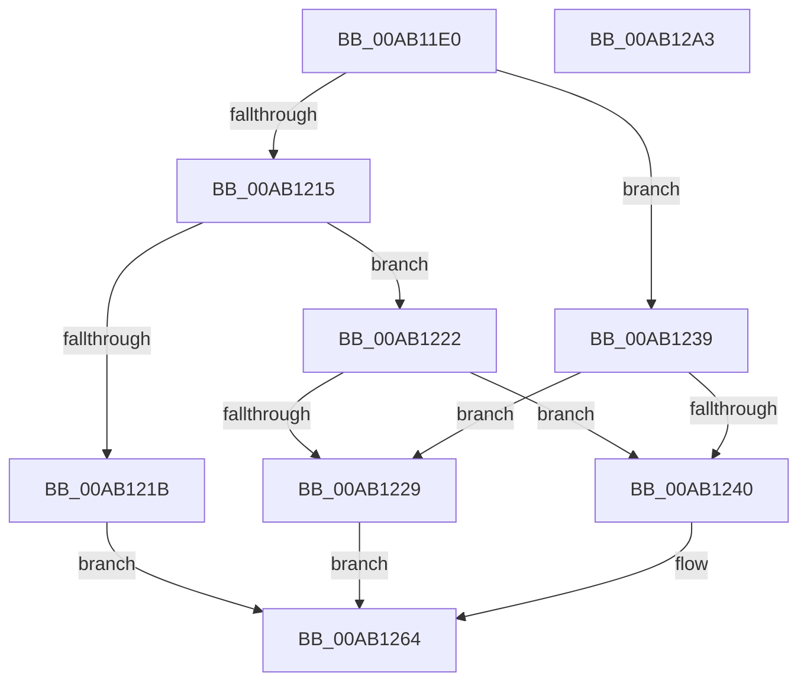

# PopPowerAggregatorNotifyPdcSleepTransition

- RVA: `0x00AB11E0`–`0x00AB12A4` (길이 `196` bytes)
- VA: `0x0000000140AB11E0`
- 실행 섹션: `PAGE`
- PDB 이름 있음: `예`; PDB Function 태그: `아니요`
- unwind 정보 RVA: `0x00066400`
- 디코드: `48`개 명령, `196/196` bytes 표시
- 미해석 바이트: `0` (있으면 어셈블리에 `.byte`로 보존)

> 이 문서는 커널 이미지의 기계어와 PDB 기호를 분석해 생성했습니다. 4번과 5번은 함수 원형과 자료형을 바이너리 사용 방식에서 추정한 C 해석이며 원본 소스 복구 결과는 아닙니다.

## 1. Dependencies

- 직접 호출 지점: **4**; 고유 호출 대상: **4**
- 직접 호출자로 확인된 함수: **1**
- RIP 상대 이미지 참조: **7**

### Outgoing calls
- `0x00AB1203` → [PopAcquireRwLockExclusive](../../text/43/PopAcquireRwLockExclusive_function_00430B44.md) (function, `0x00430B44`)
- `0x00AB125F` → [PopPowerAggregatorScheduleWorker](../91/PopPowerAggregatorScheduleWorker_function_00912B9C.md) (function, `0x00912B9C`)
- `0x00AB127B` → [PopPowerAggregatorDiagTracePdcSleepTransition](PopPowerAggregatorDiagTracePdcSleepTransition_function_00AB12AC.md) (function, `0x00AB12AC`)
- `0x00AB1287` → [PopReleaseRwLock](../../text/2D/PopReleaseRwLock_function_002DFBBC.md) (function, `0x002DFBBC`)

### Direct callers
- [PdcPoCurrentPdcPhase](../../text/5D/PdcPoCurrentPdcPhase_function_005D9E70.md) at `0x005D9F46`

### Static image references
- `0x00AB11FA` → RVA `0x00F09710` (`.data`; read)
- `0x00AB1208` → RVA `0x00F09778` (`.data`; read)
- `0x00AB1229` → RVA `0x00F09788` (`.data`; write)
- `0x00AB1230` → RVA `0x00F0978C` (`.data`; write)
- `0x00AB1240` → RVA `0x00F09740` (`.data`; read)
- `0x00AB1247` → RVA `0x00F09790` (`.data`; write)
- `0x00AB126F` → RVA `0x00F09750` (`.data`; read)

## 2. Other-region calls and transfers

- 다른 실행 섹션으로 향하는 call: **2**
  - `0x00AB1203` → [PopAcquireRwLockExclusive](../../text/43/PopAcquireRwLockExclusive_function_00430B44.md) (`PAGE` → `.text`)
  - `0x00AB1287` → [PopReleaseRwLock](../../text/2D/PopReleaseRwLock_function_002DFBBC.md) (`PAGE` → `.text`)
- 별도 외부 분기/꼬리 이동을 확인하지 못했습니다.

## 3. Assembly (complete function range)

```asm
00AB11E0  48 89 5C 24 08                  mov qword ptr [rsp + 8], rbx
00AB11E5  48 89 6C 24 10                  mov qword ptr [rsp + 0x10], rbp
00AB11EA  48 89 74 24 18                  mov qword ptr [rsp + 0x18], rsi
00AB11EF  57                              push rdi
00AB11F0  48 83 EC 30                     sub rsp, 0x30
00AB11F4  40 8A F1                        mov sil, cl
00AB11F7  41 8B D8                        mov ebx, r8d
00AB11FA  48 8D 0D 0F 85 45 00            lea rcx, [rip + 0x45850f]
00AB1201  8B EA                           mov ebp, edx
00AB1203  E8 3C F9 97 FF                  call 0x140430b44
00AB1208  44 8B 05 69 85 45 00            mov r8d, dword ptr [rip + 0x458569]
00AB120F  41 83 E8 01                     sub r8d, 1
00AB1213  74 24                           je 0x140ab1239
00AB1215  41 83 F8 03                     cmp r8d, 3
00AB1219  74 07                           je 0x140ab1222
00AB121B  BF 0D 00 00 C0                  mov edi, 0xc000000d
00AB1220  EB 42                           jmp 0x140ab1264
00AB1222  33 FF                           xor edi, edi
00AB1224  40 84 F6                        test sil, sil
00AB1227  75 17                           jne 0x140ab1240
00AB1229  40 88 3D 58 85 45 00            mov byte ptr [rip + 0x458558], dil
00AB1230  48 89 3D 55 85 45 00            mov qword ptr [rip + 0x458555], rdi
00AB1237  EB 2B                           jmp 0x140ab1264
00AB1239  33 FF                           xor edi, edi
00AB123B  40 84 F6                        test sil, sil
00AB123E  75 E9                           jne 0x140ab1229
00AB1240  48 8D 0D F9 84 45 00            lea rcx, [rip + 0x4584f9]
00AB1247  89 1D 43 85 45 00               mov dword ptr [rip + 0x458543], ebx
00AB124D  BF 03 01 00 00                  mov edi, 0x103
00AB1252  89 2D 34 85 45 00               mov dword ptr [rip + 0x458534], ebp
00AB1258  C6 05 29 85 45 00 01            mov byte ptr [rip + 0x458529], 1
00AB125F  E8 38 19 E6 FF                  call 0x140912b9c
00AB1264  4C 8D 0D 0D 85 45 00            lea r9, [rip + 0x45850d]
00AB126B  89 7C 24 20                     mov dword ptr [rsp + 0x20], edi
00AB126F  4C 8D 05 DA 84 45 00            lea r8, [rip + 0x4584da]
00AB1276  8B D5                           mov edx, ebp
00AB1278  40 8A CE                        mov cl, sil
00AB127B  E8 2C 00 00 00                  call 0x140ab12ac
00AB1280  48 8D 0D 89 84 45 00            lea rcx, [rip + 0x458489]
00AB1287  E8 30 E9 82 FF                  call 0x1402dfbbc
00AB128C  48 8B 5C 24 40                  mov rbx, qword ptr [rsp + 0x40]
00AB1291  8B C7                           mov eax, edi
00AB1293  48 8B 6C 24 48                  mov rbp, qword ptr [rsp + 0x48]
00AB1298  48 8B 74 24 50                  mov rsi, qword ptr [rsp + 0x50]
00AB129D  48 83 C4 30                     add rsp, 0x30
00AB12A1  5F                              pop rdi
00AB12A2  C3                              ret
00AB12A3  CC                              int3
```

## 4. C-style interpretation (structured pseudocode)

```c
__int64 __fastcall PopPowerAggregatorNotifyPdcSleepTransition(unsigned __int8 a1, int a2, int a3)
{
    __int64 result;
    __int64 v_rdi;
    __int64 v_rsp;
    unsigned int v_stack_m18;
    unsigned __int64 v_stack_p10;
    unsigned __int64 v_stack_p18;
    unsigned __int64 v_stack_p8;

    v_stack_p8 = v_rbx;
    v_stack_p10 = v_rbp;
    v_stack_p18 = v_rsi;
    v_rsp = (v_rsp) - (48);
    result = PopAcquireRwLockExclusive(v_rip + 4556047, a2, a3, a4);
    a3 = (unsigned int)(((unsigned int)(*(unsigned int *)(v_rip + 4556137))) - (1));
    if (condition_is_equal) goto loc_00AB1239;
    if (a3 == 3) goto loc_00AB1222;
    goto loc_00AB1264;
loc_00AB1222:
    v_rdi = 0;
    if (a1 != 0) goto loc_00AB1240;
loc_00AB1229:
    *(unsigned __int8 *)(v_rip + 4556120) = 0;
    *(unsigned __int64 *)(v_rip + 4556117) = 0;
    goto loc_00AB1264;
loc_00AB1239:
    v_rdi = 0;
    if (a1 != 0) goto loc_00AB1229;
loc_00AB1240:
    *(unsigned int *)(v_rip + 4556099) = (unsigned int)((unsigned int)(a3));
    *(unsigned int *)(v_rip + 4556084) = (unsigned int)((unsigned int)(a2));
    *(unsigned __int8 *)(v_rip + 4556073) = 1;
    result = PopPowerAggregatorScheduleWorker(v_rip + 4556025, a2, a3, a4);
loc_00AB1264:
    v_stack_m18 = 259;
    result = PopPowerAggregatorDiagTracePdcSleepTransition(a1, (unsigned int)((unsigned int)((unsigned int)(a2))), v_rip + 4555994, v_rip + 4556045);
    result = PopReleaseRwLock(v_rip + 4555913, (unsigned int)((unsigned int)((unsigned int)(a2))), v_rip + 4555994, v_rip + 4556045);
    v_rsp = (v_rsp) + (48);
    return 259;
}
```

## 5. (Beta) C Style

```c
int64_t PopPowerAggregatorNotifyPdcSleepTransition(uint8_t Arg1, int32_t Arg2, int32_t Arg3)
{
    int64_t result;
    int64_t local_rdi;
    int64_t local_rsp;
    uint32_t v_stack_m18;
    uint64_t v_stack_p10;
    uint64_t v_stack_p18;
    uint64_t v_stack_p8;

    v_stack_p8 = local_rbx;
    v_stack_p10 = local_rbp;
    v_stack_p18 = local_rsi;
    local_rsp = (local_rsp) - (48);
    result = PopAcquireRwLockExclusive(v_rip + 4556047, Arg2, Arg3, a4);
    Arg3 = (uint32_t)(((uint32_t)(*(uint32_t *)(v_rip + 0x458569))) - (1));
    if (condition_is_equal) goto loc_00AB1239;
    if (Arg3 == 3) goto loc_00AB1222;
    goto loc_00AB1264;
loc_00AB1222:
    local_rdi = 0;
    if (Arg1 != 0) goto loc_00AB1240;
loc_00AB1229:
    *(uint8_t *)(v_rip + 0x458558) = 0;
    *(uint64_t *)(v_rip + 0x458555) = 0;
    goto loc_00AB1264;
loc_00AB1239:
    local_rdi = 0;
    if (Arg1 != 0) goto loc_00AB1229;
loc_00AB1240:
    *(uint32_t *)(v_rip + 0x458543) = (uint32_t)((uint32_t)(Arg3));
    *(uint32_t *)(v_rip + 0x458534) = (uint32_t)((uint32_t)(Arg2));
    *(uint8_t *)(v_rip + 0x458529) = 1;
    result = PopPowerAggregatorScheduleWorker(v_rip + 4556025, Arg2, Arg3, a4);
loc_00AB1264:
    v_stack_m18 = 259;
    result = PopPowerAggregatorDiagTracePdcSleepTransition(Arg1, (uint32_t)((uint32_t)((uint32_t)(Arg2))), v_rip + 4555994, v_rip + 4556045);
    result = PopReleaseRwLock(v_rip + 4555913, (uint32_t)((uint32_t)((uint32_t)(Arg2))), v_rip + 4555994, v_rip + 4556045);
    local_rsp = (local_rsp) + (48);
    return 259;
}
```

## 6. Execution-region graph

[열기: 2D/3D 그래프와 함수 탐색 컨트롤 패널](../../../control-panel.html?section=page&rva=0x00AB11E0&view=graph)

- 2D 그래프는 위에서 아래로 흐르고, 3D 그래프는 빈 공간을 드래그해 회전합니다. Shift+드래그는 이동, 휠은 확대·축소, 함수 노드 선택은 대상 보고서 이동입니다.

### Static fallback


