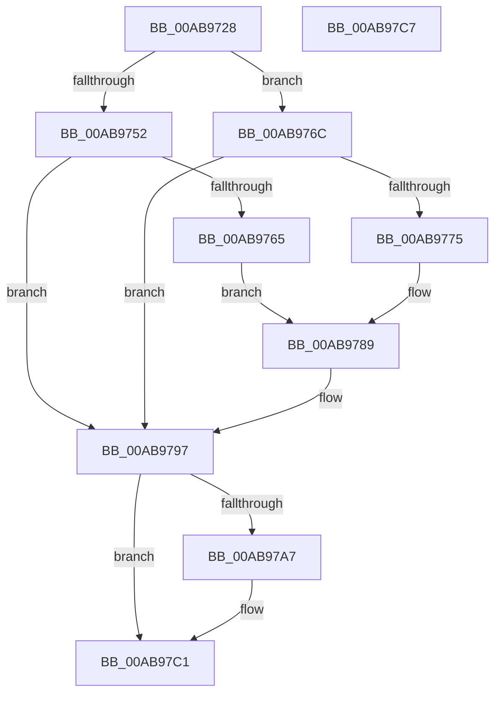

# PopPowerAggregatorNotifySuspendResume

- RVA: `0x00AB9728`–`0x00AB97C8` (길이 `160` bytes)
- VA: `0x0000000140AB9728`
- 실행 섹션: `PAGE`
- PDB 이름 있음: `예`; PDB Function 태그: `아니요`
- unwind 정보 RVA: `0x00064C80`
- 디코드: `42`개 명령, `160/160` bytes 표시
- 미해석 바이트: `0` (있으면 어셈블리에 `.byte`로 보존)

> 이 문서는 커널 이미지의 기계어와 PDB 기호를 분석해 생성했습니다. 4번과 5번은 함수 원형과 자료형을 바이너리 사용 방식에서 추정한 C 해석이며 원본 소스 복구 결과는 아닙니다.

## 1. Dependencies

- 직접 호출 지점: **5**; 고유 호출 대상: **5**
- 직접 호출자로 확인된 함수: **1**
- RIP 상대 이미지 참조: **6**

### Outgoing calls
- `0x00AB973C` → [PopAcquireRwLockExclusive](../../text/43/PopAcquireRwLockExclusive_function_00430B44.md) (function, `0x00430B44`)
- `0x00AB9749` → [PopPowerAggregatorDiagTraceSuspendResume](PopPowerAggregatorDiagTraceSuspendResume_function_00AB97D0.md) (function, `0x00AB97D0`)
- `0x00AB9792` → [PopPowerAggregatorHandleIntentUnsafe](../91/PopPowerAggregatorHandleIntentUnsafe_function_009146D8.md) (function, `0x009146D8`)
- `0x00AB979E` → [PopReleaseRwLock](../../text/2D/PopReleaseRwLock_function_002DFBBC.md) (function, `0x002DFBBC`)
- `0x00AB97BC` → [KeWaitForSingleObject](../../text/20/KeWaitForSingleObject_function_0020E6B0.md) (function, `0x0020E6B0`)

### Direct callers
- [PopIssueActionRequest](../A9/PopIssueActionRequest_function_00A9CE54.md) at `0x00A9D02E`
- [PopIssueActionRequest](../A9/PopIssueActionRequest_function_00A9CE54.md) at `0x00A9D1BF`
- [PopIssueActionRequest](../A9/PopIssueActionRequest_function_00A9CE54.md) at `0x00A9D262`

### Static image references
- `0x00AB9735` → RVA `0x00F09710` (`.data`; read)
- `0x00AB9741` → RVA `0x00F09860` (`.data`; read)
- `0x00AB975A` → RVA `0x00F09860` (`.data`; write)
- `0x00AB976C` → RVA `0x00F09860` (`.data`; read/write)
- `0x00AB9775` → RVA `0x00F09864` (`.data`; read)
- `0x00AB97AD` → RVA `0x00F09848` (`.data`; read)

## 2. Other-region calls and transfers

- 다른 실행 섹션으로 향하는 call: **3**
  - `0x00AB973C` → [PopAcquireRwLockExclusive](../../text/43/PopAcquireRwLockExclusive_function_00430B44.md) (`PAGE` → `.text`)
  - `0x00AB979E` → [PopReleaseRwLock](../../text/2D/PopReleaseRwLock_function_002DFBBC.md) (`PAGE` → `.text`)
  - `0x00AB97BC` → [KeWaitForSingleObject](../../text/20/KeWaitForSingleObject_function_0020E6B0.md) (`PAGE` → `.text`)
- 별도 외부 분기/꼬리 이동을 확인하지 못했습니다.

## 3. Assembly (complete function range)

```asm
00AB9728  40 53                           push rbx
00AB972A  48 83 EC 30                     sub rsp, 0x30
00AB972E  83 64 24 40 00                  and dword ptr [rsp + 0x40], 0
00AB9733  8A D9                           mov bl, cl
00AB9735  48 8D 0D D4 FF 44 00            lea rcx, [rip + 0x44ffd4]
00AB973C  E8 03 74 97 FF                  call 0x140430b44
00AB9741  8B 15 19 01 45 00               mov edx, dword ptr [rip + 0x450119]
00AB9747  8A CB                           mov cl, bl
00AB9749  E8 82 00 00 00                  call 0x140ab97d0
00AB974E  84 DB                           test bl, bl
00AB9750  74 1A                           je 0x140ab976c
00AB9752  8B 05 08 01 45 00               mov eax, dword ptr [rip + 0x450108]
00AB9758  FF C0                           inc eax
00AB975A  89 05 00 01 45 00               mov dword ptr [rip + 0x450100], eax
00AB9760  83 F8 01                        cmp eax, 1
00AB9763  75 32                           jne 0x140ab9797
00AB9765  33 D2                           xor edx, edx
00AB9767  8D 48 06                        lea ecx, [rax + 6]
00AB976A  EB 1D                           jmp 0x140ab9789
00AB976C  83 2D ED 00 45 00 01            sub dword ptr [rip + 0x4500ed], 1
00AB9773  75 22                           jne 0x140ab9797
00AB9775  8B 05 E9 00 45 00               mov eax, dword ptr [rip + 0x4500e9]
00AB977B  48 8D 54 24 40                  lea rdx, [rsp + 0x40]
00AB9780  89 44 24 40                     mov dword ptr [rsp + 0x40], eax
00AB9784  B9 08 00 00 00                  mov ecx, 8
00AB9789  41 B9 14 00 00 00               mov r9d, 0x14
00AB978F  45 33 C0                        xor r8d, r8d
00AB9792  E8 41 AF E5 FF                  call 0x1409146d8
00AB9797  48 8D 0D 72 FF 44 00            lea rcx, [rip + 0x44ff72]
00AB979E  E8 19 64 82 FF                  call 0x1402dfbbc
00AB97A3  84 DB                           test bl, bl
00AB97A5  74 1A                           je 0x140ab97c1
00AB97A7  48 83 64 24 20 00               and qword ptr [rsp + 0x20], 0
00AB97AD  48 8D 0D 94 00 45 00            lea rcx, [rip + 0x450094]
00AB97B4  45 33 C9                        xor r9d, r9d
00AB97B7  45 33 C0                        xor r8d, r8d
00AB97BA  33 D2                           xor edx, edx
00AB97BC  E8 EF 4E 75 FF                  call 0x14020e6b0
00AB97C1  48 83 C4 30                     add rsp, 0x30
00AB97C5  5B                              pop rbx
00AB97C6  C3                              ret
00AB97C7  CC                              int3
```

## 4. C-style interpretation (structured pseudocode)

```c
__int64 __fastcall PopPowerAggregatorNotifySuspendResume(unsigned __int8 a1, __int64 a2, int a3)
{
    __int64 result;
    __int64 v_rsp;
    unsigned __int64 v_stack_m18;
    unsigned int v_stack_p8;

    v_rsp = (v_rsp) - (48);
    result = PopAcquireRwLockExclusive(v_rip + 4521940, a2, a3, a4);
    result = PopPowerAggregatorDiagTraceSuspendResume(a1, (unsigned int)(*(unsigned int *)(v_rip + 4522265)), a3, a4);
    if (a1 == 0) goto loc_00AB976C;
    result = (unsigned int)(((unsigned int)(*(unsigned int *)(v_rip + 4522248))) + 1);
    *(unsigned int *)(v_rip + 4522240) = (unsigned int)(result);
    if (((unsigned int)(result)) != 1) goto loc_00AB9797;
    a2 = 0;
    goto loc_00AB9789;
loc_00AB976C:
    if (condition_is_not_equal) goto loc_00AB9797;
    v_stack_p8 = (unsigned int)((unsigned int)(*(unsigned int *)(v_rip + 4522217)));
loc_00AB9789:
    a3 = 0;
    result = PopPowerAggregatorHandleIntentUnsafe(8, v_stack_p8, a3, 20);
loc_00AB9797:
    result = PopReleaseRwLock(v_rip + 4521842, v_stack_p8, a3, 20);
    if (a1 != 0) {
        a1 = v_rip + 4522132;
        a4 = 0;
        a3 = 0;
        a2 = 0;
        result = KeWaitForSingleObject(a1, a2, a3, a4);
    }
    v_rsp = (v_rsp) + (48);
    return result;
}
```

## 5. (Beta) C Style

```c
int64_t PopPowerAggregatorNotifySuspendResume(uint8_t Arg1, int64_t Arg2, int32_t Arg3)
{
    int64_t result;
    int64_t local_rsp;
    uint64_t v_stack_m18;
    uint32_t v_stack_p8;

    local_rsp = (local_rsp) - (48);
    result = PopAcquireRwLockExclusive(v_rip + 4521940, Arg2, Arg3, a4);
    result = PopPowerAggregatorDiagTraceSuspendResume(Arg1, (uint32_t)(*(uint32_t *)(v_rip + 0x450119)), Arg3, a4);
    if (Arg1 == 0) goto loc_00AB976C;
    result = (uint32_t)(((uint32_t)(*(uint32_t *)(v_rip + 0x450108))) + 1);
    *(uint32_t *)(v_rip + 0x450100) = (uint32_t)(result);
    if (((uint32_t)(result)) != 1) goto loc_00AB9797;
    Arg2 = 0;
    goto loc_00AB9789;
loc_00AB976C:
    if (condition_is_not_equal) goto loc_00AB9797;
    v_stack_p8 = (uint32_t)((uint32_t)(*(uint32_t *)(v_rip + 0x4500E9)));
loc_00AB9789:
    Arg3 = 0;
    result = PopPowerAggregatorHandleIntentUnsafe(8, v_stack_p8, Arg3, 20);
loc_00AB9797:
    result = PopReleaseRwLock(v_rip + 4521842, v_stack_p8, Arg3, 20);
    if (Arg1 != 0) {
        Arg1 = v_rip + 4522132;
        a4 = 0;
        Arg3 = 0;
        Arg2 = 0;
        result = KeWaitForSingleObject(Arg1, Arg2, Arg3, a4);
    }
    local_rsp = (local_rsp) + (48);
    return result;
}
```

## 6. Execution-region graph

[열기: 2D/3D 그래프와 함수 탐색 컨트롤 패널](../../../control-panel.html?section=page&rva=0x00AB9728&view=graph)

- 2D 그래프는 위에서 아래로 흐르고, 3D 그래프는 빈 공간을 드래그해 회전합니다. Shift+드래그는 이동, 휠은 확대·축소, 함수 노드 선택은 대상 보고서 이동입니다.

### Static fallback


