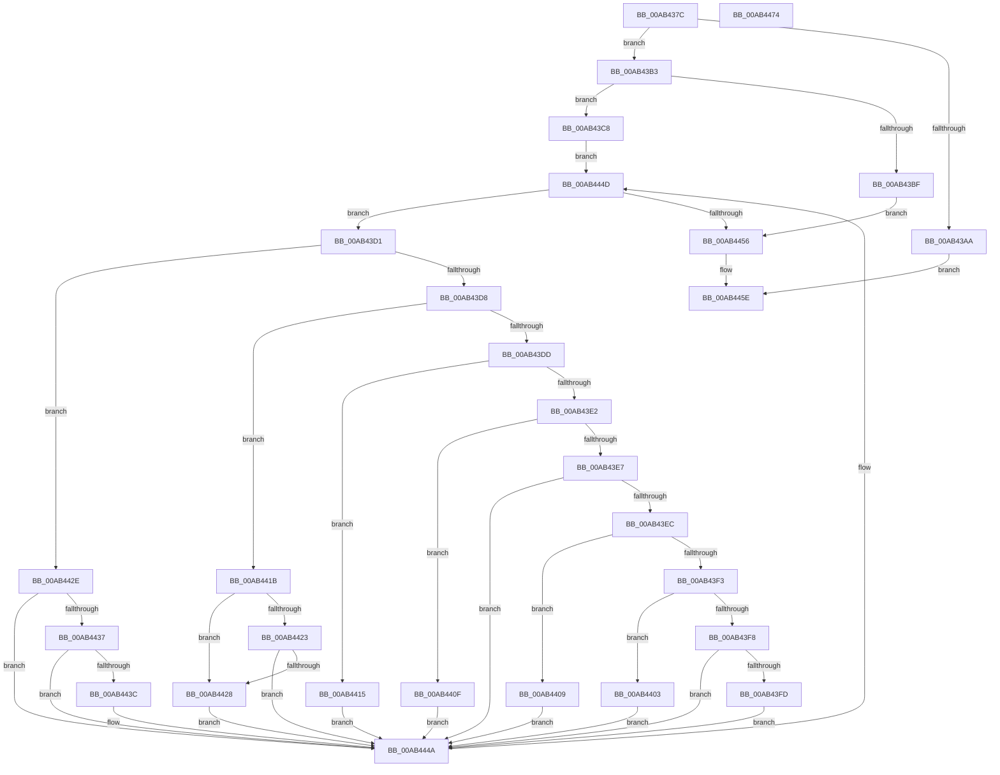

# PopQueryMostRecentWakeSourceAttributes

- RVA: `0x00AB437C`–`0x00AB4475` (길이 `249` bytes)
- VA: `0x0000000140AB437C`
- 실행 섹션: `PAGE`
- PDB 이름 있음: `예`; PDB Function 태그: `아니요`
- unwind 정보 RVA: `0x0006F978`
- 디코드: `80`개 명령, `249/249` bytes 표시
- 미해석 바이트: `0` (있으면 어셈블리에 `.byte`로 보존)

> 이 문서는 커널 이미지의 기계어와 PDB 기호를 분석해 생성했습니다. 4번과 5번은 함수 원형과 자료형을 바이너리 사용 방식에서 추정한 C 해석이며 원본 소스 복구 결과는 아닙니다.

## 1. Dependencies

- 직접 호출 지점: **2**; 고유 호출 대상: **2**
- 직접 호출자로 확인된 함수: **1**
- RIP 상대 이미지 참조: **0**

### Outgoing calls
- `0x00AB439D` → [PopGetMostRecentWakeInfo](../../text/4B/PopGetMostRecentWakeInfo_function_004BE4F8.md) (function, `0x004BE4F8`)
- `0x00AB4459` → [PopWakeInfoDereference](../../text/4C/PopWakeInfoDereference_function_004C74AC.md) (function, `0x004C74AC`)

### Direct callers
- [PopTransitionSystemPowerStateEx](../../pagelk/B7/PopTransitionSystemPowerStateEx_function_00B7E8C0.md) at `0x00B7F91A`

### Static image references
- 디코드된 RIP-relative 메모리 참조가 없습니다.

## 2. Other-region calls and transfers

- 다른 실행 섹션으로 향하는 call: **2**
  - `0x00AB439D` → [PopGetMostRecentWakeInfo](../../text/4B/PopGetMostRecentWakeInfo_function_004BE4F8.md) (`PAGE` → `.text`)
  - `0x00AB4459` → [PopWakeInfoDereference](../../text/4C/PopWakeInfoDereference_function_004C74AC.md) (`PAGE` → `.text`)
- 별도 외부 분기/꼬리 이동을 확인하지 못했습니다.

## 3. Assembly (complete function range)

```asm
00AB437C  48 89 5C 24 08                  mov qword ptr [rsp + 8], rbx
00AB4381  48 89 74 24 10                  mov qword ptr [rsp + 0x10], rsi
00AB4386  48 89 7C 24 18                  mov qword ptr [rsp + 0x18], rdi
00AB438B  41 56                           push r14
00AB438D  48 83 EC 20                     sub rsp, 0x20
00AB4391  49 8B F9                        mov rdi, r9
00AB4394  49 8B F0                        mov rsi, r8
00AB4397  4C 8B F2                        mov r14, rdx
00AB439A  48 8B D9                        mov rbx, rcx
00AB439D  E8 56 A1 A0 FF                  call 0x1404be4f8
00AB43A2  4C 8B D0                        mov r10, rax
00AB43A5  48 85 C0                        test rax, rax
00AB43A8  75 09                           jne 0x140ab43b3
00AB43AA  0F BA 2B 1A                     bts dword ptr [rbx], 0x1a
00AB43AE  E9 AB 00 00 00                  jmp 0x140ab445e
00AB43B3  41 83 7A 28 00                  cmp dword ptr [r10 + 0x28], 0
00AB43B8  8B 40 54                        mov eax, dword ptr [rax + 0x54]
00AB43BB  89 07                           mov dword ptr [rdi], eax
00AB43BD  75 09                           jne 0x140ab43c8
00AB43BF  0F BA 2B 1A                     bts dword ptr [rbx], 0x1a
00AB43C3  E9 8E 00 00 00                  jmp 0x140ab4456
00AB43C8  4D 8D 42 18                     lea r8, [r10 + 0x18]
00AB43CC  49 8B 08                        mov rcx, qword ptr [r8]
00AB43CF  EB 7C                           jmp 0x140ab444d
00AB43D1  8B 51 10                        mov edx, dword ptr [rcx + 0x10]
00AB43D4  85 D2                           test edx, edx
00AB43D6  74 56                           je 0x140ab442e
00AB43D8  83 EA 01                        sub edx, 1
00AB43DB  74 3E                           je 0x140ab441b
00AB43DD  83 EA 01                        sub edx, 1
00AB43E0  74 33                           je 0x140ab4415
00AB43E2  83 EA 01                        sub edx, 1
00AB43E5  74 28                           je 0x140ab440f
00AB43E7  83 FA 01                        cmp edx, 1
00AB43EA  75 5E                           jne 0x140ab444a
00AB43EC  8B 51 18                        mov edx, dword ptr [rcx + 0x18]
00AB43EF  85 D2                           test edx, edx
00AB43F1  74 16                           je 0x140ab4409
00AB43F3  83 EA 01                        sub edx, 1
00AB43F6  74 0B                           je 0x140ab4403
00AB43F8  83 FA 01                        cmp edx, 1
00AB43FB  75 4D                           jne 0x140ab444a
00AB43FD  0F BA 2B 19                     bts dword ptr [rbx], 0x19
00AB4401  EB 47                           jmp 0x140ab444a
00AB4403  0F BA 2B 14                     bts dword ptr [rbx], 0x14
00AB4407  EB 41                           jmp 0x140ab444a
00AB4409  0F BA 2B 10                     bts dword ptr [rbx], 0x10
00AB440D  EB 3B                           jmp 0x140ab444a
00AB440F  0F BA 2B 12                     bts dword ptr [rbx], 0x12
00AB4413  EB 35                           jmp 0x140ab444a
00AB4415  0F BA 2B 0D                     bts dword ptr [rbx], 0xd
00AB4419  EB 2F                           jmp 0x140ab444a
00AB441B  8B 51 18                        mov edx, dword ptr [rcx + 0x18]
00AB441E  83 EA 01                        sub edx, 1
00AB4421  74 05                           je 0x140ab4428
00AB4423  83 FA 01                        cmp edx, 1
00AB4426  75 22                           jne 0x140ab444a
00AB4428  0F BA 2B 0B                     bts dword ptr [rbx], 0xb
00AB442C  EB 1C                           jmp 0x140ab444a
00AB442E  0F BA 2B 0C                     bts dword ptr [rbx], 0xc
00AB4432  4D 85 F6                        test r14, r14
00AB4435  74 13                           je 0x140ab444a
00AB4437  48 85 F6                        test rsi, rsi
00AB443A  74 0E                           je 0x140ab444a
00AB443C  48 8D 41 60                     lea rax, [rcx + 0x60]
00AB4440  49 89 06                        mov qword ptr [r14], rax
00AB4443  48 8D 41 28                     lea rax, [rcx + 0x28]
00AB4447  48 89 06                        mov qword ptr [rsi], rax
00AB444A  48 8B 09                        mov rcx, qword ptr [rcx]
00AB444D  49 3B C8                        cmp rcx, r8
00AB4450  0F 85 7B FF FF FF               jne 0x140ab43d1
00AB4456  49 8B CA                        mov rcx, r10
00AB4459  E8 4E 30 A1 FF                  call 0x1404c74ac
00AB445E  48 8B 5C 24 30                  mov rbx, qword ptr [rsp + 0x30]
00AB4463  48 8B 74 24 38                  mov rsi, qword ptr [rsp + 0x38]
00AB4468  48 8B 7C 24 40                  mov rdi, qword ptr [rsp + 0x40]
00AB446D  48 83 C4 20                     add rsp, 0x20
00AB4471  41 5E                           pop r14
00AB4473  C3                              ret
00AB4474  CC                              int3
```

## 4. C-style interpretation (structured pseudocode)

```c
__int64 __fastcall PopQueryMostRecentWakeSourceAttributes(__int64 a1, __int64 a2, __int64 a3, __int64 a4)
{
    __int64 result;
    __int64 v_rsp;
    unsigned __int64 v_stack_p10;
    unsigned __int64 v_stack_p18;
    unsigned __int64 v_stack_p8;

    v_stack_p8 = v_rbx;
    v_stack_p10 = v_rsi;
    v_stack_p18 = v_rdi;
    v_rsp = (v_rsp) - (32);
    result = PopGetMostRecentWakeInfo(a1, a2, a3, a4);
    if (result != 0) goto loc_00AB43B3;
    goto loc_00AB445E;
loc_00AB43B3:
    *(unsigned int *)(a4) = (unsigned int)((unsigned int)(*(unsigned int *)(result + 84)));
    if ((*(unsigned int *)(result + 40)) != 0) goto loc_00AB43C8;
    goto loc_00AB4456;
loc_00AB43C8:
    goto loc_00AB444D;
loc_00AB43D1:
    if ((unsigned int)((unsigned int)(*(unsigned int *)(*(unsigned __int64 *)(result + 24) + 16))) == 0) goto loc_00AB442E;
    a2 = (unsigned int)(((unsigned int)(*(unsigned int *)(*(unsigned __int64 *)(result + 24) + 16))) - (1));
    if (condition_is_equal) goto loc_00AB441B;
    a2 = (unsigned int)((a2) - (1));
    if (condition_is_equal) goto loc_00AB4415;
    a2 = (unsigned int)((a2) - (1));
    if (condition_is_equal) goto loc_00AB440F;
    if (((unsigned int)(a2)) != 1) goto loc_00AB444A;
    if ((unsigned int)((unsigned int)(*(unsigned int *)(*(unsigned __int64 *)(result + 24) + 24))) == 0) goto loc_00AB4409;
    a2 = (unsigned int)(((unsigned int)(*(unsigned int *)(*(unsigned __int64 *)(result + 24) + 24))) - (1));
    if (condition_is_equal) goto loc_00AB4403;
    if (((unsigned int)(a2)) != 1) goto loc_00AB444A;
    goto loc_00AB444A;
loc_00AB4403:
    goto loc_00AB444A;
loc_00AB4409:
    goto loc_00AB444A;
loc_00AB440F:
    goto loc_00AB444A;
loc_00AB4415:
    goto loc_00AB444A;
loc_00AB441B:
    a2 = (unsigned int)(((unsigned int)(*(unsigned int *)(*(unsigned __int64 *)(result + 24) + 24))) - (1));
    if (condition_is_equal) goto loc_00AB4428;
    if (((unsigned int)(a2)) != 1) goto loc_00AB444A;
loc_00AB4428:
    goto loc_00AB444A;
loc_00AB442E:
    if (a2 == 0) goto loc_00AB444A;
    result = (unsigned int)(*(unsigned int *)(result + 84));
    if (a3 != 0) {
        result = *(unsigned __int64 *)(result + 24) + 96;
        *(unsigned __int64 *)(a2) = result;
        result = *(unsigned __int64 *)(result + 24) + 40;
        *(unsigned __int64 *)(a3) = result;
    }
loc_00AB444D:
    if ((*(unsigned __int64 *)(*(unsigned __int64 *)(result + 24))) != (result + 24)) goto loc_00AB43D1;
loc_00AB4456:
    result = PopWakeInfoDereference(result, a2, result + 24, a4);
loc_00AB445E:
    v_rsp = (v_rsp) + (32);
    return result;
}
```

## 5. (Beta) C Style

```c
int64_t PopQueryMostRecentWakeSourceAttributes(void *Arg1, int64_t Arg2, int64_t Arg3, void *Arg4)
{
    uint8_t *arg1 = (uint8_t *)Arg1;
    uint8_t *arg4 = (uint8_t *)Arg4;

    int64_t result;
    int64_t local_rsp;
    uint64_t v_stack_p10;
    uint64_t v_stack_p18;
    uint64_t v_stack_p8;

    v_stack_p8 = local_rbx;
    v_stack_p10 = local_rsi;
    v_stack_p18 = local_rdi;
    local_rsp = (local_rsp) - (32);
    result = PopGetMostRecentWakeInfo(Arg1, Arg2, Arg3, Arg4);
    if (result != 0) goto loc_00AB43B3;
    goto loc_00AB445E;
loc_00AB43B3:
    *(uint32_t *)(arg4) = (uint32_t)((uint32_t)(*(uint32_t *)(result + 0x54)));
    if ((*(uint32_t *)(result + 0x28)) != 0) goto loc_00AB43C8;
    goto loc_00AB4456;
loc_00AB43C8:
    goto loc_00AB444D;
loc_00AB43D1:
    if ((uint32_t)((uint32_t)(*(uint32_t *)(*(uint64_t *)(result + 0x18) + 0x10))) == 0) goto loc_00AB442E;
    Arg2 = (uint32_t)(((uint32_t)(*(uint32_t *)(*(uint64_t *)(result + 0x18) + 0x10))) - (1));
    if (condition_is_equal) goto loc_00AB441B;
    Arg2 = (uint32_t)((Arg2) - (1));
    if (condition_is_equal) goto loc_00AB4415;
    Arg2 = (uint32_t)((Arg2) - (1));
    if (condition_is_equal) goto loc_00AB440F;
    if (((uint32_t)(Arg2)) != 1) goto loc_00AB444A;
    if ((uint32_t)((uint32_t)(*(uint32_t *)(*(uint64_t *)(result + 0x18) + 0x18))) == 0) goto loc_00AB4409;
    Arg2 = (uint32_t)(((uint32_t)(*(uint32_t *)(*(uint64_t *)(result + 0x18) + 0x18))) - (1));
    if (condition_is_equal) goto loc_00AB4403;
    if (((uint32_t)(Arg2)) != 1) goto loc_00AB444A;
    goto loc_00AB444A;
loc_00AB4403:
    goto loc_00AB444A;
loc_00AB4409:
    goto loc_00AB444A;
loc_00AB440F:
    goto loc_00AB444A;
loc_00AB4415:
    goto loc_00AB444A;
loc_00AB441B:
    Arg2 = (uint32_t)(((uint32_t)(*(uint32_t *)(*(uint64_t *)(result + 0x18) + 0x18))) - (1));
    if (condition_is_equal) goto loc_00AB4428;
    if (((uint32_t)(Arg2)) != 1) goto loc_00AB444A;
loc_00AB4428:
    goto loc_00AB444A;
loc_00AB442E:
    if (Arg2 == 0) goto loc_00AB444A;
    result = (uint32_t)(*(uint32_t *)(result + 0x54));
    if (Arg3 != 0) {
        result = *(uint64_t *)(result + 0x18) + 96;
        *(uint64_t *)(Arg2) = result;
        result = *(uint64_t *)(result + 0x18) + 40;
        *(uint64_t *)(Arg3) = result;
    }
loc_00AB444D:
    if ((*(uint64_t *)(*(uint64_t *)(result + 0x18))) != (result + 24)) goto loc_00AB43D1;
loc_00AB4456:
    result = PopWakeInfoDereference(result, Arg2, result + 24, Arg4);
loc_00AB445E:
    local_rsp = (local_rsp) + (32);
    return result;
}
```

### 관측된 메모리 오프셋

구조체 형식이 확인되지 않은 접근은 인자 기준의 오프셋으로만 기록했습니다.

| 기준 인자 | 오프셋 표현 | 폭 (bit) | 접근 |
|---|---:|---:|---|
| `Arg1` | `+ 0x0` | `32` | `R/W` |
| `Arg4` | `+ 0x0` | `32` | `W` |

## 6. Execution-region graph

[열기: 2D/3D 그래프와 함수 탐색 컨트롤 패널](../../../control-panel.html?section=page&rva=0x00AB437C&view=graph)

- 2D 그래프는 위에서 아래로 흐르고, 3D 그래프는 빈 공간을 드래그해 회전합니다. Shift+드래그는 이동, 휠은 확대·축소, 함수 노드 선택은 대상 보고서 이동입니다.

### Static fallback


