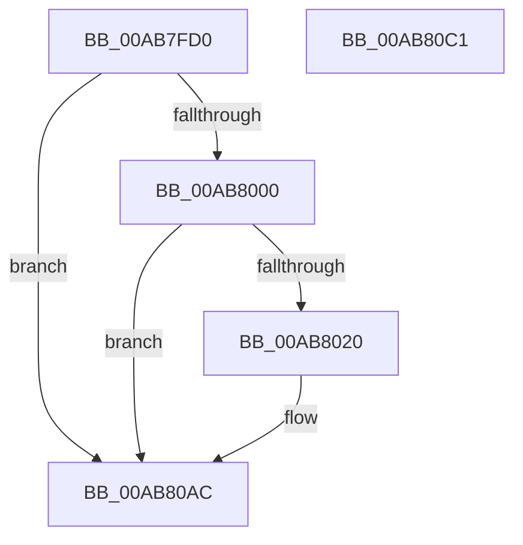

# PopSqmThermalUsermodeEvent

- RVA: `0x00AB7FD0`–`0x00AB80C2` (길이 `242` bytes)
- VA: `0x0000000140AB7FD0`
- 실행 섹션: `PAGE`
- PDB 이름 있음: `예`; PDB Function 태그: `아니요`
- unwind 정보 RVA: `0x000AC058`
- 디코드: `54`개 명령, `242/242` bytes 표시
- 미해석 바이트: `0` (있으면 어셈블리에 `.byte`로 보존)

> 이 문서는 커널 이미지의 기계어와 PDB 기호를 분석해 생성했습니다. 4번과 5번은 함수 원형과 자료형을 바이너리 사용 방식에서 추정한 C 해석이며 원본 소스 복구 결과는 아닙니다.

## 1. Dependencies

- 직접 호출 지점: **3**; 고유 호출 대상: **3**
- 직접 호출자로 확인된 함수: **1**
- RIP 상대 이미지 참조: **3**

### Outgoing calls
- `0x00AB8011` → [tlgKeywordOn](../../text/42/tlgKeywordOn_function_0042EAA0.md) (function, `0x0042EAA0`)
- `0x00AB80A7` → [tlgWriteTransfer_EtwWriteTransfer](../../text/42/tlgWriteTransfer_EtwWriteTransfer_function_004260E0.md) (function, `0x004260E0`)
- `0x00AB80B3` → [_security_check_cookie](../../text/6A/_security_check_cookie_function_006AC640.md) (function, `0x006AC640`)

### Direct callers
- [PopThermalProcessUsermodeEvent](PopThermalProcessUsermodeEvent_function_00AB7D58.md) at `0x00AB7DD4`
- [PopThermalProcessUsermodeEvent](PopThermalProcessUsermodeEvent_function_00AB7D58.md) at `0x00AB7E30`

### Static image references
- `0x00AB7FDE` → RVA `0x00E0A740` (`.data`; read)
- `0x00AB7FEC` → RVA `0x00E07748` (`.data`; read)
- `0x00AB8058` → RVA `0x00050EF1` (`.rdata`; read)

## 2. Other-region calls and transfers

- 다른 실행 섹션으로 향하는 call: **3**
  - `0x00AB8011` → [tlgKeywordOn](../../text/42/tlgKeywordOn_function_0042EAA0.md) (`PAGE` → `.text`)
  - `0x00AB80A7` → [tlgWriteTransfer_EtwWriteTransfer](../../text/42/tlgWriteTransfer_EtwWriteTransfer_function_004260E0.md) (`PAGE` → `.text`)
  - `0x00AB80B3` → [_security_check_cookie](../../text/6A/_security_check_cookie_function_006AC640.md) (`PAGE` → `.text`)
- 별도 외부 분기/꼬리 이동을 확인하지 못했습니다.

## 3. Assembly (complete function range)

```asm
00AB7FD0  40 55                           push rbp
00AB7FD2  48 8D 6C 24 B1                  lea rbp, [rsp - 0x4f]
00AB7FD7  48 81 EC C0 00 00 00            sub rsp, 0xc0
00AB7FDE  48 8B 05 5B 27 35 00            mov rax, qword ptr [rip + 0x35275b]
00AB7FE5  48 33 C4                        xor rax, rsp
00AB7FE8  48 89 45 3F                     mov qword ptr [rbp + 0x3f], rax
00AB7FEC  83 3D 55 F7 34 00 05            cmp dword ptr [rip + 0x34f755], 5
00AB7FF3  4C 8B D2                        mov r10, rdx
00AB7FF6  44 0F B7 D9                     movzx r11d, cx
00AB7FFA  0F 86 AC 00 00 00               jbe 0x140ab80ac
00AB8000  48 BA 00 00 00 00 00 80 00 00   movabs rdx, 0x800000000000
00AB800A  48 8D 0D 37 F7 34 00            lea rcx, [rip + 0x34f737]
00AB8011  E8 8A 6A 97 FF                  call 0x14042eaa0
00AB8016  33 D2                           xor edx, edx
00AB8018  84 C0                           test al, al
00AB801A  0F 84 8C 00 00 00               je 0x140ab80ac
00AB8020  38 55 7F                        cmp byte ptr [rbp + 0x7f], dl
00AB8023  48 8D 45 BF                     lea rax, [rbp - 0x41]
00AB8027  48 89 45 EF                     mov qword ptr [rbp - 0x11], rax
00AB802B  48 8D 0D 16 F7 34 00            lea rcx, [rip + 0x34f716]
00AB8032  48 8D 45 C3                     lea rax, [rbp - 0x3d]
00AB8036  44 89 45 BF                     mov dword ptr [rbp - 0x41], r8d
00AB803A  48 89 45 FF                     mov qword ptr [rbp - 1], rax
00AB803E  8B C2                           mov eax, edx
00AB8040  0F 95 C0                        setne al
00AB8043  44 89 4D C3                     mov dword ptr [rbp - 0x3d], r9d
00AB8047  89 45 C7                        mov dword ptr [rbp - 0x39], eax
00AB804A  45 33 C9                        xor r9d, r9d
00AB804D  48 8D 45 C7                     lea rax, [rbp - 0x39]
00AB8051  89 55 3B                        mov dword ptr [rbp + 0x3b], edx
00AB8054  48 89 45 0F                     mov qword ptr [rbp + 0xf], rax
00AB8058  48 8D 15 92 8E 59 FF            lea rdx, [rip - 0xa6716e]
00AB805F  48 8D 45 37                     lea rax, [rbp + 0x37]
00AB8063  48 C7 45 F7 04 00 00 00         mov qword ptr [rbp - 9], 4
00AB806B  48 89 45 1F                     mov qword ptr [rbp + 0x1f], rax
00AB806F  45 33 C0                        xor r8d, r8d
00AB8072  41 8B C3                        mov eax, r11d
00AB8075  48 C7 45 07 04 00 00 00         mov qword ptr [rbp + 7], 4
00AB807D  03 C0                           add eax, eax
00AB807F  48 C7 45 17 04 00 00 00         mov qword ptr [rbp + 0x17], 4
00AB8087  89 45 37                        mov dword ptr [rbp + 0x37], eax
00AB808A  48 8D 45 CF                     lea rax, [rbp - 0x31]
00AB808E  48 89 44 24 28                  mov qword ptr [rsp + 0x28], rax
00AB8093  C7 44 24 20 07 00 00 00         mov dword ptr [rsp + 0x20], 7
00AB809B  48 C7 45 27 02 00 00 00         mov qword ptr [rbp + 0x27], 2
00AB80A3  4C 89 55 2F                     mov qword ptr [rbp + 0x2f], r10
00AB80A7  E8 34 E0 96 FF                  call 0x1404260e0
00AB80AC  48 8B 4D 3F                     mov rcx, qword ptr [rbp + 0x3f]
00AB80B0  48 33 CC                        xor rcx, rsp
00AB80B3  E8 88 45 BF FF                  call 0x1406ac640
00AB80B8  48 81 C4 C0 00 00 00            add rsp, 0xc0
00AB80BF  5D                              pop rbp
00AB80C0  C3                              ret
00AB80C1  CC                              int3
```

## 4. C-style interpretation (structured pseudocode)

```c
__int64 __fastcall PopSqmThermalUsermodeEvent(unsigned __int16 a1, __int64 a2, int a3, int a4, unsigned __int8 a5)
{
    __int64 result;
    __int64 v_rsp;
    unsigned __int64 v_stack_m18;
    unsigned int v_stack_m1C;
    unsigned __int64 v_stack_m20;
    unsigned __int64 v_stack_m28;
    unsigned __int64 v_stack_m30;
    unsigned __int64 v_stack_m38;
    unsigned __int64 v_stack_m40;
    unsigned __int64 v_stack_m48;
    unsigned __int64 v_stack_m50;
    unsigned __int64 v_stack_m57;
    unsigned __int64 v_stack_m58;
    unsigned __int64 v_stack_m60;
    unsigned __int64 v_stack_m68;
    unsigned __int64 v_stack_m88;
    unsigned int v_stack_m90;
    unsigned __int64 v_stack_m94;
    unsigned __int64 v_stack_m98;
    unsigned __int64 v_stack_mA0;
    unsigned int v_stack_mA8;

    v_rsp = (v_rsp) - (192);
    result = (*(unsigned __int64 *)(v_rip + 3483483)) ^ (v_rsp);
    v_stack_m18 = result;
    if ((*(unsigned int *)(v_rip + 3471189)) <= 5) goto loc_00AB80AC;
    result = tlgKeywordOn(v_rip + 3471159, a2, a3, a4);
    a2 = 0;
    if ((unsigned __int8)(result) != 0) {
        result = v_stack_m98;
        v_stack_m68 = result;
        a1 = v_rip + 3471126;
        result = v_stack_m94;
        v_stack_m98 = a3;
        v_stack_m58 = result;
        result = 0;
        result = (a5 != 0) ? 1 : 0;
        v_stack_m94 = a4;
        v_stack_m90 = (unsigned int)(result);
        a4 = 0;
        result = v_stack_m90;
        v_stack_m1C = 0;
        v_stack_m48 = result;
        a2 = v_rip - 10908014;
        result = v_stack_m20;
        v_stack_m60 = 4;
        v_stack_m38 = result;
        a3 = 0;
        result = a1;
        v_stack_m50 = 4;
        result = (unsigned int)((result) + ((unsigned int)(result)));
        v_stack_m40 = 4;
        v_stack_m20 = (unsigned int)(result);
        result = v_stack_m88;
        v_stack_mA0 = result;
        v_stack_mA8 = 7;
        v_stack_m30 = 2;
        v_stack_m28 = a2;
        result = tlgWriteTransfer_EtwWriteTransfer(a1, a2, a3, a4);
    }
    a1 = (v_stack_m18) ^ (v_rsp);
    result = _security_check_cookie(a1, a2, a3, a4);
    v_rsp = (v_rsp) + (192);
    return result;
}
```

## 5. (Beta) C Style

```c
int64_t PopSqmThermalUsermodeEvent(uint16_t Arg1, int64_t Arg2, int32_t Arg3, int32_t Arg4, uint8_t Arg5)
{
    int64_t result;
    int64_t local_rsp;
    uint64_t v_stack_m18;
    uint32_t v_stack_m1C;
    uint64_t v_stack_m20;
    uint64_t v_stack_m28;
    uint64_t v_stack_m30;
    uint64_t v_stack_m38;
    uint64_t v_stack_m40;
    uint64_t v_stack_m48;
    uint64_t v_stack_m50;
    uint64_t v_stack_m57;
    uint64_t v_stack_m58;
    uint64_t v_stack_m60;
    uint64_t v_stack_m68;
    uint64_t v_stack_m88;
    uint32_t v_stack_m90;
    uint64_t v_stack_m94;
    uint64_t v_stack_m98;
    uint64_t v_stack_mA0;
    uint32_t v_stack_mA8;

    local_rsp = (local_rsp) - (192);
    result = (*(uint64_t *)(v_rip + 0x35275B)) ^ (local_rsp);
    v_stack_m18 = result;
    if ((*(uint32_t *)(v_rip + 0x34F755)) <= 5) goto loc_00AB80AC;
    result = tlgKeywordOn(v_rip + 3471159, Arg2, Arg3, Arg4);
    Arg2 = 0;
    if ((uint8_t)(result) != 0) {
        result = v_stack_m98;
        v_stack_m68 = result;
        Arg1 = v_rip + 3471126;
        result = v_stack_m94;
        v_stack_m98 = Arg3;
        v_stack_m58 = result;
        result = 0;
        result = (Arg5 != 0) ? 1 : 0;
        v_stack_m94 = Arg4;
        v_stack_m90 = (uint32_t)(result);
        Arg4 = 0;
        result = v_stack_m90;
        v_stack_m1C = 0;
        v_stack_m48 = result;
        Arg2 = v_rip - 10908014;
        result = v_stack_m20;
        v_stack_m60 = 4;
        v_stack_m38 = result;
        Arg3 = 0;
        result = Arg1;
        v_stack_m50 = 4;
        result = (uint32_t)((result) + ((uint32_t)(result)));
        v_stack_m40 = 4;
        v_stack_m20 = (uint32_t)(result);
        result = v_stack_m88;
        v_stack_mA0 = result;
        v_stack_mA8 = 7;
        v_stack_m30 = 2;
        v_stack_m28 = Arg2;
        result = tlgWriteTransfer_EtwWriteTransfer(Arg1, Arg2, Arg3, Arg4);
    }
    Arg1 = (v_stack_m18) ^ (local_rsp);
    result = _security_check_cookie(Arg1, Arg2, Arg3, Arg4);
    local_rsp = (local_rsp) + (192);
    return result;
}
```

## 6. Execution-region graph

[열기: 2D/3D 그래프와 함수 탐색 컨트롤 패널](../../../control-panel.html?section=page&rva=0x00AB7FD0&view=graph)

- 2D 그래프는 위에서 아래로 흐르고, 3D 그래프는 빈 공간을 드래그해 회전합니다. Shift+드래그는 이동, 휠은 확대·축소, 함수 노드 선택은 대상 보고서 이동입니다.

### Static fallback


