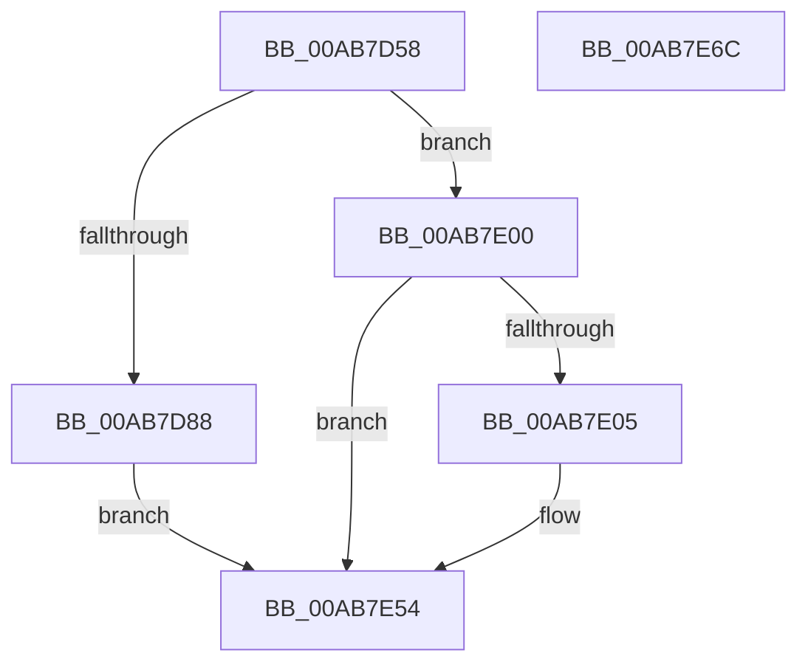

# PopThermalProcessUsermodeEvent

- RVA: `0x00AB7D58`–`0x00AB7E6D` (길이 `277` bytes)
- VA: `0x0000000140AB7D58`
- 실행 섹션: `PAGE`
- PDB 이름 있음: `예`; PDB Function 태그: `아니요`
- unwind 정보 RVA: `0x000BCAF8`
- 디코드: `68`개 명령, `277/277` bytes 표시
- 미해석 바이트: `0` (있으면 어셈블리에 `.byte`로 보존)

> 이 문서는 커널 이미지의 기계어와 PDB 기호를 분석해 생성했습니다. 4번과 5번은 함수 원형과 자료형을 바이너리 사용 방식에서 추정한 C 해석이며 원본 소스 복구 결과는 아닙니다.

## 1. Dependencies

- 직접 호출 지점: **10**; 고유 호출 대상: **8**
- 직접 호출자로 확인된 함수: **1**
- RIP 상대 이미지 참조: **4**

### Outgoing calls
- `0x00AB7D74` → [PopDiagTraceUsermodeThermalEvent](PopDiagTraceUsermodeThermalEvent_function_00AB80C8.md) (function, `0x00AB80C8`)
- `0x00AB7D7C` → [PopThermalEventTransitionDisableDeepSleep](../../text/4E/PopThermalEventTransitionDisableDeepSleep_function_004E1284.md) (function, `0x004E1284`)
- `0x00AB7DA5` → [PopDiagTraceTripPointExceeded](PopDiagTraceTripPointExceeded_function_00AB7EEC.md) (function, `0x00AB7EEC`)
- `0x00AB7DBA` → [PopDiagTraceTripPointExceeded](PopDiagTraceTripPointExceeded_function_00AB7EEC.md) (function, `0x00AB7EEC`)
- `0x00AB7DD4` → [PopSqmThermalUsermodeEvent](PopSqmThermalUsermodeEvent_function_00AB7FD0.md) (function, `0x00AB7FD0`)
- `0x00AB7DF9` → [PopThermalWriteShutdownToRegistry](../../text/4C/PopThermalWriteShutdownToRegistry_function_004CDA6C.md) (function, `0x004CDA6C`)
- `0x00AB7E15` → [PopDiagTraceUsermodeTripPointExceeded](PopDiagTraceUsermodeTripPointExceeded_function_00AB7E74.md) (function, `0x00AB7E74`)
- `0x00AB7E30` → [PopSqmThermalUsermodeEvent](PopSqmThermalUsermodeEvent_function_00AB7FD0.md) (function, `0x00AB7FD0`)
- `0x00AB7E3C` → [PopAcquireRwLockExclusive](../../text/43/PopAcquireRwLockExclusive_function_00430B44.md) (function, `0x00430B44`)
- `0x00AB7E4F` → [PopReleaseRwLock](../../text/2D/PopReleaseRwLock_function_002DFBBC.md) (function, `0x002DFBBC`)

### Direct callers
- [NtPowerInformation](../95/NtPowerInformation_function_00955D80.md) at `0x00957A79`

### Static image references
- `0x00AB7D95` → RVA `0x0001E2B8` (`.rdata`; read)
- `0x00AB7DAA` → RVA `0x0001E2A8` (`.rdata`; read)
- `0x00AB7E35` → RVA `0x00F0B980` (`.data`; read)
- `0x00AB7E48` → RVA `0x00F0B992` (`.data`; write)

## 2. Other-region calls and transfers

- 다른 실행 섹션으로 향하는 call: **4**
  - `0x00AB7D7C` → [PopThermalEventTransitionDisableDeepSleep](../../text/4E/PopThermalEventTransitionDisableDeepSleep_function_004E1284.md) (`PAGE` → `.text`)
  - `0x00AB7DF9` → [PopThermalWriteShutdownToRegistry](../../text/4C/PopThermalWriteShutdownToRegistry_function_004CDA6C.md) (`PAGE` → `.text`)
  - `0x00AB7E3C` → [PopAcquireRwLockExclusive](../../text/43/PopAcquireRwLockExclusive_function_00430B44.md) (`PAGE` → `.text`)
  - `0x00AB7E4F` → [PopReleaseRwLock](../../text/2D/PopReleaseRwLock_function_002DFBBC.md) (`PAGE` → `.text`)
- 별도 외부 분기/꼬리 이동을 확인하지 못했습니다.

## 3. Assembly (complete function range)

```asm
00AB7D58  48 8B C4                        mov rax, rsp
00AB7D5B  48 89 58 08                     mov qword ptr [rax + 8], rbx
00AB7D5F  48 89 70 10                     mov qword ptr [rax + 0x10], rsi
00AB7D63  48 89 78 18                     mov qword ptr [rax + 0x18], rdi
00AB7D67  41 56                           push r14
00AB7D69  48 83 EC 40                     sub rsp, 0x40
00AB7D6D  83 60 EC 00                     and dword ptr [rax - 0x14], 0
00AB7D71  4C 8B F1                        mov r14, rcx
00AB7D74  E8 4F 03 00 00                  call 0x140ab80c8
00AB7D79  41 8B 0E                        mov ecx, dword ptr [r14]
00AB7D7C  E8 03 95 A2 FF                  call 0x1404e1284
00AB7D81  41 8B 06                        mov eax, dword ptr [r14]
00AB7D84  85 C0                           test eax, eax
00AB7D86  75 78                           jne 0x140ab7e00
00AB7D88  41 0F B7 5E 0C                  movzx ebx, word ptr [r14 + 0xc]
00AB7D8D  49 8D 76 0E                     lea rsi, [r14 + 0xe]
00AB7D91  41 8B 7E 08                     mov edi, dword ptr [r14 + 8]
00AB7D95  4C 8D 0D 1C 65 56 FF            lea r9, [rip - 0xa99ae4]
00AB7D9C  48 8B D6                        mov rdx, rsi
00AB7D9F  0F B7 CB                        movzx ecx, bx
00AB7DA2  44 8B C7                        mov r8d, edi
00AB7DA5  E8 42 01 00 00                  call 0x140ab7eec
00AB7DAA  4C 8D 0D F7 64 56 FF            lea r9, [rip - 0xa99b09]
00AB7DB1  44 8B C7                        mov r8d, edi
00AB7DB4  48 8B D6                        mov rdx, rsi
00AB7DB7  0F B7 CB                        movzx ecx, bx
00AB7DBA  E8 2D 01 00 00                  call 0x140ab7eec
00AB7DBF  45 8B 4E 04                     mov r9d, dword ptr [r14 + 4]
00AB7DC3  48 8B D6                        mov rdx, rsi
00AB7DC6  45 8B 46 08                     mov r8d, dword ptr [r14 + 8]
00AB7DCA  41 0F B7 4E 0C                  movzx ecx, word ptr [r14 + 0xc]
00AB7DCF  C6 44 24 20 01                  mov byte ptr [rsp + 0x20], 1
00AB7DD4  E8 F7 01 00 00                  call 0x140ab7fd0
00AB7DD9  41 0F B7 46 0C                  movzx eax, word ptr [r14 + 0xc]
00AB7DDE  49 8D 56 04                     lea rdx, [r14 + 4]
00AB7DE2  66 03 C0                        add ax, ax
00AB7DE5  48 89 74 24 38                  mov qword ptr [rsp + 0x38], rsi
00AB7DEA  48 8D 4C 24 30                  lea rcx, [rsp + 0x30]
00AB7DEF  66 89 44 24 30                  mov word ptr [rsp + 0x30], ax
00AB7DF4  66 89 44 24 32                  mov word ptr [rsp + 0x32], ax
00AB7DF9  E8 6E 5C A1 FF                  call 0x1404cda6c
00AB7DFE  EB 54                           jmp 0x140ab7e54
00AB7E00  83 F8 01                        cmp eax, 1
00AB7E03  75 4F                           jne 0x140ab7e54
00AB7E05  45 8B 46 08                     mov r8d, dword ptr [r14 + 8]
00AB7E09  49 8D 56 0E                     lea rdx, [r14 + 0xe]
00AB7E0D  41 0F B7 4E 0C                  movzx ecx, word ptr [r14 + 0xc]
00AB7E12  45 33 C9                        xor r9d, r9d
00AB7E15  E8 5A 00 00 00                  call 0x140ab7e74
00AB7E1A  45 8B 4E 04                     mov r9d, dword ptr [r14 + 4]
00AB7E1E  49 8D 56 0E                     lea rdx, [r14 + 0xe]
00AB7E22  45 8B 46 08                     mov r8d, dword ptr [r14 + 8]
00AB7E26  41 0F B7 4E 0C                  movzx ecx, word ptr [r14 + 0xc]
00AB7E2B  C6 44 24 20 00                  mov byte ptr [rsp + 0x20], 0
00AB7E30  E8 9B 01 00 00                  call 0x140ab7fd0
00AB7E35  48 8D 0D 44 3B 45 00            lea rcx, [rip + 0x453b44]
00AB7E3C  E8 03 8D 97 FF                  call 0x140430b44
00AB7E41  48 8D 0D 38 3B 45 00            lea rcx, [rip + 0x453b38]
00AB7E48  C6 05 43 3B 45 00 01            mov byte ptr [rip + 0x453b43], 1
00AB7E4F  E8 68 7D 82 FF                  call 0x1402dfbbc
00AB7E54  48 8B 5C 24 50                  mov rbx, qword ptr [rsp + 0x50]
00AB7E59  33 C0                           xor eax, eax
00AB7E5B  48 8B 74 24 58                  mov rsi, qword ptr [rsp + 0x58]
00AB7E60  48 8B 7C 24 60                  mov rdi, qword ptr [rsp + 0x60]
00AB7E65  48 83 C4 40                     add rsp, 0x40
00AB7E69  41 5E                           pop r14
00AB7E6B  C3                              ret
00AB7E6C  CC                              int3
```

## 4. C-style interpretation (structured pseudocode)

```c
__int64 __fastcall PopThermalProcessUsermodeEvent(__int64 a1)
{
    __int64 result;
    __int64 v_rsp;
    unsigned __int64 v_stack_m10;
    unsigned __int16 v_stack_m16;
    unsigned __int64 v_stack_m18;
    unsigned __int8 v_stack_m28;
    unsigned __int64 v_stack_p10;
    unsigned __int64 v_stack_p18;
    unsigned __int64 v_stack_p8;

    *(unsigned __int64 *)(v_rsp + 8) = v_rbx;
    *(unsigned __int64 *)(v_rsp + 16) = v_rsi;
    *(unsigned __int64 *)(v_rsp + 24) = v_rdi;
    v_rsp = (v_rsp) - (64);
    result = PopDiagTraceUsermodeThermalEvent(a1, a2, a3, a4);
    result = PopThermalEventTransitionDisableDeepSleep((unsigned int)(*(unsigned int *)(a1)), a2, a3, a4);
    if ((unsigned int)((unsigned int)(*(unsigned int *)(a1))) != 0) goto loc_00AB7E00;
    result = PopDiagTraceTripPointExceeded((unsigned __int16)(*(unsigned __int16 *)(a1 + 12)), a1 + 14, (unsigned int)((unsigned int)((unsigned int)(*(unsigned int *)(a1 + 8)))), v_rip - 11115236);
    result = PopDiagTraceTripPointExceeded((unsigned __int16)(*(unsigned __int16 *)(a1 + 12)), a1 + 14, (unsigned int)((unsigned int)((unsigned int)(*(unsigned int *)(a1 + 8)))), v_rip - 11115273);
    v_stack_m28 = 1;
    result = PopSqmThermalUsermodeEvent(*(unsigned __int16 *)(a1 + 12), a1 + 14, (unsigned int)(*(unsigned int *)(a1 + 8)), (unsigned int)(*(unsigned int *)(a1 + 4)));
    result = (unsigned __int16)((*(unsigned __int16 *)(a1 + 12)) + ((unsigned __int16)(*(unsigned __int16 *)(a1 + 12))));
    v_stack_m10 = a1 + 14;
    v_stack_m18 = (unsigned __int16)(result);
    v_stack_m16 = (unsigned __int16)(result);
    result = PopThermalWriteShutdownToRegistry(v_stack_m18, a1 + 4, (unsigned int)(*(unsigned int *)(a1 + 8)), (unsigned int)(*(unsigned int *)(a1 + 4)));
    goto loc_00AB7E54;
loc_00AB7E00:
    if (((unsigned int)(result)) == 1) {
        a3 = *(unsigned int *)(a1 + 8);
        a2 = a1 + 14;
        a1 = *(unsigned __int16 *)(a1 + 12);
        a4 = 0;
        result = PopDiagTraceUsermodeTripPointExceeded(a1, a2, a3, a4);
        a4 = *(unsigned int *)(a1 + 4);
        a2 = a1 + 14;
        a3 = *(unsigned int *)(a1 + 8);
        a1 = *(unsigned __int16 *)(a1 + 12);
        v_stack_m28 = 0;
        result = PopSqmThermalUsermodeEvent(a1, a2, a3, a4);
        a1 = v_rip + 4537156;
        result = PopAcquireRwLockExclusive(a1, a2, a3, a4);
        a1 = v_rip + 4537144;
        *(unsigned __int8 *)(v_rip + 4537155) = 1;
        result = PopReleaseRwLock(a1, a2, a3, a4);
    }
    result = 0;
    v_rsp = (v_rsp) + (64);
    return result;
}
```

## 5. (Beta) C Style

```c
int64_t PopThermalProcessUsermodeEvent(void *Arg1)
{
    uint8_t *arg1 = (uint8_t *)Arg1;

    int64_t result;
    int64_t local_rsp;
    uint64_t v_stack_m10;
    uint16_t v_stack_m16;
    uint64_t v_stack_m18;
    uint8_t v_stack_m28;
    uint64_t v_stack_p10;
    uint64_t v_stack_p18;
    uint64_t v_stack_p8;

    *(uint64_t *)(local_rsp + 0x8) = local_rbx;
    *(uint64_t *)(local_rsp + 0x10) = local_rsi;
    *(uint64_t *)(local_rsp + 0x18) = local_rdi;
    local_rsp = (local_rsp) - (64);
    result = PopDiagTraceUsermodeThermalEvent(Arg1, a2, a3, a4);
    result = PopThermalEventTransitionDisableDeepSleep((uint32_t)(*(uint32_t *)(arg1)), a2, a3, a4);
    if ((uint32_t)((uint32_t)(*(uint32_t *)(arg1))) != 0) goto loc_00AB7E00;
    result = PopDiagTraceTripPointExceeded((uint16_t)(*(uint16_t *)(arg1 + 0xC)), Arg1 + 14, (uint32_t)((uint32_t)((uint32_t)(*(uint32_t *)(arg1 + 0x8)))), v_rip - 11115236);
    result = PopDiagTraceTripPointExceeded((uint16_t)(*(uint16_t *)(arg1 + 0xC)), Arg1 + 14, (uint32_t)((uint32_t)((uint32_t)(*(uint32_t *)(arg1 + 0x8)))), v_rip - 11115273);
    v_stack_m28 = 1;
    result = PopSqmThermalUsermodeEvent(*(uint16_t *)(arg1 + 0xC), Arg1 + 14, (uint32_t)(*(uint32_t *)(arg1 + 0x8)), (uint32_t)(*(uint32_t *)(arg1 + 0x4)));
    result = (uint16_t)((*(uint16_t *)(arg1 + 0xC)) + ((uint16_t)(*(uint16_t *)(arg1 + 0xC))));
    v_stack_m10 = Arg1 + 14;
    v_stack_m18 = (uint16_t)(result);
    v_stack_m16 = (uint16_t)(result);
    result = PopThermalWriteShutdownToRegistry(v_stack_m18, Arg1 + 4, (uint32_t)(*(uint32_t *)(arg1 + 0x8)), (uint32_t)(*(uint32_t *)(arg1 + 0x4)));
    goto loc_00AB7E54;
loc_00AB7E00:
    if (((uint32_t)(result)) == 1) {
        a3 = *(uint32_t *)(arg1 + 0x8);
        a2 = Arg1 + 14;
        Arg1 = *(uint16_t *)(arg1 + 0xC);
        a4 = 0;
        result = PopDiagTraceUsermodeTripPointExceeded(Arg1, a2, a3, a4);
        a4 = *(uint32_t *)(arg1 + 0x4);
        a2 = Arg1 + 14;
        a3 = *(uint32_t *)(arg1 + 0x8);
        Arg1 = *(uint16_t *)(arg1 + 0xC);
        v_stack_m28 = 0;
        result = PopSqmThermalUsermodeEvent(Arg1, a2, a3, a4);
        Arg1 = v_rip + 4537156;
        result = PopAcquireRwLockExclusive(Arg1, a2, a3, a4);
        Arg1 = v_rip + 4537144;
        *(uint8_t *)(v_rip + 0x453B43) = 1;
        result = PopReleaseRwLock(Arg1, a2, a3, a4);
    }
    result = 0;
    local_rsp = (local_rsp) + (64);
    return result;
}
```

### 관측된 메모리 오프셋

구조체 형식이 확인되지 않은 접근은 인자 기준의 오프셋으로만 기록했습니다.

| 기준 인자 | 오프셋 표현 | 폭 (bit) | 접근 |
|---|---:|---:|---|
| `Arg1` | `+ 0x0` | `32` | `R` |
| `Arg1` | `+ 0x4` | `32` | `R` |
| `Arg1` | `+ 0x4` | `64` | `R` |
| `Arg1` | `+ 0x8` | `32` | `R` |
| `Arg1` | `+ 0xC` | `16` | `R` |
| `Arg1` | `+ 0xE` | `64` | `R` |

## 6. Execution-region graph

[열기: 2D/3D 그래프와 함수 탐색 컨트롤 패널](../../../control-panel.html?section=page&rva=0x00AB7D58&view=graph)

- 2D 그래프는 위에서 아래로 흐르고, 3D 그래프는 빈 공간을 드래그해 회전합니다. Shift+드래그는 이동, 휠은 확대·축소, 함수 노드 선택은 대상 보고서 이동입니다.

### Static fallback


