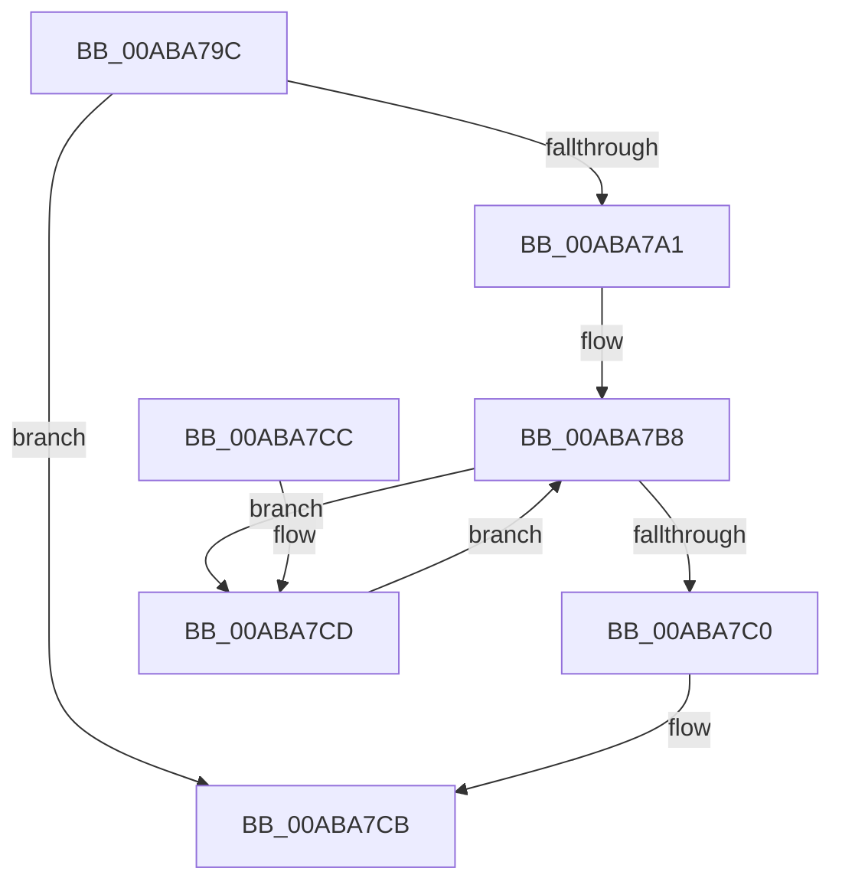

# PopThermalUpdateActiveTimeTracking

- RVA: `0x00ABA79C`–`0x00ABA7D9` (길이 `61` bytes)
- VA: `0x0000000140ABA79C`
- 실행 섹션: `PAGE`
- PDB 이름 있음: `예`; PDB Function 태그: `아니요`
- unwind 정보 RVA: `0x000DB714`
- 디코드: `17`개 명령, `61/61` bytes 표시
- 미해석 바이트: `0` (있으면 어셈블리에 `.byte`로 보존)

> 이 문서는 커널 이미지의 기계어와 PDB 기호를 분석해 생성했습니다. 4번과 5번은 함수 원형과 자료형을 바이너리 사용 방식에서 추정한 C 해석이며 원본 소스 복구 결과는 아닙니다.

## 1. Dependencies

- 직접 호출 지점: **0**; 고유 호출 대상: **0**
- 직접 호출자로 확인된 함수: **9**
- RIP 상대 이미지 참조: **0**

### Outgoing calls
- 직접 디코드된 call 명령이 없습니다.

### Direct callers
- [PopCoolingTelemetryWorker](../../text/42/PopCoolingTelemetryWorker_function_0042FC3C.md) at `0x0042FCE6`
- [PopCoolingSxTransition](../../text/42/PopCoolingSxTransition_function_0042FEA8.md) at `0x0042FF83`
- [PopThermalSxEntry](../../text/4E/PopThermalSxEntry_function_004E3D20.md) at `0x004E3DC7`
- [PopThermalTelemetryWorker](../../text/5D/PopThermalTelemetryWorker_function_005D57F0.md) at `0x005D5868`
- [PoSetThermalActiveCooling](../75/PoSetThermalActiveCooling_function_00756D40.md) at `0x00756DA0`
- [PopOrphanCoolingExtension](../75/PopOrphanCoolingExtension_function_00757474.md) at `0x0075750E`
- [PopThermalZoneRemove](../75/PopThermalZoneRemove_function_0075FAD0.md) at `0x0075FB36`
- [PopDeactiveThermalRequest](../AD/PopDeactiveThermalRequest_function_00ADF634.md) at `0x00ADF6B1`
- [sub_00B3BE18](../B3/Unknown_function_00B3BE18.md) at `0x00B3BEF5`

### Static image references
- 디코드된 RIP-relative 메모리 참조가 없습니다.

## 2. Other-region calls and transfers

- 다른 실행 섹션으로 향하는 call: **0**
- 별도 외부 분기/꼬리 이동을 확인하지 못했습니다.

## 3. Assembly (complete function range)

```asm
00ABA79C  80 39 00                        cmp byte ptr [rcx], 0
00ABA79F  75 2A                           jne 0x140aba7cb
00ABA7A1  49 B9 08 00 00 00 80 F7 FF FF   movabs r9, 0xfffff78000000008
00ABA7AB  0F B6 D2                        movzx edx, dl
00ABA7AE  4D 8B 09                        mov r9, qword ptr [r9]
00ABA7B1  4D 8B C1                        mov r8, r9
00ABA7B4  4C 2B 41 10                     sub r8, qword ptr [rcx + 0x10]
00ABA7B8  0F B6 41 01                     movzx eax, byte ptr [rcx + 1]
00ABA7BC  3B D0                           cmp edx, eax
00ABA7BE  72 0D                           jb 0x140aba7cd
00ABA7C0  4C 01 81 08 02 00 00            add qword ptr [rcx + 0x208], r8
00ABA7C7  4C 89 49 10                     mov qword ptr [rcx + 0x10], r9
00ABA7CB  C3                              ret
00ABA7CC  CC                              int3
00ABA7CD  4C 01 84 D1 68 01 00 00         add qword ptr [rcx + rdx*8 + 0x168], r8
00ABA7D5  FF C2                           inc edx
00ABA7D7  EB DF                           jmp 0x140aba7b8
```

## 4. C-style interpretation (structured pseudocode)

```c
__int64 __fastcall PopThermalUpdateActiveTimeTracking(__int64 a1, unsigned __int8 a2)
{
    if ((*(unsigned __int8 *)(a1)) != 0) goto loc_00ABA7CB;
    a3 = (*(unsigned __int64 *)(a4)) - (*(unsigned __int64 *)(a1 + 16));
loc_00ABA7B8:
    if (a2 < ((unsigned int)(*(unsigned __int8 *)(a1 + 1)))) goto loc_00ABA7CD;
    *(unsigned __int64 *)(a1 + 16) = *(unsigned __int64 *)(a4);
loc_00ABA7CB:
    return *(unsigned __int8 *)(a1 + 1);
loc_00ABA7CD:
    a2 = (unsigned int)((a2) + 1);
    goto loc_00ABA7B8;
}
```

## 5. (Beta) C Style

```c
int64_t PopThermalUpdateActiveTimeTracking(void *Arg1, uint8_t Arg2)
{
    uint8_t *arg1 = (uint8_t *)Arg1;

    if ((*(uint8_t *)(arg1)) != 0) goto loc_00ABA7CB;
    a3 = (*(uint64_t *)(a4)) - (*(uint64_t *)(arg1 + 0x10));
loc_00ABA7B8:
    if (Arg2 < ((uint32_t)(*(uint8_t *)(arg1 + 0x1)))) goto loc_00ABA7CD;
    *(uint64_t *)(arg1 + 0x10) = *(uint64_t *)(a4);
loc_00ABA7CB:
    return *(uint8_t *)(arg1 + 0x1);
loc_00ABA7CD:
    Arg2 = (uint32_t)((Arg2) + 1);
    goto loc_00ABA7B8;
}
```

### 관측된 메모리 오프셋

구조체 형식이 확인되지 않은 접근은 인자 기준의 오프셋으로만 기록했습니다.

| 기준 인자 | 오프셋 표현 | 폭 (bit) | 접근 |
|---|---:|---:|---|
| `Arg1` | `+ 0x0` | `8` | `R` |
| `Arg1` | `+ 0x1` | `8` | `R` |
| `Arg1` | `+ 0x10` | `64` | `R` |
| `Arg1` | `+ 0x10` | `64` | `W` |
| `Arg1` | `+ 0x168 + rdx*8` | `64` | `R/W` |
| `Arg1` | `+ 0x208` | `64` | `R/W` |

## 6. Execution-region graph

[열기: 2D/3D 그래프와 함수 탐색 컨트롤 패널](../../../control-panel.html?section=page&rva=0x00ABA79C&view=graph)

- 2D 그래프는 위에서 아래로 흐르고, 3D 그래프는 빈 공간을 드래그해 회전합니다. Shift+드래그는 이동, 휠은 확대·축소, 함수 노드 선택은 대상 보고서 이동입니다.

### Static fallback


