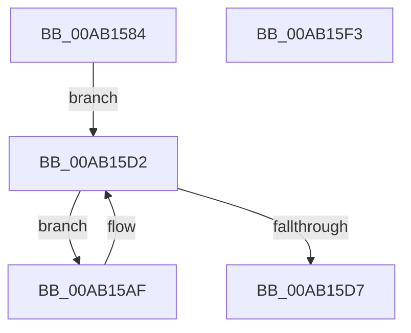

# PopThermalZoneUpdateCoolingPolicy

- RVA: `0x00AB1584`–`0x00AB15F4` (길이 `112` bytes)
- VA: `0x0000000140AB1584`
- 실행 섹션: `PAGE`
- PDB 이름 있음: `예`; PDB Function 태그: `아니요`
- unwind 정보 RVA: `0x00060BC4`
- 디코드: `27`개 명령, `112/112` bytes 표시
- 미해석 바이트: `0` (있으면 어셈블리에 `.byte`로 보존)

> 이 문서는 커널 이미지의 기계어와 PDB 기호를 분석해 생성했습니다. 4번과 5번은 함수 원형과 자료형을 바이너리 사용 방식에서 추정한 C 해석이며 원본 소스 복구 결과는 아닙니다.

## 1. Dependencies

- 직접 호출 지점: **5**; 고유 호출 대상: **4**
- 직접 호출자로 확인된 함수: **1**
- RIP 상대 이미지 참조: **2**

### Outgoing calls
- `0x00AB159A` → [PopAcquireRwLockShared](../../text/2D/PopAcquireRwLockShared_function_002D9A40.md) (function, `0x002D9A40`)
- `0x00AB15B9` → [PopAcquireRwLockExclusive](../../text/43/PopAcquireRwLockExclusive_function_00430B44.md) (function, `0x00430B44`)
- `0x00AB15C2` → [IoCancelIrp](../../text/27/IoCancelIrp_function_002720E0.md) (function, `0x002720E0`)
- `0x00AB15CA` → [PopReleaseRwLock](../../text/2D/PopReleaseRwLock_function_002DFBBC.md) (function, `0x002DFBBC`)
- `0x00AB15DE` → [PopReleaseRwLock](../../text/2D/PopReleaseRwLock_function_002DFBBC.md) (function, `0x002DFBBC`)

### Direct callers
- [PopThermalCoolingPowerSettingCallback](../../text/43/PopThermalCoolingPowerSettingCallback_function_00430950.md) at `0x004309F5`

### Static image references
- `0x00AB1593` → RVA `0x00F0C900` (`.data`; read)
- `0x00AB159F` → RVA `0x00F0CE80` (`.data`; read)

## 2. Other-region calls and transfers

- 다른 실행 섹션으로 향하는 call: **5**
  - `0x00AB159A` → [PopAcquireRwLockShared](../../text/2D/PopAcquireRwLockShared_function_002D9A40.md) (`PAGE` → `.text`)
  - `0x00AB15B9` → [PopAcquireRwLockExclusive](../../text/43/PopAcquireRwLockExclusive_function_00430B44.md) (`PAGE` → `.text`)
  - `0x00AB15C2` → [IoCancelIrp](../../text/27/IoCancelIrp_function_002720E0.md) (`PAGE` → `.text`)
  - `0x00AB15CA` → [PopReleaseRwLock](../../text/2D/PopReleaseRwLock_function_002DFBBC.md) (`PAGE` → `.text`)
  - `0x00AB15DE` → [PopReleaseRwLock](../../text/2D/PopReleaseRwLock_function_002DFBBC.md) (`PAGE` → `.text`)
- 별도 외부 분기/꼬리 이동을 확인하지 못했습니다.

## 3. Assembly (complete function range)

```asm
00AB1584  48 89 5C 24 08                  mov qword ptr [rsp + 8], rbx
00AB1589  48 89 74 24 10                  mov qword ptr [rsp + 0x10], rsi
00AB158E  57                              push rdi
00AB158F  48 83 EC 20                     sub rsp, 0x20
00AB1593  48 8D 0D 66 B3 45 00            lea rcx, [rip + 0x45b366]
00AB159A  E8 A1 84 82 FF                  call 0x1402d9a40
00AB159F  48 8B 3D DA B8 45 00            mov rdi, qword ptr [rip + 0x45b8da]
00AB15A6  48 8D 35 D3 B8 45 00            lea rsi, [rip + 0x45b8d3]
00AB15AD  EB 23                           jmp 0x140ab15d2
00AB15AF  48 8D 9F B0 01 00 00            lea rbx, [rdi + 0x1b0]
00AB15B6  48 8B CB                        mov rcx, rbx
00AB15B9  E8 86 F5 97 FF                  call 0x140430b44
00AB15BE  48 8B 4F 38                     mov rcx, qword ptr [rdi + 0x38]
00AB15C2  E8 19 0B 7C FF                  call 0x1402720e0
00AB15C7  48 8B CB                        mov rcx, rbx
00AB15CA  E8 ED E5 82 FF                  call 0x1402dfbbc
00AB15CF  48 8B 3F                        mov rdi, qword ptr [rdi]
00AB15D2  48 3B FE                        cmp rdi, rsi
00AB15D5  75 D8                           jne 0x140ab15af
00AB15D7  48 8D 0D 22 B3 45 00            lea rcx, [rip + 0x45b322]
00AB15DE  E8 D9 E5 82 FF                  call 0x1402dfbbc
00AB15E3  48 8B 5C 24 30                  mov rbx, qword ptr [rsp + 0x30]
00AB15E8  48 8B 74 24 38                  mov rsi, qword ptr [rsp + 0x38]
00AB15ED  48 83 C4 20                     add rsp, 0x20
00AB15F1  5F                              pop rdi
00AB15F2  C3                              ret
00AB15F3  CC                              int3
```

## 4. C-style interpretation (structured pseudocode)

```c
__int64 __fastcall PopThermalZoneUpdateCoolingPolicy(void)
{
    __int64 result;
    __int64 v_rsp;
    unsigned __int64 v_stack_p10;
    unsigned __int64 v_stack_p8;

    v_stack_p8 = v_rbx;
    v_stack_p10 = v_rsi;
    v_rsp = (v_rsp) - (32);
    result = PopAcquireRwLockShared(v_rip + 4567910, a2, a3, a4);
    goto loc_00AB15D2;
loc_00AB15AF:
    result = PopAcquireRwLockExclusive(*(unsigned __int64 *)(v_rip + 4569306) + 432, a2, a3, a4);
    result = IoCancelIrp(*(unsigned __int64 *)(*(unsigned __int64 *)(v_rip + 4569306) + 56), a2, a3, a4);
    result = PopReleaseRwLock(*(unsigned __int64 *)(v_rip + 4569306) + 432, a2, a3, a4);
loc_00AB15D2:
    if ((*(unsigned __int64 *)(*(unsigned __int64 *)(v_rip + 4569306))) != (v_rip + 4569299)) goto loc_00AB15AF;
    result = PopReleaseRwLock(v_rip + 4567842, a2, a3, a4);
    v_rsp = (v_rsp) + (32);
    return result;
}
```

## 5. (Beta) C Style

```c
void PopThermalZoneUpdateCoolingPolicy(void)
{
    int64_t result;
    int64_t local_rsp;
    uint64_t v_stack_p10;
    uint64_t v_stack_p8;

    v_stack_p8 = local_rbx;
    v_stack_p10 = local_rsi;
    local_rsp = (local_rsp) - (32);
    result = PopAcquireRwLockShared(v_rip + 4567910, a2, a3, a4);
    goto loc_00AB15D2;
loc_00AB15AF:
    result = PopAcquireRwLockExclusive(*(uint64_t *)(v_rip + 0x45B8DA) + 432, a2, a3, a4);
    result = IoCancelIrp(*(uint64_t *)(*(uint64_t *)(v_rip + 0x45B8DA) + 0x38), a2, a3, a4);
    result = PopReleaseRwLock(*(uint64_t *)(v_rip + 0x45B8DA) + 432, a2, a3, a4);
loc_00AB15D2:
    if ((*(uint64_t *)(*(uint64_t *)(v_rip + 0x45B8DA))) != (v_rip + 4569299)) goto loc_00AB15AF;
    result = PopReleaseRwLock(v_rip + 4567842, a2, a3, a4);
    local_rsp = (local_rsp) + (32);
    return result;
}
```

## 6. Execution-region graph

[열기: 2D/3D 그래프와 함수 탐색 컨트롤 패널](../../../control-panel.html?section=page&rva=0x00AB1584&view=graph)

- 2D 그래프는 위에서 아래로 흐르고, 3D 그래프는 빈 공간을 드래그해 회전합니다. Shift+드래그는 이동, 휠은 확대·축소, 함수 노드 선택은 대상 보고서 이동입니다.

### Static fallback


