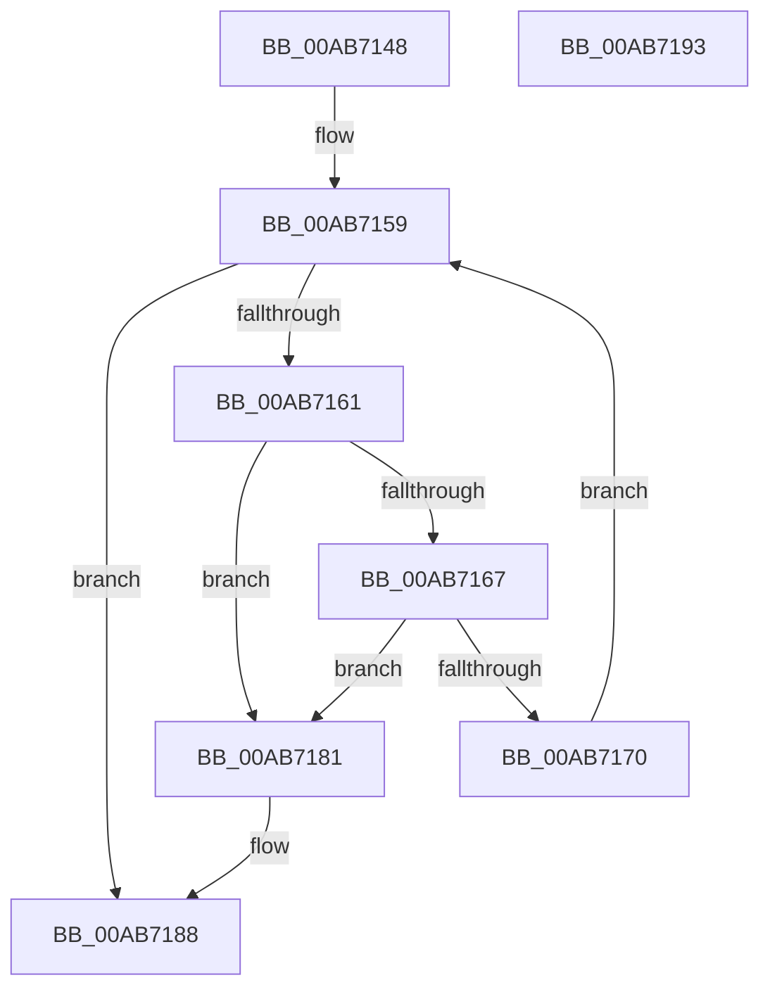

# PopUnlinkWakeSources

- RVA: `0x00AB7148`–`0x00AB7194` (길이 `76` bytes)
- VA: `0x0000000140AB7148`
- 실행 섹션: `PAGE`
- PDB 이름 있음: `예`; PDB Function 태그: `아니요`
- unwind 정보 RVA: `0x0005CAAC`
- 디코드: `25`개 명령, `76/76` bytes 표시
- 미해석 바이트: `0` (있으면 어셈블리에 `.byte`로 보존)

> 이 문서는 커널 이미지의 기계어와 PDB 기호를 분석해 생성했습니다. 4번과 5번은 함수 원형과 자료형을 바이너리 사용 방식에서 추정한 C 해석이며 원본 소스 복구 결과는 아닙니다.

## 1. Dependencies

- 직접 호출 지점: **1**; 고유 호출 대상: **1**
- 직접 호출자로 확인된 함수: **2**
- RIP 상대 이미지 참조: **0**

### Outgoing calls
- `0x00AB7177` → [PopFreeWakeSource](PopFreeWakeSource_function_00AB719C.md) (function, `0x00AB719C`)

### Direct callers
- [PopFreeWakeInfo](PopFreeWakeInfo_function_00AB7120.md) at `0x00AB7129`
- [PopHandleWakeSources](../../pagelk/B6/PopHandleWakeSources_function_00B6C264.md) at `0x00B6C385`

### Static image references
- 디코드된 RIP-relative 메모리 참조가 없습니다.

## 2. Other-region calls and transfers

- 다른 실행 섹션으로 향하는 call: **0**
- 별도 외부 분기/꼬리 이동을 확인하지 못했습니다.

## 3. Assembly (complete function range)

```asm
00AB7148  48 89 5C 24 08                  mov qword ptr [rsp + 8], rbx
00AB714D  57                              push rdi
00AB714E  48 83 EC 20                     sub rsp, 0x20
00AB7152  48 8B F9                        mov rdi, rcx
00AB7155  48 8D 59 18                     lea rbx, [rcx + 0x18]
00AB7159  48 8B 0B                        mov rcx, qword ptr [rbx]
00AB715C  48 3B CB                        cmp rcx, rbx
00AB715F  74 27                           je 0x140ab7188
00AB7161  48 39 59 08                     cmp qword ptr [rcx + 8], rbx
00AB7165  75 1A                           jne 0x140ab7181
00AB7167  48 8B 01                        mov rax, qword ptr [rcx]
00AB716A  48 39 48 08                     cmp qword ptr [rax + 8], rcx
00AB716E  75 11                           jne 0x140ab7181
00AB7170  48 89 03                        mov qword ptr [rbx], rax
00AB7173  48 89 58 08                     mov qword ptr [rax + 8], rbx
00AB7177  E8 20 00 00 00                  call 0x140ab719c
00AB717C  FF 4F 28                        dec dword ptr [rdi + 0x28]
00AB717F  EB D8                           jmp 0x140ab7159
00AB7181  B9 03 00 00 00                  mov ecx, 3
00AB7186  CD 29                           int 0x29
00AB7188  48 8B 5C 24 30                  mov rbx, qword ptr [rsp + 0x30]
00AB718D  48 83 C4 20                     add rsp, 0x20
00AB7191  5F                              pop rdi
00AB7192  C3                              ret
00AB7193  CC                              int3
```

## 4. C-style interpretation (structured pseudocode)

```c
__int64 __fastcall PopUnlinkWakeSources(__int64 a1)
{
    __int64 result;
    __int64 v_rsp;
    unsigned __int64 v_stack_p8;

    v_stack_p8 = v_rbx;
    v_rsp = (v_rsp) - (32);
loc_00AB7159:
    if ((*(unsigned __int64 *)(a1 + 24)) == (a1 + 24)) goto loc_00AB7188;
    if ((*(unsigned __int64 *)(*(unsigned __int64 *)(a1 + 24) + 8)) != (a1 + 24)) goto loc_00AB7181;
    if ((*(unsigned __int64 *)(*(unsigned __int64 *)(*(unsigned __int64 *)(a1 + 24)) + 8)) != (*(unsigned __int64 *)(a1 + 24))) goto loc_00AB7181;
    *(unsigned __int64 *)(a1 + 24) = *(unsigned __int64 *)(*(unsigned __int64 *)(a1 + 24));
    *(unsigned __int64 *)(*(unsigned __int64 *)(*(unsigned __int64 *)(a1 + 24)) + 8) = a1 + 24;
    result = PopFreeWakeSource(*(unsigned __int64 *)(a1 + 24), a2, a3, a4);
    goto loc_00AB7159;
loc_00AB7181:
loc_00AB7188:
    v_rsp = (v_rsp) + (32);
    return result;
}
```

## 5. (Beta) C Style

```c
int64_t PopUnlinkWakeSources(void *Arg1)
{
    uint8_t *arg1 = (uint8_t *)Arg1;

    int64_t result;
    int64_t local_rsp;
    uint64_t v_stack_p8;

    v_stack_p8 = local_rbx;
    local_rsp = (local_rsp) - (32);
loc_00AB7159:
    if ((*(uint64_t *)(arg1 + 0x18)) == (Arg1 + 24)) goto loc_00AB7188;
    if ((*(uint64_t *)(*(uint64_t *)(arg1 + 0x18) + 0x8)) != (Arg1 + 24)) goto loc_00AB7181;
    if ((*(uint64_t *)(*(uint64_t *)(*(uint64_t *)(arg1 + 0x18)) + 0x8)) != (*(uint64_t *)(arg1 + 0x18))) goto loc_00AB7181;
    *(uint64_t *)(arg1 + 0x18) = *(uint64_t *)(*(uint64_t *)(arg1 + 0x18));
    *(void **)(*(uint64_t *)(*(uint64_t *)(arg1 + 0x18)) + 0x8) = Arg1 + 24;
    result = PopFreeWakeSource(*(uint64_t *)(arg1 + 0x18), a2, a3, a4);
    goto loc_00AB7159;
loc_00AB7181:
loc_00AB7188:
    local_rsp = (local_rsp) + (32);
    return result;
}
```

### 관측된 메모리 오프셋

구조체 형식이 확인되지 않은 접근은 인자 기준의 오프셋으로만 기록했습니다.

| 기준 인자 | 오프셋 표현 | 폭 (bit) | 접근 |
|---|---:|---:|---|
| `Arg1` | `+ 0x0` | `64` | `R` |
| `Arg1` | `+ 0x0` | `64` | `W` |
| `Arg1` | `+ 0x18` | `64` | `R` |
| `Arg1` | `+ 0x28` | `32` | `R/W` |

## 6. Execution-region graph

[열기: 2D/3D 그래프와 함수 탐색 컨트롤 패널](../../../control-panel.html?section=page&rva=0x00AB7148&view=graph)

- 2D 그래프는 위에서 아래로 흐르고, 3D 그래프는 빈 공간을 드래그해 회전합니다. Shift+드래그는 이동, 휠은 확대·축소, 함수 노드 선택은 대상 보고서 이동입니다.

### Static fallback


