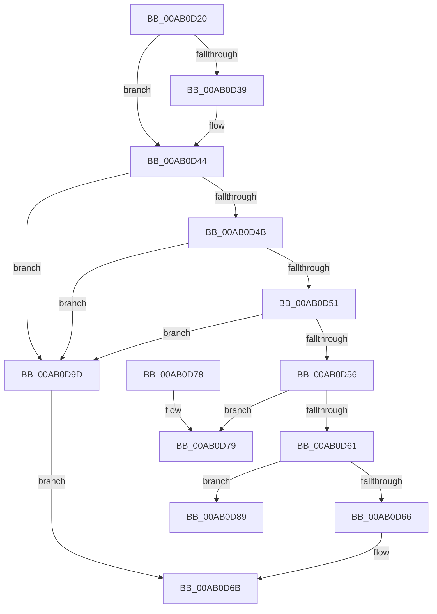

# PopUserPresencePredictionModeCallback

- RVA: `0x00AB0D20`–`0x00AB0DA4` (길이 `132` bytes)
- VA: `0x0000000140AB0D20`
- 실행 섹션: `PAGE`
- PDB 이름 있음: `예`; PDB Function 태그: `예`
- unwind 정보 RVA: `0x0005D210`
- 디코드: `37`개 명령, `132/132` bytes 표시
- 미해석 바이트: `0` (있으면 어셈블리에 `.byte`로 보존)

> 이 문서는 커널 이미지의 기계어와 PDB 기호를 분석해 생성했습니다. 4번과 5번은 함수 원형과 자료형을 바이너리 사용 방식에서 추정한 C 해석이며 원본 소스 복구 결과는 아닙니다.

## 1. Dependencies

- 직접 호출 지점: **2**; 고유 호출 대상: **2**
- 직접 호출자로 확인된 함수: **0**
- RIP 상대 이미지 참조: **3**

### Outgoing calls
- `0x00AB0D56` → [PopAcquirePolicyLock](../../pagelk/B7/PopAcquirePolicyLock_function_00B783C0.md) (function, `0x00B783C0`)
- `0x00AB0D66` → [PopReleasePolicyLock](../../pagelk/B7/PopReleasePolicyLock_function_00B78410.md) (function, `0x00B78410`)

### Direct callers
- 이 함수 시작 RVA로 연결되는 직접 call은 확인되지 않았습니다. 간접 호출은 완전히 역산할 수 없습니다.

### Static image references
- `0x00AB0D2A` → RVA `0x0001E198` (`.rdata`; read)
- `0x00AB0D39` → RVA `0x0001E1A0` (`.rdata`; read)
- `0x00AB0D79` → RVA `0x00F0CE60` (`.data`; write)

## 2. Other-region calls and transfers

- 다른 실행 섹션으로 향하는 call: **2**
  - `0x00AB0D56` → [PopAcquirePolicyLock](../../pagelk/B7/PopAcquirePolicyLock_function_00B783C0.md) (`PAGE` → `PAGELK`)
  - `0x00AB0D66` → [PopReleasePolicyLock](../../pagelk/B7/PopReleasePolicyLock_function_00B78410.md) (`PAGE` → `PAGELK`)
- call이 아닌 외부 분기/꼬리 이동: **2**
  - `0x00AB0D84` → [sub_00B4A988](../B4/Unknown_function_00B4A988.md) (`tail-transfer`)
  - `0x00AB0D98` → [sub_00B4A988](../B4/Unknown_function_00B4A988.md) (`tail-transfer`)

## 3. Assembly (complete function range)

```asm
00AB0D20  48 89 5C 24 08                  mov qword ptr [rsp + 8], rbx
00AB0D25  57                              push rdi
00AB0D26  48 83 EC 20                     sub rsp, 0x20
00AB0D2A  4C 8B 0D 67 D4 56 FF            mov r9, qword ptr [rip - 0xa92b99]
00AB0D31  48 8B FA                        mov rdi, rdx
00AB0D34  4C 2B 09                        sub r9, qword ptr [rcx]
00AB0D37  75 0B                           jne 0x140ab0d44
00AB0D39  4C 8B 0D 60 D4 56 FF            mov r9, qword ptr [rip - 0xa92ba0]
00AB0D40  4C 2B 49 08                     sub r9, qword ptr [rcx + 8]
00AB0D44  33 DB                           xor ebx, ebx
00AB0D46  4D 85 C9                        test r9, r9
00AB0D49  75 52                           jne 0x140ab0d9d
00AB0D4B  41 83 F8 04                     cmp r8d, 4
00AB0D4F  75 4C                           jne 0x140ab0d9d
00AB0D51  48 85 FF                        test rdi, rdi
00AB0D54  74 47                           je 0x140ab0d9d
00AB0D56  E8 65 76 0C 00                  call 0x140b783c0
00AB0D5B  8B 07                           mov eax, dword ptr [rdi]
00AB0D5D  85 C0                           test eax, eax
00AB0D5F  74 18                           je 0x140ab0d79
00AB0D61  83 F8 01                        cmp eax, 1
00AB0D64  74 23                           je 0x140ab0d89
00AB0D66  E8 A5 76 0C 00                  call 0x140b78410
00AB0D6B  8B C3                           mov eax, ebx
00AB0D6D  48 8B 5C 24 30                  mov rbx, qword ptr [rsp + 0x30]
00AB0D72  48 83 C4 20                     add rsp, 0x20
00AB0D76  5F                              pop rdi
00AB0D77  C3                              ret
00AB0D78  CC                              int3
00AB0D79  89 1D E1 C0 45 00               mov dword ptr [rip + 0x45c0e1], ebx
00AB0D7F  B9 02 00 00 00                  mov ecx, 2
00AB0D84  E9 FF 9B 09 00                  jmp 0x140b4a988
00AB0D89  C7 05 CD C0 45 00 01 00 00 00   mov dword ptr [rip + 0x45c0cd], 1
00AB0D93  B9 03 00 00 00                  mov ecx, 3
00AB0D98  E9 EB 9B 09 00                  jmp 0x140b4a988
00AB0D9D  BB 0D 00 00 C0                  mov ebx, 0xc000000d
00AB0DA2  EB C7                           jmp 0x140ab0d6b
```

## 4. C-style interpretation (structured pseudocode)

```c
__int64 __fastcall PopUserPresencePredictionModeCallback(__int64 a1, __int64 a2, int a3)
{
    __int64 result;
    __int64 v_rbx;
    __int64 v_rsp;
    unsigned __int64 v_stack_p8;

    v_stack_p8 = v_rbx;
    v_rsp = (v_rsp) - (32);
    a4 = (*(unsigned __int64 *)(v_rip - 11086745)) - (*(unsigned __int64 *)(a1));
    if (!(condition_is_not_equal)) {
        a4 = *(unsigned __int64 *)(v_rip - 11086752);
        a4 = (a4) - (*(unsigned __int64 *)(a1 + 8));
    }
    v_rbx = 0;
    if (a4 != 0) goto loc_00AB0D9D;
    if (a3 != 4) goto loc_00AB0D9D;
    if (a2 == 0) goto loc_00AB0D9D;
    result = PopAcquirePolicyLock(a1, a2, a3, a4);
    if ((unsigned int)((unsigned int)(*(unsigned int *)(a2))) == 0) goto loc_00AB0D79;
    if (((unsigned int)((unsigned int)(*(unsigned int *)(a2)))) == 1) goto loc_00AB0D89;
    result = PopReleasePolicyLock(a1, a2, a3, a4);
loc_00AB0D6B:
    v_rsp = (v_rsp) + (32);
    return 0;
loc_00AB0D79:
    *(unsigned int *)(v_rip + 4571361) = (unsigned int)(v_stack_p8);
loc_00AB0D89:
    *(unsigned int *)(v_rip + 4571341) = 1;
loc_00AB0D9D:
    goto loc_00AB0D6B;
}
```

## 5. (Beta) C Style

```c
int64_t PopUserPresencePredictionModeCallback(void *Arg1, int64_t Arg2, int32_t Arg3)
{
    uint8_t *arg1 = (uint8_t *)Arg1;

    int64_t result;
    int64_t local_rbx;
    int64_t local_rsp;
    uint64_t v_stack_p8;

    v_stack_p8 = local_rbx;
    local_rsp = (local_rsp) - (32);
    a4 = (*(uint64_t *)(v_rip - 0xA92B99)) - (*(uint64_t *)(arg1));
    if (!(condition_is_not_equal)) {
        a4 = *(uint64_t *)(v_rip - 0xA92BA0);
        a4 = (a4) - (*(uint64_t *)(arg1 + 0x8));
    }
    local_rbx = 0;
    if (a4 != 0) goto loc_00AB0D9D;
    if (Arg3 != 4) goto loc_00AB0D9D;
    if (Arg2 == 0) goto loc_00AB0D9D;
    result = PopAcquirePolicyLock(Arg1, Arg2, Arg3, a4);
    if ((uint32_t)((uint32_t)(*(uint32_t *)(Arg2))) == 0) goto loc_00AB0D79;
    if (((uint32_t)((uint32_t)(*(uint32_t *)(Arg2)))) == 1) goto loc_00AB0D89;
    result = PopReleasePolicyLock(Arg1, Arg2, Arg3, a4);
loc_00AB0D6B:
    local_rsp = (local_rsp) + (32);
    return 0;
loc_00AB0D79:
    *(uint32_t *)(v_rip + 0x45C0E1) = (uint32_t)(v_stack_p8);
loc_00AB0D89:
    *(uint32_t *)(v_rip + 0x45C0CD) = 1;
loc_00AB0D9D:
    goto loc_00AB0D6B;
}
```

### 관측된 메모리 오프셋

구조체 형식이 확인되지 않은 접근은 인자 기준의 오프셋으로만 기록했습니다.

| 기준 인자 | 오프셋 표현 | 폭 (bit) | 접근 |
|---|---:|---:|---|
| `Arg1` | `+ 0x0` | `64` | `R` |
| `Arg1` | `+ 0x8` | `64` | `R` |

## 6. Execution-region graph

[열기: 2D/3D 그래프와 함수 탐색 컨트롤 패널](../../../control-panel.html?section=page&rva=0x00AB0D20&view=graph)

- 2D 그래프는 위에서 아래로 흐르고, 3D 그래프는 빈 공간을 드래그해 회전합니다. Shift+드래그는 이동, 휠은 확대·축소, 함수 노드 선택은 대상 보고서 이동입니다.

### Static fallback


