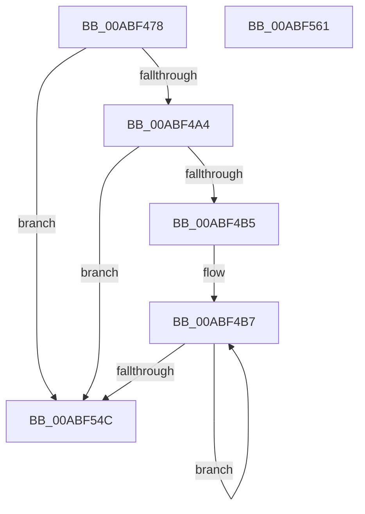

# PpmEventEnergyEstimationRundown

- RVA: `0x00ABF478`–`0x00ABF562` (길이 `234` bytes)
- VA: `0x0000000140ABF478`
- 실행 섹션: `PAGE`
- PDB 이름 있음: `예`; PDB Function 태그: `아니요`
- unwind 정보 RVA: `0x000BD7A0`
- 디코드: `54`개 명령, `234/234` bytes 표시
- 미해석 바이트: `0` (있으면 어셈블리에 `.byte`로 보존)

> 이 문서는 커널 이미지의 기계어와 PDB 기호를 분석해 생성했습니다. 4번과 5번은 함수 원형과 자료형을 바이너리 사용 방식에서 추정한 C 해석이며 원본 소스 복구 결과는 아닙니다.

## 1. Dependencies

- 직접 호출 지점: **2**; 고유 호출 대상: **2**
- 직접 호출자로 확인된 함수: **1**
- RIP 상대 이미지 참조: **4**

### Outgoing calls
- `0x00ABF530` → [EtwWrite](../../text/41/EtwWrite_function_0041C720.md) (function, `0x0041C720`)
- `0x00ABF553` → [_security_check_cookie](../../text/6A/_security_check_cookie_function_006AC640.md) (function, `0x006AC640`)

### Direct callers
- [PpmEventTraceControlCallback](../A5/PpmEventTraceControlCallback_function_00A51F60.md) at `0x00A52343`

### Static image references
- `0x00ABF486` → RVA `0x00E0A740` (`.data`; read)
- `0x00ABF494` → RVA `0x00F0EFE8` (`.data`; read)
- `0x00ABF50E` → RVA `0x00F083E8` (`.data`; read)
- `0x00ABF515` → RVA `0x0001E7D0` (`.rdata`; read)

## 2. Other-region calls and transfers

- 다른 실행 섹션으로 향하는 call: **2**
  - `0x00ABF530` → [EtwWrite](../../text/41/EtwWrite_function_0041C720.md) (`PAGE` → `.text`)
  - `0x00ABF553` → [_security_check_cookie](../../text/6A/_security_check_cookie_function_006AC640.md) (`PAGE` → `.text`)
- 별도 외부 분기/꼬리 이동을 확인하지 못했습니다.

## 3. Assembly (complete function range)

```asm
00ABF478  40 55                           push rbp
00ABF47A  48 8D 6C 24 A9                  lea rbp, [rsp - 0x57]
00ABF47F  48 81 EC 90 00 00 00            sub rsp, 0x90
00ABF486  48 8B 05 B3 B2 34 00            mov rax, qword ptr [rip + 0x34b2b3]
00ABF48D  48 33 C4                        xor rax, rsp
00ABF490  48 89 45 47                     mov qword ptr [rbp + 0x47], rax
00ABF494  48 8B 15 4D FB 44 00            mov rdx, qword ptr [rip + 0x44fb4d]
00ABF49B  48 85 D2                        test rdx, rdx
00ABF49E  0F 84 A8 00 00 00               je 0x140abf54c
00ABF4A4  C6 45 F8 04                     mov byte ptr [rbp - 8], 4
00ABF4A8  C6 45 F7 00                     mov byte ptr [rbp - 9], 0
00ABF4AC  80 3A 00                        cmp byte ptr [rdx], 0
00ABF4AF  0F 86 97 00 00 00               jbe 0x140abf54c
00ABF4B5  32 C0                           xor al, al
00ABF4B7  83 65 13 00                     and dword ptr [rbp + 0x13], 0
00ABF4BB  41 B9 04 00 00 00               mov r9d, 4
00ABF4C1  83 65 23 00                     and dword ptr [rbp + 0x23], 0
00ABF4C5  45 33 C0                        xor r8d, r8d
00ABF4C8  83 65 33 00                     and dword ptr [rbp + 0x33], 0
00ABF4CC  83 65 43 00                     and dword ptr [rbp + 0x43], 0
00ABF4D0  0F B6 C0                        movzx eax, al
00ABF4D3  48 6B C8 38                     imul rcx, rax, 0x38
00ABF4D7  48 8D 45 F7                     lea rax, [rbp - 9]
00ABF4DB  C7 45 0F 01 00 00 00            mov dword ptr [rbp + 0xf], 1
00ABF4E2  48 89 45 07                     mov qword ptr [rbp + 7], rax
00ABF4E6  48 8D 45 F8                     lea rax, [rbp - 8]
00ABF4EA  48 89 45 17                     mov qword ptr [rbp + 0x17], rax
00ABF4EE  48 8D 42 20                     lea rax, [rdx + 0x20]
00ABF4F2  48 03 C1                        add rax, rcx
00ABF4F5  C7 45 1F 01 00 00 00            mov dword ptr [rbp + 0x1f], 1
00ABF4FC  48 89 45 27                     mov qword ptr [rbp + 0x27], rax
00ABF500  48 8D 42 30                     lea rax, [rdx + 0x30]
00ABF504  48 03 C1                        add rax, rcx
00ABF507  C7 45 2F 10 00 00 00            mov dword ptr [rbp + 0x2f], 0x10
00ABF50E  48 8B 0D D3 8E 44 00            mov rcx, qword ptr [rip + 0x448ed3]
00ABF515  48 8D 15 B4 F2 55 FF            lea rdx, [rip - 0xaa0d4c]
00ABF51C  48 89 45 37                     mov qword ptr [rbp + 0x37], rax
00ABF520  48 8D 45 07                     lea rax, [rbp + 7]
00ABF524  48 89 44 24 20                  mov qword ptr [rsp + 0x20], rax
00ABF529  C7 45 3F 10 00 00 00            mov dword ptr [rbp + 0x3f], 0x10
00ABF530  E8 EB D1 95 FF                  call 0x14041c720
00ABF535  8A 45 F7                        mov al, byte ptr [rbp - 9]
00ABF538  48 8B 15 A9 FA 44 00            mov rdx, qword ptr [rip + 0x44faa9]
00ABF53F  FE C0                           inc al
00ABF541  88 45 F7                        mov byte ptr [rbp - 9], al
00ABF544  3A 02                           cmp al, byte ptr [rdx]
00ABF546  0F 82 6B FF FF FF               jb 0x140abf4b7
00ABF54C  48 8B 4D 47                     mov rcx, qword ptr [rbp + 0x47]
00ABF550  48 33 CC                        xor rcx, rsp
00ABF553  E8 E8 D0 BE FF                  call 0x1406ac640
00ABF558  48 81 C4 90 00 00 00            add rsp, 0x90
00ABF55F  5D                              pop rbp
00ABF560  C3                              ret
00ABF561  CC                              int3
```

## 4. C-style interpretation (structured pseudocode)

```c
__int64 __fastcall PpmEventEnergyEstimationRundown(__int64 a1, __int64 a2, int a3)
{
    __int64 result;
    __int64 v_rsp;
    unsigned __int64 v_stack_m18;
    unsigned int v_stack_m1C;
    unsigned int v_stack_m20;
    unsigned __int64 v_stack_m28;
    unsigned int v_stack_m2C;
    unsigned int v_stack_m30;
    unsigned __int64 v_stack_m38;
    unsigned int v_stack_m3C;
    unsigned int v_stack_m40;
    unsigned __int64 v_stack_m48;
    unsigned int v_stack_m4C;
    unsigned int v_stack_m50;
    unsigned __int64 v_stack_m58;
    unsigned __int64 v_stack_m5F;
    unsigned __int8 v_stack_m67;
    unsigned __int8 v_stack_m68;
    unsigned __int64 v_stack_m78;

    v_rsp = (v_rsp) - (144);
    result = (*(unsigned __int64 *)(v_rip + 3453619)) ^ (v_rsp);
    v_stack_m18 = result;
    if (*(unsigned __int64 *)(v_rip + 4520781) == 0) goto loc_00ABF54C;
    v_stack_m67 = 4;
    v_stack_m68 = 0;
    if ((*(unsigned __int8 *)(*(unsigned __int64 *)(v_rip + 4520781))) <= 0) goto loc_00ABF54C;
    result = 0;
loc_00ABF4B7:
    a3 = 0;
    a1 = (a1) * (0);
    v_stack_m50 = 1;
    v_stack_m58 = v_stack_m68;
    v_stack_m48 = v_stack_m67;
    result = (*(unsigned __int64 *)(v_rip + 4520781) + 32) + (a1);
    v_stack_m40 = 1;
    v_stack_m38 = result;
    result = (*(unsigned __int64 *)(v_rip + 4520781) + 48) + (a1);
    v_stack_m30 = 16;
    v_stack_m28 = result;
    v_stack_m78 = v_stack_m58;
    v_stack_m20 = 16;
    result = EtwWrite(*(unsigned __int64 *)(v_rip + 4493011), v_rip - 11144524, a3, 4);
    result = (unsigned __int8)((v_stack_m68) + 1);
    v_stack_m68 = (unsigned __int8)(result);
    if (((unsigned __int8)(result)) < (*(unsigned __int8 *)(*(unsigned __int64 *)(v_rip + 4520617)))) goto loc_00ABF4B7;
loc_00ABF54C:
    a1 = (v_stack_m18) ^ (v_rsp);
    result = _security_check_cookie(a1, *(unsigned __int64 *)(v_rip + 4520617), a3, 4);
    v_rsp = (v_rsp) + (144);
    return result;
}
```

## 5. (Beta) C Style

```c
int64_t PpmEventEnergyEstimationRundown(int64_t Arg1, int64_t Arg2, int32_t Arg3)
{
    int64_t result;
    int64_t local_rsp;
    uint64_t v_stack_m18;
    uint32_t v_stack_m1C;
    uint32_t v_stack_m20;
    uint64_t v_stack_m28;
    uint32_t v_stack_m2C;
    uint32_t v_stack_m30;
    uint64_t v_stack_m38;
    uint32_t v_stack_m3C;
    uint32_t v_stack_m40;
    uint64_t v_stack_m48;
    uint32_t v_stack_m4C;
    uint32_t v_stack_m50;
    uint64_t v_stack_m58;
    uint64_t v_stack_m5F;
    uint8_t v_stack_m67;
    uint8_t v_stack_m68;
    uint64_t v_stack_m78;

    local_rsp = (local_rsp) - (144);
    result = (*(uint64_t *)(v_rip + 0x34B2B3)) ^ (local_rsp);
    v_stack_m18 = result;
    if (*(uint64_t *)(v_rip + 0x44FB4D) == 0) goto loc_00ABF54C;
    v_stack_m67 = 4;
    v_stack_m68 = 0;
    if ((*(uint8_t *)(*(uint64_t *)(v_rip + 0x44FB4D))) <= 0) goto loc_00ABF54C;
    result = 0;
loc_00ABF4B7:
    Arg3 = 0;
    Arg1 = (Arg1) * (0);
    v_stack_m50 = 1;
    v_stack_m58 = v_stack_m68;
    v_stack_m48 = v_stack_m67;
    result = (*(uint64_t *)(v_rip + 0x44FB4D) + 32) + (Arg1);
    v_stack_m40 = 1;
    v_stack_m38 = result;
    result = (*(uint64_t *)(v_rip + 0x44FB4D) + 48) + (Arg1);
    v_stack_m30 = 16;
    v_stack_m28 = result;
    v_stack_m78 = v_stack_m58;
    v_stack_m20 = 16;
    result = EtwWrite(*(uint64_t *)(v_rip + 0x448ED3), v_rip - 11144524, Arg3, 4);
    result = (uint8_t)((v_stack_m68) + 1);
    v_stack_m68 = (uint8_t)(result);
    if (((uint8_t)(result)) < (*(uint8_t *)(*(uint64_t *)(v_rip + 0x44FAA9)))) goto loc_00ABF4B7;
loc_00ABF54C:
    Arg1 = (v_stack_m18) ^ (local_rsp);
    result = _security_check_cookie(Arg1, *(uint64_t *)(v_rip + 0x44FAA9), Arg3, 4);
    local_rsp = (local_rsp) + (144);
    return result;
}
```

## 6. Execution-region graph

[열기: 2D/3D 그래프와 함수 탐색 컨트롤 패널](../../../control-panel.html?section=page&rva=0x00ABF478&view=graph)

- 2D 그래프는 위에서 아래로 흐르고, 3D 그래프는 빈 공간을 드래그해 회전합니다. Shift+드래그는 이동, 휠은 확대·축소, 함수 노드 선택은 대상 보고서 이동입니다.

### Static fallback


