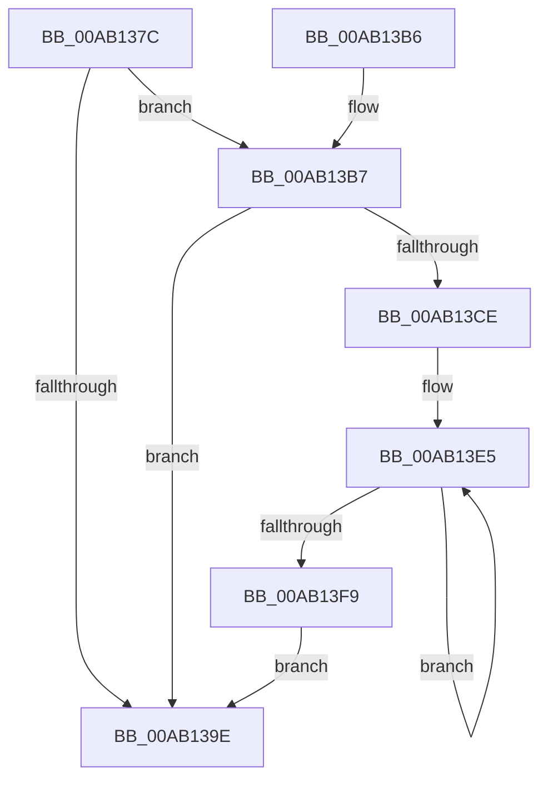

# PpmEventTraceAccountingBucketIntervalsRundown

- RVA: `0x00AB137C`–`0x00AB144D` (길이 `209` bytes)
- VA: `0x0000000140AB137C`
- 실행 섹션: `PAGE`
- PDB 이름 있음: `예`; PDB Function 태그: `아니요`
- unwind 정보 RVA: `0x000BC764`
- 디코드: `42`개 명령, `209/209` bytes 표시
- 미해석 바이트: `0` (있으면 어셈블리에 `.byte`로 보존)

> 이 문서는 커널 이미지의 기계어와 PDB 기호를 분석해 생성했습니다. 4번과 5번은 함수 원형과 자료형을 바이너리 사용 방식에서 추정한 C 해석이며 원본 소스 복구 결과는 아닙니다.

## 1. Dependencies

- 직접 호출 지점: **3**; 고유 호출 대상: **3**
- 직접 호출자로 확인된 함수: **1**
- RIP 상대 이미지 참조: **5**

### Outgoing calls
- `0x00AB13A9` → [_security_check_cookie](../../text/6A/_security_check_cookie_function_006AC640.md) (function, `0x006AC640`)
- `0x00AB13C5` → [EtwEventEnabled](../../text/39/EtwEventEnabled_function_00392450.md) (function, `0x00392450`)
- `0x00AB1443` → [EtwWrite](../../text/41/EtwWrite_function_0041C720.md) (function, `0x0041C720`)

### Direct callers
- [PpmEventTraceControlCallback](../A5/PpmEventTraceControlCallback_function_00A51F60.md) at `0x00A522B4`

### Static image references
- `0x00AB1383` → RVA `0x00E0A740` (`.data`; read)
- `0x00AB1395` → RVA `0x00E67A39` (`.data`; read)
- `0x00AB13B7` → RVA `0x00F083E8` (`.data`; read)
- `0x00AB13BE` → RVA `0x0001E1C8` (`.rdata`; read)
- `0x00AB13DE` → RVA `0x00FC5738` (`ALMOSTRO`; read)

## 2. Other-region calls and transfers

- 다른 실행 섹션으로 향하는 call: **3**
  - `0x00AB13A9` → [_security_check_cookie](../../text/6A/_security_check_cookie_function_006AC640.md) (`PAGE` → `.text`)
  - `0x00AB13C5` → [EtwEventEnabled](../../text/39/EtwEventEnabled_function_00392450.md) (`PAGE` → `.text`)
  - `0x00AB1443` → [EtwWrite](../../text/41/EtwWrite_function_0041C720.md) (`PAGE` → `.text`)
- 별도 외부 분기/꼬리 이동을 확인하지 못했습니다.

## 3. Assembly (complete function range)

```asm
00AB137C  48 81 EC 48 01 00 00            sub rsp, 0x148
00AB1383  48 8B 05 B6 93 35 00            mov rax, qword ptr [rip + 0x3593b6]
00AB138A  48 33 C4                        xor rax, rsp
00AB138D  48 89 84 24 30 01 00 00         mov qword ptr [rsp + 0x130], rax
00AB1395  80 3D 9D 66 3B 00 00            cmp byte ptr [rip + 0x3b669d], 0
00AB139C  75 19                           jne 0x140ab13b7
00AB139E  48 8B 8C 24 30 01 00 00         mov rcx, qword ptr [rsp + 0x130]
00AB13A6  48 33 CC                        xor rcx, rsp
00AB13A9  E8 92 B2 BF FF                  call 0x1406ac640
00AB13AE  48 81 C4 48 01 00 00            add rsp, 0x148
00AB13B5  C3                              ret
00AB13B6  CC                              int3
00AB13B7  48 8B 0D 2A 70 45 00            mov rcx, qword ptr [rip + 0x45702a]
00AB13BE  48 8D 15 03 CE 56 FF            lea rdx, [rip - 0xa931fd]
00AB13C5  E8 86 10 8E FF                  call 0x140392450
00AB13CA  84 C0                           test al, al
00AB13CC  74 D0                           je 0x140ab139e
00AB13CE  41 B8 1A 00 00 00               mov r8d, 0x1a
00AB13D4  48 8D 4C 24 60                  lea rcx, [rsp + 0x60]
00AB13D9  44 89 44 24 30                  mov dword ptr [rsp + 0x30], r8d
00AB13DE  48 8D 15 53 43 51 00            lea rdx, [rip + 0x514353]
00AB13E5  48 8B 02                        mov rax, qword ptr [rdx]
00AB13E8  48 8D 52 18                     lea rdx, [rdx + 0x18]
00AB13EC  48 89 01                        mov qword ptr [rcx], rax
00AB13EF  48 8D 49 08                     lea rcx, [rcx + 8]
00AB13F3  49 83 E8 01                     sub r8, 1
00AB13F7  75 EC                           jne 0x140ab13e5
00AB13F9  44 21 44 24 44                  and dword ptr [rsp + 0x44], r8d
00AB13FE  48 8D 44 24 30                  lea rax, [rsp + 0x30]
00AB1403  44 21 44 24 54                  and dword ptr [rsp + 0x54], r8d
00AB1408  45 8D 48 02                     lea r9d, [r8 + 2]
00AB140C  48 8B 0D D5 6F 45 00            mov rcx, qword ptr [rip + 0x456fd5]
00AB1413  48 8D 15 AE CD 56 FF            lea rdx, [rip - 0xa93252]
00AB141A  48 89 44 24 38                  mov qword ptr [rsp + 0x38], rax
00AB141F  48 8D 44 24 60                  lea rax, [rsp + 0x60]
00AB1424  48 89 44 24 48                  mov qword ptr [rsp + 0x48], rax
00AB1429  48 8D 44 24 38                  lea rax, [rsp + 0x38]
00AB142E  48 89 44 24 20                  mov qword ptr [rsp + 0x20], rax
00AB1433  C7 44 24 40 04 00 00 00         mov dword ptr [rsp + 0x40], 4
00AB143B  C7 44 24 50 D0 00 00 00         mov dword ptr [rsp + 0x50], 0xd0
00AB1443  E8 D8 B2 96 FF                  call 0x14041c720
00AB1448  E9 51 FF FF FF                  jmp 0x140ab139e
```

## 4. C-style interpretation (structured pseudocode)

```c
__int64 __fastcall PpmEventTraceAccountingBucketIntervalsRundown(void)
{
    __int64 result;
    __int64 v_rsp;
    unsigned __int64 v_stack_m18;
    unsigned __int64 v_stack_p20;
    unsigned int v_stack_p30;
    unsigned __int64 v_stack_p38;
    unsigned int v_stack_p40;
    unsigned int v_stack_p44;
    unsigned __int64 v_stack_p48;
    unsigned int v_stack_p50;
    unsigned int v_stack_p54;
    unsigned __int64 v_stack_p60;

    v_rsp = (v_rsp) - (328);
    result = (*(unsigned __int64 *)(v_rip + 3511222)) ^ (v_rsp);
    v_stack_m18 = result;
    if ((*(unsigned __int8 *)(v_rip + 3892893)) != 0) goto loc_00AB13B7;
loc_00AB139E:
    a1 = (v_stack_m18) ^ (v_rsp);
    result = _security_check_cookie(a1, a2, a3, a4);
    v_rsp = (v_rsp) + (328);
    return result;
loc_00AB13B7:
    result = EtwEventEnabled(*(unsigned __int64 *)(v_rip + 4550698), v_rip - 11088381, a3, a4);
    if ((unsigned __int8)(result) == 0) goto loc_00AB139E;
    v_stack_p30 = 26;
loc_00AB13E5:
    *(unsigned __int64 *)(v_stack_p60) = *(unsigned __int64 *)(v_rip + 5325651);
    a3 = (26) - (1);
    if (condition_is_not_equal) goto loc_00AB13E5;
    v_stack_p38 = v_stack_p30;
    v_stack_p48 = v_stack_p60;
    v_stack_p20 = v_stack_p38;
    v_stack_p40 = 4;
    v_stack_p50 = 208;
    result = EtwWrite(*(unsigned __int64 *)(v_rip + 4550613), v_rip - 11088466, a3, a3 + 2);
    goto loc_00AB139E;
}
```

## 5. (Beta) C Style

```c
void PpmEventTraceAccountingBucketIntervalsRundown(void)
{
    int64_t result;
    int64_t local_rsp;
    uint64_t v_stack_m18;
    uint64_t v_stack_p20;
    uint32_t v_stack_p30;
    uint64_t v_stack_p38;
    uint32_t v_stack_p40;
    uint32_t v_stack_p44;
    uint64_t v_stack_p48;
    uint32_t v_stack_p50;
    uint32_t v_stack_p54;
    uint64_t v_stack_p60;

    local_rsp = (local_rsp) - (328);
    result = (*(uint64_t *)(v_rip + 0x3593B6)) ^ (local_rsp);
    v_stack_m18 = result;
    if ((*(uint8_t *)(v_rip + 0x3B669D)) != 0) goto loc_00AB13B7;
loc_00AB139E:
    a1 = (v_stack_m18) ^ (local_rsp);
    result = _security_check_cookie(a1, a2, a3, a4);
    local_rsp = (local_rsp) + (328);
    return result;
loc_00AB13B7:
    result = EtwEventEnabled(*(uint64_t *)(v_rip + 0x45702A), v_rip - 11088381, a3, a4);
    if ((uint8_t)(result) == 0) goto loc_00AB139E;
    v_stack_p30 = 26;
loc_00AB13E5:
    *(uint64_t *)(v_stack_p60) = *(uint64_t *)(v_rip + 0x514353);
    a3 = (26) - (1);
    if (condition_is_not_equal) goto loc_00AB13E5;
    v_stack_p38 = v_stack_p30;
    v_stack_p48 = v_stack_p60;
    v_stack_p20 = v_stack_p38;
    v_stack_p40 = 4;
    v_stack_p50 = 208;
    result = EtwWrite(*(uint64_t *)(v_rip + 0x456FD5), v_rip - 11088466, a3, a3 + 2);
    goto loc_00AB139E;
}
```

## 6. Execution-region graph

[열기: 2D/3D 그래프와 함수 탐색 컨트롤 패널](../../../control-panel.html?section=page&rva=0x00AB137C&view=graph)

- 2D 그래프는 위에서 아래로 흐르고, 3D 그래프는 빈 공간을 드래그해 회전합니다. Shift+드래그는 이동, 휠은 확대·축소, 함수 노드 선택은 대상 보고서 이동입니다.

### Static fallback


