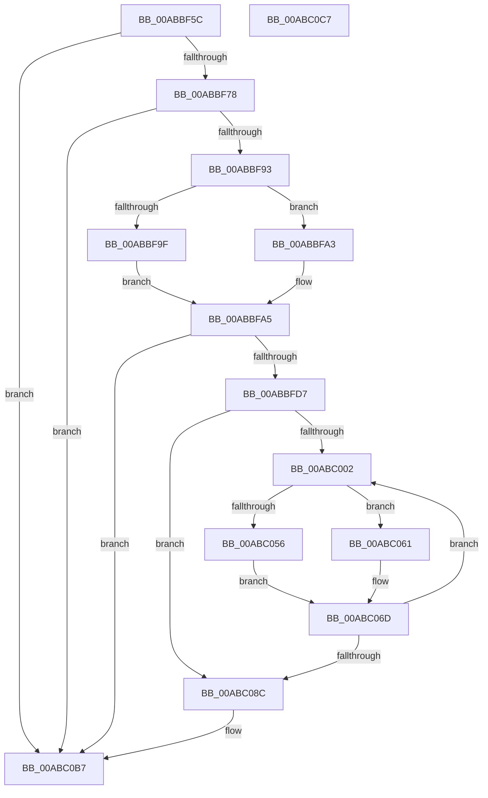

# PpmEventTraceCoordinatedIdleStates

- RVA: `0x00ABBF5C`–`0x00ABC0C8` (길이 `364` bytes)
- VA: `0x0000000140ABBF5C`
- 실행 섹션: `PAGE`
- PDB 이름 있음: `예`; PDB Function 태그: `아니요`
- unwind 정보 RVA: `0x000717F8`
- 디코드: `85`개 명령, `364/364` bytes 표시
- 미해석 바이트: `0` (있으면 어셈블리에 `.byte`로 보존)

> 이 문서는 커널 이미지의 기계어와 PDB 기호를 분석해 생성했습니다. 4번과 5번은 함수 원형과 자료형을 바이너리 사용 방식에서 추정한 C 해석이며 원본 소스 복구 결과는 아닙니다.

## 1. Dependencies

- 직접 호출 지점: **4**; 고유 호출 대상: **4**
- 직접 호출자로 확인된 함수: **1**
- RIP 상대 이미지 참조: **5**

### Outgoing calls
- `0x00ABBF86` → [EtwEventEnabled](../../text/39/EtwEventEnabled_function_00392450.md) (function, `0x00392450`)
- `0x00ABBFC6` → [ExAllocatePool2](../../poolcode/B8/ExAllocatePool2_function_00B820F0.md) (function, `0x00B820F0`)
- `0x00ABC0A5` → [EtwWrite](../../text/41/EtwWrite_function_0041C720.md) (function, `0x0041C720`)
- `0x00ABC0B2` → [ExFreePoolWithTag](../../poolcode/B8/ExFreePoolWithTag_function_00B82870.md) (function, `0x00B82870`)

### Direct callers
- [PpmEventTraceControlCallback](../A5/PpmEventTraceControlCallback_function_00A51F60.md) at `0x00A522C1`

### Static image references
- `0x00ABBF6B` → RVA `0x00E67A39` (`.data`; read)
- `0x00ABBF78` → RVA `0x00F083E8` (`.data`; read)
- `0x00ABBF7F` → RVA `0x0001E308` (`.rdata`; read)
- `0x00ABBF93` → RVA `0x00FC6AD0` (`ALMOSTRO`; read)
- `0x00ABC066` → RVA `0x00B02F00` (` ?? ::NNGAKEGL::`string'`; read)

## 2. Other-region calls and transfers

- 다른 실행 섹션으로 향하는 call: **4**
  - `0x00ABBF86` → [EtwEventEnabled](../../text/39/EtwEventEnabled_function_00392450.md) (`PAGE` → `.text`)
  - `0x00ABBFC6` → [ExAllocatePool2](../../poolcode/B8/ExAllocatePool2_function_00B820F0.md) (`PAGE` → `POOLCODE`)
  - `0x00ABC0A5` → [EtwWrite](../../text/41/EtwWrite_function_0041C720.md) (`PAGE` → `.text`)
  - `0x00ABC0B2` → [ExFreePoolWithTag](../../poolcode/B8/ExFreePoolWithTag_function_00B82870.md) (`PAGE` → `POOLCODE`)
- 별도 외부 분기/꼬리 이동을 확인하지 못했습니다.

## 3. Assembly (complete function range)

```asm
00ABBF5C  48 89 5C 24 10                  mov qword ptr [rsp + 0x10], rbx
00ABBF61  48 89 74 24 18                  mov qword ptr [rsp + 0x18], rsi
00ABBF66  57                              push rdi
00ABBF67  48 83 EC 30                     sub rsp, 0x30
00ABBF6B  80 3D C7 BA 3A 00 00            cmp byte ptr [rip + 0x3abac7], 0
00ABBF72  0F 84 3F 01 00 00               je 0x140abc0b7
00ABBF78  48 8B 0D 69 C4 44 00            mov rcx, qword ptr [rip + 0x44c469]
00ABBF7F  48 8D 15 82 23 56 FF            lea rdx, [rip - 0xa9dc7e]
00ABBF86  E8 C5 64 8D FF                  call 0x140392450
00ABBF8B  84 C0                           test al, al
00ABBF8D  0F 84 24 01 00 00               je 0x140abc0b7
00ABBF93  48 8B 3D 36 AB 50 00            mov rdi, qword ptr [rip + 0x50ab36]
00ABBF9A  48 85 FF                        test rdi, rdi
00ABBF9D  75 04                           jne 0x140abbfa3
00ABBF9F  33 C0                           xor eax, eax
00ABBFA1  EB 02                           jmp 0x140abbfa5
00ABBFA3  8B 07                           mov eax, dword ptr [rdi]
00ABBFA5  8D 0C 40                        lea ecx, [rax + rax*2]
00ABBFA8  89 44 24 40                     mov dword ptr [rsp + 0x40], eax
00ABBFAC  8D 34 45 01 00 00 00            lea esi, [rax*2 + 1]
00ABBFB3  41 B8 50 50 4D 65               mov r8d, 0x654d5050
00ABBFB9  8B C6                           mov eax, esi
00ABBFBB  C1 E0 04                        shl eax, 4
00ABBFBE  8D 14 88                        lea edx, [rax + rcx*4]
00ABBFC1  B9 00 01 00 00                  mov ecx, 0x100
00ABBFC6  E8 25 61 0C 00                  call 0x140b820f0
00ABBFCB  48 8B D8                        mov rbx, rax
00ABBFCE  48 85 C0                        test rax, rax
00ABBFD1  0F 84 E0 00 00 00               je 0x140abc0b7
00ABBFD7  83 63 0C 00                     and dword ptr [rbx + 0xc], 0
00ABBFDB  45 33 C9                        xor r9d, r9d
00ABBFDE  44 8B C6                        mov r8d, esi
00ABBFE1  49 C1 E0 04                     shl r8, 4
00ABBFE5  4C 03 C0                        add r8, rax
00ABBFE8  C7 43 08 04 00 00 00            mov dword ptr [rbx + 8], 4
00ABBFEF  48 8D 44 24 40                  lea rax, [rsp + 0x40]
00ABBFF4  48 89 03                        mov qword ptr [rbx], rax
00ABBFF7  44 39 4C 24 40                  cmp dword ptr [rsp + 0x40], r9d
00ABBFFC  0F 86 8A 00 00 00               jbe 0x140abc08c
00ABC002  41 8B C1                        mov eax, r9d
00ABC005  43 8D 14 09                     lea edx, [r9 + r9]
00ABC009  4C 69 D8 C0 01 00 00            imul r11, rax, 0x1c0
00ABC010  8D 4A 01                        lea ecx, [rdx + 1]
00ABC013  48 C1 E1 04                     shl rcx, 4
00ABC017  48 03 CB                        add rcx, rbx
00ABC01A  41 8B 44 3B 48                  mov eax, dword ptr [r11 + rdi + 0x48]
00ABC01F  41 89 00                        mov dword ptr [r8], eax
00ABC022  41 8B 44 3B 4C                  mov eax, dword ptr [r11 + rdi + 0x4c]
00ABC027  41 89 40 04                     mov dword ptr [r8 + 4], eax
00ABC02B  41 0F B6 44 3B 79               movzx eax, byte ptr [r11 + rdi + 0x79]
00ABC031  41 89 40 08                     mov dword ptr [r8 + 8], eax
00ABC035  83 61 0C 00                     and dword ptr [rcx + 0xc], 0
00ABC039  4C 89 01                        mov qword ptr [rcx], r8
00ABC03C  C7 41 08 0C 00 00 00            mov dword ptr [rcx + 8], 0xc
00ABC043  8D 4A 02                        lea ecx, [rdx + 2]
00ABC046  4D 8B 94 3B 90 01 00 00         mov r10, qword ptr [r11 + rdi + 0x190]
00ABC04E  48 03 C9                        add rcx, rcx
00ABC051  4D 85 D2                        test r10, r10
00ABC054  74 0B                           je 0x140abc061
00ABC056  41 0F B7 84 3B 8A 01 00 00      movzx eax, word ptr [r11 + rdi + 0x18a]
00ABC05F  EB 0C                           jmp 0x140abc06d
00ABC061  B8 1C 00 00 00                  mov eax, 0x1c
00ABC066  4C 8D 15 93 6E 04 00            lea r10, [rip + 0x46e93]
00ABC06D  4C 89 14 CB                     mov qword ptr [rbx + rcx*8], r10
00ABC071  49 83 C0 0C                     add r8, 0xc
00ABC075  89 44 CB 08                     mov dword ptr [rbx + rcx*8 + 8], eax
00ABC079  41 FF C1                        inc r9d
00ABC07C  83 64 CB 0C 00                  and dword ptr [rbx + rcx*8 + 0xc], 0
00ABC081  44 3B 4C 24 40                  cmp r9d, dword ptr [rsp + 0x40]
00ABC086  0F 82 76 FF FF FF               jb 0x140abc002
00ABC08C  48 8B 0D 55 C3 44 00            mov rcx, qword ptr [rip + 0x44c355]
00ABC093  48 8D 15 6E 22 56 FF            lea rdx, [rip - 0xa9dd92]
00ABC09A  44 8B CE                        mov r9d, esi
00ABC09D  48 89 5C 24 20                  mov qword ptr [rsp + 0x20], rbx
00ABC0A2  45 33 C0                        xor r8d, r8d
00ABC0A5  E8 76 06 96 FF                  call 0x14041c720
00ABC0AA  BA 50 50 4D 65                  mov edx, 0x654d5050
00ABC0AF  48 8B CB                        mov rcx, rbx
00ABC0B2  E8 B9 67 0C 00                  call 0x140b82870
00ABC0B7  48 8B 5C 24 48                  mov rbx, qword ptr [rsp + 0x48]
00ABC0BC  48 8B 74 24 50                  mov rsi, qword ptr [rsp + 0x50]
00ABC0C1  48 83 C4 30                     add rsp, 0x30
00ABC0C5  5F                              pop rdi
00ABC0C6  C3                              ret
00ABC0C7  CC                              int3
```

## 4. C-style interpretation (structured pseudocode)

```c
__int64 __fastcall PpmEventTraceCoordinatedIdleStates(__int64 a1, __int64 a2, __int64 a3, int a4)
{
    __int64 result;
    __int64 v_r11;
    __int64 v_rsp;
    unsigned __int64 v_stack_m18;
    unsigned __int64 v_stack_p10;
    unsigned __int64 v_stack_p18;
    unsigned int v_stack_p8;

    v_stack_p10 = v_rbx;
    v_stack_p18 = v_rsi;
    v_rsp = (v_rsp) - (48);
    if ((*(unsigned __int8 *)(v_rip + 3848903)) == 0) goto loc_00ABC0B7;
    result = EtwEventEnabled(*(unsigned __int64 *)(v_rip + 4506729), v_rip - 11132030, a3, a4);
    if ((unsigned __int8)(result) == 0) goto loc_00ABC0B7;
    if (*(unsigned __int64 *)(v_rip + 5286710) != 0) goto loc_00ABBFA3;
    result = 0;
    goto loc_00ABBFA5;
loc_00ABBFA3:
loc_00ABBFA5:
    v_stack_p8 = (unsigned int)((unsigned int)(*(unsigned int *)(*(unsigned __int64 *)(v_rip + 5286710))));
    result = (unsigned int)(((unsigned int)((unsigned int)((unsigned int)(*(unsigned int *)(*(unsigned __int64 *)(v_rip + 5286710))) * 2 + 1))) << (4));
    result = ExAllocatePool2(256, result + (unsigned int)(*(unsigned int *)(*(unsigned __int64 *)(v_rip + 5286710))) + (unsigned int)(*(unsigned int *)(*(unsigned __int64 *)(v_rip + 5286710))) * 2 * 4, (unsigned int)(0x654D5050ULL), a4);
    if (result == 0) goto loc_00ABC0B7;
    a4 = 0;
    a3 = ((unsigned int)((unsigned int)((unsigned int)(*(unsigned int *)(*(unsigned __int64 *)(v_rip + 5286710))) * 2 + 1))) << (4);
    a3 = (a3) + (result);
    *(unsigned int *)(result + 8) = 4;
    *(unsigned __int64 *)(result) = v_stack_p8;
    if (v_stack_p8 <= 0) goto loc_00ABC08C;
loc_00ABC002:
    v_r11 = (v_r11) * (0);
    a1 = (a4 + a4 * 1 + 1) << (4);
    a1 = (a1) + (result);
    *(unsigned int *)(a3) = (unsigned int)((unsigned int)(*(unsigned int *)(v_r11 + *(unsigned __int64 *)(v_rip + 5286710) * 1 + 72)));
    *(unsigned int *)(a3 + 4) = (unsigned int)((unsigned int)(*(unsigned int *)(v_r11 + *(unsigned __int64 *)(v_rip + 5286710) * 1 + 76)));
    *(unsigned int *)(a3 + 8) = (unsigned int)(*(unsigned __int8 *)(v_r11 + *(unsigned __int64 *)(v_rip + 5286710) * 1 + 121));
    *(unsigned __int64 *)(a1) = a3;
    *(unsigned int *)(a1 + 8) = 12;
    a1 = (a4 + a4 * 1 + 2) + (a4 + a4 * 1 + 2);
    if (*(unsigned __int64 *)(v_r11 + *(unsigned __int64 *)(v_rip + 5286710) * 1 + 400) == 0) goto loc_00ABC061;
    goto loc_00ABC06D;
loc_00ABC061:
loc_00ABC06D:
    *(unsigned __int64 *)(result + a1 * 8) = v_rip + 290451;
    a3 = (a3) + (12);
    *(unsigned int *)(result + a1 * 8 + 8) = 28;
    a4 = (unsigned int)((a4) + 1);
    if (a4 < v_stack_p8) goto loc_00ABC002;
loc_00ABC08C:
    v_stack_m18 = result;
    a3 = 0;
    result = EtwWrite(*(unsigned __int64 *)(v_rip + 4506453), v_rip - 11132306, a3, (unsigned int)((unsigned int)((unsigned int)(*(unsigned int *)(*(unsigned __int64 *)(v_rip + 5286710))) * 2 + 1)));
    result = ExFreePoolWithTag(result, (unsigned int)(0x654D5050ULL), a3, (unsigned int)((unsigned int)((unsigned int)(*(unsigned int *)(*(unsigned __int64 *)(v_rip + 5286710))) * 2 + 1)));
loc_00ABC0B7:
    v_rsp = (v_rsp) + (48);
    return result;
}
```

## 5. (Beta) C Style

```c
int64_t PpmEventTraceCoordinatedIdleStates(int64_t Arg1, int64_t Arg2, int64_t Arg3, int32_t Arg4)
{
    int64_t result;
    int64_t local_r11;
    int64_t local_rsp;
    uint64_t v_stack_m18;
    uint64_t v_stack_p10;
    uint64_t v_stack_p18;
    uint32_t v_stack_p8;

    v_stack_p10 = local_rbx;
    v_stack_p18 = local_rsi;
    local_rsp = (local_rsp) - (48);
    if ((*(uint8_t *)(v_rip + 0x3ABAC7)) == 0) goto loc_00ABC0B7;
    result = EtwEventEnabled(*(uint64_t *)(v_rip + 0x44C469), v_rip - 11132030, Arg3, Arg4);
    if ((uint8_t)(result) == 0) goto loc_00ABC0B7;
    if (*(uint64_t *)(v_rip + 0x50AB36) != 0) goto loc_00ABBFA3;
    result = 0;
    goto loc_00ABBFA5;
loc_00ABBFA3:
loc_00ABBFA5:
    v_stack_p8 = (uint32_t)((uint32_t)(*(uint32_t *)(*(uint64_t *)(v_rip + 0x50AB36))));
    result = (uint32_t)(((uint32_t)((uint32_t)((uint32_t)(*(uint32_t *)(*(uint64_t *)(v_rip + 0x50AB36))) * 2 + 1))) << (4));
    result = ExAllocatePool2(256, result + (uint32_t)(*(uint32_t *)(*(uint64_t *)(v_rip + 0x50AB36))) + (uint32_t)(*(uint32_t *)(*(uint64_t *)(v_rip + 0x50AB36))) * 2 * 4, (uint32_t)(0x654D5050ULL), Arg4);
    if (result == 0) goto loc_00ABC0B7;
    Arg4 = 0;
    Arg3 = ((uint32_t)((uint32_t)((uint32_t)(*(uint32_t *)(*(uint64_t *)(v_rip + 0x50AB36))) * 2 + 1))) << (4);
    Arg3 = (Arg3) + (result);
    *(uint32_t *)(result + 0x8) = 4;
    *(uint64_t *)(result) = v_stack_p8;
    if (v_stack_p8 <= 0) goto loc_00ABC08C;
loc_00ABC002:
    local_r11 = (local_r11) * (0);
    Arg1 = (Arg4 + Arg4 * 1 + 1) << (4);
    Arg1 = (Arg1) + (result);
    *(uint32_t *)(Arg3) = (uint32_t)((uint32_t)(*(uint32_t *)(local_r11 + *(uint64_t *)(v_rip + 0x50AB36) * 1 + 0x48)));
    *(uint32_t *)(Arg3 + 0x4) = (uint32_t)((uint32_t)(*(uint32_t *)(local_r11 + *(uint64_t *)(v_rip + 0x50AB36) * 1 + 0x4C)));
    *(uint32_t *)(Arg3 + 0x8) = (uint32_t)(*(uint8_t *)(local_r11 + *(uint64_t *)(v_rip + 0x50AB36) * 1 + 0x79));
    *(uint64_t *)(Arg1) = Arg3;
    *(uint32_t *)(Arg1 + 0x8) = 12;
    Arg1 = (Arg4 + Arg4 * 1 + 2) + (Arg4 + Arg4 * 1 + 2);
    if (*(uint64_t *)(local_r11 + *(uint64_t *)(v_rip + 0x50AB36) * 1 + 0x190) == 0) goto loc_00ABC061;
    goto loc_00ABC06D;
loc_00ABC061:
loc_00ABC06D:
    *(uint64_t *)(result + Arg1 * 8) = v_rip + 290451;
    Arg3 = (Arg3) + (12);
    *(uint32_t *)(result + Arg1 * 8 + 0x8) = 28;
    Arg4 = (uint32_t)((Arg4) + 1);
    if (Arg4 < v_stack_p8) goto loc_00ABC002;
loc_00ABC08C:
    v_stack_m18 = result;
    Arg3 = 0;
    result = EtwWrite(*(uint64_t *)(v_rip + 0x44C355), v_rip - 11132306, Arg3, (uint32_t)((uint32_t)((uint32_t)(*(uint32_t *)(*(uint64_t *)(v_rip + 0x50AB36))) * 2 + 1)));
    result = ExFreePoolWithTag(result, (uint32_t)(0x654D5050ULL), Arg3, (uint32_t)((uint32_t)((uint32_t)(*(uint32_t *)(*(uint64_t *)(v_rip + 0x50AB36))) * 2 + 1)));
loc_00ABC0B7:
    local_rsp = (local_rsp) + (48);
    return result;
}
```

## 6. Execution-region graph

[열기: 2D/3D 그래프와 함수 탐색 컨트롤 패널](../../../control-panel.html?section=page&rva=0x00ABBF5C&view=graph)

- 2D 그래프는 위에서 아래로 흐르고, 3D 그래프는 빈 공간을 드래그해 회전합니다. Shift+드래그는 이동, 휠은 확대·축소, 함수 노드 선택은 대상 보고서 이동입니다.

### Static fallback


