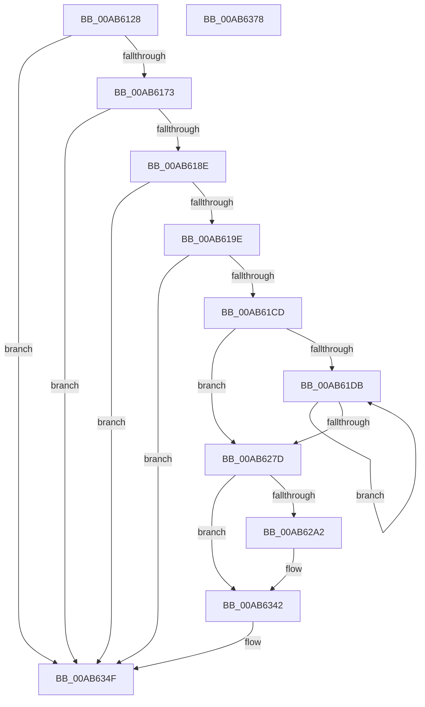

# PpmEventTracePlatformIdleAccounting

- RVA: `0x00AB6128`–`0x00AB6379` (길이 `593` bytes)
- VA: `0x0000000140AB6128`
- 실행 섹션: `PAGE`
- PDB 이름 있음: `예`; PDB Function 태그: `아니요`
- unwind 정보 RVA: `0x000BCDF4`
- 디코드: `132`개 명령, `593/593` bytes 표시
- 미해석 바이트: `0` (있으면 어셈블리에 `.byte`로 보존)

> 이 문서는 커널 이미지의 기계어와 PDB 기호를 분석해 생성했습니다. 4번과 5번은 함수 원형과 자료형을 바이너리 사용 방식에서 추정한 C 해석이며 원본 소스 복구 결과는 아닙니다.

## 1. Dependencies

- 직접 호출 지점: **8**; 고유 호출 대상: **6**
- 직접 호출자로 확인된 함수: **1**
- RIP 상대 이미지 참조: **5**

### Outgoing calls
- `0x00AB6181` → [EtwEventEnabled](../../text/39/EtwEventEnabled_function_00392450.md) (function, `0x00392450`)
- `0x00AB61BC` → [ExAllocatePool2](../../poolcode/B8/ExAllocatePool2_function_00B820F0.md) (function, `0x00B820F0`)
- `0x00AB6291` → [ExAllocatePool2](../../poolcode/B8/ExAllocatePool2_function_00B820F0.md) (function, `0x00B820F0`)
- `0x00AB62A8` → [PpmTranslatePlatformIdleAccounting](../../text/43/PpmTranslatePlatformIdleAccounting_function_0043AFD8.md) (function, `0x0043AFD8`)
- `0x00AB6330` → [EtwWrite](../../text/41/EtwWrite_function_0041C720.md) (function, `0x0041C720`)
- `0x00AB633D` → [ExFreePoolWithTag](../../poolcode/B8/ExFreePoolWithTag_function_00B82870.md) (function, `0x00B82870`)
- `0x00AB634A` → [ExFreePoolWithTag](../../poolcode/B8/ExFreePoolWithTag_function_00B82870.md) (function, `0x00B82870`)
- `0x00AB6356` → [_security_check_cookie](../../text/6A/_security_check_cookie_function_006AC640.md) (function, `0x006AC640`)

### Direct callers
- [PpmEventTraceControlCallback](../A5/PpmEventTraceControlCallback_function_00A51F60.md) at `0x00A522C6`

### Static image references
- `0x00AB6147` → RVA `0x00E0A740` (`.data`; read)
- `0x00AB6155` → RVA `0x00E67A39` (`.data`; read)
- `0x00AB6173` → RVA `0x00F083E8` (`.data`; read)
- `0x00AB617A` → RVA `0x0001E248` (`.rdata`; read)
- `0x00AB618E` → RVA `0x00FC6AD0` (`ALMOSTRO`; read)

## 2. Other-region calls and transfers

- 다른 실행 섹션으로 향하는 call: **8**
  - `0x00AB6181` → [EtwEventEnabled](../../text/39/EtwEventEnabled_function_00392450.md) (`PAGE` → `.text`)
  - `0x00AB61BC` → [ExAllocatePool2](../../poolcode/B8/ExAllocatePool2_function_00B820F0.md) (`PAGE` → `POOLCODE`)
  - `0x00AB6291` → [ExAllocatePool2](../../poolcode/B8/ExAllocatePool2_function_00B820F0.md) (`PAGE` → `POOLCODE`)
  - `0x00AB62A8` → [PpmTranslatePlatformIdleAccounting](../../text/43/PpmTranslatePlatformIdleAccounting_function_0043AFD8.md) (`PAGE` → `.text`)
  - `0x00AB6330` → [EtwWrite](../../text/41/EtwWrite_function_0041C720.md) (`PAGE` → `.text`)
  - `0x00AB633D` → [ExFreePoolWithTag](../../poolcode/B8/ExFreePoolWithTag_function_00B82870.md) (`PAGE` → `POOLCODE`)
  - `0x00AB634A` → [ExFreePoolWithTag](../../poolcode/B8/ExFreePoolWithTag_function_00B82870.md) (`PAGE` → `POOLCODE`)
  - `0x00AB6356` → [_security_check_cookie](../../text/6A/_security_check_cookie_function_006AC640.md) (`PAGE` → `.text`)
- 별도 외부 분기/꼬리 이동을 확인하지 못했습니다.

## 3. Assembly (complete function range)

```asm
00AB6128  48 8B C4                        mov rax, rsp
00AB612B  48 89 58 08                     mov qword ptr [rax + 8], rbx
00AB612F  48 89 70 10                     mov qword ptr [rax + 0x10], rsi
00AB6133  48 89 78 18                     mov qword ptr [rax + 0x18], rdi
00AB6137  55                              push rbp
00AB6138  41 56                           push r14
00AB613A  41 57                           push r15
00AB613C  48 8D 68 A1                     lea rbp, [rax - 0x5f]
00AB6140  48 81 EC B0 00 00 00            sub rsp, 0xb0
00AB6147  48 8B 05 F2 45 35 00            mov rax, qword ptr [rip + 0x3545f2]
00AB614E  48 33 C4                        xor rax, rsp
00AB6151  48 89 45 37                     mov qword ptr [rbp + 0x37], rax
00AB6155  80 3D DD 18 3B 00 00            cmp byte ptr [rip + 0x3b18dd], 0
00AB615C  B8 20 00 00 00                  mov eax, 0x20
00AB6161  66 89 45 CB                     mov word ptr [rbp - 0x35], ax
00AB6165  44 8D 78 20                     lea r15d, [rax + 0x20]
00AB6169  44 88 7D C7                     mov byte ptr [rbp - 0x39], r15b
00AB616D  0F 84 DC 01 00 00               je 0x140ab634f
00AB6173  48 8B 0D 6E 22 45 00            mov rcx, qword ptr [rip + 0x45226e]
00AB617A  48 8D 15 C7 80 56 FF            lea rdx, [rip - 0xa97f39]
00AB6181  E8 CA C2 8D FF                  call 0x140392450
00AB6186  84 C0                           test al, al
00AB6188  0F 84 C1 01 00 00               je 0x140ab634f
00AB618E  48 8B 3D 3B 09 51 00            mov rdi, qword ptr [rip + 0x51093b]
00AB6195  48 85 FF                        test rdi, rdi
00AB6198  0F 84 B1 01 00 00               je 0x140ab634f
00AB619E  48 8B 7F 30                     mov rdi, qword ptr [rdi + 0x30]
00AB61A2  41 B8 50 50 4D 65               mov r8d, 0x654d5050
00AB61A8  41 8B CF                        mov ecx, r15d
00AB61AB  8B 47 04                        mov eax, dword ptr [rdi + 4]
00AB61AE  89 45 CF                        mov dword ptr [rbp - 0x31], eax
00AB61B1  44 8D 34 80                     lea r14d, [rax + rax*4]
00AB61B5  41 C1 E6 04                     shl r14d, 4
00AB61B9  41 8B D6                        mov edx, r14d
00AB61BC  E8 2F BF 0C 00                  call 0x140b820f0
00AB61C1  48 8B D8                        mov rbx, rax
00AB61C4  48 85 C0                        test rax, rax
00AB61C7  0F 84 82 01 00 00               je 0x140ab634f
00AB61CD  8B 45 CF                        mov eax, dword ptr [rbp - 0x31]
00AB61D0  45 33 C9                        xor r9d, r9d
00AB61D3  85 C0                           test eax, eax
00AB61D5  0F 84 A2 00 00 00               je 0x140ab627d
00AB61DB  45 8B C1                        mov r8d, r9d
00AB61DE  4B 8D 14 89                     lea rdx, [r9 + r9*4]
00AB61E2  49 C1 E0 0A                     shl r8, 0xa
00AB61E6  48 03 D2                        add rdx, rdx
00AB61E9  41 FF C1                        inc r9d
00AB61EC  49 8B 84 38 D8 00 00 00         mov rax, qword ptr [r8 + rdi + 0xd8]
00AB61F4  49 03 44 38 78                  add rax, qword ptr [r8 + rdi + 0x78]
00AB61F9  48 89 44 D3 08                  mov qword ptr [rbx + rdx*8 + 8], rax
00AB61FE  49 8B 84 38 D0 00 00 00         mov rax, qword ptr [r8 + rdi + 0xd0]
00AB6206  49 03 84 38 80 00 00 00         add rax, qword ptr [r8 + rdi + 0x80]
00AB620E  48 89 44 D3 10                  mov qword ptr [rbx + rdx*8 + 0x10], rax
00AB6213  49 8B 84 38 90 00 00 00         mov rax, qword ptr [r8 + rdi + 0x90]
00AB621B  48 89 44 D3 18                  mov qword ptr [rbx + rdx*8 + 0x18], rax
00AB6220  49 8B 84 38 88 00 00 00         mov rax, qword ptr [r8 + rdi + 0x88]
00AB6228  48 89 44 D3 20                  mov qword ptr [rbx + rdx*8 + 0x20], rax
00AB622D  49 8B 44 38 68                  mov rax, qword ptr [r8 + rdi + 0x68]
00AB6232  48 89 44 D3 38                  mov qword ptr [rbx + rdx*8 + 0x38], rax
00AB6237  49 8B 44 38 60                  mov rax, qword ptr [r8 + rdi + 0x60]
00AB623C  48 89 44 D3 40                  mov qword ptr [rbx + rdx*8 + 0x40], rax
00AB6241  49 8B 44 38 58                  mov rax, qword ptr [r8 + rdi + 0x58]
00AB6246  48 89 44 D3 48                  mov qword ptr [rbx + rdx*8 + 0x48], rax
00AB624B  49 8B 84 38 A8 00 00 00         mov rax, qword ptr [r8 + rdi + 0xa8]
00AB6253  48 89 04 D3                     mov qword ptr [rbx + rdx*8], rax
00AB6257  49 8B 84 38 B8 00 00 00         mov rax, qword ptr [r8 + rdi + 0xb8]
00AB625F  48 89 44 D3 28                  mov qword ptr [rbx + rdx*8 + 0x28], rax
00AB6264  49 8B 84 38 B0 00 00 00         mov rax, qword ptr [r8 + rdi + 0xb0]
00AB626C  48 89 44 D3 30                  mov qword ptr [rbx + rdx*8 + 0x30], rax
00AB6271  8B 45 CF                        mov eax, dword ptr [rbp - 0x31]
00AB6274  44 3B C8                        cmp r9d, eax
00AB6277  0F 82 5E FF FF FF               jb 0x140ab61db
00AB627D  69 F0 98 02 00 00               imul esi, eax, 0x298
00AB6283  41 B8 50 50 4D 65               mov r8d, 0x654d5050
00AB6289  49 8B CF                        mov rcx, r15
00AB628C  83 C6 20                        add esi, 0x20
00AB628F  8B D6                           mov edx, esi
00AB6291  E8 5A BE 0C 00                  call 0x140b820f0
00AB6296  4C 8B F8                        mov r15, rax
00AB6299  48 85 C0                        test rax, rax
00AB629C  0F 84 A0 00 00 00               je 0x140ab6342
00AB62A2  48 8B D0                        mov rdx, rax
00AB62A5  48 8B CF                        mov rcx, rdi
00AB62A8  E8 2B 4D 98 FF                  call 0x14043afd8
00AB62AD  83 65 E3 00                     and dword ptr [rbp - 0x1d], 0
00AB62B1  48 8D 45 CB                     lea rax, [rbp - 0x35]
00AB62B5  83 65 F3 00                     and dword ptr [rbp - 0xd], 0
00AB62B9  48 8D 15 88 7F 56 FF            lea rdx, [rip - 0xa98078]
00AB62C0  83 65 03 00                     and dword ptr [rbp + 3], 0
00AB62C4  41 B9 06 00 00 00               mov r9d, 6
00AB62CA  83 65 13 00                     and dword ptr [rbp + 0x13], 0
00AB62CE  45 33 C0                        xor r8d, r8d
00AB62D1  83 65 23 00                     and dword ptr [rbp + 0x23], 0
00AB62D5  83 65 33 00                     and dword ptr [rbp + 0x33], 0
00AB62D9  48 8B 0D 08 21 45 00            mov rcx, qword ptr [rip + 0x452108]
00AB62E0  48 89 45 E7                     mov qword ptr [rbp - 0x19], rax
00AB62E4  48 8D 45 C7                     lea rax, [rbp - 0x39]
00AB62E8  48 89 45 F7                     mov qword ptr [rbp - 9], rax
00AB62EC  48 8D 45 CF                     lea rax, [rbp - 0x31]
00AB62F0  48 89 45 07                     mov qword ptr [rbp + 7], rax
00AB62F4  48 8D 47 10                     lea rax, [rdi + 0x10]
00AB62F8  48 89 45 27                     mov qword ptr [rbp + 0x27], rax
00AB62FC  48 8D 45 D7                     lea rax, [rbp - 0x29]
00AB6300  48 89 44 24 20                  mov qword ptr [rsp + 0x20], rax
00AB6305  4C 89 7D D7                     mov qword ptr [rbp - 0x29], r15
00AB6309  89 75 DF                        mov dword ptr [rbp - 0x21], esi
00AB630C  C7 45 EF 02 00 00 00            mov dword ptr [rbp - 0x11], 2
00AB6313  C7 45 FF 01 00 00 00            mov dword ptr [rbp - 1], 1
00AB631A  C7 45 0F 04 00 00 00            mov dword ptr [rbp + 0xf], 4
00AB6321  48 89 5D 17                     mov qword ptr [rbp + 0x17], rbx
00AB6325  44 89 75 1F                     mov dword ptr [rbp + 0x1f], r14d
00AB6329  C7 45 2F 08 00 00 00            mov dword ptr [rbp + 0x2f], 8
00AB6330  E8 EB 63 96 FF                  call 0x14041c720
00AB6335  BA 50 50 4D 65                  mov edx, 0x654d5050
00AB633A  49 8B CF                        mov rcx, r15
00AB633D  E8 2E C5 0C 00                  call 0x140b82870
00AB6342  BA 50 50 4D 65                  mov edx, 0x654d5050
00AB6347  48 8B CB                        mov rcx, rbx
00AB634A  E8 21 C5 0C 00                  call 0x140b82870
00AB634F  48 8B 4D 37                     mov rcx, qword ptr [rbp + 0x37]
00AB6353  48 33 CC                        xor rcx, rsp
00AB6356  E8 E5 62 BF FF                  call 0x1406ac640
00AB635B  4C 8D 9C 24 B0 00 00 00         lea r11, [rsp + 0xb0]
00AB6363  49 8B 5B 20                     mov rbx, qword ptr [r11 + 0x20]
00AB6367  49 8B 73 28                     mov rsi, qword ptr [r11 + 0x28]
00AB636B  49 8B 7B 30                     mov rdi, qword ptr [r11 + 0x30]
00AB636F  49 8B E3                        mov rsp, r11
00AB6372  41 5F                           pop r15
00AB6374  41 5E                           pop r14
00AB6376  5D                              pop rbp
00AB6377  C3                              ret
00AB6378  CC                              int3
```

## 4. C-style interpretation (structured pseudocode)

```c
__int64 __fastcall PpmEventTracePlatformIdleAccounting(__int64 a1, __int64 a2, __int64 a3, int a4)
{
    __int64 result;
    __int64 v_r14;
    __int64 v_rsi;
    __int64 v_rsp;
    unsigned __int64 v_stack_m18;
    unsigned __int64 v_stack_mA8;

    *(unsigned __int64 *)(v_rsp + 8) = v_rbx;
    *(unsigned __int64 *)(v_rsp + 16) = v_rsi;
    *(unsigned __int64 *)(v_rsp + 24) = v_rdi;
    v_rsp = (v_rsp) - (176);
    result = (*(unsigned __int64 *)(v_rip + 3491314)) ^ (v_rsp);
    *(unsigned __int64 *)(v_rsp - 95 + 55) = result;
    *(unsigned __int16 *)(v_rsp - 95 - 53) = 32;
    *(unsigned __int8 *)(v_rsp - 95 - 57) = (unsigned __int8)(32 + 32);
    if ((*(unsigned __int8 *)(v_rip + 3872989)) == 0) goto loc_00AB634F;
    result = EtwEventEnabled(*(unsigned __int64 *)(v_rip + 4530798), v_rip - 11108153, a3, a4);
    if ((unsigned __int8)(result) == 0) goto loc_00AB634F;
    if (*(unsigned __int64 *)(v_rip + 5310779) == 0) goto loc_00AB634F;
    *(unsigned int *)(v_rsp - 95 - 49) = (unsigned int)((unsigned int)(*(unsigned int *)(*(unsigned __int64 *)(*(unsigned __int64 *)(v_rip + 5310779) + 48) + 4)));
    v_r14 = (unsigned int)(((unsigned int)(*(unsigned int *)(*(unsigned __int64 *)(*(unsigned __int64 *)(v_rip + 5310779) + 48) + 4)) + (unsigned int)(*(unsigned int *)(*(unsigned __int64 *)(*(unsigned __int64 *)(v_rip + 5310779) + 48) + 4)) * 4) << (4));
    result = ExAllocatePool2((unsigned int)((unsigned int)(32 + 32)), (unsigned int)((unsigned int)(v_r14)), (unsigned int)(0x654D5050ULL), a4);
    if (result == 0) goto loc_00AB634F;
    a4 = 0;
    if ((unsigned int)((unsigned int)(*(unsigned int *)(v_rsp - 95 - 49))) == 0) goto loc_00AB627D;
loc_00AB61DB:
    a3 = (0) << (10);
    a2 = (a4 + a4 * 4) + (a4 + a4 * 4);
    a4 = (unsigned int)((a4) + 1);
    result = (*(unsigned __int64 *)(a3 + *(unsigned __int64 *)(*(unsigned __int64 *)(v_rip + 5310779) + 48) * 1 + 216)) + (*(unsigned __int64 *)(a3 + *(unsigned __int64 *)(*(unsigned __int64 *)(v_rip + 5310779) + 48) * 1 + 120));
    *(unsigned __int64 *)(result + a2 * 8 + 8) = result;
    result = (*(unsigned __int64 *)(a3 + *(unsigned __int64 *)(*(unsigned __int64 *)(v_rip + 5310779) + 48) * 1 + 208)) + (*(unsigned __int64 *)(a3 + *(unsigned __int64 *)(*(unsigned __int64 *)(v_rip + 5310779) + 48) * 1 + 128));
    *(unsigned __int64 *)(result + a2 * 8 + 16) = result;
    *(unsigned __int64 *)(result + a2 * 8 + 24) = *(unsigned __int64 *)(a3 + *(unsigned __int64 *)(*(unsigned __int64 *)(v_rip + 5310779) + 48) * 1 + 144);
    *(unsigned __int64 *)(result + a2 * 8 + 32) = *(unsigned __int64 *)(a3 + *(unsigned __int64 *)(*(unsigned __int64 *)(v_rip + 5310779) + 48) * 1 + 136);
    *(unsigned __int64 *)(result + a2 * 8 + 56) = *(unsigned __int64 *)(a3 + *(unsigned __int64 *)(*(unsigned __int64 *)(v_rip + 5310779) + 48) * 1 + 104);
    *(unsigned __int64 *)(result + a2 * 8 + 64) = *(unsigned __int64 *)(a3 + *(unsigned __int64 *)(*(unsigned __int64 *)(v_rip + 5310779) + 48) * 1 + 96);
    *(unsigned __int64 *)(result + a2 * 8 + 72) = *(unsigned __int64 *)(a3 + *(unsigned __int64 *)(*(unsigned __int64 *)(v_rip + 5310779) + 48) * 1 + 88);
    *(unsigned __int64 *)(result + a2 * 8) = *(unsigned __int64 *)(a3 + *(unsigned __int64 *)(*(unsigned __int64 *)(v_rip + 5310779) + 48) * 1 + 168);
    *(unsigned __int64 *)(result + a2 * 8 + 40) = *(unsigned __int64 *)(a3 + *(unsigned __int64 *)(*(unsigned __int64 *)(v_rip + 5310779) + 48) * 1 + 184);
    *(unsigned __int64 *)(result + a2 * 8 + 48) = *(unsigned __int64 *)(a3 + *(unsigned __int64 *)(*(unsigned __int64 *)(v_rip + 5310779) + 48) * 1 + 176);
    if (a4 < ((unsigned int)((unsigned int)(*(unsigned int *)(v_rsp - 95 - 49))))) goto loc_00AB61DB;
loc_00AB627D:
    v_rsi = (unsigned int)((v_rsi) * ((unsigned int)((unsigned int)(*(unsigned int *)(v_rsp - 95 - 49)))));
    v_rsi = (unsigned int)((v_rsi) + (32));
    result = ExAllocatePool2(32 + 32, (unsigned int)((unsigned int)(v_rsi)), (unsigned int)(0x654D5050ULL), a4);
    if (result != 0) {
        a2 = result;
        a1 = *(unsigned __int64 *)(*(unsigned __int64 *)(v_rip + 5310779) + 48);
        result = PpmTranslatePlatformIdleAccounting(a1, a2, (unsigned int)(0x654D5050ULL), a4);
        result = v_rsp - 95 - 53;
        a2 = v_rip - 11108472;
        a4 = 6;
        a3 = 0;
        a1 = *(unsigned __int64 *)(v_rip + 4530440);
        *(unsigned __int64 *)(v_rsp - 95 - 25) = result;
        result = v_rsp - 95 - 57;
        *(unsigned __int64 *)(v_rsp - 95 - 9) = result;
        result = v_rsp - 95 - 49;
        *(unsigned __int64 *)(v_rsp - 95 + 7) = result;
        result = *(unsigned __int64 *)(*(unsigned __int64 *)(v_rip + 5310779) + 48) + 16;
        *(unsigned __int64 *)(v_rsp - 95 + 39) = result;
        result = v_rsp - 95 - 41;
        v_stack_mA8 = result;
        *(unsigned __int64 *)(v_rsp - 95 - 41) = result;
        *(unsigned int *)(v_rsp - 95 - 33) = (unsigned int)(v_rsi);
        *(unsigned int *)(v_rsp - 95 - 17) = 2;
        *(unsigned int *)(v_rsp - 95 - 1) = 1;
        *(unsigned int *)(v_rsp - 95 + 15) = 4;
        *(unsigned __int64 *)(v_rsp - 95 + 23) = result;
        *(unsigned int *)(v_rsp - 95 + 31) = (unsigned int)(v_r14);
        *(unsigned int *)(v_rsp - 95 + 47) = 8;
        result = EtwWrite(a1, a2, a3, a4);
        a2 = 0x654D5050ULL;
        a1 = result;
        result = ExFreePoolWithTag(a1, a2, a3, a4);
    }
    result = ExFreePoolWithTag(result, (unsigned int)(0x654D5050ULL), a3, a4);
loc_00AB634F:
    a1 = (*(unsigned __int64 *)(v_rsp - 95 + 55)) ^ (v_rsp);
    result = _security_check_cookie(a1, (unsigned int)(0x654D5050ULL), a3, a4);
    return result;
}
```

## 5. (Beta) C Style

```c
int64_t PpmEventTracePlatformIdleAccounting(int64_t Arg1, int64_t Arg2, int64_t Arg3, int32_t Arg4)
{
    int64_t result;
    int64_t local_r14;
    int64_t local_rsi;
    int64_t local_rsp;
    uint64_t v_stack_m18;
    uint64_t v_stack_mA8;

    *(uint64_t *)(local_rsp + 0x8) = local_rbx;
    *(uint64_t *)(local_rsp + 0x10) = local_rsi;
    *(uint64_t *)(local_rsp + 0x18) = local_rdi;
    local_rsp = (local_rsp) - (176);
    result = (*(uint64_t *)(v_rip + 0x3545F2)) ^ (local_rsp);
    *(uint64_t *)(local_rsp - 0x5F + 0x37) = result;
    *(uint16_t *)(local_rsp - 0x5F - 0x35) = 32;
    *(uint8_t *)(local_rsp - 0x5F - 0x39) = (uint8_t)(32 + 32);
    if ((*(uint8_t *)(v_rip + 0x3B18DD)) == 0) goto loc_00AB634F;
    result = EtwEventEnabled(*(uint64_t *)(v_rip + 0x45226E), v_rip - 11108153, Arg3, Arg4);
    if ((uint8_t)(result) == 0) goto loc_00AB634F;
    if (*(uint64_t *)(v_rip + 0x51093B) == 0) goto loc_00AB634F;
    *(uint32_t *)(local_rsp - 0x5F - 0x31) = (uint32_t)((uint32_t)(*(uint32_t *)(*(uint64_t *)(*(uint64_t *)(v_rip + 0x51093B) + 0x30) + 0x4)));
    local_r14 = (uint32_t)(((uint32_t)(*(uint32_t *)(*(uint64_t *)(*(uint64_t *)(v_rip + 0x51093B) + 0x30) + 0x4)) + (uint32_t)(*(uint32_t *)(*(uint64_t *)(*(uint64_t *)(v_rip + 0x51093B) + 0x30) + 0x4)) * 4) << (4));
    result = ExAllocatePool2((uint32_t)((uint32_t)(32 + 32)), (uint32_t)((uint32_t)(local_r14)), (uint32_t)(0x654D5050ULL), Arg4);
    if (result == 0) goto loc_00AB634F;
    Arg4 = 0;
    if ((uint32_t)((uint32_t)(*(uint32_t *)(local_rsp - 0x5F - 0x31))) == 0) goto loc_00AB627D;
loc_00AB61DB:
    Arg3 = (0) << (10);
    Arg2 = (Arg4 + Arg4 * 4) + (Arg4 + Arg4 * 4);
    Arg4 = (uint32_t)((Arg4) + 1);
    result = (*(uint64_t *)(Arg3 + *(uint64_t *)(*(uint64_t *)(v_rip + 0x51093B) + 0x30) * 1 + 0xD8)) + (*(uint64_t *)(Arg3 + *(uint64_t *)(*(uint64_t *)(v_rip + 0x51093B) + 0x30) * 1 + 0x78));
    *(uint64_t *)(result + Arg2 * 8 + 0x8) = result;
    result = (*(uint64_t *)(Arg3 + *(uint64_t *)(*(uint64_t *)(v_rip + 0x51093B) + 0x30) * 1 + 0xD0)) + (*(uint64_t *)(Arg3 + *(uint64_t *)(*(uint64_t *)(v_rip + 0x51093B) + 0x30) * 1 + 0x80));
    *(uint64_t *)(result + Arg2 * 8 + 0x10) = result;
    *(uint64_t *)(result + Arg2 * 8 + 0x18) = *(uint64_t *)(Arg3 + *(uint64_t *)(*(uint64_t *)(v_rip + 0x51093B) + 0x30) * 1 + 0x90);
    *(uint64_t *)(result + Arg2 * 8 + 0x20) = *(uint64_t *)(Arg3 + *(uint64_t *)(*(uint64_t *)(v_rip + 0x51093B) + 0x30) * 1 + 0x88);
    *(uint64_t *)(result + Arg2 * 8 + 0x38) = *(uint64_t *)(Arg3 + *(uint64_t *)(*(uint64_t *)(v_rip + 0x51093B) + 0x30) * 1 + 0x68);
    *(uint64_t *)(result + Arg2 * 8 + 0x40) = *(uint64_t *)(Arg3 + *(uint64_t *)(*(uint64_t *)(v_rip + 0x51093B) + 0x30) * 1 + 0x60);
    *(uint64_t *)(result + Arg2 * 8 + 0x48) = *(uint64_t *)(Arg3 + *(uint64_t *)(*(uint64_t *)(v_rip + 0x51093B) + 0x30) * 1 + 0x58);
    *(uint64_t *)(result + Arg2 * 8) = *(uint64_t *)(Arg3 + *(uint64_t *)(*(uint64_t *)(v_rip + 0x51093B) + 0x30) * 1 + 0xA8);
    *(uint64_t *)(result + Arg2 * 8 + 0x28) = *(uint64_t *)(Arg3 + *(uint64_t *)(*(uint64_t *)(v_rip + 0x51093B) + 0x30) * 1 + 0xB8);
    *(uint64_t *)(result + Arg2 * 8 + 0x30) = *(uint64_t *)(Arg3 + *(uint64_t *)(*(uint64_t *)(v_rip + 0x51093B) + 0x30) * 1 + 0xB0);
    if (Arg4 < ((uint32_t)((uint32_t)(*(uint32_t *)(local_rsp - 0x5F - 0x31))))) goto loc_00AB61DB;
loc_00AB627D:
    local_rsi = (uint32_t)((local_rsi) * ((uint32_t)((uint32_t)(*(uint32_t *)(local_rsp - 0x5F - 0x31)))));
    local_rsi = (uint32_t)((local_rsi) + (32));
    result = ExAllocatePool2(32 + 32, (uint32_t)((uint32_t)(local_rsi)), (uint32_t)(0x654D5050ULL), Arg4);
    if (result != 0) {
        Arg2 = result;
        Arg1 = *(uint64_t *)(*(uint64_t *)(v_rip + 0x51093B) + 0x30);
        result = PpmTranslatePlatformIdleAccounting(Arg1, Arg2, (uint32_t)(0x654D5050ULL), Arg4);
        result = local_rsp - 95 - 53;
        Arg2 = v_rip - 11108472;
        Arg4 = 6;
        Arg3 = 0;
        Arg1 = *(uint64_t *)(v_rip + 0x452108);
        *(uint64_t *)(local_rsp - 0x5F - 0x19) = result;
        result = local_rsp - 95 - 57;
        *(uint64_t *)(local_rsp - 0x5F - 0x9) = result;
        result = local_rsp - 95 - 49;
        *(uint64_t *)(local_rsp - 0x5F + 0x7) = result;
        result = *(uint64_t *)(*(uint64_t *)(v_rip + 0x51093B) + 0x30) + 16;
        *(uint64_t *)(local_rsp - 0x5F + 0x27) = result;
        result = local_rsp - 95 - 41;
        v_stack_mA8 = result;
        *(uint64_t *)(local_rsp - 0x5F - 0x29) = result;
        *(uint32_t *)(local_rsp - 0x5F - 0x21) = (uint32_t)(local_rsi);
        *(uint32_t *)(local_rsp - 0x5F - 0x11) = 2;
        *(uint32_t *)(local_rsp - 0x5F - 0x1) = 1;
        *(uint32_t *)(local_rsp - 0x5F + 0xF) = 4;
        *(uint64_t *)(local_rsp - 0x5F + 0x17) = result;
        *(uint32_t *)(local_rsp - 0x5F + 0x1F) = (uint32_t)(local_r14);
        *(uint32_t *)(local_rsp - 0x5F + 0x2F) = 8;
        result = EtwWrite(Arg1, Arg2, Arg3, Arg4);
        Arg2 = 0x654D5050ULL;
        Arg1 = result;
        result = ExFreePoolWithTag(Arg1, Arg2, Arg3, Arg4);
    }
    result = ExFreePoolWithTag(result, (uint32_t)(0x654D5050ULL), Arg3, Arg4);
loc_00AB634F:
    Arg1 = (*(uint64_t *)(local_rsp - 0x5F + 0x37)) ^ (local_rsp);
    result = _security_check_cookie(Arg1, (uint32_t)(0x654D5050ULL), Arg3, Arg4);
    return result;
}
```

## 6. Execution-region graph

[열기: 2D/3D 그래프와 함수 탐색 컨트롤 패널](../../../control-panel.html?section=page&rva=0x00AB6128&view=graph)

- 2D 그래프는 위에서 아래로 흐르고, 3D 그래프는 빈 공간을 드래그해 회전합니다. Shift+드래그는 이동, 휠은 확대·축소, 함수 노드 선택은 대상 보고서 이동입니다.

### Static fallback


